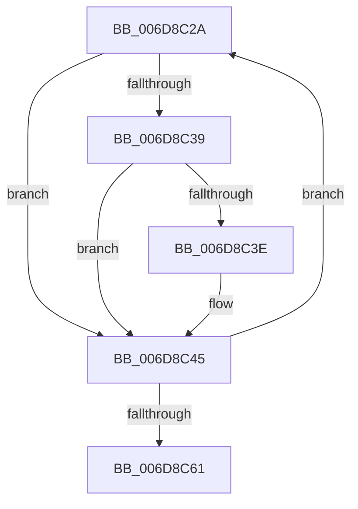

# sub_006D8C2A

- RVA: `0x006D8C2A`–`0x006D8C66` (길이 `60` bytes)
- VA: `0x00000001406D8C2A`
- 실행 섹션: `.text`
- PDB 이름 있음: `아니요`; PDB Function 태그: `아니요`
- unwind 정보 RVA: `0x000638BC`
- 디코드: `17`개 명령, `60/60` bytes 표시
- 미해석 바이트: `0` (있으면 어셈블리에 `.byte`로 보존)

> 이 문서는 커널 이미지의 기계어와 PDB 기호를 분석해 생성했습니다. 4번과 5번은 함수 원형과 자료형을 바이너리 사용 방식에서 추정한 C 해석이며 원본 소스 복구 결과는 아닙니다.

## 1. Dependencies

- 직접 호출 지점: **0**; 고유 호출 대상: **0**
- 직접 호출자로 확인된 함수: **0**
- RIP 상대 이미지 참조: **0**

### Outgoing calls
- 직접 디코드된 call 명령이 없습니다.

### Direct callers
- 이 함수 시작 RVA로 연결되는 직접 call은 확인되지 않았습니다. 간접 호출은 완전히 역산할 수 없습니다.

### Static image references
- 디코드된 RIP-relative 메모리 참조가 없습니다.

## 2. Other-region calls and transfers

- 다른 실행 섹션으로 향하는 call: **0**
- call이 아닌 외부 분기/꼬리 이동: **1**
  - `0x006D8C61` → [sub_002567A2 + 0xFD](../25/Unknown_function_002567A2.md) (`tail-transfer`)

## 3. Assembly (complete function range)

```asm
006D8C2A  0F B6 10                        movzx edx, byte ptr [rax]
006D8C2D  48 8D 40 01                     lea rax, [rax + 1]
006D8C31  41 8B C8                        mov ecx, r8d
006D8C34  49 3B CB                        cmp rcx, r11
006D8C37  75 0C                           jne 0x1406d8c45
006D8C39  48 85 F6                        test rsi, rsi
006D8C3C  74 07                           je 0x1406d8c45
006D8C3E  22 94 1E 90 C8 02 00            and dl, byte ptr [rsi + rbx + 0x2c890]
006D8C45  0F B6 CA                        movzx ecx, dl
006D8C48  41 FF C0                        inc r8d
006D8C4B  F7 D1                           not ecx
006D8C4D  0F B6 D1                        movzx edx, cl
006D8C50  0F B6 8C 1A 40 41 03 00         movzx ecx, byte ptr [rdx + rbx + 0x34140]
006D8C58  4C 03 D1                        add r10, rcx
006D8C5B  41 83 C6 FF                     add r14d, -1
006D8C5F  75 C9                           jne 0x1406d8c2a
006D8C61  E9 39 DC B7 FF                  jmp 0x14025689f
```

## 4. C-style interpretation (structured pseudocode)

```c
__int64 __fastcall sub_006D8C2A(__int64 a1, __int64 a2, int a3)
{
    __int64 v_r10;
    __int64 v_r14;

    if (((unsigned int)(a3)) != v_r11) goto loc_006D8C45;
    if (v_rsi != 0) {
        a2 = (unsigned __int8)((*(unsigned __int8 *)(result)) & (*(unsigned __int8 *)(v_rsi + v_rbx * 1 + 182416)));
    }
    a3 = (unsigned int)((a3) + 1);
    a1 = (unsigned int)(~((unsigned __int8)(a2)));
    v_r10 = (v_r10) + (*(unsigned __int8 *)((unsigned __int8)(a1) + v_rbx * 1 + 213312));
    v_r14 = (unsigned int)((v_r14) + (-1));
    if (condition_is_not_equal) goto loc_006D8C2A;
}
```

## 5. (Beta) C Style

```c
int64_t sub_006D8C2A(int64_t Arg1, int64_t Arg2, int32_t Arg3)
{
    int64_t local_r10;
    int64_t local_r14;

    if (((uint32_t)(Arg3)) != local_r11) goto loc_006D8C45;
    if (local_rsi != 0) {
        Arg2 = (uint8_t)((*(uint8_t *)(result)) & (*(uint8_t *)(local_rsi + local_rbx * 1 + 0x2C890)));
    }
    Arg3 = (uint32_t)((Arg3) + 1);
    Arg1 = (uint32_t)(~((uint8_t)(Arg2)));
    local_r10 = (local_r10) + (*(uint8_t *)((uint8_t)(Arg1) + local_rbx * 1 + 0x34140));
    local_r14 = (uint32_t)((local_r14) + (-1));
    if (condition_is_not_equal) goto loc_006D8C2A;
}
```

## 6. Execution-region graph

[열기: 2D/3D 그래프와 함수 탐색 컨트롤 패널](../../../control-panel.html?section=text&rva=0x006D8C2A&view=graph)

- 2D 그래프는 위에서 아래로 흐르고, 3D 그래프는 빈 공간을 드래그해 회전합니다. Shift+드래그는 이동, 휠은 확대·축소, 함수 노드 선택은 대상 보고서 이동입니다.

### Static fallback


