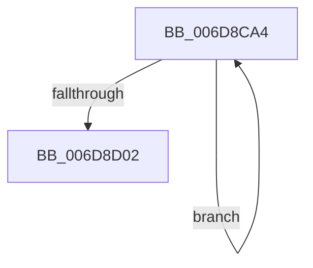

# sub_006D8CA4

- RVA: `0x006D8CA4`–`0x006D8D07` (길이 `99` bytes)
- VA: `0x00000001406D8CA4`
- 실행 섹션: `.text`
- PDB 이름 있음: `아니요`; PDB Function 태그: `아니요`
- unwind 정보 RVA: `0x00063AD8`
- 디코드: `29`개 명령, `99/99` bytes 표시
- 미해석 바이트: `0` (있으면 어셈블리에 `.byte`로 보존)

> 이 문서는 커널 이미지의 기계어와 PDB 기호를 분석해 생성했습니다. 4번과 5번은 함수 원형과 자료형을 바이너리 사용 방식에서 추정한 C 해석이며 원본 소스 복구 결과는 아닙니다.

## 1. Dependencies

- 직접 호출 지점: **1**; 고유 호출 대상: **1**
- 직접 호출자로 확인된 함수: **0**
- RIP 상대 이미지 참조: **1**

### Outgoing calls
- `0x006D8CF3` → [KiUpdateThreadQosGroupingSummaries](../25/KiUpdateThreadQosGroupingSummaries_function_00257AEC.md) (function, `0x00257AEC`)

### Direct callers
- 이 함수 시작 RVA로 연결되는 직접 call은 확인되지 않았습니다. 간접 호출은 완전히 역산할 수 없습니다.

### Static image references
- `0x006D8CDD` → RVA `0x00FC537C` (`ALMOSTRO`; read)

## 2. Other-region calls and transfers

- 다른 실행 섹션으로 향하는 call: **0**
- call이 아닌 외부 분기/꼬리 이동: **1**
  - `0x006D8D02` → [KzRefreshWorkloadProperties + 0xCB](../25/KzRefreshWorkloadProperties_function_002576D4.md) (`tail-transfer`)

## 3. Assembly (complete function range)

```asm
006D8CA4  8B 53 54                        mov edx, dword ptr [rbx + 0x54]
006D8CA7  4C 8B 17                        mov r10, qword ptr [rdi]
006D8CAA  44 8B 43 50                     mov r8d, dword ptr [rbx + 0x50]
006D8CAE  4D 8B 4A 38                     mov r9, qword ptr [r10 + 0x38]
006D8CB2  41 8A 41 40                     mov al, byte ptr [r9 + 0x40]
006D8CB6  8A C8                           mov cl, al
006D8CB8  32 8B 04 02 00 00               xor cl, byte ptr [rbx + 0x204]
006D8CBE  80 E1 07                        and cl, 7
006D8CC1  32 C1                           xor al, cl
006D8CC3  8A 8B 05 02 00 00               mov cl, byte ptr [rbx + 0x205]
006D8CC9  C0 E1 03                        shl cl, 3
006D8CCC  32 C8                           xor cl, al
006D8CCE  80 E1 38                        and cl, 0x38
006D8CD1  32 C1                           xor al, cl
006D8CD3  49 8B CA                        mov rcx, r10
006D8CD6  44 3B C2                        cmp r8d, edx
006D8CD9  44 0F 46 C2                     cmovbe r8d, edx
006D8CDD  44 3B 05 98 C6 8E 00            cmp r8d, dword ptr [rip + 0x8ec698]
006D8CE4  1A D2                           sbb dl, dl
006D8CE6  24 BF                           and al, 0xbf
006D8CE8  F6 D2                           not dl
006D8CEA  80 E2 40                        and dl, 0x40
006D8CED  0A C2                           or al, dl
006D8CEF  41 88 41 40                     mov byte ptr [r9 + 0x40], al
006D8CF3  E8 F4 ED B7 FF                  call 0x140257aec
006D8CF8  48 8D 7F 08                     lea rdi, [rdi + 8]
006D8CFC  48 83 EE 01                     sub rsi, 1
006D8D00  75 A2                           jne 0x1406d8ca4
006D8D02  E9 98 EA B7 FF                  jmp 0x14025779f
```

## 4. C-style interpretation (structured pseudocode)

```c
__int64 __fastcall sub_006D8CA4(void)
{
    __int64 result;
    __int64 v_rsi;

    a1 = (unsigned __int8)(((unsigned __int8)(*(unsigned __int8 *)(*(unsigned __int64 *)(*(unsigned __int64 *)(v_rdi) + 56) + 64))) ^ (*(unsigned __int8 *)(v_rbx + 516)));
    a1 = (unsigned __int8)((a1) & (7));
    result = (unsigned __int8)((*(unsigned __int8 *)(*(unsigned __int64 *)(*(unsigned __int64 *)(v_rdi) + 56) + 64)) ^ ((unsigned __int8)(a1)));
    a1 = (unsigned __int8)((*(unsigned __int8 *)(v_rbx + 517)) << (3));
    a1 = (unsigned __int8)((a1) ^ ((unsigned __int8)(result)));
    a1 = (unsigned __int8)((a1) & (56));
    result = (unsigned __int8)((result) ^ ((unsigned __int8)(a1)));
    a3 = (unsigned int)(*(unsigned int *)(v_rbx + 80));
    if (((unsigned int)((unsigned int)(*(unsigned int *)(v_rbx + 80)))) <= ((unsigned int)((unsigned int)(*(unsigned int *)(v_rbx + 84))))) { a3 = (unsigned int)((unsigned int)(*(unsigned int *)(v_rbx + 84))); }
    result = (unsigned __int8)((result) & (191));
    a2 = (unsigned __int8)(~((unsigned int)(*(unsigned int *)(v_rbx + 84))));
    a2 = (unsigned __int8)((a2) & (64));
    result = (unsigned __int8)((result) | ((unsigned __int8)(a2)));
    *(unsigned __int8 *)(*(unsigned __int64 *)(*(unsigned __int64 *)(v_rdi) + 56) + 64) = (unsigned __int8)(result);
    result = KiUpdateThreadQosGroupingSummaries(*(unsigned __int64 *)(v_rdi), a2, a3, *(unsigned __int64 *)(*(unsigned __int64 *)(v_rdi) + 56));
    v_rsi = (v_rsi) - (1);
    if (condition_is_not_equal) goto loc_006D8CA4;
}
```

## 5. (Beta) C Style

```c
void sub_006D8CA4(void)
{
    int64_t result;
    int64_t local_rsi;

    a1 = (uint8_t)(((uint8_t)(*(uint8_t *)(*(uint64_t *)(*(uint64_t *)(local_rdi) + 0x38) + 0x40))) ^ (*(uint8_t *)(local_rbx + 0x204)));
    a1 = (uint8_t)((a1) & (7));
    result = (uint8_t)((*(uint8_t *)(*(uint64_t *)(*(uint64_t *)(local_rdi) + 0x38) + 0x40)) ^ ((uint8_t)(a1)));
    a1 = (uint8_t)((*(uint8_t *)(local_rbx + 0x205)) << (3));
    a1 = (uint8_t)((a1) ^ ((uint8_t)(result)));
    a1 = (uint8_t)((a1) & (56));
    result = (uint8_t)((result) ^ ((uint8_t)(a1)));
    a3 = (uint32_t)(*(uint32_t *)(local_rbx + 0x50));
    if (((uint32_t)((uint32_t)(*(uint32_t *)(local_rbx + 0x50)))) <= ((uint32_t)((uint32_t)(*(uint32_t *)(local_rbx + 0x54))))) { a3 = (uint32_t)((uint32_t)(*(uint32_t *)(local_rbx + 0x54))); }
    result = (uint8_t)((result) & (191));
    a2 = (uint8_t)(~((uint32_t)(*(uint32_t *)(local_rbx + 0x54))));
    a2 = (uint8_t)((a2) & (64));
    result = (uint8_t)((result) | ((uint8_t)(a2)));
    *(uint8_t *)(*(uint64_t *)(*(uint64_t *)(local_rdi) + 0x38) + 0x40) = (uint8_t)(result);
    result = KiUpdateThreadQosGroupingSummaries(*(uint64_t *)(local_rdi), a2, a3, *(uint64_t *)(*(uint64_t *)(local_rdi) + 0x38));
    local_rsi = (local_rsi) - (1);
    if (condition_is_not_equal) goto loc_006D8CA4;
}
```

## 6. Execution-region graph

[열기: 2D/3D 그래프와 함수 탐색 컨트롤 패널](../../../control-panel.html?section=text&rva=0x006D8CA4&view=graph)

- 2D 그래프는 위에서 아래로 흐르고, 3D 그래프는 빈 공간을 드래그해 회전합니다. Shift+드래그는 이동, 휠은 확대·축소, 함수 노드 선택은 대상 보고서 이동입니다.

### Static fallback


