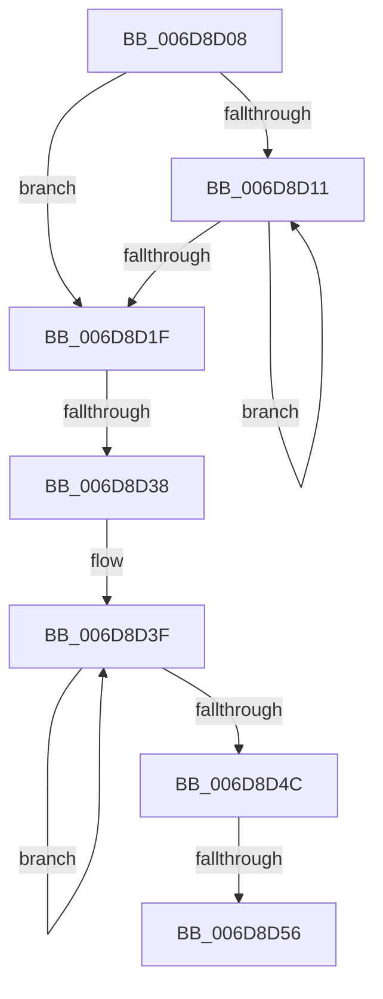

# sub_006D8D08

- RVA: `0x006D8D08`–`0x006D8D61` (길이 `89` bytes)
- VA: `0x00000001406D8D08`
- 실행 섹션: `.text`
- PDB 이름 있음: `아니요`; PDB Function 태그: `아니요`
- unwind 정보 RVA: `0x00063D10`
- 디코드: `24`개 명령, `89/89` bytes 표시
- 미해석 바이트: `0` (있으면 어셈블리에 `.byte`로 보존)

> 이 문서는 커널 이미지의 기계어와 PDB 기호를 분석해 생성했습니다. 4번과 5번은 함수 원형과 자료형을 바이너리 사용 방식에서 추정한 C 해석이며 원본 소스 복구 결과는 아닙니다.

## 1. Dependencies

- 직접 호출 지점: **2**; 고유 호출 대상: **2**
- 직접 호출자로 확인된 함수: **0**
- RIP 상대 이미지 참조: **0**

### Outgoing calls
- `0x006D8D11` → [HalProcessorIdle](../6A/HalProcessorIdle_function_006AC7C0.md) (function, `0x006AC7C0`)
- `0x006D8D56` → [KiRemoveSystemWorkPriorityKick](../26/KiRemoveSystemWorkPriorityKick_function_002631D0.md) (function, `0x002631D0`)

### Direct callers
- 이 함수 시작 RVA로 연결되는 직접 call은 확인되지 않았습니다. 간접 호출은 완전히 역산할 수 없습니다.

### Static image references
- 디코드된 RIP-relative 메모리 참조가 없습니다.

## 2. Other-region calls and transfers

- 다른 실행 섹션으로 향하는 call: **0**
- call이 아닌 외부 분기/꼬리 이동: **3**
  - `0x006D8D32` → [KxWaitForLockOwnerShip + 0xFE](../25/KxWaitForLockOwnerShip_function_00257EB0.md) (`tail-transfer`)
  - `0x006D8D50` → [KxWaitForLockOwnerShip + 0xFE](../25/KxWaitForLockOwnerShip_function_00257EB0.md) (`tail-transfer`)
  - `0x006D8D5C` → [KxWaitForLockOwnerShip + 0xFE](../25/KxWaitForLockOwnerShip_function_00257EB0.md) (`tail-transfer`)

## 3. Assembly (complete function range)

```asm
006D8D08  FA                              cli
006D8D09  8B 45 C8                        mov eax, dword ptr [rbp - 0x38]
006D8D0C  83 F8 01                        cmp eax, 1
006D8D0F  74 0E                           je 0x1406d8d1f
006D8D11  E8 AA 3A FD FF                  call 0x1406ac7c0
006D8D16  FA                              cli
006D8D17  8B 45 C8                        mov eax, dword ptr [rbp - 0x38]
006D8D1A  83 F8 01                        cmp eax, 1
006D8D1D  75 F2                           jne 0x1406d8d11
006D8D1F  65 48 8B 0C 25 20 00 00 00      mov rcx, qword ptr gs:[0x20]
006D8D28  4C 8B 81 B8 8E 00 00            mov r8, qword ptr [rcx + 0x8eb8]
006D8D2F  4D 85 C0                        test r8, r8
006D8D32  0F 84 76 F2 B7 FF               je 0x140257fae
006D8D38  41 0F 0D 08                     prefetchw byte ptr [r8]
006D8D3C  41 8B 00                        mov eax, dword ptr [r8]
006D8D3F  8B D0                           mov edx, eax
006D8D41  0F BA F2 15                     btr edx, 0x15
006D8D45  F0 41 0F B1 10                  lock cmpxchg dword ptr [r8], edx
006D8D4A  75 F3                           jne 0x1406d8d3f
006D8D4C  0F BA E0 15                     bt eax, 0x15
006D8D50  0F 83 58 F2 B7 FF               jae 0x140257fae
006D8D56  E8 75 A4 B8 FF                  call 0x1402631d0
006D8D5B  90                              nop
006D8D5C  E9 4D F2 B7 FF                  jmp 0x140257fae
```

## 4. C-style interpretation (structured pseudocode)

```c
__int64 __fastcall sub_006D8D08(void)
{
    __int64 result;

    if (((unsigned int)((unsigned int)(*(unsigned int *)(v_rbp - 56)))) == 1) goto loc_006D8D1F;
loc_006D8D11:
    result = HalProcessorIdle(a1, a2, a3, a4);
    if (((unsigned int)((unsigned int)(*(unsigned int *)(v_rbp - 56)))) != 1) goto loc_006D8D11;
loc_006D8D1F:
loc_006D8D3F:
    if (*(unsigned __int64 *)(*(unsigned __int64 *)(gs_base + (0 + 32)) + 36536) != 0) goto loc_006D8D3F;
    result = KiRemoveSystemWorkPriorityKick(*(unsigned __int64 *)(gs_base + (0 + 32)), (unsigned int)((unsigned int)((unsigned int)(*(unsigned int *)(*(unsigned __int64 *)(*(unsigned __int64 *)(gs_base + (0 + 32)) + 36536))))), *(unsigned __int64 *)(*(unsigned __int64 *)(gs_base + (0 + 32)) + 36536), a4);
}
```

## 5. (Beta) C Style

```c
void sub_006D8D08(void)
{
    int64_t result;

    if (((uint32_t)((uint32_t)(*(uint32_t *)(local_rbp - 0x38)))) == 1) goto loc_006D8D1F;
loc_006D8D11:
    result = HalProcessorIdle(a1, a2, a3, a4);
    if (((uint32_t)((uint32_t)(*(uint32_t *)(local_rbp - 0x38)))) != 1) goto loc_006D8D11;
loc_006D8D1F:
loc_006D8D3F:
    if (*(uint64_t *)(*(uint64_t *)(gs_base + (0 + 0x20)) + 0x8EB8) != 0) goto loc_006D8D3F;
    result = KiRemoveSystemWorkPriorityKick(*(uint64_t *)(gs_base + (0 + 0x20)), (uint32_t)((uint32_t)((uint32_t)(*(uint32_t *)(*(uint64_t *)(*(uint64_t *)(gs_base + (0 + 0x20)) + 0x8EB8))))), *(uint64_t *)(*(uint64_t *)(gs_base + (0 + 0x20)) + 0x8EB8), a4);
}
```

## 6. Execution-region graph

[열기: 2D/3D 그래프와 함수 탐색 컨트롤 패널](../../../control-panel.html?section=text&rva=0x006D8D08&view=graph)

- 2D 그래프는 위에서 아래로 흐르고, 3D 그래프는 빈 공간을 드래그해 회전합니다. Shift+드래그는 이동, 휠은 확대·축소, 함수 노드 선택은 대상 보고서 이동입니다.

### Static fallback


