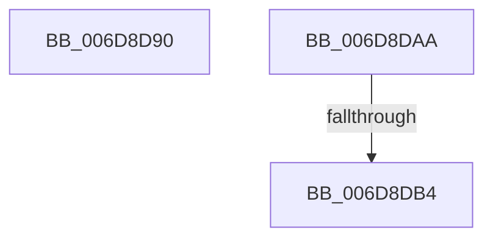

# sub_006D8D90

- RVA: `0x006D8D90`–`0x006D8E57` (길이 `199` bytes)
- VA: `0x00000001406D8D90`
- 실행 섹션: `.text`
- PDB 이름 있음: `아니요`; PDB Function 태그: `아니요`
- unwind 정보 RVA: `0x000640BC`
- 디코드: `37`개 명령, `199/199` bytes 표시
- 미해석 바이트: `0` (있으면 어셈블리에 `.byte`로 보존)

> 이 문서는 커널 이미지의 기계어와 PDB 기호를 분석해 생성했습니다. 4번과 5번은 함수 원형과 자료형을 바이너리 사용 방식에서 추정한 C 해석이며 원본 소스 복구 결과는 아닙니다.

## 1. Dependencies

- 직접 호출 지점: **2**; 고유 호출 대상: **2**
- 직접 호출자로 확인된 함수: **0**
- RIP 상대 이미지 참조: **0**

### Outgoing calls
- `0x006D8D94` → [_chkstk](../6B/_chkstk_function_006BA960.md) (function, `0x006BA960`)
- `0x006D8E4C` → [EtwpLogKernelEvent](../25/EtwpLogKernelEvent_function_0025CC00.md) (function, `0x0025CC00`)

### Direct callers
- 이 함수 시작 RVA로 연결되는 직접 call은 확인되지 않았습니다. 간접 호출은 완전히 역산할 수 없습니다.

### Static image references
- 디코드된 RIP-relative 메모리 참조가 없습니다.

## 2. Other-region calls and transfers

- 다른 실행 섹션으로 향하는 call: **0**
- call이 아닌 외부 분기/꼬리 이동: **3**
  - `0x006D8DA5` → [EtwpLogKernelEvent + 0xC05](../25/EtwpLogKernelEvent_function_0025CC00.md) (`tail-transfer`)
  - `0x006D8DAE` → [EtwpLogKernelEvent + 0xC23](../25/EtwpLogKernelEvent_function_0025CC00.md) (`tail-transfer`)
  - `0x006D8E52` → [EtwpLogKernelEvent + 0xC23](../25/EtwpLogKernelEvent_function_0025CC00.md) (`tail-transfer`)

## 3. Assembly (complete function range)

```asm
006D8D90  48 83 E0 F0                     and rax, 0xfffffffffffffff0
006D8D94  E8 C7 1B FE FF                  call 0x1406ba960
006D8D99  48 2B E0                        sub rsp, rax
006D8D9C  44 88 6D 00                     mov byte ptr [rbp], r13b
006D8DA0  4C 8D 7C 24 40                  lea r15, [rsp + 0x40]
006D8DA5  E9 5B 4A B8 FF                  jmp 0x14025d805
006D8DAA  83 7D 18 00                     cmp dword ptr [rbp + 0x18], 0
006D8DAE  0F 84 6F 4A B8 FF               je 0x14025d823
006D8DB4  48 8B 4D 28                     mov rcx, qword ptr [rbp + 0x28]
006D8DB8  41 8B D4                        mov edx, r12d
006D8DBB  81 E2 02 E6 FF FF               and edx, 0xffffe602
006D8DC1  41 B9 02 00 00 00               mov r9d, 2
006D8DC7  83 CA 02                        or edx, 2
006D8DCA  89 54 24 28                     mov dword ptr [rsp + 0x28], edx
006D8DCE  8B 81 08 05 00 00               mov eax, dword ptr [rcx + 0x508]
006D8DD4  89 85 88 00 00 00               mov dword ptr [rbp + 0x88], eax
006D8DDA  8B 81 10 05 00 00               mov eax, dword ptr [rcx + 0x510]
006D8DE0  89 85 8C 00 00 00               mov dword ptr [rbp + 0x8c], eax
006D8DE6  48 8B 45 10                     mov rax, qword ptr [rbp + 0x10]
006D8DEA  48 89 85 80 00 00 00            mov qword ptr [rbp + 0x80], rax
006D8DF1  48 8B 87 30 04 00 00            mov rax, qword ptr [rdi + 0x430]
006D8DF8  66 C7 44 24 20 20 0C            mov word ptr [rsp + 0x20], 0xc20
006D8DFF  8B 48 04                        mov ecx, dword ptr [rax + 4]
006D8E02  48 8D 85 80 00 00 00            lea rax, [rbp + 0x80]
006D8E09  44 8B 07                        mov r8d, dword ptr [rdi]
006D8E0C  48 8B 97 50 05 00 00            mov rdx, qword ptr [rdi + 0x550]
006D8E13  48 89 85 C0 00 00 00            mov qword ptr [rbp + 0xc0], rax
006D8E1A  8B 45 18                        mov eax, dword ptr [rbp + 0x18]
006D8E1D  89 8D 90 00 00 00               mov dword ptr [rbp + 0x90], ecx
006D8E23  48 8D 8D C0 00 00 00            lea rcx, [rbp + 0xc0]
006D8E2A  89 85 D8 00 00 00               mov dword ptr [rbp + 0xd8], eax
006D8E30  48 C7 85 C8 00 00 00 18 00 00 00  mov qword ptr [rbp + 0xc8], 0x18
006D8E3B  4C 89 BD D0 00 00 00            mov qword ptr [rbp + 0xd0], r15
006D8E42  C7 85 DC 00 00 00 00 00 00 00   mov dword ptr [rbp + 0xdc], 0
006D8E4C  E8 AF 3D B8 FF                  call 0x14025cc00
006D8E51  90                              nop
006D8E52  E9 CC 49 B8 FF                  jmp 0x14025d823
```

## 4. C-style interpretation (structured pseudocode)

```c
__int64 __fastcall sub_006D8D90(__int64 a1, __int64 a2, __int64 a3, __int64 a4, __int64 a5, __int64 a6, __int64 a7, __int64 a8)
{
    __int64 result;
    __int64 v_rsp;
    unsigned __int16 v_stack_p20;
    unsigned int v_stack_p28;

    result = (result) & (-16);
    result = _chkstk(a1, a2, a3, a4);
    v_rsp = (v_rsp) - (result);
    *(unsigned __int8 *)(v_rbp) = (unsigned __int8)(v_r13);
}
```

## 5. (Beta) C Style

```c
int64_t sub_006D8D90(int64_t Arg1, int64_t Arg2, int64_t Arg3, int64_t Arg4, uint64_t Arg5, uint64_t Arg6, uint64_t Arg7, int64_t Arg8)
{
    int64_t result;
    int64_t local_rsp;
    uint16_t v_stack_p20;
    uint32_t v_stack_p28;

    result = (result) & (-16);
    result = _chkstk(Arg1, Arg2, Arg3, Arg4);
    local_rsp = (local_rsp) - (result);
    *(uint8_t *)(local_rbp) = (uint8_t)(local_r13);
}
```

## 6. Execution-region graph

[열기: 2D/3D 그래프와 함수 탐색 컨트롤 패널](../../../control-panel.html?section=text&rva=0x006D8D90&view=graph)

- 2D 그래프는 위에서 아래로 흐르고, 3D 그래프는 빈 공간을 드래그해 회전합니다. Shift+드래그는 이동, 휠은 확대·축소, 함수 노드 선택은 대상 보고서 이동입니다.

### Static fallback


