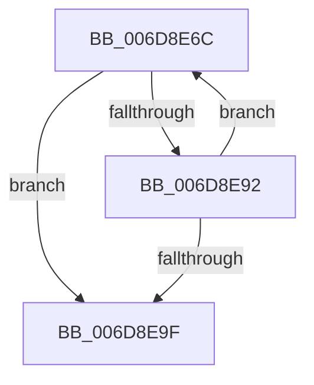

# sub_006D8E6C

- RVA: `0x006D8E6C`–`0x006D8EAD` (길이 `65` bytes)
- VA: `0x00000001406D8E6C`
- 실행 섹션: `.text`
- PDB 이름 있음: `아니요`; PDB Function 태그: `아니요`
- unwind 정보 RVA: `0x00064D34`
- 디코드: `18`개 명령, `65/65` bytes 표시
- 미해석 바이트: `0` (있으면 어셈블리에 `.byte`로 보존)

> 이 문서는 커널 이미지의 기계어와 PDB 기호를 분석해 생성했습니다. 4번과 5번은 함수 원형과 자료형을 바이너리 사용 방식에서 추정한 C 해석이며 원본 소스 복구 결과는 아닙니다.

## 1. Dependencies

- 직접 호출 지점: **2**; 고유 호출 대상: **2**
- 직접 호출자로 확인된 함수: **0**
- RIP 상대 이미지 참조: **0**

### Outgoing calls
- `0x006D8E88` → [SMKM_STORE_MGR<SM_TRAITS>::SmFeAddComplete](../2D/SMKM_STORE_MGR_SM_TRAITS_SmFeAddComplete_function_002DFEE0.md) (function, `0x002DFEE0`)
- `0x006D8EA2` → [StLockReleaseExclusive](../26/StLockReleaseExclusive_function_00267050.md) (function, `0x00267050`)

### Direct callers
- 이 함수 시작 RVA로 연결되는 직접 call은 확인되지 않았습니다. 간접 호출은 완전히 역산할 수 없습니다.

### Static image references
- 디코드된 RIP-relative 메모리 참조가 없습니다.

## 2. Other-region calls and transfers

- 다른 실행 섹션으로 향하는 call: **0**
- call이 아닌 외부 분기/꼬리 이동: **1**
  - `0x006D8EA8` → [SMKM_STORE_MGR<SM_TRAITS>::SmFeAddInitiate + 0x1D7](../26/SMKM_STORE_MGR_SM_TRAITS_SmFeAddInitiate_function_0026618C.md) (`tail-transfer`)

## 3. Assembly (complete function range)

```asm
006D8E6C  0F B7 5E 04                     movzx ebx, word ptr [rsi + 4]
006D8E70  48 8B D6                        mov rdx, rsi
006D8E73  44 3B F3                        cmp r14d, ebx
006D8E76  C7 44 24 20 02 00 00 00         mov dword ptr [rsp + 0x20], 2
006D8E7E  49 8B CD                        mov rcx, r13
006D8E81  41 0F 46 DE                     cmovbe ebx, r14d
006D8E85  44 8B C3                        mov r8d, ebx
006D8E88  E8 53 70 C0 FF                  call 0x1402dfee0
006D8E8D  44 2B F3                        sub r14d, ebx
006D8E90  74 0D                           je 0x1406d8e9f
006D8E92  48 83 C6 10                     add rsi, 0x10
006D8E96  48 8D 46 F8                     lea rax, [rsi - 8]
006D8E9A  49 3B C7                        cmp rax, r15
006D8E9D  72 CD                           jb 0x1406d8e6c
006D8E9F  49 8B CC                        mov rcx, r12
006D8EA2  E8 A9 E1 B8 FF                  call 0x140267050
006D8EA7  90                              nop
006D8EA8  E9 B6 D4 B8 FF                  jmp 0x140266363
```

## 4. C-style interpretation (structured pseudocode)

```c
__int64 __fastcall sub_006D8E6C(void)
{
    __int64 result;
    __int64 v_r14;
    __int64 v_rbx;
    __int64 v_rsi;
    unsigned int v_stack_p20;

    v_stack_p20 = 2;
    v_rbx = *(unsigned __int16 *)(v_rsi + 4);
    if (((unsigned int)(v_r14)) <= ((unsigned int)(*(unsigned __int16 *)(v_rsi + 4)))) { v_rbx = (unsigned int)(v_r14); }
    result = SMKM_STORE_MGR_SM_TRAITS___SmFeAddComplete(v_r13, v_rsi, (unsigned int)((unsigned int)(v_rbx)), a4);
    v_r14 = (unsigned int)((v_r14) - ((unsigned int)(v_rbx)));
    if (condition_is_equal) goto loc_006D8E9F;
    v_rsi = (v_rsi) + (16);
    if ((v_rsi - 8) < v_r15) goto loc_006D8E6C;
loc_006D8E9F:
    result = StLockReleaseExclusive(v_r12, v_rsi, (unsigned int)((unsigned int)(v_rbx)), a4);
}
```

## 5. (Beta) C Style

```c
void sub_006D8E6C(void)
{
    int64_t result;
    int64_t local_r14;
    int64_t local_rbx;
    int64_t local_rsi;
    uint32_t v_stack_p20;

    v_stack_p20 = 2;
    local_rbx = *(uint16_t *)(local_rsi + 0x4);
    if (((uint32_t)(local_r14)) <= ((uint32_t)(*(uint16_t *)(local_rsi + 0x4)))) { local_rbx = (uint32_t)(local_r14); }
    result = SMKM_STORE_MGR_SM_TRAITS___SmFeAddComplete(local_r13, local_rsi, (uint32_t)((uint32_t)(local_rbx)), a4);
    local_r14 = (uint32_t)((local_r14) - ((uint32_t)(local_rbx)));
    if (condition_is_equal) goto loc_006D8E9F;
    local_rsi = (local_rsi) + (16);
    if ((local_rsi - 8) < local_r15) goto loc_006D8E6C;
loc_006D8E9F:
    result = StLockReleaseExclusive(local_r12, local_rsi, (uint32_t)((uint32_t)(local_rbx)), a4);
}
```

## 6. Execution-region graph

[열기: 2D/3D 그래프와 함수 탐색 컨트롤 패널](../../../control-panel.html?section=text&rva=0x006D8E6C&view=graph)

- 2D 그래프는 위에서 아래로 흐르고, 3D 그래프는 빈 공간을 드래그해 회전합니다. Shift+드래그는 이동, 휠은 확대·축소, 함수 노드 선택은 대상 보고서 이동입니다.

### Static fallback


