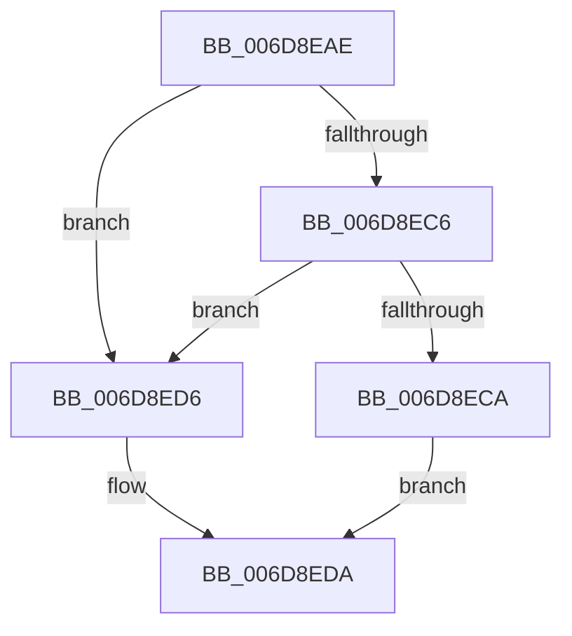

# sub_006D8EAE

- RVA: `0x006D8EAE`–`0x006D8EE3` (길이 `53` bytes)
- VA: `0x00000001406D8EAE`
- 실행 섹션: `.text`
- PDB 이름 있음: `아니요`; PDB Function 태그: `아니요`
- unwind 정보 RVA: `0x00064E58`
- 디코드: `16`개 명령, `53/53` bytes 표시
- 미해석 바이트: `0` (있으면 어셈블리에 `.byte`로 보존)

> 이 문서는 커널 이미지의 기계어와 PDB 기호를 분석해 생성했습니다. 4번과 5번은 함수 원형과 자료형을 바이너리 사용 방식에서 추정한 C 해석이며 원본 소스 복구 결과는 아닙니다.

## 1. Dependencies

- 직접 호출 지점: **1**; 고유 호출 대상: **1**
- 직접 호출자로 확인된 함수: **0**
- RIP 상대 이미지 참조: **0**

### Outgoing calls
- `0x006D8EB9` → [B_TREE<_SM_PAGE_KEY,SMKM_STORE_MGR<SM_TRAITS>::SMKM_FRONTEND_ENTRY,4096,B_TREE_DUMMY_NODE_POOL,B_TREE_KEY_COMPARATOR<_SM_PAGE_KEY> >::BTreeSearchKey](../26/B_TREE__SM_PAGE_KEY_SMKM_STORE_MGR_SM_TRAITS_SMKM_FRONTEND_ENTRY_4096_B_TREE_DUMMY_NODE_POOL_B_TREE__function_00266E10.md) (function, `0x00266E10`)

### Direct callers
- 이 함수 시작 RVA로 연결되는 직접 call은 확인되지 않았습니다. 간접 호출은 완전히 역산할 수 없습니다.

### Static image references
- 디코드된 RIP-relative 메모리 참조가 없습니다.

## 2. Other-region calls and transfers

- 다른 실행 섹션으로 향하는 call: **0**
- call이 아닌 외부 분기/꼬리 이동: **1**
  - `0x006D8EDE` → [SMKM_STORE_MGR<SM_TRAITS>::SmFeEvictComplete + 0x111](../26/SMKM_STORE_MGR_SM_TRAITS_SmFeEvictComplete_function_00266854.md) (`tail-transfer`)

## 3. Assembly (complete function range)

```asm
006D8EAE  41 8B 51 10                     mov edx, dword ptr [r9 + 0x10]
006D8EB2  4C 8D 45 A0                     lea r8, [rbp - 0x60]
006D8EB6  49 8B CF                        mov rcx, r15
006D8EB9  E8 52 DF B8 FF                  call 0x140266e10
006D8EBE  8B 45 B8                        mov eax, dword ptr [rbp - 0x48]
006D8EC1  83 F8 FF                        cmp eax, -1
006D8EC4  74 10                           je 0x1406d8ed6
006D8EC6  85 C0                           test eax, eax
006D8EC8  74 0C                           je 0x1406d8ed6
006D8ECA  FF C8                           dec eax
006D8ECC  48 C1 E0 04                     shl rax, 4
006D8ED0  48 03 45 A0                     add rax, qword ptr [rbp - 0x60]
006D8ED4  EB 04                           jmp 0x1406d8eda
006D8ED6  48 8D 45 A8                     lea rax, [rbp - 0x58]
006D8EDA  48 89 78 08                     mov qword ptr [rax + 8], rdi
006D8EDE  E9 82 DA B8 FF                  jmp 0x140266965
```

## 4. C-style interpretation (structured pseudocode)

```c
__int64 __fastcall sub_006D8EAE(__int64 a1, __int64 a2, __int64 a3, __int64 a4)
{
    __int64 result;

    result = B_TREE__SM_PAGE_KEY_SMKM_STORE_MGR_SM_TRAITS___SMKM_FRONTEND_ENTRY_4096_B_TREE_DUMMY_NODE_POOL_B_TRE(v_r15, (unsigned int)(*(unsigned int *)(a4 + 16)), v_rbp - 96, a4);
    if (((unsigned int)((unsigned int)(*(unsigned int *)(v_rbp - 72)))) == -1) goto loc_006D8ED6;
    if ((unsigned int)((unsigned int)(*(unsigned int *)(v_rbp - 72))) == 0) goto loc_006D8ED6;
    result = (unsigned int)(((unsigned int)(*(unsigned int *)(v_rbp - 72))) - 1);
    result = (result) << (4);
    result = (result) + (*(unsigned __int64 *)(v_rbp - 96));
    goto loc_006D8EDA;
loc_006D8ED6:
loc_006D8EDA:
    *(unsigned __int64 *)(v_rbp - 88 + 8) = v_rdi;
}
```

## 5. (Beta) C Style

```c
int64_t sub_006D8EAE(int64_t Arg1, int64_t Arg2, int64_t Arg3, void *Arg4)
{
    uint8_t *arg4 = (uint8_t *)Arg4;

    int64_t result;

    result = B_TREE__SM_PAGE_KEY_SMKM_STORE_MGR_SM_TRAITS___SMKM_FRONTEND_ENTRY_4096_B_TREE_DUMMY_NODE_POOL_B_TRE(local_r15, (uint32_t)(*(uint32_t *)(arg4 + 0x10)), local_rbp - 96, Arg4);
    if (((uint32_t)((uint32_t)(*(uint32_t *)(local_rbp - 0x48)))) == -1) goto loc_006D8ED6;
    if ((uint32_t)((uint32_t)(*(uint32_t *)(local_rbp - 0x48))) == 0) goto loc_006D8ED6;
    result = (uint32_t)(((uint32_t)(*(uint32_t *)(local_rbp - 0x48))) - 1);
    result = (result) << (4);
    result = (result) + (*(uint64_t *)(local_rbp - 0x60));
    goto loc_006D8EDA;
loc_006D8ED6:
loc_006D8EDA:
    *(uint64_t *)(local_rbp - 0x58 + 0x8) = local_rdi;
}
```

### 관측된 메모리 오프셋

구조체 형식이 확인되지 않은 접근은 인자 기준의 오프셋으로만 기록했습니다.

| 기준 인자 | 오프셋 표현 | 폭 (bit) | 접근 |
|---|---:|---:|---|
| `Arg4` | `+ 0x10` | `32` | `R` |

## 6. Execution-region graph

[열기: 2D/3D 그래프와 함수 탐색 컨트롤 패널](../../../control-panel.html?section=text&rva=0x006D8EAE&view=graph)

- 2D 그래프는 위에서 아래로 흐르고, 3D 그래프는 빈 공간을 드래그해 회전합니다. Shift+드래그는 이동, 휠은 확대·축소, 함수 노드 선택은 대상 보고서 이동입니다.

### Static fallback


