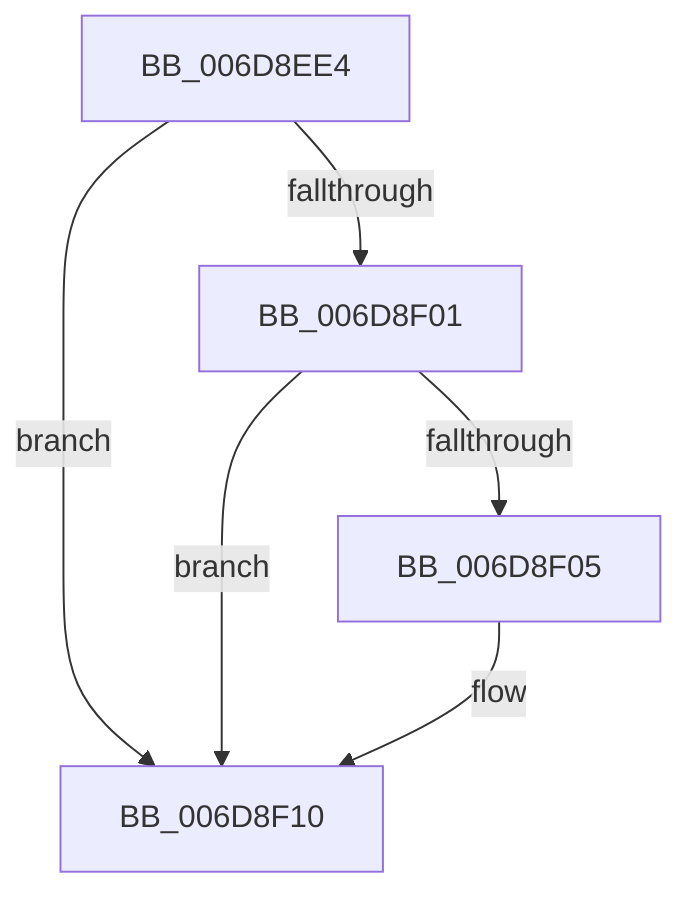

# sub_006D8EE4

- RVA: `0x006D8EE4`–`0x006D8F1D` (길이 `57` bytes)
- VA: `0x00000001406D8EE4`
- 실행 섹션: `.text`
- PDB 이름 있음: `아니요`; PDB Function 태그: `아니요`
- unwind 정보 RVA: `0x00064E80`
- 디코드: `16`개 명령, `57/57` bytes 표시
- 미해석 바이트: `0` (있으면 어셈블리에 `.byte`로 보존)

> 이 문서는 커널 이미지의 기계어와 PDB 기호를 분석해 생성했습니다. 4번과 5번은 함수 원형과 자료형을 바이너리 사용 방식에서 추정한 C 해석이며 원본 소스 복구 결과는 아닙니다.

## 1. Dependencies

- 직접 호출 지점: **1**; 고유 호출 대상: **1**
- 직접 호출자로 확인된 함수: **0**
- RIP 상대 이미지 참조: **0**

### Outgoing calls
- `0x006D8EF4` → [B_TREE<_SM_PAGE_KEY,SMKM_STORE_MGR<SM_TRAITS>::SMKM_FRONTEND_ENTRY,4096,B_TREE_DUMMY_NODE_POOL,B_TREE_KEY_COMPARATOR<_SM_PAGE_KEY> >::BTreeSearchKey](../26/B_TREE__SM_PAGE_KEY_SMKM_STORE_MGR_SM_TRAITS_SMKM_FRONTEND_ENTRY_4096_B_TREE_DUMMY_NODE_POOL_B_TREE__function_00266E10.md) (function, `0x00266E10`)

### Direct callers
- 이 함수 시작 RVA로 연결되는 직접 call은 확인되지 않았습니다. 간접 호출은 완전히 역산할 수 없습니다.

### Static image references
- 디코드된 RIP-relative 메모리 참조가 없습니다.

## 2. Other-region calls and transfers

- 다른 실행 섹션으로 향하는 call: **0**
- call이 아닌 외부 분기/꼬리 이동: **1**
  - `0x006D8F18` → [SMKM_STORE_MGR<SM_TRAITS>::SmFeDeleteEntry + 0x4F](../26/SMKM_STORE_MGR_SM_TRAITS_SmFeDeleteEntry_function_00266B70.md) (`tail-transfer`)

## 3. Assembly (complete function range)

```asm
006D8EE4  C7 43 18 00 00 00 00            mov dword ptr [rbx + 0x18], 0
006D8EEB  4C 8B C3                        mov r8, rbx
006D8EEE  8B 52 10                        mov edx, dword ptr [rdx + 0x10]
006D8EF1  48 8B CE                        mov rcx, rsi
006D8EF4  E8 17 DF B8 FF                  call 0x140266e10
006D8EF9  8B 43 18                        mov eax, dword ptr [rbx + 0x18]
006D8EFC  83 F8 FF                        cmp eax, -1
006D8EFF  74 0F                           je 0x1406d8f10
006D8F01  85 C0                           test eax, eax
006D8F03  74 0B                           je 0x1406d8f10
006D8F05  44 8D 70 FF                     lea r14d, [rax - 1]
006D8F09  49 C1 E6 04                     shl r14, 4
006D8F0D  4C 03 33                        add r14, qword ptr [rbx]
006D8F10  48 8B 47 08                     mov rax, qword ptr [rdi + 8]
006D8F14  49 89 46 08                     mov qword ptr [r14 + 8], rax
006D8F18  E9 A2 DC B8 FF                  jmp 0x140266bbf
```

## 4. C-style interpretation (structured pseudocode)

```c
__int64 __fastcall sub_006D8EE4(__int64 a1, __int64 a2)
{
    __int64 result;
    __int64 v_r14;

    *(unsigned int *)(v_rbx + 24) = 0;
    result = B_TREE__SM_PAGE_KEY_SMKM_STORE_MGR_SM_TRAITS___SMKM_FRONTEND_ENTRY_4096_B_TREE_DUMMY_NODE_POOL_B_TRE(v_rsi, (unsigned int)(*(unsigned int *)(a2 + 16)), v_rbx, a4);
    if (((unsigned int)((unsigned int)(*(unsigned int *)(v_rbx + 24)))) == -1) goto loc_006D8F10;
    if ((unsigned int)((unsigned int)(*(unsigned int *)(v_rbx + 24))) != 0) {
        v_r14 = (unsigned int)(*(unsigned int *)(v_rbx + 24)) - 1;
        v_r14 = (v_r14) << (4);
        v_r14 = (v_r14) + (*(unsigned __int64 *)(v_rbx));
    }
    *(unsigned __int64 *)(v_r14 + 8) = *(unsigned __int64 *)(v_rdi + 8);
}
```

## 5. (Beta) C Style

```c
int64_t sub_006D8EE4(int64_t Arg1, void *Arg2)
{
    uint8_t *arg2 = (uint8_t *)Arg2;

    int64_t result;
    int64_t local_r14;

    *(uint32_t *)(local_rbx + 0x18) = 0;
    result = B_TREE__SM_PAGE_KEY_SMKM_STORE_MGR_SM_TRAITS___SMKM_FRONTEND_ENTRY_4096_B_TREE_DUMMY_NODE_POOL_B_TRE(local_rsi, (uint32_t)(*(uint32_t *)(arg2 + 0x10)), local_rbx, a4);
    if (((uint32_t)((uint32_t)(*(uint32_t *)(local_rbx + 0x18)))) == -1) goto loc_006D8F10;
    if ((uint32_t)((uint32_t)(*(uint32_t *)(local_rbx + 0x18))) != 0) {
        local_r14 = (uint32_t)(*(uint32_t *)(local_rbx + 0x18)) - 1;
        local_r14 = (local_r14) << (4);
        local_r14 = (local_r14) + (*(uint64_t *)(local_rbx));
    }
    *(uint64_t *)(local_r14 + 0x8) = *(uint64_t *)(local_rdi + 0x8);
}
```

### 관측된 메모리 오프셋

구조체 형식이 확인되지 않은 접근은 인자 기준의 오프셋으로만 기록했습니다.

| 기준 인자 | 오프셋 표현 | 폭 (bit) | 접근 |
|---|---:|---:|---|
| `Arg2` | `+ 0x10` | `32` | `R` |

## 6. Execution-region graph

[열기: 2D/3D 그래프와 함수 탐색 컨트롤 패널](../../../control-panel.html?section=text&rva=0x006D8EE4&view=graph)

- 2D 그래프는 위에서 아래로 흐르고, 3D 그래프는 빈 공간을 드래그해 회전합니다. Shift+드래그는 이동, 휠은 확대·축소, 함수 노드 선택은 대상 보고서 이동입니다.

### Static fallback


