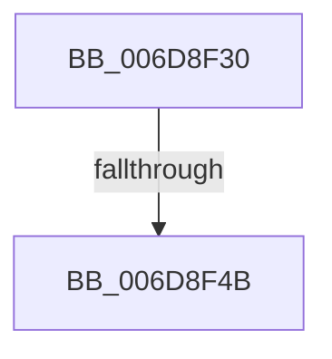

# sub_006D8F30

- RVA: `0x006D8F30`–`0x006D8F99` (길이 `105` bytes)
- VA: `0x00000001406D8F30`
- 실행 섹션: `.text`
- PDB 이름 있음: `아니요`; PDB Function 태그: `아니요`
- unwind 정보 RVA: `0x00065040`
- 디코드: `26`개 명령, `105/105` bytes 표시
- 미해석 바이트: `0` (있으면 어셈블리에 `.byte`로 보존)

> 이 문서는 커널 이미지의 기계어와 PDB 기호를 분석해 생성했습니다. 4번과 5번은 함수 원형과 자료형을 바이너리 사용 방식에서 추정한 C 해석이며 원본 소스 복구 결과는 아닙니다.

## 1. Dependencies

- 직접 호출 지점: **2**; 고유 호출 대상: **2**
- 직접 호출자로 확인된 함수: **0**
- RIP 상대 이미지 참조: **0**

### Outgoing calls
- `0x006D8F3A` → [B_TREE<_SM_PAGE_KEY,SMKM_STORE_MGR<SM_TRAITS>::SMKM_FRONTEND_ENTRY,4096,B_TREE_DUMMY_NODE_POOL,B_TREE_KEY_COMPARATOR<_SM_PAGE_KEY> >::BTreeNewNode](../26/B_TREE__SM_PAGE_KEY_SMKM_STORE_MGR_SM_TRAITS_SMKM_FRONTEND_ENTRY_4096_B_TREE_DUMMY_NODE_POOL_B_TREE__function_0026788C.md) (function, `0x0026788C`)
- `0x006D8F7E` → [memcpy](../6C/memcpy_function_006C6840.md) (function, `0x006C6840`)

### Direct callers
- 이 함수 시작 RVA로 연결되는 직접 call은 확인되지 않았습니다. 간접 호출은 완전히 역산할 수 없습니다.

### Static image references
- 디코드된 RIP-relative 메모리 참조가 없습니다.

## 2. Other-region calls and transfers

- 다른 실행 섹션으로 향하는 call: **0**
- call이 아닌 외부 분기/꼬리 이동: **2**
  - `0x006D8F45` → [B_TREE<_SM_PAGE_KEY,SMKM_STORE_MGR<SM_TRAITS>::SMKM_FRONTEND_ENTRY,4096,B_TREE_DUMMY_NODE_POOL,B_TREE_KEY_COMPARATOR<_SM_PAGE_KEY> >::BTreeSplitChild + 0x133](../26/B_TREE__SM_PAGE_KEY_SMKM_STORE_MGR_SM_TRAITS_SMKM_FRONTEND_ENTRY_4096_B_TREE_DUMMY_NODE_POOL_B_TREE__function_002675D4.md) (`tail-transfer`)
  - `0x006D8F94` → [B_TREE<_SM_PAGE_KEY,SMKM_STORE_MGR<SM_TRAITS>::SMKM_FRONTEND_ENTRY,4096,B_TREE_DUMMY_NODE_POOL,B_TREE_KEY_COMPARATOR<_SM_PAGE_KEY> >::BTreeSplitChild + 0xEE](../26/B_TREE__SM_PAGE_KEY_SMKM_STORE_MGR_SM_TRAITS_SMKM_FRONTEND_ENTRY_4096_B_TREE_DUMMY_NODE_POOL_B_TREE__function_002675D4.md) (`tail-transfer`)

## 3. Assembly (complete function range)

```asm
006D8F30  44 0F B6 47 02                  movzx r8d, byte ptr [rdi + 2]
006D8F35  33 D2                           xor edx, edx
006D8F37  41 FF C0                        inc r8d
006D8F3A  E8 4D E9 B8 FF                  call 0x14026788c
006D8F3F  4C 8B E0                        mov r12, rax
006D8F42  48 85 C0                        test rax, rax
006D8F45  0F 84 BC E7 B8 FF               je 0x140267707
006D8F4B  48 8B 4C 24 60                  mov rcx, qword ptr [rsp + 0x60]
006D8F50  48 8D 58 10                     lea rbx, [rax + 0x10]
006D8F54  48 89 78 08                     mov qword ptr [rax + 8], rdi
006D8F58  BA 01 00 00 00                  mov edx, 1
006D8F5D  0F 10 44 24 20                  movups xmm0, xmmword ptr [rsp + 0x20]
006D8F62  F3 0F 7F 03                     movdqu xmmword ptr [rbx], xmm0
006D8F66  66 89 10                        mov word ptr [rax], dx
006D8F69  48 89 01                        mov qword ptr [rcx], rax
006D8F6C  49 8D 4D 10                     lea rcx, [r13 + 0x10]
006D8F70  45 8B 47 1C                     mov r8d, dword ptr [r15 + 0x1c]
006D8F74  44 2B C2                        sub r8d, edx
006D8F77  49 8B D5                        mov rdx, r13
006D8F7A  49 C1 E0 04                     shl r8, 4
006D8F7E  E8 BD D8 FE FF                  call 0x1406c6840
006D8F83  B9 01 00 00 00                  mov ecx, 1
006D8F88  4D 89 65 00                     mov qword ptr [r13], r12
006D8F8C  49 89 5D 08                     mov qword ptr [r13 + 8], rbx
006D8F90  41 01 4F 18                     add dword ptr [r15 + 0x18], ecx
006D8F94  E9 29 E7 B8 FF                  jmp 0x1402676c2
```

## 4. C-style interpretation (structured pseudocode)

```c
__int64 __fastcall sub_006D8F30(__int64 a1, int a2, __int64 a3, __int64 a4, __int64 a5, __int64 a6, __int64 a7, __int64 a8, __int64 a9, __int64 a10, __int64 a11, __int64 a12)
{
    __int64 result;
    unsigned __int64 v_stack_p20;

    a2 = 0;
    a3 = (unsigned int)((*(unsigned __int8 *)(v_rdi + 2)) + 1);
    result = B_TREE__SM_PAGE_KEY_SMKM_STORE_MGR_SM_TRAITS___SMKM_FRONTEND_ENTRY_4096_B_TREE_DUMMY_NODE_POOL_B_TRE(a1, a2, a3, a4);
    *(unsigned __int64 *)(result + 8) = v_rdi;
    *(unsigned __int64 *)(result + 16) = v_xmm0;
    *(unsigned __int16 *)(result) = 1;
    *(unsigned __int64 *)(a12) = result;
    a3 = (unsigned int)(((unsigned int)(*(unsigned int *)(v_r15 + 28))) - (1));
    a3 = (a3) << (4);
    result = memcpy(v_r13 + 16, v_r13, a3, a4);
    *(unsigned __int64 *)(v_r13) = result;
    *(unsigned __int64 *)(v_r13 + 8) = result + 16;
}
```

## 5. (Beta) C Style

```c
int64_t sub_006D8F30(int64_t Arg1, int32_t Arg2, int64_t Arg3, int64_t Arg4, uint64_t Arg5, uint64_t Arg6, uint64_t Arg7, uint64_t Arg8, uint64_t Arg9, uint64_t Arg10, uint64_t Arg11, void *Arg12)
{
    uint8_t *arg12 = (uint8_t *)Arg12;

    int64_t result;
    uint64_t v_stack_p20;

    Arg2 = 0;
    Arg3 = (uint32_t)((*(uint8_t *)(local_rdi + 0x2)) + 1);
    result = B_TREE__SM_PAGE_KEY_SMKM_STORE_MGR_SM_TRAITS___SMKM_FRONTEND_ENTRY_4096_B_TREE_DUMMY_NODE_POOL_B_TRE(Arg1, Arg2, Arg3, Arg4);
    *(uint64_t *)(result + 0x8) = local_rdi;
    *(uint64_t *)(result + 0x10) = v_xmm0;
    *(uint16_t *)(result) = 1;
    *(uint64_t *)(arg12) = result;
    Arg3 = (uint32_t)(((uint32_t)(*(uint32_t *)(local_r15 + 0x1C))) - (1));
    Arg3 = (Arg3) << (4);
    result = memcpy(local_r13 + 16, local_r13, Arg3, Arg4);
    *(uint64_t *)(local_r13) = result;
    *(uint64_t *)(local_r13 + 0x8) = result + 16;
}
```

### 관측된 메모리 오프셋

구조체 형식이 확인되지 않은 접근은 인자 기준의 오프셋으로만 기록했습니다.

| 기준 인자 | 오프셋 표현 | 폭 (bit) | 접근 |
|---|---:|---:|---|
| `Arg12` | `+ 0x0` | `64` | `W` |

## 6. Execution-region graph

[열기: 2D/3D 그래프와 함수 탐색 컨트롤 패널](../../../control-panel.html?section=text&rva=0x006D8F30&view=graph)

- 2D 그래프는 위에서 아래로 흐르고, 3D 그래프는 빈 공간을 드래그해 회전합니다. Shift+드래그는 이동, 휠은 확대·축소, 함수 노드 선택은 대상 보고서 이동입니다.

### Static fallback


