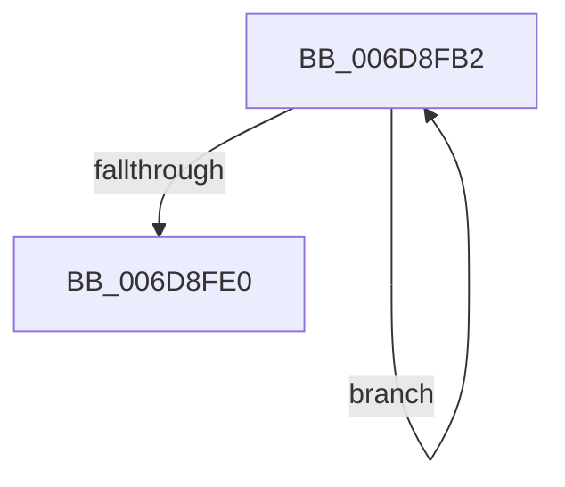

# sub_006D8FB2

- RVA: `0x006D8FB2`–`0x006D8FE5` (길이 `51` bytes)
- VA: `0x00000001406D8FB2`
- 실행 섹션: `.text`
- PDB 이름 있음: `아니요`; PDB Function 태그: `아니요`
- unwind 정보 RVA: `0x0006509C`
- 디코드: `13`개 명령, `51/51` bytes 표시
- 미해석 바이트: `0` (있으면 어셈블리에 `.byte`로 보존)

> 이 문서는 커널 이미지의 기계어와 PDB 기호를 분석해 생성했습니다. 4번과 5번은 함수 원형과 자료형을 바이너리 사용 방식에서 추정한 C 해석이며 원본 소스 복구 결과는 아닙니다.

## 1. Dependencies

- 직접 호출 지점: **2**; 고유 호출 대상: **2**
- 직접 호출자로 확인된 함수: **0**
- RIP 상대 이미지 참조: **0**

### Outgoing calls
- `0x006D8FC2` → [SmKmStoreGet](../34/SmKmStoreGet_function_00349F24.md) (function, `0x00349F24`)
- `0x006D8FD2` → [SMKM_STORE_MGR<SM_TRAITS>::SmWorkItemFree](../20/SMKM_STORE_MGR_SM_TRAITS_SmWorkItemFree_function_00205570.md) (function, `0x00205570`)

### Direct callers
- 이 함수 시작 RVA로 연결되는 직접 call은 확인되지 않았습니다. 간접 호출은 완전히 역산할 수 없습니다.

### Static image references
- 디코드된 RIP-relative 메모리 참조가 없습니다.

## 2. Other-region calls and transfers

- 다른 실행 섹션으로 향하는 call: **0**
- call이 아닌 외부 분기/꼬리 이동: **1**
  - `0x006D8FE0` → [SMKM_STORE_MGR<SM_TRAITS>::SmCompressCtxProcessReadyQueue + 0x123](../26/SMKM_STORE_MGR_SM_TRAITS_SmCompressCtxProcessReadyQueue_function_002678F0.md) (`tail-transfer`)

## 3. Assembly (complete function range)

```asm
006D8FB2  4D 8B 16                        mov r10, qword ptr [r14]
006D8FB5  49 8B CF                        mov rcx, r15
006D8FB8  41 0F B7 56 0E                  movzx edx, word ptr [r14 + 0xe]
006D8FBD  41 83 4A 0C 40                  or dword ptr [r10 + 0xc], 0x40
006D8FC2  E8 5D 0F C7 FF                  call 0x140349f24
006D8FC7  48 8B D0                        mov rdx, rax
006D8FCA  4C 8D 4C 24 30                  lea r9, [rsp + 0x30]
006D8FCF  4D 8B C2                        mov r8, r10
006D8FD2  E8 99 C5 B2 FF                  call 0x140205570
006D8FD7  49 83 C6 10                     add r14, 0x10
006D8FDB  4C 3B F3                        cmp r14, rbx
006D8FDE  72 D2                           jb 0x1406d8fb2
006D8FE0  E9 2E EA B8 FF                  jmp 0x140267a13
```

## 4. C-style interpretation (structured pseudocode)

```c
__int64 __fastcall sub_006D8FB2(__int64 a1, __int64 a2, __int64 a3, __int64 a4, __int64 a5, __int64 a6)
{
    __int64 result;
    __int64 v_r14;

    result = SmKmStoreGet(v_r15, *(unsigned __int16 *)(v_r14 + 14), a3, a4);
    result = SMKM_STORE_MGR_SM_TRAITS___SmWorkItemFree(v_r15, result, *(unsigned __int64 *)(v_r14), a6);
    v_r14 = (v_r14) + (16);
    if (v_r14 < v_rbx) goto loc_006D8FB2;
}
```

## 5. (Beta) C Style

```c
int64_t sub_006D8FB2(int64_t Arg1, int64_t Arg2, int64_t Arg3, int64_t Arg4, uint64_t Arg5, int64_t Arg6)
{
    int64_t result;
    int64_t local_r14;

    result = SmKmStoreGet(local_r15, *(uint16_t *)(local_r14 + 0xE), Arg3, Arg4);
    result = SMKM_STORE_MGR_SM_TRAITS___SmWorkItemFree(local_r15, result, *(uint64_t *)(local_r14), Arg6);
    local_r14 = (local_r14) + (16);
    if (local_r14 < local_rbx) goto loc_006D8FB2;
}
```

## 6. Execution-region graph

[열기: 2D/3D 그래프와 함수 탐색 컨트롤 패널](../../../control-panel.html?section=text&rva=0x006D8FB2&view=graph)

- 2D 그래프는 위에서 아래로 흐르고, 3D 그래프는 빈 공간을 드래그해 회전합니다. Shift+드래그는 이동, 휠은 확대·축소, 함수 노드 선택은 대상 보고서 이동입니다.

### Static fallback


