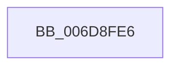

# sub_006D8FE6

- RVA: `0x006D8FE6`–`0x006D8FF8` (길이 `18` bytes)
- VA: `0x00000001406D8FE6`
- 실행 섹션: `.text`
- PDB 이름 있음: `아니요`; PDB Function 태그: `아니요`
- unwind 정보 RVA: `0x000650E0`
- 디코드: `5`개 명령, `18/18` bytes 표시
- 미해석 바이트: `0` (있으면 어셈블리에 `.byte`로 보존)

> 이 문서는 커널 이미지의 기계어와 PDB 기호를 분석해 생성했습니다. 4번과 5번은 함수 원형과 자료형을 바이너리 사용 방식에서 추정한 C 해석이며 원본 소스 복구 결과는 아닙니다.

## 1. Dependencies

- 직접 호출 지점: **1**; 고유 호출 대상: **1**
- 직접 호출자로 확인된 함수: **0**
- RIP 상대 이미지 참조: **0**

### Outgoing calls
- `0x006D8FED` → [SmHwAcceleratorPartitionMgrFreeDescriptor](../4D/SmHwAcceleratorPartitionMgrFreeDescriptor_function_004D7918.md) (function, `0x004D7918`)

### Direct callers
- 이 함수 시작 RVA로 연결되는 직접 call은 확인되지 않았습니다. 간접 호출은 완전히 역산할 수 없습니다.

### Static image references
- 디코드된 RIP-relative 메모리 참조가 없습니다.

## 2. Other-region calls and transfers

- 다른 실행 섹션으로 향하는 call: **0**
- call이 아닌 외부 분기/꼬리 이동: **1**
  - `0x006D8FF3` → [SMKM_STORE_MGR<SM_TRAITS>::SmCompressCtxWorkerThread + 0x3B5](../26/SMKM_STORE_MGR_SM_TRAITS_SmCompressCtxWorkerThread_function_00267D20.md) (`tail-transfer`)

## 3. Assembly (complete function range)

```asm
006D8FE6  48 8B 4D F7                     mov rcx, qword ptr [rbp - 9]
006D8FEA  49 8B D0                        mov rdx, r8
006D8FED  E8 26 E9 DF FF                  call 0x1404d7918
006D8FF2  90                              nop
006D8FF3  E9 DD F0 B8 FF                  jmp 0x1402680d5
```

## 4. C-style interpretation (structured pseudocode)

```c
__int64 __fastcall sub_006D8FE6(__int64 a1, __int64 a2, __int64 a3)
{
    __int64 result;

    result = SmHwAcceleratorPartitionMgrFreeDescriptor(*(unsigned __int64 *)(v_rbp - 9), a3, a3, a4);
}
```

## 5. (Beta) C Style

```c
int64_t sub_006D8FE6(int64_t Arg1, int64_t Arg2, int64_t Arg3)
{
    int64_t result;

    result = SmHwAcceleratorPartitionMgrFreeDescriptor(*(uint64_t *)(local_rbp - 0x9), Arg3, Arg3, a4);
}
```

## 6. Execution-region graph

[열기: 2D/3D 그래프와 함수 탐색 컨트롤 패널](../../../control-panel.html?section=text&rva=0x006D8FE6&view=graph)

- 2D 그래프는 위에서 아래로 흐르고, 3D 그래프는 빈 공간을 드래그해 회전합니다. Shift+드래그는 이동, 휠은 확대·축소, 함수 노드 선택은 대상 보고서 이동입니다.

### Static fallback


