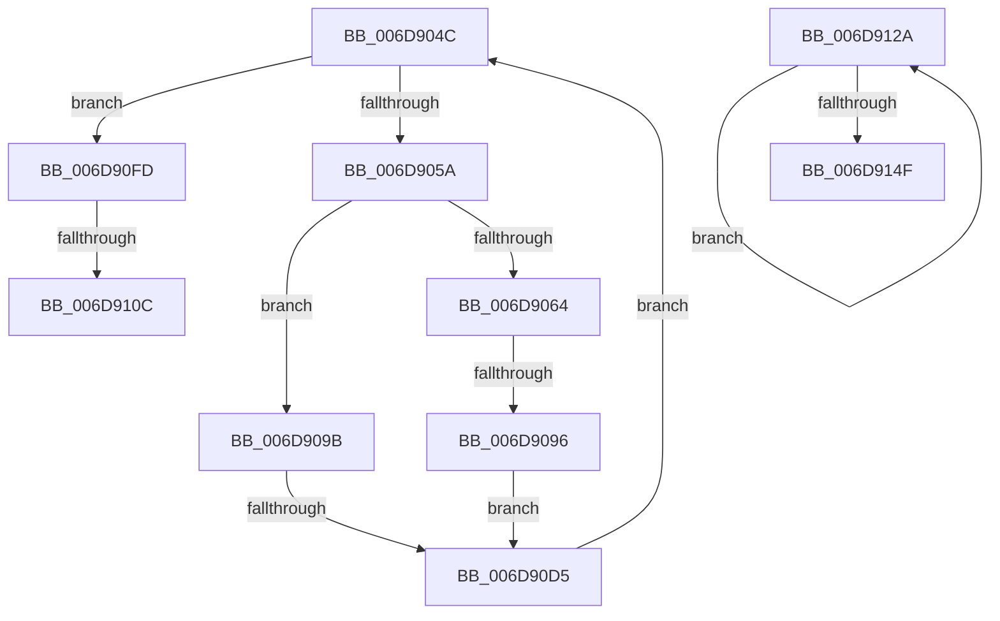

# sub_006D904C

- RVA: `0x006D904C`–`0x006D9154` (길이 `264` bytes)
- VA: `0x00000001406D904C`
- 실행 섹션: `.text`
- PDB 이름 있음: `아니요`; PDB Function 태그: `아니요`
- unwind 정보 RVA: `0x0006513C`
- 디코드: `62`개 명령, `264/264` bytes 표시
- 미해석 바이트: `0` (있으면 어셈블리에 `.byte`로 보존)

> 이 문서는 커널 이미지의 기계어와 PDB 기호를 분석해 생성했습니다. 4번과 5번은 함수 원형과 자료형을 바이너리 사용 방식에서 추정한 C 해석이며 원본 소스 복구 결과는 아닙니다.

## 1. Dependencies

- 직접 호출 지점: **4**; 고유 호출 대상: **4**
- 직접 호출자로 확인된 함수: **0**
- RIP 상대 이미지 참조: **0**

### Outgoing calls
- `0x006D9084` → [SmHwAcceleratorIssueRequest](../61/SmHwAcceleratorIssueRequest_function_006114C0.md) (function, `0x006114C0`)
- `0x006D90C6` → [RtlCompressBuffer](../26/RtlCompressBuffer_function_0026A220.md) (function, `0x0026A220`)
- `0x006D911F` → [SmStoreCompressCompleteCompressedChunks](../61/SmStoreCompressCompleteCompressedChunks_function_00610A78.md) (function, `0x00610A78`)
- `0x006D913F` → [SmHwAcceleratorWaitForRequest](../61/SmHwAcceleratorWaitForRequest_function_00611A7C.md) (function, `0x00611A7C`)

### Direct callers
- 이 함수 시작 RVA로 연결되는 직접 call은 확인되지 않았습니다. 간접 호출은 완전히 역산할 수 없습니다.

### Static image references
- 디코드된 RIP-relative 메모리 참조가 없습니다.

## 2. Other-region calls and transfers

- 다른 실행 섹션으로 향하는 call: **0**
- call이 아닌 외부 분기/꼬리 이동: **5**
  - `0x006D9090` → [SmStoreCompressBuffer + 0xBD](../26/SmStoreCompressBuffer_function_002683E0.md) (`tail-transfer`)
  - `0x006D90CF` → [SmStoreCompressBuffer + 0xBD](../26/SmStoreCompressBuffer_function_002683E0.md) (`tail-transfer`)
  - `0x006D9106` → [SmStoreCompressBuffer + 0xBD](../26/SmStoreCompressBuffer_function_002683E0.md) (`tail-transfer`)
  - `0x006D9125` → [SmStoreCompressBuffer + 0xB9](../26/SmStoreCompressBuffer_function_002683E0.md) (`tail-transfer`)
  - `0x006D914F` → [SmStoreCompressBuffer + 0xC6](../26/SmStoreCompressBuffer_function_002683E0.md) (`tail-transfer`)

## 3. Assembly (complete function range)

```asm
006D904C  48 89 54 24 58                  mov qword ptr [rsp + 0x58], rdx
006D9051  45 3B EA                        cmp r13d, r10d
006D9054  0F 83 A3 00 00 00               jae 0x1406d90fd
006D905A  48 39 BC 24 D0 00 00 00         cmp qword ptr [rsp + 0xd0], rdi
006D9062  74 37                           je 0x1406d909b
006D9064  48 8B 8C 24 D0 00 00 00         mov rcx, qword ptr [rsp + 0xd0]
006D906C  4C 8B CD                        mov r9, rbp
006D906F  44 89 44 24 30                  mov dword ptr [rsp + 0x30], r8d
006D9074  45 33 C0                        xor r8d, r8d
006D9077  48 89 54 24 28                  mov qword ptr [rsp + 0x28], rdx
006D907C  41 8B D5                        mov edx, r13d
006D907F  44 89 5C 24 20                  mov dword ptr [rsp + 0x20], r11d
006D9084  E8 37 84 F3 FF                  call 0x1406114c0
006D9089  8B D8                           mov ebx, eax
006D908B  3D 03 01 00 00                  cmp eax, 0x103
006D9090  0F 85 07 F4 B8 FF               jne 0x14026849d
006D9096  41 FF C7                        inc r15d
006D9099  EB 3A                           jmp 0x1406d90d5
006D909B  4C 89 64 24 38                  mov qword ptr [rsp + 0x38], r12
006D90A0  48 8D 4C 24 60                  lea rcx, [rsp + 0x60]
006D90A5  41 8B C5                        mov eax, r13d
006D90A8  4C 8B CA                        mov r9, rdx
006D90AB  48 8B D5                        mov rdx, rbp
006D90AE  48 8D 0C 81                     lea rcx, [rcx + rax*4]
006D90B2  48 89 4C 24 30                  mov qword ptr [rsp + 0x30], rcx
006D90B7  0F B7 CE                        movzx ecx, si
006D90BA  89 7C 24 28                     mov dword ptr [rsp + 0x28], edi
006D90BE  44 89 44 24 20                  mov dword ptr [rsp + 0x20], r8d
006D90C3  45 8B C3                        mov r8d, r11d
006D90C6  E8 55 11 B9 FF                  call 0x14026a220
006D90CB  8B D8                           mov ebx, eax
006D90CD  85 C0                           test eax, eax
006D90CF  0F 88 C8 F3 B8 FF               js 0x14026849d
006D90D5  44 8B 9C 24 B0 00 00 00         mov r11d, dword ptr [rsp + 0xb0]
006D90DD  44 8B 84 24 C0 00 00 00         mov r8d, dword ptr [rsp + 0xc0]
006D90E5  49 03 EB                        add rbp, r11
006D90E8  48 8B 54 24 58                  mov rdx, qword ptr [rsp + 0x58]
006D90ED  44 8B 54 24 50                  mov r10d, dword ptr [rsp + 0x50]
006D90F2  49 03 D0                        add rdx, r8
006D90F5  41 FF C5                        inc r13d
006D90F8  E9 4F FF FF FF                  jmp 0x1406d904c
006D90FD  44 8B FF                        mov r15d, edi
006D9100  81 FB 03 01 00 00               cmp ebx, 0x103
006D9106  0F 84 91 F3 B8 FF               je 0x14026849d
006D910C  4C 8B 8C 24 D8 00 00 00         mov r9, qword ptr [rsp + 0xd8]
006D9114  48 8D 54 24 60                  lea rdx, [rsp + 0x60]
006D9119  45 8B C2                        mov r8d, r10d
006D911C  49 8B CE                        mov rcx, r14
006D911F  E8 54 79 F3 FF                  call 0x140610a78
006D9124  90                              nop
006D9125  E9 6F F3 B8 FF                  jmp 0x140268499
006D912A  48 8B 8C 24 D0 00 00 00         mov rcx, qword ptr [rsp + 0xd0]
006D9132  4C 8B CE                        mov r9, rsi
006D9135  45 33 C0                        xor r8d, r8d
006D9138  48 89 74 24 20                  mov qword ptr [rsp + 0x20], rsi
006D913D  8B D7                           mov edx, edi
006D913F  E8 38 89 F3 FF                  call 0x140611a7c
006D9144  FF C7                           inc edi
006D9146  48 83 C6 04                     add rsi, 4
006D914A  41 3B FF                        cmp edi, r15d
006D914D  72 DB                           jb 0x1406d912a
006D914F  E9 52 F3 B8 FF                  jmp 0x1402684a6
```

## 4. C-style interpretation (structured pseudocode)

```c
__int64 __fastcall sub_006D904C(__int64 a1, __int64 a2, int a3, __int64 a4, __int64 a5, __int64 a6, __int64 a7, __int64 a8, __int64 a9, unsigned int a10, __int64 a11, __int64 a12, __int64 a13, __int64 a14, __int64 a15, __int64 a16, __int64 a17, __int64 a18, __int64 a19, __int64 a20, __int64 a21, unsigned int a22, __int64 a23, unsigned int a24, __int64 a25, __int64 a26, __int64 a27)
{
    __int64 result;
    __int64 v_r13;
    __int64 v_r15;
    __int64 v_rbp;
    unsigned int v_stack_p20;
    unsigned __int64 v_stack_p28;
    unsigned int v_stack_p30;
    unsigned __int64 v_stack_p38;
    unsigned __int64 v_stack_p58;
    unsigned __int64 v_stack_pD0;

    v_stack_p58 = a2;
    if (((unsigned int)(v_r13)) >= ((unsigned int)(v_r10))) goto loc_006D90FD;
    if (a26 == v_rdi) goto loc_006D909B;
    v_stack_p30 = a3;
    a3 = 0;
    v_stack_p28 = a2;
    v_stack_p20 = (unsigned int)(v_r11);
    result = SmHwAcceleratorIssueRequest(a26, (unsigned int)((unsigned int)(v_r13)), a3, v_rbp);
    v_r15 = (unsigned int)((v_r15) + 1);
    goto loc_006D90D5;
loc_006D909B:
    v_stack_p38 = v_r12;
    v_stack_p30 = a12 + (unsigned int)((unsigned int)(v_r13)) * 4;
    v_stack_p28 = (unsigned int)(v_rdi);
    v_stack_p20 = 0;
    result = RtlCompressBuffer((unsigned __int16)(v_rsi), v_rbp, (unsigned int)((unsigned int)(v_r11)), (unsigned int)((unsigned int)(v_r13)));
loc_006D90D5:
    v_rbp = (v_rbp) + ((unsigned int)(a22));
    a2 = (a11) + ((unsigned int)(a24));
    v_r13 = (unsigned int)((v_r13) + 1);
    goto loc_006D904C;
loc_006D90FD:
    result = SmStoreCompressCompleteCompressedChunks(v_r14, a12, (unsigned int)((unsigned int)((unsigned int)(a10))), a27);
}
```

## 5. (Beta) C Style

```c
int64_t sub_006D904C(int64_t Arg1, int64_t Arg2, int32_t Arg3, int64_t Arg4, uint64_t Arg5, uint64_t Arg6, uint64_t Arg7, uint64_t Arg8, uint64_t Arg9, uint32_t Arg10, int64_t Arg11, int64_t Arg12, uint64_t Arg13, uint64_t Arg14, uint64_t Arg15, uint64_t Arg16, uint64_t Arg17, uint64_t Arg18, uint64_t Arg19, uint64_t Arg20, uint64_t Arg21, uint32_t Arg22, uint64_t Arg23, uint32_t Arg24, uint64_t Arg25, int64_t Arg26, int64_t Arg27)
{
    int64_t result;
    int64_t local_r13;
    int64_t local_r15;
    int64_t local_rbp;
    uint32_t v_stack_p20;
    uint64_t v_stack_p28;
    uint32_t v_stack_p30;
    uint64_t v_stack_p38;
    uint64_t v_stack_p58;
    uint64_t v_stack_pD0;

    v_stack_p58 = Arg2;
    if (((uint32_t)(local_r13)) >= ((uint32_t)(local_r10))) goto loc_006D90FD;
    if (Arg26 == local_rdi) goto loc_006D909B;
    v_stack_p30 = Arg3;
    Arg3 = 0;
    v_stack_p28 = Arg2;
    v_stack_p20 = (uint32_t)(local_r11);
    result = SmHwAcceleratorIssueRequest(Arg26, (uint32_t)((uint32_t)(local_r13)), Arg3, local_rbp);
    local_r15 = (uint32_t)((local_r15) + 1);
    goto loc_006D90D5;
loc_006D909B:
    v_stack_p38 = local_r12;
    v_stack_p30 = Arg12 + (uint32_t)((uint32_t)(local_r13)) * 4;
    v_stack_p28 = (uint32_t)(local_rdi);
    v_stack_p20 = 0;
    result = RtlCompressBuffer((uint16_t)(local_rsi), local_rbp, (uint32_t)((uint32_t)(local_r11)), (uint32_t)((uint32_t)(local_r13)));
loc_006D90D5:
    local_rbp = (local_rbp) + ((uint32_t)(Arg22));
    Arg2 = (Arg11) + ((uint32_t)(Arg24));
    local_r13 = (uint32_t)((local_r13) + 1);
    goto loc_006D904C;
loc_006D90FD:
    result = SmStoreCompressCompleteCompressedChunks(local_r14, Arg12, (uint32_t)((uint32_t)((uint32_t)(Arg10))), Arg27);
}
```

## 6. Execution-region graph

[열기: 2D/3D 그래프와 함수 탐색 컨트롤 패널](../../../control-panel.html?section=text&rva=0x006D904C&view=graph)

- 2D 그래프는 위에서 아래로 흐르고, 3D 그래프는 빈 공간을 드래그해 회전합니다. Shift+드래그는 이동, 휠은 확대·축소, 함수 노드 선택은 대상 보고서 이동입니다.

### Static fallback


