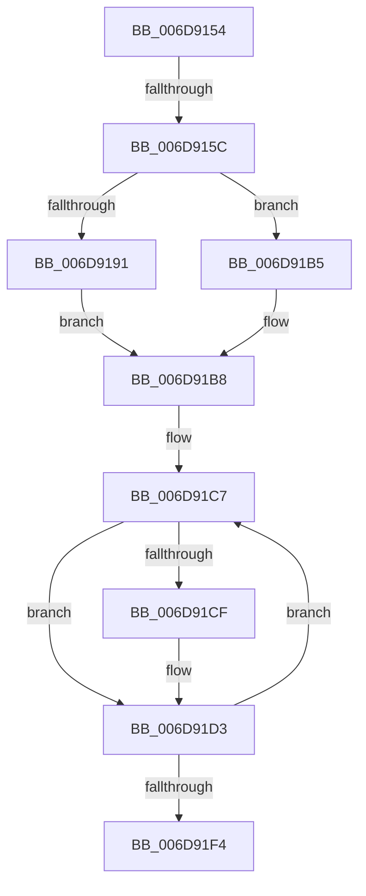

# sub_006D9154

- RVA: `0x006D9154`–`0x006D9207` (길이 `179` bytes)
- VA: `0x00000001406D9154`
- 실행 섹션: `.text`
- PDB 이름 있음: `아니요`; PDB Function 태그: `아니요`
- unwind 정보 RVA: `0x00065168`
- 디코드: `49`개 명령, `179/179` bytes 표시
- 미해석 바이트: `0` (있으면 어셈블리에 `.byte`로 보존)

> 이 문서는 커널 이미지의 기계어와 PDB 기호를 분석해 생성했습니다. 4번과 5번은 함수 원형과 자료형을 바이너리 사용 방식에서 추정한 C 해석이며 원본 소스 복구 결과는 아닙니다.

## 1. Dependencies

- 직접 호출 지점: **2**; 고유 호출 대상: **1**
- 직접 호출자로 확인된 함수: **0**
- RIP 상대 이미지 참조: **0**

### Outgoing calls
- `0x006D919A` → [wyhash](../26/wyhash_function_00269FE4.md) (function, `0x00269FE4`)
- `0x006D91D9` → [wyhash](../26/wyhash_function_00269FE4.md) (function, `0x00269FE4`)

### Direct callers
- 이 함수 시작 RVA로 연결되는 직접 call은 확인되지 않았습니다. 간접 호출은 완전히 역산할 수 없습니다.

### Static image references
- 디코드된 RIP-relative 메모리 참조가 없습니다.

## 2. Other-region calls and transfers

- 다른 실행 섹션으로 향하는 call: **0**
- call이 아닌 외부 분기/꼬리 이동: **2**
  - `0x006D9156` → [SMKM_STORE_MGR<SM_TRAITS>::SmCompressCtxCompleteEntry + 0x90](../26/SMKM_STORE_MGR_SM_TRAITS_SmCompressCtxCompleteEntry_function_002685C0.md) (`tail-transfer`)
  - `0x006D9202` → [SMKM_STORE_MGR<SM_TRAITS>::SmCompressCtxCompleteEntry + 0x9D](../26/SMKM_STORE_MGR_SM_TRAITS_SmCompressCtxCompleteEntry_function_002685C0.md) (`tail-transfer`)

## 3. Assembly (complete function range)

```asm
006D9154  3B DD                           cmp ebx, ebp
006D9156  0F 84 F4 F4 B8 FF               je 0x140268650
006D915C  45 33 ED                        xor r13d, r13d
006D915F  8B CF                           mov ecx, edi
006D9161  83 F8 02                        cmp eax, 2
006D9164  41 0F 94 C5                     sete r13b
006D9168  81 E1 FF 0F 00 00               and ecx, 0xfff
006D916E  41 FF C5                        inc r13d
006D9171  2B E9                           sub ebp, ecx
006D9173  33 D2                           xor edx, edx
006D9175  46 8D 0C 6D FE FF FF FF         lea r9d, [r13*2 - 2]
006D917D  41 2B E9                        sub ebp, r9d
006D9180  8B C5                           mov eax, ebp
006D9182  41 F7 F5                        div r13d
006D9185  89 84 24 90 00 00 00            mov dword ptr [rsp + 0x90], eax
006D918C  45 85 C9                        test r9d, r9d
006D918F  74 24                           je 0x1406d91b5
006D9191  41 8B D1                        mov edx, r9d
006D9194  48 8B CF                        mov rcx, rdi
006D9197  45 8B F9                        mov r15d, r9d
006D919A  E8 45 0E B9 FF                  call 0x140269fe4
006D919F  42 8D 0C 6D FE FF FF FF         lea ecx, [r13*2 - 2]
006D91A7  4C 8B C0                        mov r8, rax
006D91AA  8B 84 24 90 00 00 00            mov eax, dword ptr [rsp + 0x90]
006D91B1  2B D9                           sub ebx, ecx
006D91B3  EB 03                           jmp 0x1406d91b8
006D91B5  45 33 FF                        xor r15d, r15d
006D91B8  49 8D 34 3F                     lea rsi, [r15 + rdi]
006D91BC  48 89 44 24 78                  mov qword ptr [rsp + 0x78], rax
006D91C1  33 ED                           xor ebp, ebp
006D91C3  45 8D 65 FF                     lea r12d, [r13 - 1]
006D91C7  44 8B FB                        mov r15d, ebx
006D91CA  41 3B EC                        cmp ebp, r12d
006D91CD  74 04                           je 0x1406d91d3
006D91CF  44 0F B7 3F                     movzx r15d, word ptr [rdi]
006D91D3  41 8B D7                        mov edx, r15d
006D91D6  48 8B CE                        mov rcx, rsi
006D91D9  E8 06 0E B9 FF                  call 0x140269fe4
006D91DE  48 03 74 24 78                  add rsi, qword ptr [rsp + 0x78]
006D91E3  41 2B DF                        sub ebx, r15d
006D91E6  FF C5                           inc ebp
006D91E8  48 83 C7 02                     add rdi, 2
006D91EC  4C 8B C0                        mov r8, rax
006D91EF  41 3B ED                        cmp ebp, r13d
006D91F2  72 D3                           jb 0x1406d91c7
006D91F4  4C 8B 64 24 20                  mov r12, qword ptr [rsp + 0x20]
006D91F9  49 8D 76 28                     lea rsi, [r14 + 0x28]
006D91FD  4C 8B 7C 24 28                  mov r15, qword ptr [rsp + 0x28]
006D9202  E9 56 F4 B8 FF                  jmp 0x14026865d
```

## 4. C-style interpretation (structured pseudocode)

```c
__int64 __fastcall sub_006D9154(__int64 a1, int a2, __int64 a3, __int64 a4, __int64 a5, __int64 a6, __int64 a7, __int64 a8, __int64 a9, __int64 a10, __int64 a11, __int64 a12, __int64 a13, __int64 a14, __int64 a15, __int64 a16, __int64 a17, unsigned int a18)
{
    __int64 result;
    __int64 v_r13;
    __int64 v_r15;
    __int64 v_rbp;
    __int64 v_rbx;
    __int64 v_rdi;
    __int64 v_rsi;
    unsigned __int64 v_stack_p20;
    unsigned __int64 v_stack_p78;
    unsigned int v_stack_p90;

    v_r13 = 0;
    v_r13 = (((unsigned int)(result)) == 2) ? 1 : 0;
    a1 = (unsigned int)(((unsigned int)((unsigned int)(v_rdi))) & (0xFFFULL));
    v_r13 = (unsigned int)((v_r13) + 1);
    v_rbp = (unsigned int)((v_rbp) - ((unsigned int)(a1)));
    a2 = 0;
    v_rbp = (unsigned int)((v_rbp) - ((unsigned int)(v_r13 * 2 - 2)));
    v_stack_p90 = (unsigned int)((unsigned int)((unsigned int)(v_rbp)));
    if ((unsigned int)(v_r13 * 2 - 2) == 0) goto loc_006D91B5;
    result = wyhash(v_rdi, (unsigned int)((unsigned int)(v_r13 * 2 - 2)), a3, v_r13 * 2 - 2);
    v_rbx = (unsigned int)((v_rbx) - ((unsigned int)(v_r13 * 2 - 2)));
    goto loc_006D91B8;
loc_006D91B5:
    v_r15 = 0;
loc_006D91B8:
    v_stack_p78 = (unsigned int)(a18);
    v_rbp = 0;
loc_006D91C7:
    v_r15 = (unsigned int)((unsigned int)(v_rbx));
    if (0 != ((unsigned int)(v_r13 - 1))) {
        v_r15 = *(unsigned __int16 *)(v_rdi);
    }
    result = wyhash(v_r15 + v_rdi * 1, (unsigned int)((unsigned int)(v_r15)), result, v_r13 * 2 - 2);
    v_rsi = (v_r15 + v_rdi * 1) + (a15);
    v_rbx = (unsigned int)((v_rbx) - ((unsigned int)(v_r15)));
    v_rbp = (unsigned int)((v_rbp) + 1);
    v_rdi = (v_rdi) + (2);
    if (((unsigned int)(v_rbp)) < ((unsigned int)(v_r13))) goto loc_006D91C7;
}
```

## 5. (Beta) C Style

```c
int64_t sub_006D9154(int64_t Arg1, int32_t Arg2, int64_t Arg3, int64_t Arg4, int64_t Arg5, uint64_t Arg6, uint64_t Arg7, uint64_t Arg8, uint64_t Arg9, uint64_t Arg10, uint64_t Arg11, uint64_t Arg12, uint64_t Arg13, uint64_t Arg14, int64_t Arg15, uint64_t Arg16, uint64_t Arg17, uint32_t Arg18)
{
    int64_t result;
    int64_t local_r13;
    int64_t local_r15;
    int64_t local_rbp;
    int64_t local_rbx;
    int64_t local_rdi;
    int64_t local_rsi;
    uint64_t v_stack_p20;
    uint64_t v_stack_p78;
    uint32_t v_stack_p90;

    local_r13 = 0;
    local_r13 = (((uint32_t)(result)) == 2) ? 1 : 0;
    Arg1 = (uint32_t)(((uint32_t)((uint32_t)(local_rdi))) & (0xFFFULL));
    local_r13 = (uint32_t)((local_r13) + 1);
    local_rbp = (uint32_t)((local_rbp) - ((uint32_t)(Arg1)));
    Arg2 = 0;
    local_rbp = (uint32_t)((local_rbp) - ((uint32_t)(local_r13 * 2 - 2)));
    v_stack_p90 = (uint32_t)((uint32_t)((uint32_t)(local_rbp)));
    if ((uint32_t)(local_r13 * 2 - 2) == 0) goto loc_006D91B5;
    result = wyhash(local_rdi, (uint32_t)((uint32_t)(local_r13 * 2 - 2)), Arg3, local_r13 * 2 - 2);
    local_rbx = (uint32_t)((local_rbx) - ((uint32_t)(local_r13 * 2 - 2)));
    goto loc_006D91B8;
loc_006D91B5:
    local_r15 = 0;
loc_006D91B8:
    v_stack_p78 = (uint32_t)(Arg18);
    local_rbp = 0;
loc_006D91C7:
    local_r15 = (uint32_t)((uint32_t)(local_rbx));
    if (0 != ((uint32_t)(local_r13 - 1))) {
        local_r15 = *(uint16_t *)(local_rdi);
    }
    result = wyhash(local_r15 + local_rdi * 1, (uint32_t)((uint32_t)(local_r15)), result, local_r13 * 2 - 2);
    local_rsi = (local_r15 + local_rdi * 1) + (Arg15);
    local_rbx = (uint32_t)((local_rbx) - ((uint32_t)(local_r15)));
    local_rbp = (uint32_t)((local_rbp) + 1);
    local_rdi = (local_rdi) + (2);
    if (((uint32_t)(local_rbp)) < ((uint32_t)(local_r13))) goto loc_006D91C7;
}
```

## 6. Execution-region graph

[열기: 2D/3D 그래프와 함수 탐색 컨트롤 패널](../../../control-panel.html?section=text&rva=0x006D9154&view=graph)

- 2D 그래프는 위에서 아래로 흐르고, 3D 그래프는 빈 공간을 드래그해 회전합니다. Shift+드래그는 이동, 휠은 확대·축소, 함수 노드 선택은 대상 보고서 이동입니다.

### Static fallback


