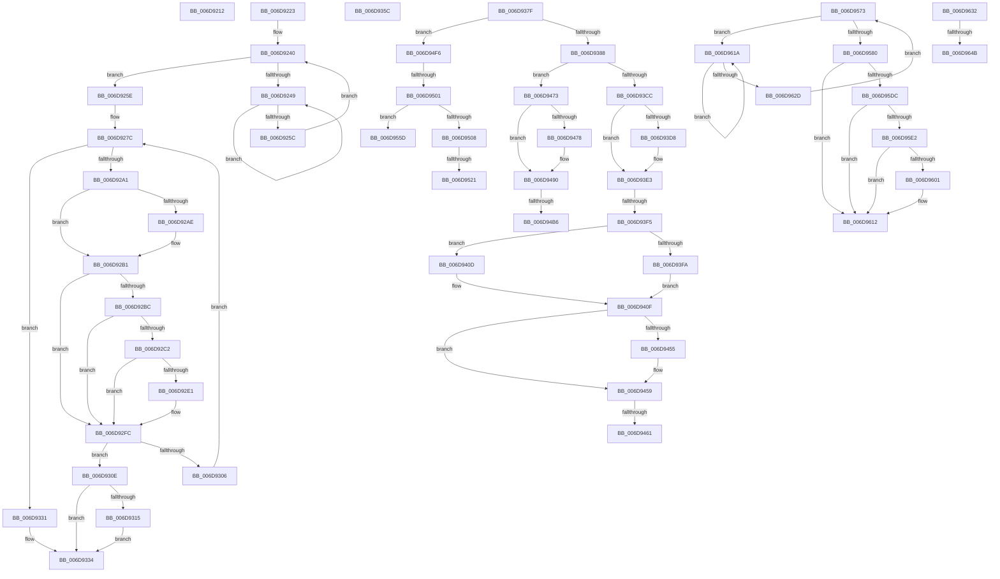

# sub_006D9212

- RVA: `0x006D9212`–`0x006D9693` (길이 `1,153` bytes)
- VA: `0x00000001406D9212`
- 실행 섹션: `.text`
- PDB 이름 있음: `아니요`; PDB Function 태그: `아니요`
- unwind 정보 RVA: `0x000653A0`
- 디코드: `271`개 명령, `1,153/1,153` bytes 표시
- 미해석 바이트: `0` (있으면 어셈블리에 `.byte`로 보존)

> 이 문서는 커널 이미지의 기계어와 PDB 기호를 분석해 생성했습니다. 4번과 5번은 함수 원형과 자료형을 바이너리 사용 방식에서 추정한 C 해석이며 원본 소스 복구 결과는 아닙니다.

## 1. Dependencies

- 직접 호출 지점: **25**; 고유 호출 대상: **19**
- 직접 호출자로 확인된 함수: **0**
- RIP 상대 이미지 참조: **1**

### Outgoing calls
- `0x006D9218` → [MiUnlockPageTable](../21/MiUnlockPageTable_function_00216EC0.md) (function, `0x00216EC0`)
- `0x006D924E` → [KeYieldProcessorEx](../3F/KeYieldProcessorEx_function_003FBD00.md) (function, `0x003FBD00`)
- `0x006D928B` → [MiMakeTransitionPte](../36/MiMakeTransitionPte_function_00363F70.md) (function, `0x00363F70`)
- `0x006D92ED` → [MiCheckLinearProtectedPteAccessedBit](../29/MiCheckLinearProtectedPteAccessedBit_function_00292D80.md) (function, `0x00292D80`)
- `0x006D9374` → [MiInitializeTbFlushList](../29/MiInitializeTbFlushList_function_00294F00.md) (function, `0x00294F00`)
- `0x006D93CF` → [MiVmAccessLoggingEnabled](../36/MiVmAccessLoggingEnabled_function_003629D4.md) (function, `0x003629D4`)
- `0x006D93DE` → [MI_WSLE_LOG_ACCESS](../29/MI_WSLE_LOG_ACCESS_function_00294400.md) (function, `0x00294400`)
- `0x006D93E6` → [MiGetWsleContents](../31/MiGetWsleContents_function_00316540.md) (function, `0x00316540`)
- `0x006D93FE` → [MiGetProcessorFlushList](../24/MiGetProcessorFlushList_function_00242C90.md) (function, `0x00242C90`)
- `0x006D942F` → [MiInitializeTbFlushList](../29/MiInitializeTbFlushList_function_00294F00.md) (function, `0x00294F00`)
- `0x006D943D` → [MiInsertTbFlushEntry](../29/MiInsertTbFlushEntry_function_00293670.md) (function, `0x00293670`)
- `0x006D944B` → [MiFreeWsleList](../24/MiFreeWsleList_function_00241168.md) (function, `0x00241168`)
- `0x006D9461` → [MiReleaseProcessorFlushList](../31/MiReleaseProcessorFlushList_function_00313C70.md) (function, `0x00313C70`)
- `0x006D947B` → [MiFlushTbList](../31/MiFlushTbList_function_00311FC0.md) (function, `0x00311FC0`)
- `0x006D9480` → [MiReleaseProcessorFlushList](../31/MiReleaseProcessorFlushList_function_00313C70.md) (function, `0x00313C70`)
- `0x006D94A3` → [MiCopyOnWrite](../36/MiCopyOnWrite_function_00362A0C.md) (function, `0x00362A0C`)
- `0x006D94BC` → [MiUnlockPageTable](../21/MiUnlockPageTable_function_00216EC0.md) (function, `0x00216EC0`)
- `0x006D94CB` → [MiUnlockWorkingSetShared](../27/MiUnlockWorkingSetShared_function_0027D690.md) (function, `0x0027D690`)
- `0x006D94D8` → [MiCopyOnWriteCheckConditions](../2A/MiCopyOnWriteCheckConditions_function_002A750C.md) (function, `0x002A750C`)
- `0x006D94E0` → [MiLockWorkingSetShared](../27/MiLockWorkingSetShared_function_0027CBF0.md) (function, `0x0027CBF0`)
- `0x006D94EB` → [MiLockNestedPageTable](../23/MiLockNestedPageTable_function_0023E890.md) (function, `0x0023E890`)
- `0x006D9510` → [MiLockTransitionLeafPageEx](../40/MiLockTransitionLeafPageEx_function_00405884.md) (function, `0x00405884`)
- `0x006D960D` → [MiCheckLinearProtectedPteAccessedBit](../29/MiCheckLinearProtectedPteAccessedBit_function_00292D80.md) (function, `0x00292D80`)
- `0x006D961F` → [KeYieldProcessorEx](../3F/KeYieldProcessorEx_function_003FBD00.md) (function, `0x003FBD00`)
- `0x006D963A` → [MiLockTransitionLeafPageEx](../40/MiLockTransitionLeafPageEx_function_00405884.md) (function, `0x00405884`)

### Direct callers
- 이 함수 시작 RVA로 연결되는 직접 call은 확인되지 않았습니다. 간접 호출은 완전히 역산할 수 없습니다.

### Static image references
- `0x006D92A1` → RVA `0x00FC6A88` (`ALMOSTRO`; read)

## 2. Other-region calls and transfers

- 다른 실행 섹션으로 향하는 call: **0**
- call이 아닌 외부 분기/꼬리 이동: **15**
  - `0x006D921E` → [MmProtectPool + 0x2DD](../26/MmProtectPool_function_002697AC.md) (`tail-transfer`)
  - `0x006D9357` → [MmProtectPool + 0x250](../26/MmProtectPool_function_002697AC.md) (`tail-transfer`)
  - `0x006D937A` → [MmProtectPool + 0x264](../26/MmProtectPool_function_002697AC.md) (`tail-transfer`)
  - `0x006D93EF` → [MmProtectPool + 0x276](../26/MmProtectPool_function_002697AC.md) (`tail-transfer`)
  - `0x006D945B` → [MmProtectPool + 0x276](../26/MmProtectPool_function_002697AC.md) (`tail-transfer`)
  - `0x006D946E` → [MmProtectPool + 0x276](../26/MmProtectPool_function_002697AC.md) (`tail-transfer`)
  - `0x006D94B0` → [MmProtectPool + 0x276](../26/MmProtectPool_function_002697AC.md) (`tail-transfer`)
  - `0x006D94F1` → [MmProtectPool + 0x276](../26/MmProtectPool_function_002697AC.md) (`tail-transfer`)
  - `0x006D94FB` → [MmProtectPool + 0x649](../26/MmProtectPool_function_002697AC.md) (`tail-transfer`)
  - `0x006D951B` → [MmProtectPool + 0x42D](../26/MmProtectPool_function_002697AC.md) (`tail-transfer`)
  - `0x006D9558` → [MmProtectPool + 0x276](../26/MmProtectPool_function_002697AC.md) (`tail-transfer`)
  - `0x006D956E` → [MmProtectPool + 0x276](../26/MmProtectPool_function_002697AC.md) (`tail-transfer`)
  - `0x006D9615` → [MmProtectPool + 0x583](../26/MmProtectPool_function_002697AC.md) (`tail-transfer`)
  - `0x006D9645` → [MmProtectPool + 0x42D](../26/MmProtectPool_function_002697AC.md) (`tail-transfer`)
  - `0x006D968E` → [MmProtectPool + 0x276](../26/MmProtectPool_function_002697AC.md) (`tail-transfer`)

## 3. Assembly (complete function range)

```asm
006D9212  48 8B D7                        mov rdx, rdi
006D9215  49 8B CD                        mov rcx, r13
006D9218  E8 A3 DC B3 FF                  call 0x140216ec0
006D921D  90                              nop
006D921E  E9 66 08 B9 FF                  jmp 0x140269a89
006D9223  48 8B C3                        mov rax, rbx
006D9226  48 C1 E8 0C                     shr rax, 0xc
006D922A  49 23 C0                        and rax, r8
006D922D  48 8D 2C 40                     lea rbp, [rax + rax*2]
006D9231  48 C1 E5 04                     shl rbp, 4
006D9235  49 8B C1                        mov rax, r9
006D9238  48 03 E8                        add rbp, rax
006D923B  83 64 24 3C 00                  and dword ptr [rsp + 0x3c], 0
006D9240  F0 48 0F BA 6D 18 3F            lock bts qword ptr [rbp + 0x18], 0x3f
006D9247  73 15                           jae 0x1406d925e
006D9249  48 8D 4C 24 3C                  lea rcx, [rsp + 0x3c]
006D924E  E8 AD 2A D2 FF                  call 0x1403fbd00
006D9253  48 8B 45 18                     mov rax, qword ptr [rbp + 0x18]
006D9257  48 85 C0                        test rax, rax
006D925A  78 ED                           js 0x1406d9249
006D925C  EB E2                           jmp 0x1406d9240
006D925E  48 8B 45 10                     mov rax, qword ptr [rbp + 0x10]
006D9262  49 B8 FF FF FF FF FF 00 00 00   movabs r8, 0xffffffffff
006D926C  48 25 1F FF FF FF               and rax, 0xffffffffffffff1f
006D9272  48 0D 00 03 00 00               or rax, 0x300
006D9278  48 89 45 10                     mov qword ptr [rbp + 0x10], rax
006D927C  48 8B CB                        mov rcx, rbx
006D927F  BA 18 00 00 00                  mov edx, 0x18
006D9284  48 C1 E9 0C                     shr rcx, 0xc
006D9288  49 23 C8                        and rcx, r8
006D928B  E8 E0 AC C8 FF                  call 0x140363f70
006D9290  83 BC 24 E8 00 00 00 00         cmp dword ptr [rsp + 0xe8], 0
006D9298  48 8B F8                        mov rdi, rax
006D929B  0F 84 90 00 00 00               je 0x1406d9331
006D92A1  48 F7 05 DC D7 8E 00 00 00 00 02  test qword ptr [rip + 0x8ed7dc], 0x2000000
006D92AC  74 03                           je 0x1406d92b1
006D92AE  0F AE E8                        lfence
006D92B1  48 0F BA 25 CE D7 8E 00 24      bt qword ptr [rip + 0x8ed7ce], 0x24
006D92BA  73 40                           jae 0x1406d92fc
006D92BC  24 21                           and al, 0x21
006D92BE  3C 01                           cmp al, 1
006D92C0  75 3A                           jne 0x1406d92fc
006D92C2  48 B8 00 00 00 00 80 F6 FF FF   movabs rax, 0xfffff68000000000
006D92CC  48 8B C0                        mov rax, rax
006D92CF  48 B9 00 00 00 00 40 00 00 00   movabs rcx, 0x4000000000
006D92D9  48 03 C1                        add rax, rcx
006D92DC  48 3B F0                        cmp rsi, rax
006D92DF  72 1B                           jb 0x1406d92fc
006D92E1  41 B8 80 00 00 00               mov r8d, 0x80
006D92E7  48 8B D7                        mov rdx, rdi
006D92EA  48 8B CE                        mov rcx, rsi
006D92ED  E8 8E 9A BB FF                  call 0x140292d80
006D92F2  49 B8 FF FF FF FF FF 00 00 00   movabs r8, 0xffffffffff
006D92FC  48 8B C3                        mov rax, rbx
006D92FF  F0 48 0F B1 3E                  lock cmpxchg qword ptr [rsi], rdi
006D9304  74 08                           je 0x1406d930e
006D9306  48 8B D8                        mov rbx, rax
006D9309  E9 6E FF FF FF                  jmp 0x1406d927c
006D930E  48 0F BA E3 09                  bt rbx, 9
006D9313  73 1F                           jae 0x1406d9334
006D9315  48 8B 45 18                     mov rax, qword ptr [rbp + 0x18]
006D9319  48 B9 00 00 01 00 00 00 00 C0   movabs rcx, 0xc000000000010000
006D9323  48 23 C1                        and rax, rcx
006D9326  48 0F BA E8 10                  bts rax, 0x10
006D932B  48 89 45 18                     mov qword ptr [rbp + 0x18], rax
006D932F  EB 03                           jmp 0x1406d9334
006D9331  48 89 3E                        mov qword ptr [rsi], rdi
006D9334  48 B8 FF FF FF FF FF FF FF 7F   movabs rax, 0x7fffffffffffffff
006D933E  F0 48 21 45 18                  lock and qword ptr [rbp + 0x18], rax
006D9343  48 8B DE                        mov rbx, rsi
006D9346  48 B8 00 00 00 00 80 F6 FF FF   movabs rax, 0xfffff68000000000
006D9350  48 C1 E3 19                     shl rbx, 0x19
006D9354  48 8B C0                        mov rax, rax
006D9357  E9 A0 06 B9 FF                  jmp 0x1402699fc
006D935C  45 8B 46 0C                     mov r8d, dword ptr [r14 + 0xc]
006D9360  45 33 C9                        xor r9d, r9d
006D9363  49 8B D5                        mov rdx, r13
006D9366  C7 44 24 20 20 00 00 00         mov dword ptr [rsp + 0x20], 0x20
006D936E  49 8B CE                        mov rcx, r14
006D9371  4D 8B E6                        mov r12, r14
006D9374  E8 87 BB BB FF                  call 0x140294f00
006D9379  90                              nop
006D937A  E9 91 06 B9 FF                  jmp 0x140269a10
006D937F  48 85 C9                        test rcx, rcx
006D9382  0F 84 6E 01 00 00               je 0x1406d94f6
006D9388  48 8B EE                        mov rbp, rsi
006D938B  48 B8 00 00 00 00 80 F6 FF FF   movabs rax, 0xfffff68000000000
006D9395  48 C1 E5 19                     shl rbp, 0x19
006D9399  48 8B C0                        mov rax, rax
006D939C  48 C1 E0 19                     shl rax, 0x19
006D93A0  48 2B E8                        sub rbp, rax
006D93A3  48 C1 EB 0C                     shr rbx, 0xc
006D93A7  49 23 D8                        and rbx, r8
006D93AA  48 C1 FD 10                     sar rbp, 0x10
006D93AE  48 8D 04 5B                     lea rax, [rbx + rbx*2]
006D93B2  48 03 C0                        add rax, rax
006D93B5  48 B9 28 00 00 00 00 DE FF FF   movabs rcx, 0xffffde0000000028
006D93BF  48 8B 04 C1                     mov rax, qword ptr [rcx + rax*8]
006D93C3  48 85 C0                        test rax, rax
006D93C6  0F 88 A7 00 00 00               js 0x1406d9473
006D93CC  49 8B CD                        mov rcx, r13
006D93CF  E8 00 96 C8 FF                  call 0x1403629d4
006D93D4  85 C0                           test eax, eax
006D93D6  74 0B                           je 0x1406d93e3
006D93D8  48 8B D6                        mov rdx, rsi
006D93DB  49 8B CD                        mov rcx, r13
006D93DE  E8 1D B0 BB FF                  call 0x140294400
006D93E3  48 8B D5                        mov rdx, rbp
006D93E6  E8 55 D1 C3 FF                  call 0x140316540
006D93EB  24 0F                           and al, 0xf
006D93ED  3C 08                           cmp al, 8
006D93EF  0F 84 2D 06 B9 FF               je 0x140269a22
006D93F5  4D 85 F6                        test r14, r14
006D93F8  75 13                           jne 0x1406d940d
006D93FA  41 8D 7E 01                     lea edi, [r14 + 1]
006D93FE  E8 8D 98 B6 FF                  call 0x140242c90
006D9403  4C 8B F0                        mov r14, rax
006D9406  48 89 44 24 30                  mov qword ptr [rsp + 0x30], rax
006D940B  EB 02                           jmp 0x1406d940f
006D940D  33 FF                           xor edi, edi
006D940F  41 BB 01 00 00 00               mov r11d, 1
006D9415  49 8D 9E 28 10 00 00            lea rbx, [r14 + 0x1028]
006D941C  44 8B 43 0C                     mov r8d, dword ptr [rbx + 0xc]
006D9420  49 8B D5                        mov rdx, r13
006D9423  48 8B CB                        mov rcx, rbx
006D9426  44 89 5C 24 20                  mov dword ptr [rsp + 0x20], r11d
006D942B  45 8D 4B 01                     lea r9d, [r11 + 1]
006D942F  E8 CC BA BB FF                  call 0x140294f00
006D9434  45 8B C3                        mov r8d, r11d
006D9437  48 8B D5                        mov rdx, rbp
006D943A  45 33 C9                        xor r9d, r9d
006D943D  E8 2E A2 BB FF                  call 0x140293670
006D9442  45 33 C0                        xor r8d, r8d
006D9445  48 8B D3                        mov rdx, rbx
006D9448  49 8B CD                        mov rcx, r13
006D944B  E8 18 7D B6 FF                  call 0x140241168
006D9450  48 85 C0                        test rax, rax
006D9453  75 04                           jne 0x1406d9459
006D9455  48 83 EE 08                     sub rsi, 8
006D9459  85 FF                           test edi, edi
006D945B  0F 84 C1 05 B9 FF               je 0x140269a22
006D9461  E8 0A A8 C3 FF                  call 0x140313c70
006D9466  45 33 F6                        xor r14d, r14d
006D9469  4C 89 74 24 30                  mov qword ptr [rsp + 0x30], r14
006D946E  E9 AF 05 B9 FF                  jmp 0x140269a22
006D9473  4D 85 E4                        test r12, r12
006D9476  74 18                           je 0x1406d9490
006D9478  49 8B CC                        mov rcx, r12
006D947B  E8 40 8B C3 FF                  call 0x140311fc0
006D9480  E8 EB A7 C3 FF                  call 0x140313c70
006D9485  45 33 E4                        xor r12d, r12d
006D9488  45 33 F6                        xor r14d, r14d
006D948B  4C 89 74 24 30                  mov qword ptr [rsp + 0x30], r14
006D9490  48 83 64 24 20 00               and qword ptr [rsp + 0x20], 0
006D9496  45 33 C9                        xor r9d, r9d
006D9499  49 83 C8 FF                     or r8, 0xffffffffffffffff
006D949D  48 8B D6                        mov rdx, rsi
006D94A0  48 8B CD                        mov rcx, rbp
006D94A3  E8 64 95 C8 FF                  call 0x140362a0c
006D94A8  48 83 EE 08                     sub rsi, 8
006D94AC  8B D8                           mov ebx, eax
006D94AE  85 C0                           test eax, eax
006D94B0  0F 89 6C 05 B9 FF               jns 0x140269a22
006D94B6  48 8B D7                        mov rdx, rdi
006D94B9  49 8B CD                        mov rcx, r13
006D94BC  E8 FF D9 B3 FF                  call 0x140216ec0
006D94C1  8A 94 24 E0 00 00 00            mov dl, byte ptr [rsp + 0xe0]
006D94C8  49 8B CD                        mov rcx, r13
006D94CB  E8 C0 41 BA FF                  call 0x14027d690
006D94D0  45 33 C0                        xor r8d, r8d
006D94D3  8B D3                           mov edx, ebx
006D94D5  49 8B CD                        mov rcx, r13
006D94D8  E8 2F E0 BC FF                  call 0x1402a750c
006D94DD  49 8B CD                        mov rcx, r13
006D94E0  E8 0B 37 BA FF                  call 0x14027cbf0
006D94E5  48 8B D7                        mov rdx, rdi
006D94E8  49 8B CD                        mov rcx, r13
006D94EB  E8 A0 53 B6 FF                  call 0x14023e890
006D94F0  90                              nop
006D94F1  E9 2C 05 B9 FF                  jmp 0x140269a22
006D94F6  48 0F BA E3 0A                  bt rbx, 0xa
006D94FB  0F 82 F4 08 B9 FF               jb 0x140269df5
006D9501  48 0F BA E3 0B                  bt rbx, 0xb
006D9506  73 55                           jae 0x1406d955d
006D9508  45 33 C0                        xor r8d, r8d
006D950B  33 D2                           xor edx, edx
006D950D  48 8B CE                        mov rcx, rsi
006D9510  E8 6F C3 D2 FF                  call 0x140405884
006D9515  48 8B D0                        mov rdx, rax
006D9518  48 85 C0                        test rax, rax
006D951B  0F 84 B8 06 B9 FF               je 0x140269bd9
006D9521  48 8B 0E                        mov rcx, qword ptr [rsi]
006D9524  48 8B 40 10                     mov rax, qword ptr [rax + 0x10]
006D9528  48 81 E1 1F FC FF FF            and rcx, 0xfffffffffffffc1f
006D952F  48 25 1F FC FF FF               and rax, 0xfffffffffffffc1f
006D9535  48 35 00 03 00 00               xor rax, 0x300
006D953B  48 89 42 10                     mov qword ptr [rdx + 0x10], rax
006D953F  48 81 F1 00 03 00 00            xor rcx, 0x300
006D9546  48 89 0E                        mov qword ptr [rsi], rcx
006D9549  48 B8 FF FF FF FF FF FF FF 7F   movabs rax, 0x7fffffffffffffff
006D9553  F0 48 21 42 18                  lock and qword ptr [rdx + 0x18], rax
006D9558  E9 C5 04 B9 FF                  jmp 0x140269a22
006D955D  48 81 E3 1F FC FF FF            and rbx, 0xfffffffffffffc1f
006D9564  48 81 F3 00 03 00 00            xor rbx, 0x300
006D956B  48 89 1E                        mov qword ptr [rsi], rbx
006D956E  E9 AF 04 B9 FF                  jmp 0x140269a22
006D9573  F0 48 0F BA 6D 18 3F            lock bts qword ptr [rbp + 0x18], 0x3f
006D957A  0F 82 9A 00 00 00               jb 0x1406d961a
006D9580  48 8B 45 18                     mov rax, qword ptr [rbp + 0x18]
006D9584  48 B9 01 00 00 00 00 00 00 C0   movabs rcx, 0xc000000000000001
006D958E  48 23 C1                        and rax, rcx
006D9591  48 83 C8 01                     or rax, 1
006D9595  48 89 45 18                     mov qword ptr [rbp + 0x18], rax
006D9599  48 B8 FF FF FF FF FF FF FF 7F   movabs rax, 0x7fffffffffffffff
006D95A3  F0 48 21 45 18                  lock and qword ptr [rbp + 0x18], rax
006D95A8  48 0F BA EF 09                  bts rdi, 9
006D95AD  48 8B 45 10                     mov rax, qword ptr [rbp + 0x10]
006D95B1  44 8B 7C 24 38                  mov r15d, dword ptr [rsp + 0x38]
006D95B6  41 8B D7                        mov edx, r15d
006D95B9  48 C1 E2 05                     shl rdx, 5
006D95BD  48 8B CA                        mov rcx, rdx
006D95C0  48 33 C8                        xor rcx, rax
006D95C3  48 81 E1 1F FC FF FF            and rcx, 0xfffffffffffffc1f
006D95CA  48 33 CA                        xor rcx, rdx
006D95CD  48 0F BA 25 B2 D4 8E 00 24      bt qword ptr [rip + 0x8ed4b2], 0x24
006D95D6  48 89 4D 10                     mov qword ptr [rbp + 0x10], rcx
006D95DA  73 36                           jae 0x1406d9612
006D95DC  40 F6 C7 20                     test dil, 0x20
006D95E0  75 30                           jne 0x1406d9612
006D95E2  48 B8 00 00 00 00 80 F6 FF FF   movabs rax, 0xfffff68000000000
006D95EC  48 8B C0                        mov rax, rax
006D95EF  48 B9 00 00 00 00 40 00 00 00   movabs rcx, 0x4000000000
006D95F9  48 03 C1                        add rax, rcx
006D95FC  48 3B F0                        cmp rsi, rax
006D95FF  72 11                           jb 0x1406d9612
006D9601  41 B8 80 00 00 00               mov r8d, 0x80
006D9607  48 8B D7                        mov rdx, rdi
006D960A  48 8B CE                        mov rcx, rsi
006D960D  E8 6E 97 BB FF                  call 0x140292d80
006D9612  48 89 3E                        mov qword ptr [rsi], rdi
006D9615  E9 15 07 B9 FF                  jmp 0x140269d2f
006D961A  48 8D 4C 24 40                  lea rcx, [rsp + 0x40]
006D961F  E8 DC 26 D2 FF                  call 0x1403fbd00
006D9624  48 8B 45 18                     mov rax, qword ptr [rbp + 0x18]
006D9628  48 85 C0                        test rax, rax
006D962B  78 ED                           js 0x1406d961a
006D962D  E9 41 FF FF FF                  jmp 0x1406d9573
006D9632  45 33 C0                        xor r8d, r8d
006D9635  33 D2                           xor edx, edx
006D9637  48 8B CE                        mov rcx, rsi
006D963A  E8 45 C2 D2 FF                  call 0x140405884
006D963F  4C 8B C8                        mov r9, rax
006D9642  48 85 C0                        test rax, rax
006D9645  0F 84 8E 05 B9 FF               je 0x140269bd9
006D964B  48 8B 0E                        mov rcx, qword ptr [rsi]
006D964E  48 8B 40 10                     mov rax, qword ptr [rax + 0x10]
006D9652  45 8B C7                        mov r8d, r15d
006D9655  49 C1 E0 05                     shl r8, 5
006D9659  49 8B D0                        mov rdx, r8
006D965C  48 33 D0                        xor rdx, rax
006D965F  49 8B C0                        mov rax, r8
006D9662  48 33 C1                        xor rax, rcx
006D9665  48 81 E2 1F FC FF FF            and rdx, 0xfffffffffffffc1f
006D966C  48 25 1F FC FF FF               and rax, 0xfffffffffffffc1f
006D9672  49 33 D0                        xor rdx, r8
006D9675  49 33 C0                        xor rax, r8
006D9678  49 89 51 10                     mov qword ptr [r9 + 0x10], rdx
006D967C  48 89 06                        mov qword ptr [rsi], rax
006D967F  48 B8 FF FF FF FF FF FF FF 7F   movabs rax, 0x7fffffffffffffff
006D9689  F0 49 21 41 18                  lock and qword ptr [r9 + 0x18], rax
006D968E  E9 8F 03 B9 FF                  jmp 0x140269a22
```

## 4. C-style interpretation (structured pseudocode)

```c
__int64 __fastcall sub_006D9212(__int64 a1, __int64 a2, __int64 a3, __int64 a4)
{
    __int64 result;
    unsigned int v_stack_p20;
    unsigned __int64 v_stack_p30;
    unsigned int v_stack_p38;
    unsigned int v_stack_p3C;
    unsigned __int64 v_stack_p40;
    unsigned __int8 v_stack_pE0;
    unsigned int v_stack_pE8;

    result = MiUnlockPageTable(v_r13, v_rdi, a3, a4);
}
```

## 5. (Beta) C Style

```c
int64_t sub_006D9212(int64_t Arg1, int64_t Arg2, int64_t Arg3, int64_t Arg4)
{
    int64_t result;
    uint32_t v_stack_p20;
    uint64_t v_stack_p30;
    uint32_t v_stack_p38;
    uint32_t v_stack_p3C;
    uint64_t v_stack_p40;
    uint8_t v_stack_pE0;
    uint32_t v_stack_pE8;

    result = MiUnlockPageTable(local_r13, local_rdi, Arg3, Arg4);
}
```

## 6. Execution-region graph

[열기: 2D/3D 그래프와 함수 탐색 컨트롤 패널](../../../control-panel.html?section=text&rva=0x006D9212&view=graph)

- 2D 그래프는 위에서 아래로 흐르고, 3D 그래프는 빈 공간을 드래그해 회전합니다. Shift+드래그는 이동, 휠은 확대·축소, 함수 노드 선택은 대상 보고서 이동입니다.

### Static fallback


