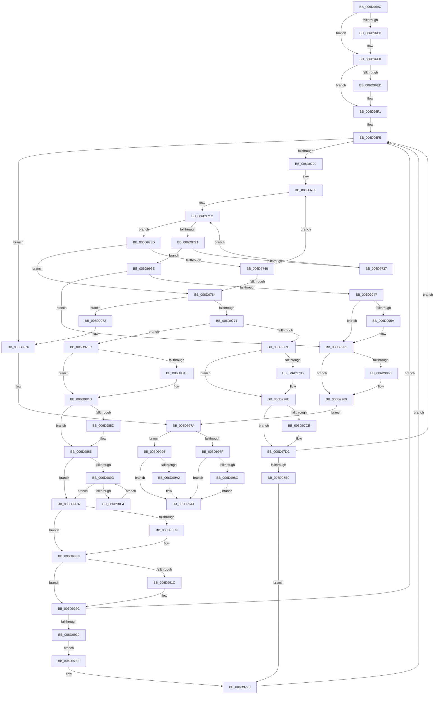

# sub_006D969C

- RVA: `0x006D969C`–`0x006D99BF` (길이 `803` bytes)
- VA: `0x00000001406D969C`
- 실행 섹션: `.text`
- PDB 이름 있음: `아니요`; PDB Function 태그: `아니요`
- unwind 정보 RVA: `0x000653F4`
- 디코드: `218`개 명령, `803/803` bytes 표시
- 미해석 바이트: `0` (있으면 어셈블리에 `.byte`로 보존)

> 이 문서는 커널 이미지의 기계어와 PDB 기호를 분석해 생성했습니다. 4번과 5번은 함수 원형과 자료형을 바이너리 사용 방식에서 추정한 C 해석이며 원본 소스 복구 결과는 아닙니다.

## 1. Dependencies

- 직접 호출 지점: **25**; 고유 호출 대상: **12**
- 직접 호출자로 확인된 함수: **0**
- RIP 상대 이미지 참조: **0**

### Outgoing calls
- `0x006D96C4` → [KeAbPreAcquire](../21/KeAbPreAcquire_function_00210230.md) (function, `0x00210230`)
- `0x006D96E3` → [ExfAcquirePushLockSharedEx](../21/ExfAcquirePushLockSharedEx_function_0021044C.md) (function, `0x0021044C`)
- `0x006D9726` → [ExpInterlockedPopEntrySList](../6B/ExpInterlockedPopEntrySList_function_006BA570.md) (function, `0x006BA570`)
- `0x006D974D` → [MmGetNextNode](../43/MmGetNextNode_function_00436620.md) (function, `0x00436620`)
- `0x006D9789` → [ExfReleasePushLockShared](../26/ExfReleasePushLockShared_function_00263440.md) (function, `0x00263440`)
- `0x006D9791` → [KeAbPostRelease](../2E/KeAbPostRelease_function_002E1600.md) (function, `0x002E1600`)
- `0x006D9796` → [KeLeaveCriticalRegion](../25/KeLeaveCriticalRegion_function_0025D8B0.md) (function, `0x0025D8B0`)
- `0x006D97BE` → [KeAbPreAcquire](../21/KeAbPreAcquire_function_00210230.md) (function, `0x00210230`)
- `0x006D97D7` → [ExfAcquirePushLockExclusiveEx](../20/ExfAcquirePushLockExclusiveEx_function_0020FC90.md) (function, `0x0020FC90`)
- `0x006D9835` → [KeAbPreAcquire](../21/KeAbPreAcquire_function_00210230.md) (function, `0x00210230`)
- `0x006D9848` → [KeAbPreWait](../20/KeAbPreWait_function_0020E560.md) (function, `0x0020E560`)
- `0x006D9860` → [ExfTryToWakePushLock](../26/ExfTryToWakePushLock_function_00265DD0.md) (function, `0x00265DD0`)
- `0x006D9868` → [KeAbPostRelease](../2E/KeAbPostRelease_function_002E1600.md) (function, `0x002E1600`)
- `0x006D986D` → [KeLeaveCriticalRegion](../25/KeLeaveCriticalRegion_function_0025D8B0.md) (function, `0x0025D8B0`)
- `0x006D9894` → [KeWaitForSingleObject](../20/KeWaitForSingleObject_function_0020E6B0.md) (function, `0x0020E6B0`)
- `0x006D98BB` → [KeWaitForSingleObject](../20/KeWaitForSingleObject_function_0020E6B0.md) (function, `0x0020E6B0`)
- `0x006D98D8` → [KeAbPreAcquire](../21/KeAbPreAcquire_function_00210230.md) (function, `0x00210230`)
- `0x006D98E3` → [KeAbPostReleaseEx](../26/KeAbPostReleaseEx_function_00262210.md) (function, `0x00262210`)
- `0x006D9908` → [KeAbPreAcquire](../21/KeAbPreAcquire_function_00210230.md) (function, `0x00210230`)
- `0x006D9927` → [ExfAcquirePushLockSharedEx](../21/ExfAcquirePushLockSharedEx_function_0021044C.md) (function, `0x0021044C`)
- `0x006D9950` → [KeAbPreAcquire](../21/KeAbPreAcquire_function_00210230.md) (function, `0x00210230`)
- `0x006D998F` → [ExfTryToWakePushLock](../26/ExfTryToWakePushLock_function_00265DD0.md) (function, `0x00265DD0`)
- `0x006D99A5` → [ExfReleasePushLockShared](../26/ExfReleasePushLockShared_function_00263440.md) (function, `0x00263440`)
- `0x006D99AD` → [KeAbPostRelease](../2E/KeAbPostRelease_function_002E1600.md) (function, `0x002E1600`)
- `0x006D99B2` → [KeLeaveCriticalRegion](../25/KeLeaveCriticalRegion_function_0025D8B0.md) (function, `0x0025D8B0`)

### Direct callers
- 이 함수 시작 RVA로 연결되는 직접 call은 확인되지 않았습니다. 간접 호출은 완전히 역산할 수 없습니다.

### Static image references
- 디코드된 RIP-relative 메모리 참조가 없습니다.

## 2. Other-region calls and transfers

- 다른 실행 섹션으로 향하는 call: **0**
- call이 아닌 외부 분기/꼬리 이동: **1**
  - `0x006D99BA` → [SmHwAcceleratorPartitionMgrGetDescriptor + 0x68](../26/SmHwAcceleratorPartitionMgrGetDescriptor_function_0026A190.md) (`tail-transfer`)

## 3. Assembly (complete function range)

```asm
006D969C  65 48 8B 04 25 88 01 00 00      mov rax, qword ptr gs:[0x188]
006D96A5  49 8D 7E 18                     lea rdi, [r14 + 0x18]
006D96A9  48 83 CB FF                     or rbx, 0xffffffffffffffff
006D96AD  44 89 6D 7F                     mov dword ptr [rbp + 0x7f], r13d
006D96B1  45 33 C0                        xor r8d, r8d
006D96B4  33 D2                           xor edx, edx
006D96B6  48 8B CF                        mov rcx, rdi
006D96B9  45 8B E5                        mov r12d, r13d
006D96BC  66 01 98 E4 01 00 00            add word ptr [rax + 0x1e4], bx
006D96C3  90                              nop
006D96C4  E8 67 6B B3 FF                  call 0x140210230
006D96C9  48 8B F0                        mov rsi, rax
006D96CC  8D 4B 12                        lea ecx, [rbx + 0x12]
006D96CF  33 C0                           xor eax, eax
006D96D1  F0 48 0F B1 0F                  lock cmpxchg qword ptr [rdi], rcx
006D96D6  74 10                           je 0x1406d96e8
006D96D8  4C 8B CF                        mov r9, rdi
006D96DB  4C 8B C6                        mov r8, rsi
006D96DE  33 D2                           xor edx, edx
006D96E0  48 8B CF                        mov rcx, rdi
006D96E3  E8 64 6D B3 FF                  call 0x14021044c
006D96E8  48 85 F6                        test rsi, rsi
006D96EB  74 04                           je 0x1406d96f1
006D96ED  C6 46 0A 01                     mov byte ptr [rsi + 0xa], 1
006D96F1  4C 89 6D DF                     mov qword ptr [rbp - 0x21], r13
006D96F5  47 39 6C BE 30                  cmp dword ptr [r14 + r15*4 + 0x30], r13d
006D96FA  0F 84 76 02 00 00               je 0x1406d9976
006D9700  8B 45 77                        mov eax, dword ptr [rbp + 0x77]
006D9703  33 F6                           xor esi, esi
006D9705  89 75 C7                        mov dword ptr [rbp - 0x39], esi
006D9708  41 BD 01 00 00 00               mov r13d, 1
006D970E  44 8B F0                        mov r14d, eax
006D9711  49 C1 E6 04                     shl r14, 4
006D9715  4C 03 75 E7                     add r14, qword ptr [rbp - 0x19]
006D9719  4D 8B 26                        mov r12, qword ptr [r14]
006D971C  4D 3B E6                        cmp r12, r14
006D971F  74 1C                           je 0x1406d973d
006D9721  49 8D 4C 24 10                  lea rcx, [r12 + 0x10]
006D9726  E8 45 0E FE FF                  call 0x1406ba570
006D972B  48 8B F0                        mov rsi, rax
006D972E  48 85 C0                        test rax, rax
006D9731  0F 85 07 02 00 00               jne 0x1406d993e
006D9737  4D 8B 24 24                     mov r12, qword ptr [r12]
006D973B  EB DF                           jmp 0x1406d971c
006D973D  8B 75 6F                        mov esi, dword ptr [rbp + 0x6f]
006D9740  40 F6 C6 04                     test sil, 4
006D9744  75 1E                           jne 0x1406d9764
006D9746  8B 4D 77                        mov ecx, dword ptr [rbp + 0x77]
006D9749  48 8D 55 C7                     lea rdx, [rbp - 0x39]
006D974D  E8 CE CE D5 FF                  call 0x140436620
006D9752  4D 39 36                        cmp qword ptr [r14], r14
006D9755  41 BE 00 00 00 00               mov r14d, 0
006D975B  45 0F 45 EE                     cmovne r13d, r14d
006D975F  83 F8 FF                        cmp eax, -1
006D9762  75 AA                           jne 0x1406d970e
006D9764  45 33 ED                        xor r13d, r13d
006D9767  40 F6 C6 02                     test sil, 2
006D976B  0F 85 01 02 00 00               jne 0x1406d9972
006D9771  44 39 6D 7F                     cmp dword ptr [rbp + 0x7f], r13d
006D9775  0F 85 81 00 00 00               jne 0x1406d97fc
006D977B  41 8D 45 11                     lea eax, [r13 + 0x11]
006D977F  F0 4C 0F B1 2F                  lock cmpxchg qword ptr [rdi], r13
006D9784  74 08                           je 0x1406d978e
006D9786  48 8B CF                        mov rcx, rdi
006D9789  E8 B2 9C B8 FF                  call 0x140263440
006D978E  48 8B CF                        mov rcx, rdi
006D9791  E8 6A 7E C0 FF                  call 0x1402e1600
006D9796  E8 15 41 B8 FF                  call 0x14025d8b0
006D979B  65 48 8B 04 25 88 01 00 00      mov rax, qword ptr gs:[0x188]
006D97A4  41 BC 01 00 00 00               mov r12d, 1
006D97AA  45 33 C0                        xor r8d, r8d
006D97AD  44 89 65 7F                     mov dword ptr [rbp + 0x7f], r12d
006D97B1  33 D2                           xor edx, edx
006D97B3  48 8B CF                        mov rcx, rdi
006D97B6  66 01 98 E4 01 00 00            add word ptr [rax + 0x1e4], bx
006D97BD  90                              nop
006D97BE  E8 6D 6A B3 FF                  call 0x140210230
006D97C3  F0 48 0F BA 2F 00               lock bts qword ptr [rdi], 0
006D97C9  48 8B F0                        mov rsi, rax
006D97CC  73 0E                           jae 0x1406d97dc
006D97CE  4C 8B C7                        mov r8, rdi
006D97D1  48 8B D0                        mov rdx, rax
006D97D4  48 8B CF                        mov rcx, rdi
006D97D7  E8 B4 64 B3 FF                  call 0x14020fc90
006D97DC  4C 8B 75 67                     mov r14, qword ptr [rbp + 0x67]
006D97E0  48 85 F6                        test rsi, rsi
006D97E3  0F 84 0C FF FF FF               je 0x1406d96f5
006D97E9  44 88 66 0A                     mov byte ptr [rsi + 0xa], r12b
006D97ED  EB 04                           jmp 0x1406d97f3
006D97EF  C6 46 0A 01                     mov byte ptr [rsi + 0xa], 1
006D97F3  4C 8B 75 67                     mov r14, qword ptr [rbp + 0x67]
006D97F7  E9 F9 FE FF FF                  jmp 0x1406d96f5
006D97FC  66 44 89 6D FF                  mov word ptr [rbp - 1], r13w
006D9801  48 8D 45 07                     lea rax, [rbp + 7]
006D9805  48 89 45 0F                     mov qword ptr [rbp + 0xf], rax
006D9809  45 33 C0                        xor r8d, r8d
006D980C  44 89 6D 03                     mov dword ptr [rbp + 3], r13d
006D9810  48 8D 45 07                     lea rax, [rbp + 7]
006D9814  4C 8B 6D D7                     mov r13, qword ptr [rbp - 0x29]
006D9818  33 D2                           xor edx, edx
006D981A  48 89 45 07                     mov qword ptr [rbp + 7], rax
006D981E  49 8B CD                        mov rcx, r13
006D9821  C6 45 01 06                     mov byte ptr [rbp + 1], 6
006D9825  49 8B 45 00                     mov rax, qword ptr [r13]
006D9829  48 89 45 F7                     mov qword ptr [rbp - 9], rax
006D982D  48 8D 45 F7                     lea rax, [rbp - 9]
006D9831  49 89 45 00                     mov qword ptr [r13], rax
006D9835  E8 F6 69 B3 FF                  call 0x140210230
006D983A  45 33 E4                        xor r12d, r12d
006D983D  48 8B F0                        mov rsi, rax
006D9840  48 85 C0                        test rax, rax
006D9843  74 08                           je 0x1406d984d
006D9845  48 8B C8                        mov rcx, rax
006D9848  E8 13 4D B3 FF                  call 0x14020e560
006D984D  48 8B CB                        mov rcx, rbx
006D9850  F0 48 0F C1 0F                  lock xadd qword ptr [rdi], rcx
006D9855  80 E1 06                        and cl, 6
006D9858  80 F9 02                        cmp cl, 2
006D985B  75 08                           jne 0x1406d9865
006D985D  48 8B CF                        mov rcx, rdi
006D9860  E8 6B C5 B8 FF                  call 0x140265dd0
006D9865  48 8B CF                        mov rcx, rdi
006D9868  E8 93 7D C0 FF                  call 0x1402e1600
006D986D  E8 3E 40 B8 FF                  call 0x14025d8b0
006D9872  45 33 C9                        xor r9d, r9d
006D9875  48 C7 45 CF 00 BA 3C DC         mov qword ptr [rbp - 0x31], 0xffffffffdc3cba00
006D987D  48 8D 45 CF                     lea rax, [rbp - 0x31]
006D9881  45 33 C0                        xor r8d, r8d
006D9884  48 8D 4D FF                     lea rcx, [rbp - 1]
006D9888  48 89 44 24 20                  mov qword ptr [rsp + 0x20], rax
006D988D  45 8B F4                        mov r14d, r12d
006D9890  41 8D 51 1A                     lea edx, [r9 + 0x1a]
006D9894  E8 17 4E B3 FF                  call 0x14020e6b0
006D9899  85 C0                           test eax, eax
006D989B  74 2D                           je 0x1406d98ca
006D989D  45 33 C9                        xor r9d, r9d
006D98A0  41 8D 46 01                     lea eax, [r14 + 1]
006D98A4  89 45 7F                        mov dword ptr [rbp + 0x7f], eax
006D98A7  48 8D 4D FF                     lea rcx, [rbp - 1]
006D98AB  48 8D 45 CF                     lea rax, [rbp - 0x31]
006D98AF  45 33 C0                        xor r8d, r8d
006D98B2  48 89 44 24 20                  mov qword ptr [rsp + 0x20], rax
006D98B7  41 8D 51 1A                     lea edx, [r9 + 0x1a]
006D98BB  E8 F0 4D B3 FF                  call 0x14020e6b0
006D98C0  85 C0                           test eax, eax
006D98C2  74 06                           je 0x1406d98ca
006D98C4  44 8B 75 7F                     mov r14d, dword ptr [rbp + 0x7f]
006D98C8  EB D3                           jmp 0x1406d989d
006D98CA  48 85 F6                        test rsi, rsi
006D98CD  74 19                           je 0x1406d98e8
006D98CF  45 33 C0                        xor r8d, r8d
006D98D2  48 8B D6                        mov rdx, rsi
006D98D5  49 8B CD                        mov rcx, r13
006D98D8  E8 53 69 B3 FF                  call 0x140210230
006D98DD  48 8B D0                        mov rdx, rax
006D98E0  49 8B CD                        mov rcx, r13
006D98E3  E8 28 89 B8 FF                  call 0x140262210
006D98E8  65 48 8B 04 25 88 01 00 00      mov rax, qword ptr gs:[0x188]
006D98F1  45 33 ED                        xor r13d, r13d
006D98F4  45 33 C0                        xor r8d, r8d
006D98F7  44 89 6D 7F                     mov dword ptr [rbp + 0x7f], r13d
006D98FB  33 D2                           xor edx, edx
006D98FD  48 8B CF                        mov rcx, rdi
006D9900  66 01 98 E4 01 00 00            add word ptr [rax + 0x1e4], bx
006D9907  90                              nop
006D9908  E8 23 69 B3 FF                  call 0x140210230
006D990D  48 8B F0                        mov rsi, rax
006D9910  33 C0                           xor eax, eax
006D9912  8D 48 11                        lea ecx, [rax + 0x11]
006D9915  F0 48 0F B1 0F                  lock cmpxchg qword ptr [rdi], rcx
006D991A  74 10                           je 0x1406d992c
006D991C  4C 8B CF                        mov r9, rdi
006D991F  4C 8B C6                        mov r8, rsi
006D9922  33 D2                           xor edx, edx
006D9924  48 8B CF                        mov rcx, rdi
006D9927  E8 20 6B B3 FF                  call 0x14021044c
006D992C  4C 8B 75 67                     mov r14, qword ptr [rbp + 0x67]
006D9930  48 85 F6                        test rsi, rsi
006D9933  0F 84 BC FD FF FF               je 0x1406d96f5
006D9939  E9 B1 FE FF FF                  jmp 0x1406d97ef
006D993E  F6 45 6F 02                     test byte ptr [rbp + 0x6f], 2
006D9942  4C 8B F6                        mov r14, rsi
006D9945  75 1A                           jne 0x1406d9961
006D9947  48 8B 4D D7                     mov rcx, qword ptr [rbp - 0x29]
006D994B  45 33 C0                        xor r8d, r8d
006D994E  33 D2                           xor edx, edx
006D9950  E8 DB 68 B3 FF                  call 0x140210230
006D9955  48 85 C0                        test rax, rax
006D9958  74 07                           je 0x1406d9961
006D995A  C6 40 0A 01                     mov byte ptr [rax + 0xa], 1
006D995E  83 0E 01                        or dword ptr [rsi], 1
006D9961  45 85 ED                        test r13d, r13d
006D9964  74 03                           je 0x1406d9969
006D9966  83 0E 02                        or dword ptr [rsi], 2
006D9969  44 8B 65 7F                     mov r12d, dword ptr [rbp + 0x7f]
006D996D  45 33 ED                        xor r13d, r13d
006D9970  EB 08                           jmp 0x1406d997a
006D9972  44 8B 65 7F                     mov r12d, dword ptr [rbp + 0x7f]
006D9976  4C 8B 75 DF                     mov r14, qword ptr [rbp - 0x21]
006D997A  45 85 E4                        test r12d, r12d
006D997D  74 17                           je 0x1406d9996
006D997F  F0 48 0F C1 1F                  lock xadd qword ptr [rdi], rbx
006D9984  80 E3 06                        and bl, 6
006D9987  80 FB 02                        cmp bl, 2
006D998A  75 1E                           jne 0x1406d99aa
006D998C  48 8B CF                        mov rcx, rdi
006D998F  E8 3C C4 B8 FF                  call 0x140265dd0
006D9994  EB 14                           jmp 0x1406d99aa
006D9996  B8 11 00 00 00                  mov eax, 0x11
006D999B  F0 4C 0F B1 2F                  lock cmpxchg qword ptr [rdi], r13
006D99A0  74 08                           je 0x1406d99aa
006D99A2  48 8B CF                        mov rcx, rdi
006D99A5  E8 96 9A B8 FF                  call 0x140263440
006D99AA  48 8B CF                        mov rcx, rdi
006D99AD  E8 4E 7C C0 FF                  call 0x1402e1600
006D99B2  E8 F9 3E B8 FF                  call 0x14025d8b0
006D99B7  49 8B C6                        mov rax, r14
006D99BA  E9 39 08 B9 FF                  jmp 0x14026a1f8
```

## 4. C-style interpretation (structured pseudocode)

```c
__int64 __fastcall sub_006D969C(__int64 a1, int a2, int a3)
{
    __int64 result;
    __int64 v_r12;
    __int64 v_r13;
    __int64 v_r14;
    __int64 v_rbx;
    __int64 v_rsi;
    unsigned __int64 v_stack_p20;

    v_rbx = (v_rbx) | (-1);
    *(unsigned int *)(v_rbp + 127) = (unsigned int)(v_r13);
    a3 = 0;
    a2 = 0;
    result = KeAbPreAcquire(v_r14 + 24, a2, a3, a4);
    result = 0;
    if (!(condition_is_equal)) {
        a4 = v_r14 + 24;
        a3 = 0;
        a2 = 0;
        a1 = v_r14 + 24;
        result = ExfAcquirePushLockSharedEx(a1, a2, a3, a4);
    }
    if (result != 0) {
        *(unsigned __int8 *)(result + 10) = 1;
    }
    *(unsigned __int64 *)(v_rbp - 33) = v_r13;
loc_006D96F5:
    if ((*(unsigned int *)(v_r14 + v_r15 * 4 + 48)) == ((unsigned int)(v_r13))) goto loc_006D9976;
    v_rsi = 0;
    *(unsigned int *)(v_rbp - 57) = 0;
loc_006D970E:
    v_r14 = ((unsigned int)((unsigned int)((unsigned int)(*(unsigned int *)(v_rbp + 119))))) << (4);
    v_r14 = (v_r14) + (*(unsigned __int64 *)(v_rbp - 25));
loc_006D971C:
    if ((*(unsigned __int64 *)(v_r14)) == v_r14) goto loc_006D973D;
    result = ExpInterlockedPopEntrySList(*(unsigned __int64 *)(v_r14) + 16, a2, a3, a4);
    if (result != 0) goto loc_006D993E;
    goto loc_006D971C;
loc_006D973D:
    if ((((unsigned __int8)((unsigned int)(*(unsigned int *)(v_rbp + 111)))) & (4)) != 0) goto loc_006D9764;
    result = MmGetNextNode((unsigned int)(*(unsigned int *)(v_rbp + 119)), v_rbp - 57, a3, a4);
    v_r13 = 1;
    if ((*(unsigned __int64 *)(v_r14)) != v_r14) { v_r13 = 0; }
    if (((unsigned int)(result)) != -1) goto loc_006D970E;
loc_006D9764:
    v_r13 = 0;
    if ((((unsigned __int8)((unsigned int)(*(unsigned int *)(v_rbp + 111)))) & (2)) != 0) goto loc_006D9972;
    if ((*(unsigned int *)(v_rbp + 127)) != 0) goto loc_006D97FC;
    result = v_r13 + 17;
    if ((*(unsigned int *)(v_rbp + 127)) != 0) {
        a1 = v_r14 + 24;
        result = ExfReleasePushLockShared(a1, v_rbp - 57, a3, a4);
    }
    result = KeAbPostRelease(v_r14 + 24, v_rbp - 57, a3, a4);
    result = KeLeaveCriticalRegion(v_r14 + 24, v_rbp - 57, a3, a4);
    a3 = 0;
    *(unsigned int *)(v_rbp + 127) = 1;
    a2 = 0;
    result = KeAbPreAcquire(v_r14 + 24, a2, a3, a4);
    if (!(condition_is_above_or_equal)) {
        a3 = v_r14 + 24;
        a2 = result;
        a1 = v_r14 + 24;
        result = ExfAcquirePushLockExclusiveEx(a1, a2, a3, a4);
    }
    if (result == 0) goto loc_006D96F5;
    *(unsigned __int8 *)(result + 10) = 1;
    goto loc_006D97F3;
loc_006D97EF:
    *(unsigned __int8 *)(result + 10) = 1;
loc_006D97F3:
    goto loc_006D96F5;
loc_006D97FC:
    *(unsigned __int16 *)(v_rbp - 1) = 0;
    *(unsigned __int64 *)(v_rbp + 15) = v_rbp + 7;
    a3 = 0;
    *(unsigned int *)(v_rbp + 3) = 0;
    a2 = 0;
    *(unsigned __int64 *)(v_rbp + 7) = v_rbp + 7;
    *(unsigned __int8 *)(v_rbp + 1) = 6;
    *(unsigned __int64 *)(v_rbp - 9) = *(unsigned __int64 *)(*(unsigned __int64 *)(v_rbp - 41));
    *(unsigned __int64 *)(*(unsigned __int64 *)(v_rbp - 41)) = v_rbp - 9;
    result = KeAbPreAcquire(*(unsigned __int64 *)(v_rbp - 41), a2, a3, a4);
    v_r12 = 0;
    if (result != 0) {
        a1 = result;
        result = KeAbPreWait(a1, a2, a3, a4);
    }
    a1 = (unsigned __int8)((v_rbx) & (6));
    if (((unsigned __int8)(a1)) == 2) {
        a1 = v_r14 + 24;
        result = ExfTryToWakePushLock(a1, a2, a3, a4);
    }
    result = KeAbPostRelease(v_r14 + 24, a2, a3, a4);
    result = KeLeaveCriticalRegion(v_r14 + 24, a2, a3, a4);
    a4 = 0;
    *(unsigned __int64 *)(v_rbp - 49) = 0xFFFFFFFFDC3CBA00ULL;
    a3 = 0;
    v_stack_p20 = v_rbp - 49;
    result = KeWaitForSingleObject(v_rbp - 1, a4 + 26, a3, a4);
    if ((unsigned int)(result) == 0) goto loc_006D98CA;
loc_006D989D:
    a4 = 0;
    *(unsigned int *)(v_rbp + 127) = (unsigned int)(0 + 1);
    a3 = 0;
    v_stack_p20 = v_rbp - 49;
    result = KeWaitForSingleObject(v_rbp - 1, a4 + 26, a3, a4);
    if ((unsigned int)(result) == 0) goto loc_006D98CA;
    goto loc_006D989D;
loc_006D98CA:
    if (result != 0) {
        a3 = 0;
        a2 = result;
        a1 = *(unsigned __int64 *)(v_rbp - 41);
        result = KeAbPreAcquire(a1, a2, a3, a4);
        a2 = result;
        a1 = *(unsigned __int64 *)(v_rbp - 41);
        result = KeAbPostReleaseEx(a1, a2, a3, a4);
    }
    v_r13 = 0;
    a3 = 0;
    *(unsigned int *)(v_rbp + 127) = 0;
    a2 = 0;
    result = KeAbPreAcquire(v_r14 + 24, a2, a3, a4);
    result = 0;
    if (!(condition_is_equal)) {
        a4 = v_r14 + 24;
        a3 = 0;
        a2 = 0;
        a1 = v_r14 + 24;
        result = ExfAcquirePushLockSharedEx(a1, a2, a3, a4);
    }
    if (result == 0) goto loc_006D96F5;
    goto loc_006D97EF;
loc_006D993E:
    if (((*(unsigned __int8 *)(v_rbp + 111)) & (2)) != 0) goto loc_006D9961;
    a3 = 0;
    a2 = 0;
    result = KeAbPreAcquire(*(unsigned __int64 *)(v_rbp - 41), a2, a3, a4);
    if (result != 0) {
        *(unsigned __int8 *)(result + 10) = 1;
    }
    if (0 != 0) {
    }
    v_r13 = 0;
    goto loc_006D997A;
loc_006D9972:
loc_006D9976:
loc_006D997A:
    if ((unsigned int)((unsigned int)(*(unsigned int *)(v_rbp + 127))) == 0) goto loc_006D9996;
    v_rbx = (unsigned __int8)((v_rbx) & (6));
    if (((unsigned __int8)(v_rbx)) != 2) goto loc_006D99AA;
    result = ExfTryToWakePushLock(v_r14 + 24, a2, a3, a4);
    goto loc_006D99AA;
loc_006D9996:
    result = 17;
    if (((unsigned __int8)(v_rbx)) != 2) {
        a1 = v_r14 + 24;
        result = ExfReleasePushLockShared(a1, a2, a3, a4);
    }
    result = KeAbPostRelease(v_r14 + 24, a2, a3, a4);
    result = KeLeaveCriticalRegion(v_r14 + 24, a2, a3, a4);
}
```

## 5. (Beta) C Style

```c
int64_t sub_006D969C(int64_t Arg1, int32_t Arg2, int32_t Arg3)
{
    int64_t result;
    int64_t local_r12;
    int64_t local_r13;
    int64_t local_r14;
    int64_t local_rbx;
    int64_t local_rsi;
    uint64_t v_stack_p20;

    local_rbx = (local_rbx) | (-1);
    *(uint32_t *)(local_rbp + 0x7F) = (uint32_t)(local_r13);
    Arg3 = 0;
    Arg2 = 0;
    result = KeAbPreAcquire(local_r14 + 24, Arg2, Arg3, a4);
    result = 0;
    if (!(condition_is_equal)) {
        a4 = local_r14 + 24;
        Arg3 = 0;
        Arg2 = 0;
        Arg1 = local_r14 + 24;
        result = ExfAcquirePushLockSharedEx(Arg1, Arg2, Arg3, a4);
    }
    if (result != 0) {
        *(uint8_t *)(result + 0xA) = 1;
    }
    *(uint64_t *)(local_rbp - 0x21) = local_r13;
loc_006D96F5:
    if ((*(uint32_t *)(local_r14 + local_r15 * 4 + 0x30)) == ((uint32_t)(local_r13))) goto loc_006D9976;
    local_rsi = 0;
    *(uint32_t *)(local_rbp - 0x39) = 0;
loc_006D970E:
    local_r14 = ((uint32_t)((uint32_t)((uint32_t)(*(uint32_t *)(local_rbp + 0x77))))) << (4);
    local_r14 = (local_r14) + (*(uint64_t *)(local_rbp - 0x19));
loc_006D971C:
    if ((*(uint64_t *)(local_r14)) == local_r14) goto loc_006D973D;
    result = ExpInterlockedPopEntrySList(*(uint64_t *)(local_r14) + 16, Arg2, Arg3, a4);
    if (result != 0) goto loc_006D993E;
    goto loc_006D971C;
loc_006D973D:
    if ((((uint8_t)((uint32_t)(*(uint32_t *)(local_rbp + 0x6F)))) & (4)) != 0) goto loc_006D9764;
    result = MmGetNextNode((uint32_t)(*(uint32_t *)(local_rbp + 0x77)), local_rbp - 57, Arg3, a4);
    local_r13 = 1;
    if ((*(uint64_t *)(local_r14)) != local_r14) { local_r13 = 0; }
    if (((uint32_t)(result)) != -1) goto loc_006D970E;
loc_006D9764:
    local_r13 = 0;
    if ((((uint8_t)((uint32_t)(*(uint32_t *)(local_rbp + 0x6F)))) & (2)) != 0) goto loc_006D9972;
    if ((*(uint32_t *)(local_rbp + 0x7F)) != 0) goto loc_006D97FC;
    result = local_r13 + 17;
    if ((*(uint32_t *)(local_rbp + 0x7F)) != 0) {
        Arg1 = local_r14 + 24;
        result = ExfReleasePushLockShared(Arg1, local_rbp - 57, Arg3, a4);
    }
    result = KeAbPostRelease(local_r14 + 24, local_rbp - 57, Arg3, a4);
    result = KeLeaveCriticalRegion(local_r14 + 24, local_rbp - 57, Arg3, a4);
    Arg3 = 0;
    *(uint32_t *)(local_rbp + 0x7F) = 1;
    Arg2 = 0;
    result = KeAbPreAcquire(local_r14 + 24, Arg2, Arg3, a4);
    if (!(condition_is_above_or_equal)) {
        Arg3 = local_r14 + 24;
        Arg2 = result;
        Arg1 = local_r14 + 24;
        result = ExfAcquirePushLockExclusiveEx(Arg1, Arg2, Arg3, a4);
    }
    if (result == 0) goto loc_006D96F5;
    *(uint8_t *)(result + 0xA) = 1;
    goto loc_006D97F3;
loc_006D97EF:
    *(uint8_t *)(result + 0xA) = 1;
loc_006D97F3:
    goto loc_006D96F5;
loc_006D97FC:
    *(uint16_t *)(local_rbp - 0x1) = 0;
    *(uint64_t *)(local_rbp + 0xF) = local_rbp + 7;
    Arg3 = 0;
    *(uint32_t *)(local_rbp + 0x3) = 0;
    Arg2 = 0;
    *(uint64_t *)(local_rbp + 0x7) = local_rbp + 7;
    *(uint8_t *)(local_rbp + 0x1) = 6;
    *(uint64_t *)(local_rbp - 0x9) = *(uint64_t *)(*(uint64_t *)(local_rbp - 0x29));
    *(uint64_t *)(*(uint64_t *)(local_rbp - 0x29)) = local_rbp - 9;
    result = KeAbPreAcquire(*(uint64_t *)(local_rbp - 0x29), Arg2, Arg3, a4);
    local_r12 = 0;
    if (result != 0) {
        Arg1 = result;
        result = KeAbPreWait(Arg1, Arg2, Arg3, a4);
    }
    Arg1 = (uint8_t)((local_rbx) & (6));
    if (((uint8_t)(Arg1)) == 2) {
        Arg1 = local_r14 + 24;
        result = ExfTryToWakePushLock(Arg1, Arg2, Arg3, a4);
    }
    result = KeAbPostRelease(local_r14 + 24, Arg2, Arg3, a4);
    result = KeLeaveCriticalRegion(local_r14 + 24, Arg2, Arg3, a4);
    a4 = 0;
    *(uint64_t *)(local_rbp - 0x31) = 0xFFFFFFFFDC3CBA00ULL;
    Arg3 = 0;
    v_stack_p20 = local_rbp - 49;
    result = KeWaitForSingleObject(local_rbp - 1, a4 + 26, Arg3, a4);
    if ((uint32_t)(result) == 0) goto loc_006D98CA;
loc_006D989D:
    a4 = 0;
    *(uint32_t *)(local_rbp + 0x7F) = (uint32_t)(0 + 1);
    Arg3 = 0;
    v_stack_p20 = local_rbp - 49;
    result = KeWaitForSingleObject(local_rbp - 1, a4 + 26, Arg3, a4);
    if ((uint32_t)(result) == 0) goto loc_006D98CA;
    goto loc_006D989D;
loc_006D98CA:
    if (result != 0) {
        Arg3 = 0;
        Arg2 = result;
        Arg1 = *(uint64_t *)(local_rbp - 0x29);
        result = KeAbPreAcquire(Arg1, Arg2, Arg3, a4);
        Arg2 = result;
        Arg1 = *(uint64_t *)(local_rbp - 0x29);
        result = KeAbPostReleaseEx(Arg1, Arg2, Arg3, a4);
    }
    local_r13 = 0;
    Arg3 = 0;
    *(uint32_t *)(local_rbp + 0x7F) = 0;
    Arg2 = 0;
    result = KeAbPreAcquire(local_r14 + 24, Arg2, Arg3, a4);
    result = 0;
    if (!(condition_is_equal)) {
        a4 = local_r14 + 24;
        Arg3 = 0;
        Arg2 = 0;
        Arg1 = local_r14 + 24;
        result = ExfAcquirePushLockSharedEx(Arg1, Arg2, Arg3, a4);
    }
    if (result == 0) goto loc_006D96F5;
    goto loc_006D97EF;
loc_006D993E:
    if (((*(uint8_t *)(local_rbp + 0x6F)) & (2)) != 0) goto loc_006D9961;
    Arg3 = 0;
    Arg2 = 0;
    result = KeAbPreAcquire(*(uint64_t *)(local_rbp - 0x29), Arg2, Arg3, a4);
    if (result != 0) {
        *(uint8_t *)(result + 0xA) = 1;
    }
    if (0 != 0) {
    }
    local_r13 = 0;
    goto loc_006D997A;
loc_006D9972:
loc_006D9976:
loc_006D997A:
    if ((uint32_t)((uint32_t)(*(uint32_t *)(local_rbp + 0x7F))) == 0) goto loc_006D9996;
    local_rbx = (uint8_t)((local_rbx) & (6));
    if (((uint8_t)(local_rbx)) != 2) goto loc_006D99AA;
    result = ExfTryToWakePushLock(local_r14 + 24, Arg2, Arg3, a4);
    goto loc_006D99AA;
loc_006D9996:
    result = 17;
    if (((uint8_t)(local_rbx)) != 2) {
        Arg1 = local_r14 + 24;
        result = ExfReleasePushLockShared(Arg1, Arg2, Arg3, a4);
    }
    result = KeAbPostRelease(local_r14 + 24, Arg2, Arg3, a4);
    result = KeLeaveCriticalRegion(local_r14 + 24, Arg2, Arg3, a4);
}
```

## 6. Execution-region graph

[열기: 2D/3D 그래프와 함수 탐색 컨트롤 패널](../../../control-panel.html?section=text&rva=0x006D969C&view=graph)

- 2D 그래프는 위에서 아래로 흐르고, 3D 그래프는 빈 공간을 드래그해 회전합니다. Shift+드래그는 이동, 휠은 확대·축소, 함수 노드 선택은 대상 보고서 이동입니다.

### Static fallback


