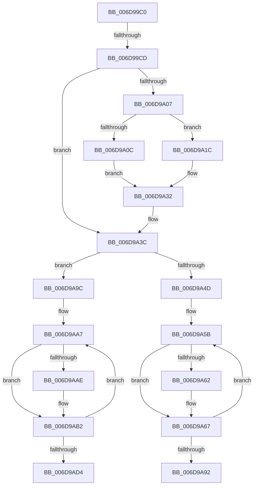

# sub_006D99C0

- RVA: `0x006D99C0`–`0x006D9AD9` (길이 `281` bytes)
- VA: `0x00000001406D99C0`
- 실행 섹션: `.text`
- PDB 이름 있음: `아니요`; PDB Function 태그: `아니요`
- unwind 정보 RVA: `0x00065528`
- 디코드: `81`개 명령, `281/281` bytes 표시
- 미해석 바이트: `0` (있으면 어셈블리에 `.byte`로 보존)

> 이 문서는 커널 이미지의 기계어와 PDB 기호를 분석해 생성했습니다. 4번과 5번은 함수 원형과 자료형을 바이너리 사용 방식에서 추정한 C 해석이며 원본 소스 복구 결과는 아닙니다.

## 1. Dependencies

- 직접 호출 지점: **4**; 고유 호출 대상: **2**
- 직접 호출자로 확인된 함수: **0**
- RIP 상대 이미지 참조: **0**

### Outgoing calls
- `0x006D9A15` → [memcpy](../6C/memcpy_function_006C6840.md) (function, `0x006C6840`)
- `0x006D9A25` → [wyhash](../26/wyhash_function_00269FE4.md) (function, `0x00269FE4`)
- `0x006D9A73` → [memcpy](../6C/memcpy_function_006C6840.md) (function, `0x006C6840`)
- `0x006D9ABA` → [wyhash](../26/wyhash_function_00269FE4.md) (function, `0x00269FE4`)

### Direct callers
- 이 함수 시작 RVA로 연결되는 직접 call은 확인되지 않았습니다. 간접 호출은 완전히 역산할 수 없습니다.

### Static image references
- 디코드된 RIP-relative 메모리 참조가 없습니다.

## 2. Other-region calls and transfers

- 다른 실행 섹션으로 향하는 call: **0**
- call이 아닌 외부 분기/꼬리 이동: **3**
  - `0x006D99C7` → [SmStoreCopyHashCompressedBuffer + 0x38](../26/SmStoreCopyHashCompressedBuffer_function_0026B918.md) (`tail-transfer`)
  - `0x006D9A97` → [SmStoreCopyHashCompressedBuffer + 0x4E](../26/SmStoreCopyHashCompressedBuffer_function_0026B918.md) (`tail-transfer`)
  - `0x006D9AD4` → [SmStoreCopyHashCompressedBuffer + 0x4E](../26/SmStoreCopyHashCompressedBuffer_function_0026B918.md) (`tail-transfer`)

## 3. Assembly (complete function range)

```asm
006D99C0  B9 00 10 00 00                  mov ecx, 0x1000
006D99C5  3B F1                           cmp esi, ecx
006D99C7  0F 84 83 1F B9 FF               je 0x14026b950
006D99CD  41 83 F9 02                     cmp r9d, 2
006D99D1  44 8B EF                        mov r13d, edi
006D99D4  8B C5                           mov eax, ebp
006D99D6  41 0F 94 C5                     sete r13b
006D99DA  25 FF 0F 00 00                  and eax, 0xfff
006D99DF  2B C8                           sub ecx, eax
006D99E1  41 FF C5                        inc r13d
006D99E4  33 D2                           xor edx, edx
006D99E6  46 8D 24 6D FE FF FF FF         lea r12d, [r13*2 - 2]
006D99EE  41 2B CC                        sub ecx, r12d
006D99F1  45 8B FC                        mov r15d, r12d
006D99F4  8B C1                           mov eax, ecx
006D99F6  41 F7 F5                        div r13d
006D99F9  8B C8                           mov ecx, eax
006D99FB  89 8C 24 88 00 00 00            mov dword ptr [rsp + 0x88], ecx
006D9A02  45 85 E4                        test r12d, r12d
006D9A05  74 35                           je 0x1406d9a3c
006D9A07  48 85 DB                        test rbx, rbx
006D9A0A  74 10                           je 0x1406d9a1c
006D9A0C  45 8B C7                        mov r8d, r15d
006D9A0F  48 8B D5                        mov rdx, rbp
006D9A12  48 8B CB                        mov rcx, rbx
006D9A15  E8 26 CE FE FF                  call 0x1406c6840
006D9A1A  EB 16                           jmp 0x1406d9a32
006D9A1C  45 33 C0                        xor r8d, r8d
006D9A1F  49 8B D7                        mov rdx, r15
006D9A22  48 8B CD                        mov rcx, rbp
006D9A25  E8 BA 05 B9 FF                  call 0x140269fe4
006D9A2A  4C 8B F0                        mov r14, rax
006D9A2D  48 89 44 24 20                  mov qword ptr [rsp + 0x20], rax
006D9A32  8B 8C 24 88 00 00 00            mov ecx, dword ptr [rsp + 0x88]
006D9A39  41 2B F4                        sub esi, r12d
006D9A3C  4C 03 FD                        add r15, rbp
006D9A3F  49 8D 04 1C                     lea rax, [r12 + rbx]
006D9A43  48 89 44 24 28                  mov qword ptr [rsp + 0x28], rax
006D9A48  48 85 DB                        test rbx, rbx
006D9A4B  74 4F                           je 0x1406d9a9c
006D9A4D  4C 8B 74 24 28                  mov r14, qword ptr [rsp + 0x28]
006D9A52  41 8D 45 FF                     lea eax, [r13 - 1]
006D9A56  48 89 4C 24 30                  mov qword ptr [rsp + 0x30], rcx
006D9A5B  44 8B E6                        mov r12d, esi
006D9A5E  3B F8                           cmp edi, eax
006D9A60  74 05                           je 0x1406d9a67
006D9A62  44 0F B7 65 00                  movzx r12d, word ptr [rbp]
006D9A67  45 8B C4                        mov r8d, r12d
006D9A6A  49 8B D7                        mov rdx, r15
006D9A6D  49 8B CE                        mov rcx, r14
006D9A70  41 8B DC                        mov ebx, r12d
006D9A73  E8 C8 CD FE FF                  call 0x1406c6840
006D9A78  4C 03 7C 24 30                  add r15, qword ptr [rsp + 0x30]
006D9A7D  41 8D 45 FF                     lea eax, [r13 - 1]
006D9A81  4C 03 F3                        add r14, rbx
006D9A84  41 2B F4                        sub esi, r12d
006D9A87  FF C7                           inc edi
006D9A89  48 83 C5 02                     add rbp, 2
006D9A8D  41 3B FD                        cmp edi, r13d
006D9A90  72 C9                           jb 0x1406d9a5b
006D9A92  4C 8B 74 24 20                  mov r14, qword ptr [rsp + 0x20]
006D9A97  E9 CA 1E B9 FF                  jmp 0x14026b966
006D9A9C  8B C1                           mov eax, ecx
006D9A9E  45 8D 65 FF                     lea r12d, [r13 - 1]
006D9AA2  48 89 44 24 30                  mov qword ptr [rsp + 0x30], rax
006D9AA7  8B DE                           mov ebx, esi
006D9AA9  41 3B FC                        cmp edi, r12d
006D9AAC  74 04                           je 0x1406d9ab2
006D9AAE  0F B7 5D 00                     movzx ebx, word ptr [rbp]
006D9AB2  8B D3                           mov edx, ebx
006D9AB4  4D 8B C6                        mov r8, r14
006D9AB7  49 8B CF                        mov rcx, r15
006D9ABA  E8 25 05 B9 FF                  call 0x140269fe4
006D9ABF  4C 03 7C 24 30                  add r15, qword ptr [rsp + 0x30]
006D9AC4  2B F3                           sub esi, ebx
006D9AC6  FF C7                           inc edi
006D9AC8  48 83 C5 02                     add rbp, 2
006D9ACC  4C 8B F0                        mov r14, rax
006D9ACF  41 3B FD                        cmp edi, r13d
006D9AD2  72 D3                           jb 0x1406d9aa7
006D9AD4  E9 8D 1E B9 FF                  jmp 0x14026b966
```

## 4. C-style interpretation (structured pseudocode)

```c
__int64 __fastcall sub_006D99C0(__int64 a1, int a2, __int64 a3, int a4, __int64 a5, __int64 a6, __int64 a7, __int64 a8, __int64 a9, __int64 a10, __int64 a11, __int64 a12, __int64 a13, __int64 a14, __int64 a15, __int64 a16, unsigned int a17)
{
    __int64 result;
    __int64 v_r12;
    __int64 v_r13;
    __int64 v_r14;
    __int64 v_r15;
    __int64 v_rbp;
    __int64 v_rbx;
    __int64 v_rdi;
    __int64 v_rsi;
    unsigned __int64 v_stack_p20;
    unsigned __int64 v_stack_p28;
    unsigned __int64 v_stack_p30;
    unsigned int v_stack_p88;

    v_r13 = (a4 == 2) ? 1 : 0;
    result = (unsigned int)(((unsigned int)((unsigned int)(v_rbp))) & (0xFFFULL));
    a1 = (unsigned int)(((unsigned int)(0x1000ULL)) - ((unsigned int)(result)));
    v_r13 = (unsigned int)((v_r13) + 1);
    a2 = 0;
    a1 = (unsigned int)((a1) - ((unsigned int)(v_r13 * 2 - 2)));
    v_stack_p88 = (unsigned int)((unsigned int)((unsigned int)((unsigned int)((unsigned int)(a1)))));
    if ((unsigned int)(v_r13 * 2 - 2) == 0) goto loc_006D9A3C;
    if (v_rbx == 0) goto loc_006D9A1C;
    result = memcpy(v_rbx, v_rbp, (unsigned int)((unsigned int)((unsigned int)((unsigned int)(v_r13 * 2 - 2)))), a4);
    goto loc_006D9A32;
loc_006D9A1C:
    a3 = 0;
    result = wyhash(v_rbp, (unsigned int)((unsigned int)(v_r13 * 2 - 2)), a3, a4);
    v_stack_p20 = result;
loc_006D9A32:
    v_rsi = (unsigned int)((v_rsi) - ((unsigned int)(v_r13 * 2 - 2)));
loc_006D9A3C:
    v_r15 = ((unsigned int)((unsigned int)(v_r13 * 2 - 2))) + (v_rbp);
    v_stack_p28 = v_r13 * 2 - 2 + v_rbx * 1;
    if (v_rbx == 0) goto loc_006D9A9C;
    v_stack_p30 = (unsigned int)(a17);
loc_006D9A5B:
    v_r12 = (unsigned int)((unsigned int)(v_rsi));
    if (((unsigned int)(v_rdi)) != ((unsigned int)(v_r13 - 1))) {
        v_r12 = *(unsigned __int16 *)(v_rbp);
    }
    result = memcpy(a5, v_r15, (unsigned int)((unsigned int)(v_r12)), a4);
    v_r15 = (v_r15) + (a6);
    v_r14 = (a5) + ((unsigned int)((unsigned int)(v_r12)));
    v_rsi = (unsigned int)((v_rsi) - ((unsigned int)(v_r12)));
    v_rdi = (unsigned int)((v_rdi) + 1);
    v_rbp = (v_rbp) + (2);
    if (((unsigned int)(v_rdi)) < ((unsigned int)(v_r13))) goto loc_006D9A5B;
loc_006D9A9C:
    v_stack_p30 = (unsigned int)((unsigned int)(a5));
loc_006D9AA7:
    v_rbx = (unsigned int)((unsigned int)(v_rsi));
    if (((unsigned int)(v_rdi)) != ((unsigned int)(v_r13 - 1))) {
        v_rbx = *(unsigned __int16 *)(v_rbp);
    }
    result = wyhash(v_r15, (unsigned int)((unsigned int)(v_rbx)), v_stack_p20, a4);
    v_r15 = (v_r15) + (a6);
    v_rsi = (unsigned int)((v_rsi) - ((unsigned int)(v_rbx)));
    v_rdi = (unsigned int)((v_rdi) + 1);
    v_rbp = (v_rbp) + (2);
    if (((unsigned int)(v_rdi)) < ((unsigned int)(v_r13))) goto loc_006D9AA7;
}
```

## 5. (Beta) C Style

```c
int64_t sub_006D99C0(int64_t Arg1, int32_t Arg2, int64_t Arg3, int32_t Arg4, int64_t Arg5, int64_t Arg6, uint64_t Arg7, uint64_t Arg8, uint64_t Arg9, uint64_t Arg10, uint64_t Arg11, uint64_t Arg12, uint64_t Arg13, uint64_t Arg14, uint64_t Arg15, uint64_t Arg16, uint32_t Arg17)
{
    int64_t result;
    int64_t local_r12;
    int64_t local_r13;
    int64_t local_r14;
    int64_t local_r15;
    int64_t local_rbp;
    int64_t local_rbx;
    int64_t local_rdi;
    int64_t local_rsi;
    uint64_t v_stack_p20;
    uint64_t v_stack_p28;
    uint64_t v_stack_p30;
    uint32_t v_stack_p88;

    local_r13 = (Arg4 == 2) ? 1 : 0;
    result = (uint32_t)(((uint32_t)((uint32_t)(local_rbp))) & (0xFFFULL));
    Arg1 = (uint32_t)(((uint32_t)(0x1000ULL)) - ((uint32_t)(result)));
    local_r13 = (uint32_t)((local_r13) + 1);
    Arg2 = 0;
    Arg1 = (uint32_t)((Arg1) - ((uint32_t)(local_r13 * 2 - 2)));
    v_stack_p88 = (uint32_t)((uint32_t)((uint32_t)((uint32_t)((uint32_t)(Arg1)))));
    if ((uint32_t)(local_r13 * 2 - 2) == 0) goto loc_006D9A3C;
    if (local_rbx == 0) goto loc_006D9A1C;
    result = memcpy(local_rbx, local_rbp, (uint32_t)((uint32_t)((uint32_t)((uint32_t)(local_r13 * 2 - 2)))), Arg4);
    goto loc_006D9A32;
loc_006D9A1C:
    Arg3 = 0;
    result = wyhash(local_rbp, (uint32_t)((uint32_t)(local_r13 * 2 - 2)), Arg3, Arg4);
    v_stack_p20 = result;
loc_006D9A32:
    local_rsi = (uint32_t)((local_rsi) - ((uint32_t)(local_r13 * 2 - 2)));
loc_006D9A3C:
    local_r15 = ((uint32_t)((uint32_t)(local_r13 * 2 - 2))) + (local_rbp);
    v_stack_p28 = local_r13 * 2 - 2 + local_rbx * 1;
    if (local_rbx == 0) goto loc_006D9A9C;
    v_stack_p30 = (uint32_t)(Arg17);
loc_006D9A5B:
    local_r12 = (uint32_t)((uint32_t)(local_rsi));
    if (((uint32_t)(local_rdi)) != ((uint32_t)(local_r13 - 1))) {
        local_r12 = *(uint16_t *)(local_rbp);
    }
    result = memcpy(Arg5, local_r15, (uint32_t)((uint32_t)(local_r12)), Arg4);
    local_r15 = (local_r15) + (Arg6);
    local_r14 = (Arg5) + ((uint32_t)((uint32_t)(local_r12)));
    local_rsi = (uint32_t)((local_rsi) - ((uint32_t)(local_r12)));
    local_rdi = (uint32_t)((local_rdi) + 1);
    local_rbp = (local_rbp) + (2);
    if (((uint32_t)(local_rdi)) < ((uint32_t)(local_r13))) goto loc_006D9A5B;
loc_006D9A9C:
    v_stack_p30 = (uint32_t)((uint32_t)(Arg5));
loc_006D9AA7:
    local_rbx = (uint32_t)((uint32_t)(local_rsi));
    if (((uint32_t)(local_rdi)) != ((uint32_t)(local_r13 - 1))) {
        local_rbx = *(uint16_t *)(local_rbp);
    }
    result = wyhash(local_r15, (uint32_t)((uint32_t)(local_rbx)), v_stack_p20, Arg4);
    local_r15 = (local_r15) + (Arg6);
    local_rsi = (uint32_t)((local_rsi) - ((uint32_t)(local_rbx)));
    local_rdi = (uint32_t)((local_rdi) + 1);
    local_rbp = (local_rbp) + (2);
    if (((uint32_t)(local_rdi)) < ((uint32_t)(local_r13))) goto loc_006D9AA7;
}
```

## 6. Execution-region graph

[열기: 2D/3D 그래프와 함수 탐색 컨트롤 패널](../../../control-panel.html?section=text&rva=0x006D99C0&view=graph)

- 2D 그래프는 위에서 아래로 흐르고, 3D 그래프는 빈 공간을 드래그해 회전합니다. Shift+드래그는 이동, 휠은 확대·축소, 함수 노드 선택은 대상 보고서 이동입니다.

### Static fallback


