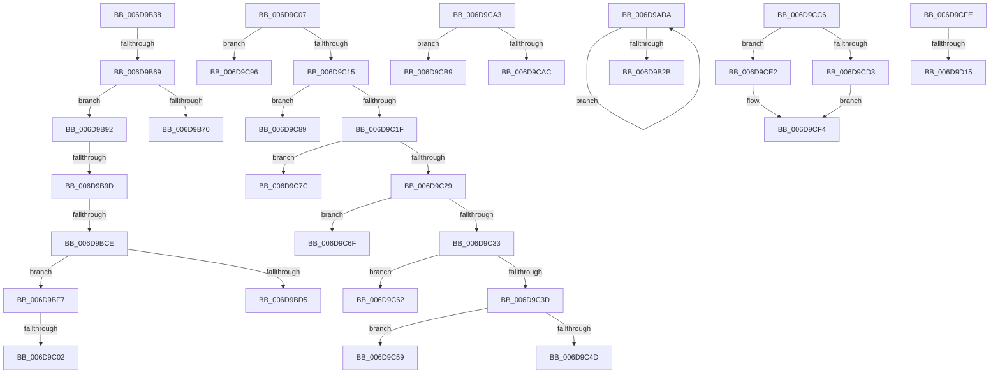

# sub_006D9ADA

- RVA: `0x006D9ADA`–`0x006D9D1A` (길이 `576` bytes)
- VA: `0x00000001406D9ADA`
- 실행 섹션: `.text`
- PDB 이름 있음: `아니요`; PDB Function 태그: `아니요`
- unwind 정보 RVA: `0x00065614`
- 디코드: `141`개 명령, `576/576` bytes 표시
- 미해석 바이트: `0` (있으면 어셈블리에 `.byte`로 보존)

> 이 문서는 커널 이미지의 기계어와 PDB 기호를 분석해 생성했습니다. 4번과 5번은 함수 원형과 자료형을 바이너리 사용 방식에서 추정한 C 해석이며 원본 소스 복구 결과는 아닙니다.

## 1. Dependencies

- 직접 호출 지점: **0**; 고유 호출 대상: **0**
- 직접 호출자로 확인된 함수: **0**
- RIP 상대 이미지 참조: **0**

### Outgoing calls
- 직접 디코드된 call 명령이 없습니다.

### Direct callers
- 이 함수 시작 RVA로 연결되는 직접 call은 확인되지 않았습니다. 간접 호출은 완전히 역산할 수 없습니다.

### Static image references
- 디코드된 RIP-relative 메모리 참조가 없습니다.

## 2. Other-region calls and transfers

- 다른 실행 섹션으로 향하는 call: **0**
- call이 아닌 외부 분기/꼬리 이동: **20**
  - `0x006D9B33` → [RtlCompressBufferXpressHuffMax + 0x253](../26/RtlCompressBufferXpressHuffMax_function_0026CA10.md) (`tail-transfer`)
  - `0x006D9B63` → [RtlCompressBufferXpressHuffMax + 0x28C](../26/RtlCompressBufferXpressHuffMax_function_0026CA10.md) (`tail-transfer`)
  - `0x006D9B8D` → [RtlCompressBufferXpressHuffMax + 0x3C1](../26/RtlCompressBufferXpressHuffMax_function_0026CA10.md) (`tail-transfer`)
  - `0x006D9B97` → [RtlCompressBufferXpressHuffMax + 0x2CD](../26/RtlCompressBufferXpressHuffMax_function_0026CA10.md) (`tail-transfer`)
  - `0x006D9BC8` → [RtlCompressBufferXpressHuffMax + 0x28C](../26/RtlCompressBufferXpressHuffMax_function_0026CA10.md) (`tail-transfer`)
  - `0x006D9BF2` → [RtlCompressBufferXpressHuffMax + 0x3C1](../26/RtlCompressBufferXpressHuffMax_function_0026CA10.md) (`tail-transfer`)
  - `0x006D9BFC` → [RtlCompressBufferXpressHuffMax + 0x28C](../26/RtlCompressBufferXpressHuffMax_function_0026CA10.md) (`tail-transfer`)
  - `0x006D9C02` → [RtlCompressBufferXpressHuffMax + 0x2CD](../26/RtlCompressBufferXpressHuffMax_function_0026CA10.md) (`tail-transfer`)
  - `0x006D9C54` → [RtlCompressBufferXpressHuffMax + 0x3C9](../26/RtlCompressBufferXpressHuffMax_function_0026CA10.md) (`tail-transfer`)
  - `0x006D9C5D` → [RtlCompressBufferXpressHuffMax + 0x3F5](../26/RtlCompressBufferXpressHuffMax_function_0026CA10.md) (`tail-transfer`)
  - `0x006D9C6A` → [RtlCompressBufferXpressHuffMax + 0x3F5](../26/RtlCompressBufferXpressHuffMax_function_0026CA10.md) (`tail-transfer`)
  - `0x006D9C77` → [RtlCompressBufferXpressHuffMax + 0x3F5](../26/RtlCompressBufferXpressHuffMax_function_0026CA10.md) (`tail-transfer`)
  - `0x006D9C84` → [RtlCompressBufferXpressHuffMax + 0x3F5](../26/RtlCompressBufferXpressHuffMax_function_0026CA10.md) (`tail-transfer`)
  - `0x006D9C91` → [RtlCompressBufferXpressHuffMax + 0x3F5](../26/RtlCompressBufferXpressHuffMax_function_0026CA10.md) (`tail-transfer`)
  - `0x006D9C9E` → [RtlCompressBufferXpressHuffMax + 0x3F5](../26/RtlCompressBufferXpressHuffMax_function_0026CA10.md) (`tail-transfer`)
  - `0x006D9CB4` → [RtlCompressBufferXpressHuffMax + 0x3FD](../26/RtlCompressBufferXpressHuffMax_function_0026CA10.md) (`tail-transfer`)
  - `0x006D9CC1` → [RtlCompressBufferXpressHuffMax + 0x3FD](../26/RtlCompressBufferXpressHuffMax_function_0026CA10.md) (`tail-transfer`)
  - `0x006D9CF9` → [RtlCompressBufferXpressHuffMax + 0x384](../26/RtlCompressBufferXpressHuffMax_function_0026CA10.md) (`tail-transfer`)
  - `0x006D9D0F` → [RtlCompressBufferXpressHuffMax + 0x579](../26/RtlCompressBufferXpressHuffMax_function_0026CA10.md) (`tail-transfer`)
  - `0x006D9D15` → [RtlCompressBufferXpressHuffMax + 0x14C](../26/RtlCompressBufferXpressHuffMax_function_0026CA10.md) (`tail-transfer`)

## 3. Assembly (complete function range)

```asm
006D9ADA  41 0F B6 48 01                  movzx ecx, byte ptr [r8 + 1]
006D9ADF  41 0F B7 94 4A 10 38 01 00      movzx edx, word ptr [r10 + rcx*2 + 0x13810]
006D9AE8  41 0F B6 08                     movzx ecx, byte ptr [r8]
006D9AEC  41 0F B7 84 4A 10 36 01 00      movzx eax, word ptr [r10 + rcx*2 + 0x13610]
006D9AF5  48 33 D0                        xor rdx, rax
006D9AF8  41 0F B6 40 02                  movzx eax, byte ptr [r8 + 2]
006D9AFD  41 0F B7 84 42 10 3A 01 00      movzx eax, word ptr [r10 + rax*2 + 0x13a10]
006D9B06  48 33 D0                        xor rdx, rax
006D9B09  49 8B 04 D6                     mov rax, qword ptr [r14 + rdx*8]
006D9B0D  4D 89 04 D6                     mov qword ptr [r14 + rdx*8], r8
006D9B11  49 FF C0                        inc r8
006D9B14  4B 89 84 CE 00 00 04 00         mov qword ptr [r14 + r9*8 + 0x40000], rax
006D9B1C  49 FF C1                        inc r9
006D9B1F  41 81 E1 FF FF 01 00            and r9d, 0x1ffff
006D9B26  4D 3B C3                        cmp r8, r11
006D9B29  72 AF                           jb 0x1406d9ada
006D9B2B  48 8B 8C 24 E0 00 00 00         mov rcx, qword ptr [rsp + 0xe0]
006D9B33  E9 2B 31 B9 FF                  jmp 0x14026cc63
006D9B38  49 2B D7                        sub rdx, r15
006D9B3B  48 8B C2                        mov rax, rdx
006D9B3E  48 99                           cqo
006D9B40  81 E2 FF FF 01 00               and edx, 0x1ffff
006D9B46  48 03 C2                        add rax, rdx
006D9B49  25 FF FF 01 00                  and eax, 0x1ffff
006D9B4E  48 2B C2                        sub rax, rdx
006D9B51  49 8B 94 C6 00 00 04 00         mov rdx, qword ptr [r14 + rax*8 + 0x40000]
006D9B59  48 8D 82 00 00 01 00            lea rax, [rdx + 0x10000]
006D9B60  48 3B C3                        cmp rax, rbx
006D9B63  0F 86 33 31 B9 FF               jbe 0x14026cc9c
006D9B69  41 8B C0                        mov eax, r8d
006D9B6C  33 02                           xor eax, dword ptr [rdx]
006D9B6E  75 22                           jne 0x1406d9b92
006D9B70  48 8D 83 00 00 FF FF            lea rax, [rbx - 0x10000]
006D9B77  48 C7 44 24 30 03 00 00 00      mov qword ptr [rsp + 0x30], 3
006D9B80  48 89 44 24 38                  mov qword ptr [rsp + 0x38], rax
006D9B85  4C 8B EB                        mov r13, rbx
006D9B88  33 C0                           xor eax, eax
006D9B8A  44 8B C8                        mov r9d, eax
006D9B8D  E9 3F 32 B9 FF                  jmp 0x14026cdd1
006D9B92  A9 FF FF FF 00                  test eax, 0xffffff
006D9B97  0F 84 40 31 B9 FF               je 0x14026ccdd
006D9B9D  49 2B D7                        sub rdx, r15
006D9BA0  48 8B C2                        mov rax, rdx
006D9BA3  48 99                           cqo
006D9BA5  81 E2 FF FF 01 00               and edx, 0x1ffff
006D9BAB  48 03 C2                        add rax, rdx
006D9BAE  25 FF FF 01 00                  and eax, 0x1ffff
006D9BB3  48 2B C2                        sub rax, rdx
006D9BB6  49 8B 94 C6 00 00 04 00         mov rdx, qword ptr [r14 + rax*8 + 0x40000]
006D9BBE  48 8D 82 00 00 01 00            lea rax, [rdx + 0x10000]
006D9BC5  48 3B C3                        cmp rax, rbx
006D9BC8  0F 86 CE 30 B9 FF               jbe 0x14026cc9c
006D9BCE  41 8B C0                        mov eax, r8d
006D9BD1  33 02                           xor eax, dword ptr [rdx]
006D9BD3  75 22                           jne 0x1406d9bf7
006D9BD5  48 8D 83 00 00 FF FF            lea rax, [rbx - 0x10000]
006D9BDC  48 C7 44 24 30 03 00 00 00      mov qword ptr [rsp + 0x30], 3
006D9BE5  48 89 44 24 38                  mov qword ptr [rsp + 0x38], rax
006D9BEA  4C 8B EB                        mov r13, rbx
006D9BED  33 C0                           xor eax, eax
006D9BEF  44 8B C8                        mov r9d, eax
006D9BF2  E9 DA 31 B9 FF                  jmp 0x14026cdd1
006D9BF7  A9 FF FF FF 00                  test eax, 0xffffff
006D9BFC  0F 85 9A 30 B9 FF               jne 0x14026cc9c
006D9C02  E9 D6 30 B9 FF                  jmp 0x14026ccdd
006D9C07  8B 43 08                        mov eax, dword ptr [rbx + 8]
006D9C0A  8B 4A 08                        mov ecx, dword ptr [rdx + 8]
006D9C0D  3B C1                           cmp eax, ecx
006D9C0F  0F 85 81 00 00 00               jne 0x1406d9c96
006D9C15  8B 43 0C                        mov eax, dword ptr [rbx + 0xc]
006D9C18  8B 4A 0C                        mov ecx, dword ptr [rdx + 0xc]
006D9C1B  3B C1                           cmp eax, ecx
006D9C1D  75 6A                           jne 0x1406d9c89
006D9C1F  8B 43 10                        mov eax, dword ptr [rbx + 0x10]
006D9C22  8B 4A 10                        mov ecx, dword ptr [rdx + 0x10]
006D9C25  3B C1                           cmp eax, ecx
006D9C27  75 53                           jne 0x1406d9c7c
006D9C29  8B 43 14                        mov eax, dword ptr [rbx + 0x14]
006D9C2C  8B 4A 14                        mov ecx, dword ptr [rdx + 0x14]
006D9C2F  3B C1                           cmp eax, ecx
006D9C31  75 3C                           jne 0x1406d9c6f
006D9C33  8B 43 18                        mov eax, dword ptr [rbx + 0x18]
006D9C36  8B 4A 18                        mov ecx, dword ptr [rdx + 0x18]
006D9C39  3B C1                           cmp eax, ecx
006D9C3B  75 25                           jne 0x1406d9c62
006D9C3D  8B 4A 1C                        mov ecx, dword ptr [rdx + 0x1c]
006D9C40  48 8D 43 1C                     lea rax, [rbx + 0x1c]
006D9C44  48 8B D8                        mov rbx, rax
006D9C47  8B 00                           mov eax, dword ptr [rax]
006D9C49  3B C1                           cmp eax, ecx
006D9C4B  75 0C                           jne 0x1406d9c59
006D9C4D  49 8B DC                        mov rbx, r12
006D9C50  48 83 C2 20                     add rdx, 0x20
006D9C54  E9 80 31 B9 FF                  jmp 0x14026cdd9
006D9C59  48 83 C2 1C                     add rdx, 0x1c
006D9C5D  E9 A3 31 B9 FF                  jmp 0x14026ce05
006D9C62  48 83 C3 18                     add rbx, 0x18
006D9C66  48 83 C2 18                     add rdx, 0x18
006D9C6A  E9 96 31 B9 FF                  jmp 0x14026ce05
006D9C6F  48 83 C3 14                     add rbx, 0x14
006D9C73  48 83 C2 14                     add rdx, 0x14
006D9C77  E9 89 31 B9 FF                  jmp 0x14026ce05
006D9C7C  48 83 C3 10                     add rbx, 0x10
006D9C80  48 83 C2 10                     add rdx, 0x10
006D9C84  E9 7C 31 B9 FF                  jmp 0x14026ce05
006D9C89  48 83 C3 0C                     add rbx, 0xc
006D9C8D  48 83 C2 0C                     add rdx, 0xc
006D9C91  E9 6F 31 B9 FF                  jmp 0x14026ce05
006D9C96  48 83 C3 08                     add rbx, 8
006D9C9A  48 83 C2 08                     add rdx, 8
006D9C9E  E9 62 31 B9 FF                  jmp 0x14026ce05
006D9CA3  0F B6 42 02                     movzx eax, byte ptr [rdx + 2]
006D9CA7  38 43 02                        cmp byte ptr [rbx + 2], al
006D9CAA  74 0D                           je 0x1406d9cb9
006D9CAC  48 83 C3 02                     add rbx, 2
006D9CB0  48 83 C2 02                     add rdx, 2
006D9CB4  E9 54 31 B9 FF                  jmp 0x14026ce0d
006D9CB9  48 83 C3 03                     add rbx, 3
006D9CBD  48 83 C2 03                     add rdx, 3
006D9CC1  E9 47 31 B9 FF                  jmp 0x14026ce0d
006D9CC6  41 C6 00 FF                     mov byte ptr [r8], 0xff
006D9CCA  49 81 F9 00 00 01 00            cmp r9, 0x10000
006D9CD1  73 0F                           jae 0x1406d9ce2
006D9CD3  66 44 89 0E                     mov word ptr [rsi], r9w
006D9CD7  B8 03 00 00 00                  mov eax, 3
006D9CDC  49 8D 70 03                     lea rsi, [r8 + 3]
006D9CE0  EB 12                           jmp 0x1406d9cf4
006D9CE2  33 C0                           xor eax, eax
006D9CE4  45 89 48 03                     mov dword ptr [r8 + 3], r9d
006D9CE8  66 89 06                        mov word ptr [rsi], ax
006D9CEB  49 8D 70 07                     lea rsi, [r8 + 7]
006D9CEF  B8 07 00 00 00                  mov eax, 7
006D9CF4  48 01 44 24 58                  add qword ptr [rsp + 0x58], rax
006D9CF9  E9 96 30 B9 FF                  jmp 0x14026cd94
006D9CFE  89 01                           mov dword ptr [rcx], eax
006D9D00  BF 01 00 00 00                  mov edi, 1
006D9D05  48 8B CE                        mov rcx, rsi
006D9D08  48 83 C6 04                     add rsi, 4
006D9D0C  49 3B DA                        cmp rbx, r10
006D9D0F  0F 82 74 32 B9 FF               jb 0x14026cf89
006D9D15  E9 42 2E B9 FF                  jmp 0x14026cb5c
```

## 4. C-style interpretation (structured pseudocode)

```c
__int64 __fastcall sub_006D9ADA(__int64 a1, __int64 a2, __int64 a3, __int64 a4, __int64 a5, __int64 a6, __int64 a7, __int64 a8, __int64 a9, __int64 a10, __int64 a11, __int64 a12, __int64 a13, __int64 a14, __int64 a15, __int64 a16, __int64 a17, __int64 a18, __int64 a19, __int64 a20, __int64 a21, __int64 a22, __int64 a23, __int64 a24, __int64 a25, __int64 a26, __int64 a27, __int64 a28)
{
    unsigned __int64 v_stack_p30;
    unsigned __int64 v_stack_p38;
    unsigned __int64 v_stack_p58;

    a2 = (*(unsigned __int16 *)(v_r10 + *(unsigned __int8 *)(a3 + 1) * 2 + 79888)) ^ (*(unsigned __int16 *)(v_r10 + *(unsigned __int8 *)(a3) * 2 + 79376));
    a2 = (a2) ^ (*(unsigned __int16 *)(v_r10 + *(unsigned __int8 *)(a3 + 2) * 2 + 80400));
    *(unsigned __int64 *)(v_r14 + a2 * 8) = a3;
    a3 = (a3) + 1;
    *(unsigned __int64 *)(v_r14 + a4 * 8 + 262144) = *(unsigned __int64 *)(v_r14 + a2 * 8);
    a4 = (a4) + 1;
    a4 = (unsigned int)((a4) & (0x1FFFFULL));
    if (a3 < v_r11) goto loc_006D9ADA;
}
```

## 5. (Beta) C Style

```c
int64_t sub_006D9ADA(int64_t Arg1, int64_t Arg2, int64_t Arg3, int64_t Arg4, uint64_t Arg5, uint64_t Arg6, uint64_t Arg7, uint64_t Arg8, uint64_t Arg9, uint64_t Arg10, uint64_t Arg11, uint64_t Arg12, uint64_t Arg13, uint64_t Arg14, uint64_t Arg15, uint64_t Arg16, uint64_t Arg17, uint64_t Arg18, uint64_t Arg19, uint64_t Arg20, uint64_t Arg21, uint64_t Arg22, uint64_t Arg23, uint64_t Arg24, uint64_t Arg25, uint64_t Arg26, uint64_t Arg27, int64_t Arg28)
{
    uint64_t v_stack_p30;
    uint64_t v_stack_p38;
    uint64_t v_stack_p58;

    Arg2 = (*(uint16_t *)(local_r10 + *(uint8_t *)(Arg3 + 0x1) * 2 + 0x13810)) ^ (*(uint16_t *)(local_r10 + *(uint8_t *)(Arg3) * 2 + 0x13610));
    Arg2 = (Arg2) ^ (*(uint16_t *)(local_r10 + *(uint8_t *)(Arg3 + 0x2) * 2 + 0x13A10));
    *(uint64_t *)(local_r14 + Arg2 * 8) = Arg3;
    Arg3 = (Arg3) + 1;
    *(uint64_t *)(local_r14 + Arg4 * 8 + 0x40000) = *(uint64_t *)(local_r14 + Arg2 * 8);
    Arg4 = (Arg4) + 1;
    Arg4 = (uint32_t)((Arg4) & (0x1FFFFULL));
    if (Arg3 < local_r11) goto loc_006D9ADA;
}
```

## 6. Execution-region graph

[열기: 2D/3D 그래프와 함수 탐색 컨트롤 패널](../../../control-panel.html?section=text&rva=0x006D9ADA&view=graph)

- 2D 그래프는 위에서 아래로 흐르고, 3D 그래프는 빈 공간을 드래그해 회전합니다. Shift+드래그는 이동, 휠은 확대·축소, 함수 노드 선택은 대상 보고서 이동입니다.

### Static fallback


