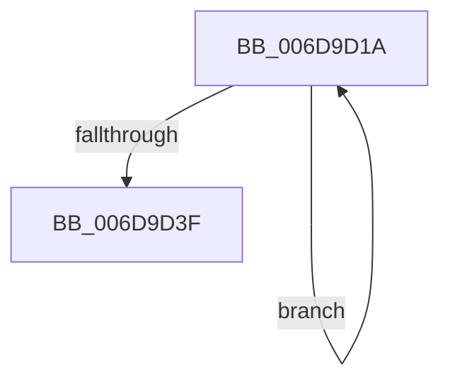

# sub_006D9D1A

- RVA: `0x006D9D1A`–`0x006D9D44` (길이 `42` bytes)
- VA: `0x00000001406D9D1A`
- 실행 섹션: `.text`
- PDB 이름 있음: `아니요`; PDB Function 태그: `아니요`
- unwind 정보 RVA: `0x00065634`
- 디코드: `11`개 명령, `42/42` bytes 표시
- 미해석 바이트: `0` (있으면 어셈블리에 `.byte`로 보존)

> 이 문서는 커널 이미지의 기계어와 PDB 기호를 분석해 생성했습니다. 4번과 5번은 함수 원형과 자료형을 바이너리 사용 방식에서 추정한 C 해석이며 원본 소스 복구 결과는 아닙니다.

## 1. Dependencies

- 직접 호출 지점: **0**; 고유 호출 대상: **0**
- 직접 호출자로 확인된 함수: **0**
- RIP 상대 이미지 참조: **0**

### Outgoing calls
- 직접 디코드된 call 명령이 없습니다.

### Direct callers
- 이 함수 시작 RVA로 연결되는 직접 call은 확인되지 않았습니다. 간접 호출은 완전히 역산할 수 없습니다.

### Static image references
- 디코드된 RIP-relative 메모리 참조가 없습니다.

## 2. Other-region calls and transfers

- 다른 실행 섹션으로 향하는 call: **0**
- call이 아닌 외부 분기/꼬리 이동: **1**
  - `0x006D9D3F` → [CcCalculateVacbLevelLockCount + 0x45](../26/CcCalculateVacbLevelLockCount_function_0026CFC8.md) (`tail-transfer`)

## 3. Assembly (complete function range)

```asm
006D9D1A  66 44 39 02                     cmp word ptr [rdx], r8w
006D9D1E  41 8D 41 01                     lea eax, [r9 + 1]
006D9D22  48 8B 52 18                     mov rdx, qword ptr [rdx + 0x18]
006D9D26  41 0F 45 C1                     cmovne eax, r9d
006D9D2A  44 8B C8                        mov r9d, eax
006D9D2D  41 8D 43 01                     lea eax, [r11 + 1]
006D9D31  44 0F 45 D8                     cmovne r11d, eax
006D9D35  48 83 EA 10                     sub rdx, 0x10
006D9D39  41 83 FB 3F                     cmp r11d, 0x3f
006D9D3D  76 DB                           jbe 0x1406d9d1a
006D9D3F  E9 C9 32 B9 FF                  jmp 0x14026d00d
```

## 4. C-style interpretation (structured pseudocode)

```c
__int64 __fastcall sub_006D9D1A(__int64 a1, __int64 a2, unsigned __int16 a3, __int64 a4)
{
    __int64 result;
    __int64 v_r11;

    result = a4 + 1;
    if ((*(unsigned __int16 *)(a2)) != a3) {
        result = (unsigned int)(a4);
        v_r11 = (unsigned int)(v_r11 + 1);
    }
    a2 = (*(unsigned __int64 *)(a2 + 24)) - (16);
    if (((unsigned int)(v_r11)) <= 63) goto loc_006D9D1A;
}
```

## 5. (Beta) C Style

```c
int64_t sub_006D9D1A(int64_t Arg1, int64_t Arg2, uint16_t Arg3, int64_t Arg4)
{
    int64_t result;
    int64_t local_r11;

    result = Arg4 + 1;
    if ((*(uint16_t *)(Arg2)) != Arg3) {
        result = (uint32_t)(Arg4);
        local_r11 = (uint32_t)(local_r11 + 1);
    }
    Arg2 = (*(uint64_t *)(Arg2 + 0x18)) - (16);
    if (((uint32_t)(local_r11)) <= 63) goto loc_006D9D1A;
}
```

## 6. Execution-region graph

[열기: 2D/3D 그래프와 함수 탐색 컨트롤 패널](../../../control-panel.html?section=text&rva=0x006D9D1A&view=graph)

- 2D 그래프는 위에서 아래로 흐르고, 3D 그래프는 빈 공간을 드래그해 회전합니다. Shift+드래그는 이동, 휠은 확대·축소, 함수 노드 선택은 대상 보고서 이동입니다.

### Static fallback


