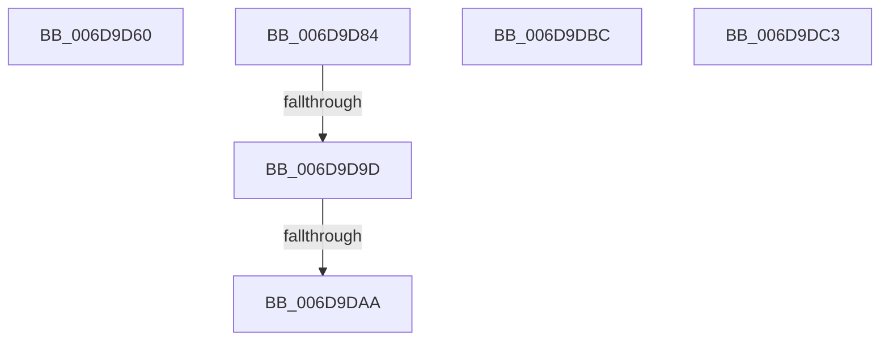

# sub_006D9D60

- RVA: `0x006D9D60`–`0x006D9DD0` (길이 `112` bytes)
- VA: `0x00000001406D9D60`
- 실행 섹션: `.text`
- PDB 이름 있음: `아니요`; PDB Function 태그: `아니요`
- unwind 정보 RVA: `0x00065690`
- 디코드: `25`개 명령, `112/112` bytes 표시
- 미해석 바이트: `0` (있으면 어셈블리에 `.byte`로 보존)

> 이 문서는 커널 이미지의 기계어와 PDB 기호를 분석해 생성했습니다. 4번과 5번은 함수 원형과 자료형을 바이너리 사용 방식에서 추정한 C 해석이며 원본 소스 복구 결과는 아닙니다.

## 1. Dependencies

- 직접 호출 지점: **1**; 고유 호출 대상: **1**
- 직접 호출자로 확인된 함수: **0**
- RIP 상대 이미지 참조: **2**

### Outgoing calls
- `0x006D9D6A` → [ExFreeToNPagedLookasideList](../38/ExFreeToNPagedLookasideList_function_0038D9D0.md) (function, `0x0038D9D0`)

### Direct callers
- 이 함수 시작 RVA로 연결되는 직접 call은 확인되지 않았습니다. 간접 호출은 완전히 역산할 수 없습니다.

### Static image references
- `0x006D9D63` → RVA `0x00E27F00` (`.data`; read)
- `0x006D9DB1` → RVA `0x00F09198` (`.data`; write)

## 2. Other-region calls and transfers

- 다른 실행 섹션으로 향하는 call: **0**
- call이 아닌 외부 분기/꼬리 이동: **6**
  - `0x006D9D7F` → [PopIrpWorker + 0x65](../26/PopIrpWorker_function_0026D410.md) (`tail-transfer`)
  - `0x006D9D97` → [PopIrpWorker + 0x2F7](../26/PopIrpWorker_function_0026D410.md) (`tail-transfer`)
  - `0x006D9DA4` → [PopIrpWorker + 0x2F7](../26/PopIrpWorker_function_0026D410.md) (`tail-transfer`)
  - `0x006D9DB7` → [PopIrpWorker + 0x315](../26/PopIrpWorker_function_0026D410.md) (`tail-transfer`)
  - `0x006D9DBE` → [PopIrpWorker + 0x217](../26/PopIrpWorker_function_0026D410.md) (`tail-transfer`)
  - `0x006D9DCB` → [PopIrpWorker + 0x235](../26/PopIrpWorker_function_0026D410.md) (`tail-transfer`)

## 3. Assembly (complete function range)

```asm
006D9D60  48 8B D3                        mov rdx, rbx
006D9D63  48 8D 0D 96 E1 74 00            lea rcx, [rip + 0x74e196]
006D9D6A  E8 61 3C CB FF                  call 0x14038d9d0
006D9D6F  48 C7 45 30 00 1F 0A FA         mov qword ptr [rbp + 0x30], 0xfffffffffa0a1f00
006D9D77  4C 8D 65 30                     lea r12, [rbp + 0x30]
006D9D7B  44 88 6D F0                     mov byte ptr [rbp - 0x10], r13b
006D9D7F  E9 F1 36 B9 FF                  jmp 0x14026d475
006D9D84  48 8B 4D C8                     mov rcx, qword ptr [rbp - 0x38]
006D9D88  4C 8D 45 C8                     lea r8, [rbp - 0x38]
006D9D8C  48 8B 45 D0                     mov rax, qword ptr [rbp - 0x30]
006D9D90  41 8A DD                        mov bl, r13b
006D9D93  4C 39 41 08                     cmp qword ptr [rcx + 8], r8
006D9D97  0F 85 6A 39 B9 FF               jne 0x14026d707
006D9D9D  4C 8D 45 C8                     lea r8, [rbp - 0x38]
006D9DA1  4C 39 00                        cmp qword ptr [rax], r8
006D9DA4  0F 85 5D 39 B9 FF               jne 0x14026d707
006D9DAA  48 89 08                        mov qword ptr [rax], rcx
006D9DAD  48 89 41 08                     mov qword ptr [rcx + 8], rax
006D9DB1  89 15 E1 F3 82 00               mov dword ptr [rip + 0x82f3e1], edx
006D9DB7  E9 69 39 B9 FF                  jmp 0x14026d725
006D9DBC  B3 01                           mov bl, 1
006D9DBE  E9 64 38 B9 FF                  jmp 0x14026d627
006D9DC3  41 0F B6 C7                     movzx eax, r15b
006D9DC7  44 0F 22 C0                     mov cr8, rax
006D9DCB  E9 75 38 B9 FF                  jmp 0x14026d645
```

## 4. C-style interpretation (structured pseudocode)

```c
__int64 __fastcall sub_006D9D60(void)
{
    __int64 result;

    result = ExFreeToNPagedLookasideList(v_rip + 7659926, v_rbx, a3, a4);
    *(unsigned __int64 *)(v_rbp + 48) = 0xFFFFFFFFFA0A1F00ULL;
    *(unsigned __int8 *)(v_rbp - 16) = (unsigned __int8)(v_r13);
}
```

## 5. (Beta) C Style

```c
void sub_006D9D60(void)
{
    int64_t result;

    result = ExFreeToNPagedLookasideList(v_rip + 7659926, local_rbx, a3, a4);
    *(uint64_t *)(local_rbp + 0x30) = 0xFFFFFFFFFA0A1F00ULL;
    *(uint8_t *)(local_rbp - 0x10) = (uint8_t)(local_r13);
}
```

## 6. Execution-region graph

[열기: 2D/3D 그래프와 함수 탐색 컨트롤 패널](../../../control-panel.html?section=text&rva=0x006D9D60&view=graph)

- 2D 그래프는 위에서 아래로 흐르고, 3D 그래프는 빈 공간을 드래그해 회전합니다. Shift+드래그는 이동, 휠은 확대·축소, 함수 노드 선택은 대상 보고서 이동입니다.

### Static fallback


