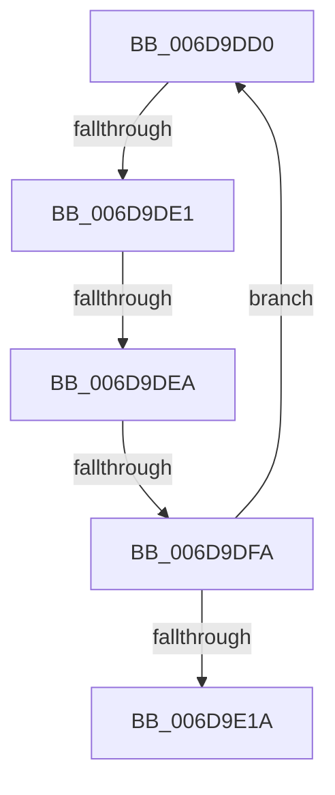

# sub_006D9DD0

- RVA: `0x006D9DD0`–`0x006D9E23` (길이 `83` bytes)
- VA: `0x00000001406D9DD0`
- 실행 섹션: `.text`
- PDB 이름 있음: `아니요`; PDB Function 태그: `아니요`
- unwind 정보 RVA: `0x000656D0`
- 디코드: `21`개 명령, `83/83` bytes 표시
- 미해석 바이트: `0` (있으면 어셈블리에 `.byte`로 보존)

> 이 문서는 커널 이미지의 기계어와 PDB 기호를 분석해 생성했습니다. 4번과 5번은 함수 원형과 자료형을 바이너리 사용 방식에서 추정한 C 해석이며 원본 소스 복구 결과는 아닙니다.

## 1. Dependencies

- 직접 호출 지점: **0**; 고유 호출 대상: **0**
- 직접 호출자로 확인된 함수: **0**
- RIP 상대 이미지 참조: **0**

### Outgoing calls
- 직접 디코드된 call 명령이 없습니다.

### Direct callers
- 이 함수 시작 RVA로 연결되는 직접 call은 확인되지 않았습니다. 간접 호출은 완전히 역산할 수 없습니다.

### Static image references
- 디코드된 RIP-relative 메모리 참조가 없습니다.

## 2. Other-region calls and transfers

- 다른 실행 섹션으로 향하는 call: **0**
- call이 아닌 외부 분기/꼬리 이동: **4**
  - `0x006D9DDB` → [CcExtendVacbArray + 0x2A3](../26/CcExtendVacbArray_function_0026DCD0.md) (`tail-transfer`)
  - `0x006D9DE4` → [CcExtendVacbArray + 0x2A3](../26/CcExtendVacbArray_function_0026DCD0.md) (`tail-transfer`)
  - `0x006D9DF4` → [CcExtendVacbArray + 0x2A3](../26/CcExtendVacbArray_function_0026DCD0.md) (`tail-transfer`)
  - `0x006D9E1E` → [CcExtendVacbArray + 0x26D](../26/CcExtendVacbArray_function_0026DCD0.md) (`tail-transfer`)

## 3. Assembly (complete function range)

```asm
006D9DD0  4C 8B 0A                        mov r9, qword ptr [rdx]
006D9DD3  4C 8B 42 08                     mov r8, qword ptr [rdx + 8]
006D9DD7  49 39 51 08                     cmp qword ptr [r9 + 8], rdx
006D9DDB  0F 85 92 41 B9 FF               jne 0x14026df73
006D9DE1  49 39 10                        cmp qword ptr [r8], rdx
006D9DE4  0F 85 89 41 B9 FF               jne 0x14026df73
006D9DEA  4D 89 08                        mov qword ptr [r8], r9
006D9DED  4D 89 41 08                     mov qword ptr [r9 + 8], r8
006D9DF1  4D 39 08                        cmp qword ptr [r8], r9
006D9DF4  0F 85 79 41 B9 FF               jne 0x14026df73
006D9DFA  4C 89 09                        mov qword ptr [rcx], r9
006D9DFD  49 03 C3                        add rax, r11
006D9E00  4D 89 44 12 08                  mov qword ptr [r10 + rdx + 8], r8
006D9E05  48 83 C2 10                     add rdx, 0x10
006D9E09  49 89 08                        mov qword ptr [r8], rcx
006D9E0C  49 89 49 08                     mov qword ptr [r9 + 8], rcx
006D9E10  48 83 C1 10                     add rcx, 0x10
006D9E14  48 3B 47 20                     cmp rax, qword ptr [rdi + 0x20]
006D9E18  7C B6                           jl 0x1406d9dd0
006D9E1A  4C 8D 47 10                     lea r8, [rdi + 0x10]
006D9E1E  E9 1A 41 B9 FF                  jmp 0x14026df3d
```

## 4. C-style interpretation (structured pseudocode)

```c
__int64 __fastcall sub_006D9DD0(__int64 a1, __int64 a2)
{
    __int64 result;

    *(unsigned __int64 *)(*(unsigned __int64 *)(a2 + 8)) = *(unsigned __int64 *)(a2);
    *(unsigned __int64 *)(*(unsigned __int64 *)(a2) + 8) = *(unsigned __int64 *)(a2 + 8);
    *(unsigned __int64 *)(a1) = *(unsigned __int64 *)(a2);
    result = (result) + (v_r11);
    *(unsigned __int64 *)(v_r10 + a2 * 1 + 8) = *(unsigned __int64 *)(a2 + 8);
    a2 = (a2) + (16);
    *(unsigned __int64 *)(*(unsigned __int64 *)(a2 + 8)) = a1;
    *(unsigned __int64 *)(*(unsigned __int64 *)(a2) + 8) = a1;
    a1 = (a1) + (16);
    if (result < (*(unsigned __int64 *)(v_rdi + 32))) goto loc_006D9DD0;
}
```

## 5. (Beta) C Style

```c
int64_t sub_006D9DD0(void *Arg1, void *Arg2)
{
    uint8_t *arg1 = (uint8_t *)Arg1;
    uint8_t *arg2 = (uint8_t *)Arg2;

    int64_t result;

    *(uint64_t *)(*(uint64_t *)(arg2 + 0x8)) = *(uint64_t *)(arg2);
    *(uint64_t *)(*(uint64_t *)(arg2) + 0x8) = *(uint64_t *)(arg2 + 0x8);
    *(uint64_t *)(arg1) = *(uint64_t *)(arg2);
    result = (result) + (local_r11);
    *(uint64_t *)(local_r10 + arg2 * 1 + 0x8) = *(uint64_t *)(arg2 + 0x8);
    Arg2 = (Arg2) + (16);
    *(void **)(*(uint64_t *)(arg2 + 0x8)) = Arg1;
    *(void **)(*(uint64_t *)(arg2) + 0x8) = Arg1;
    Arg1 = (Arg1) + (16);
    if (result < (*(uint64_t *)(local_rdi + 0x20))) goto loc_006D9DD0;
}
```

### 관측된 메모리 오프셋

구조체 형식이 확인되지 않은 접근은 인자 기준의 오프셋으로만 기록했습니다.

| 기준 인자 | 오프셋 표현 | 폭 (bit) | 접근 |
|---|---:|---:|---|
| `Arg1` | `+ 0x0` | `64` | `W` |
| `Arg2` | `+ 0x0` | `64` | `R` |
| `Arg2` | `+ 0x8` | `64` | `R` |

## 6. Execution-region graph

[열기: 2D/3D 그래프와 함수 탐색 컨트롤 패널](../../../control-panel.html?section=text&rva=0x006D9DD0&view=graph)

- 2D 그래프는 위에서 아래로 흐르고, 3D 그래프는 빈 공간을 드래그해 회전합니다. Shift+드래그는 이동, 휠은 확대·축소, 함수 노드 선택은 대상 보고서 이동입니다.

### Static fallback


