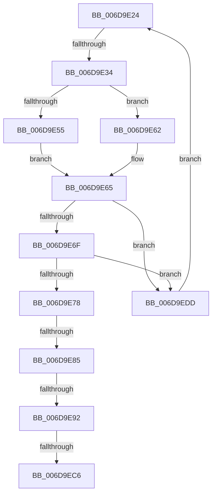

# sub_006D9E24

- RVA: `0x006D9E24`–`0x006D9EE5` (길이 `193` bytes)
- VA: `0x00000001406D9E24`
- 실행 섹션: `.text`
- PDB 이름 있음: `아니요`; PDB Function 태그: `아니요`
- unwind 정보 RVA: `0x000657D0`
- 디코드: `43`개 명령, `193/193` bytes 표시
- 미해석 바이트: `0` (있으면 어셈블리에 `.byte`로 보존)

> 이 문서는 커널 이미지의 기계어와 PDB 기호를 분석해 생성했습니다. 4번과 5번은 함수 원형과 자료형을 바이너리 사용 방식에서 추정한 C 해석이며 원본 소스 복구 결과는 아닙니다.

## 1. Dependencies

- 직접 호출 지점: **0**; 고유 호출 대상: **0**
- 직접 호출자로 확인된 함수: **0**
- RIP 상대 이미지 참조: **2**

### Outgoing calls
- 직접 디코드된 call 명령이 없습니다.

### Direct callers
- 이 함수 시작 RVA로 연결되는 직접 call은 확인되지 않았습니다. 간접 호출은 완전히 역산할 수 없습니다.

### Static image references
- `0x006D9E24` → RVA `0x00F0CA30` (`.data`; read)
- `0x006D9EB6` → RVA `0x00F0BCE8` (`.data`; write)

## 2. Other-region calls and transfers

- 다른 실행 섹션으로 향하는 call: **0**
- call이 아닌 외부 분기/꼬리 이동: **5**
  - `0x006D9E2E` → [PopDequeueQuerySetIrp + 0xC0](../26/PopDequeueQuerySetIrp_function_0026EC34.md) (`tail-transfer`)
  - `0x006D9E7F` → [PopDequeueQuerySetIrp + 0x1A5](../26/PopDequeueQuerySetIrp_function_0026EC34.md) (`tail-transfer`)
  - `0x006D9E8C` → [PopDequeueQuerySetIrp + 0x1A5](../26/PopDequeueQuerySetIrp_function_0026EC34.md) (`tail-transfer`)
  - `0x006D9EC0` → [PopDequeueQuerySetIrp + 0x1A5](../26/PopDequeueQuerySetIrp_function_0026EC34.md) (`tail-transfer`)
  - `0x006D9ED8` → [PopDequeueQuerySetIrp + 0xC0](../26/PopDequeueQuerySetIrp_function_0026EC34.md) (`tail-transfer`)

## 3. Assembly (complete function range)

```asm
006D9E24  48 8D 05 05 2C 83 00            lea rax, [rip + 0x832c05]
006D9E2B  48 3B D0                        cmp rdx, rax
006D9E2E  0F 84 C0 4E B9 FF               je 0x14026ecf4
006D9E34  4C 8D 92 58 FF FF FF            lea r10, [rdx - 0xa8]
006D9E3B  49 0F BE 42 42                  movsx rax, byte ptr [r10 + 0x42]
006D9E40  48 8D 0C C0                     lea rcx, [rax + rax*8]
006D9E44  49 8B 84 CA C8 00 00 00         mov rax, qword ptr [r10 + rcx*8 + 0xc8]
006D9E4C  48 8B 40 18                     mov rax, qword ptr [rax + 0x18]
006D9E50  48 85 C0                        test rax, rax
006D9E53  74 0D                           je 0x1406d9e62
006D9E55  48 8B 80 38 01 00 00            mov rax, qword ptr [rax + 0x138]
006D9E5C  4C 8B 48 28                     mov r9, qword ptr [rax + 0x28]
006D9E60  EB 03                           jmp 0x1406d9e65
006D9E62  45 33 C9                        xor r9d, r9d
006D9E65  49 83 B9 08 01 00 00 00         cmp qword ptr [r9 + 0x108], 0
006D9E6D  75 6E                           jne 0x1406d9edd
006D9E6F  4D 39 91 10 01 00 00            cmp qword ptr [r9 + 0x110], r10
006D9E76  75 65                           jne 0x1406d9edd
006D9E78  48 8B 0A                        mov rcx, qword ptr [rdx]
006D9E7B  48 39 51 08                     cmp qword ptr [rcx + 8], rdx
006D9E7F  0F 85 54 4F B9 FF               jne 0x14026edd9
006D9E85  48 8B 42 08                     mov rax, qword ptr [rdx + 8]
006D9E89  48 39 10                        cmp qword ptr [rax], rdx
006D9E8C  0F 85 47 4F B9 FF               jne 0x14026edd9
006D9E92  48 89 08                        mov qword ptr [rax], rcx
006D9E95  48 8D 55 D0                     lea rdx, [rbp - 0x30]
006D9E99  48 89 41 08                     mov qword ptr [rcx + 8], rax
006D9E9D  49 8D 4A 78                     lea rcx, [r10 + 0x78]
006D9EA1  4D 89 91 08 01 00 00            mov qword ptr [r9 + 0x108], r10
006D9EA8  48 8B 01                        mov rax, qword ptr [rcx]
006D9EAB  49 89 81 10 01 00 00            mov qword ptr [r9 + 0x110], rax
006D9EB2  48 8B 45 D8                     mov rax, qword ptr [rbp - 0x28]
006D9EB6  4C 89 15 2B 1E 83 00            mov qword ptr [rip + 0x831e2b], r10
006D9EBD  48 39 10                        cmp qword ptr [rax], rdx
006D9EC0  0F 85 13 4F B9 FF               jne 0x14026edd9
006D9EC6  48 89 41 08                     mov qword ptr [rcx + 8], rax
006D9ECA  48 8D 55 D0                     lea rdx, [rbp - 0x30]
006D9ECE  48 89 11                        mov qword ptr [rcx], rdx
006D9ED1  48 89 08                        mov qword ptr [rax], rcx
006D9ED4  48 89 4D D8                     mov qword ptr [rbp - 0x28], rcx
006D9ED8  E9 17 4E B9 FF                  jmp 0x14026ecf4
006D9EDD  48 8B 12                        mov rdx, qword ptr [rdx]
006D9EE0  E9 3F FF FF FF                  jmp 0x1406d9e24
```

## 4. C-style interpretation (structured pseudocode)

```c
__int64 __fastcall sub_006D9E24(__int64 a1, __int64 a2)
{
    if (*(unsigned __int64 *)(*(unsigned __int64 *)(a2 - 168 + (__int8)(*(unsigned __int8 *)(a2 - 168 + 66)) + (__int8)(*(unsigned __int8 *)(a2 - 168 + 66)) * 8 * 8 + 200) + 24) == 0) goto loc_006D9E62;
    goto loc_006D9E65;
loc_006D9E62:
    a4 = 0;
loc_006D9E65:
    if ((*(unsigned __int64 *)(a4 + 264)) != 0) goto loc_006D9EDD;
    if ((*(unsigned __int64 *)(a4 + 272)) != (a2 - 168)) goto loc_006D9EDD;
    *(unsigned __int64 *)(*(unsigned __int64 *)(a2 + 8)) = *(unsigned __int64 *)(a2);
    *(unsigned __int64 *)(*(unsigned __int64 *)(a2) + 8) = *(unsigned __int64 *)(a2 + 8);
    *(unsigned __int64 *)(a4 + 264) = a2 - 168;
    *(unsigned __int64 *)(a4 + 272) = *(unsigned __int64 *)(a2 - 168 + 120);
    *(unsigned __int64 *)(v_rip + 8592939) = a2 - 168;
    *(unsigned __int64 *)(a2 - 168 + 120 + 8) = *(unsigned __int64 *)(v_rbp - 40);
    *(unsigned __int64 *)(a2 - 168 + 120) = v_rbp - 48;
    *(unsigned __int64 *)(*(unsigned __int64 *)(v_rbp - 40)) = a2 - 168 + 120;
    *(unsigned __int64 *)(v_rbp - 40) = a2 - 168 + 120;
loc_006D9EDD:
    goto loc_006D9E24;
}
```

## 5. (Beta) C Style

```c
int64_t sub_006D9E24(int64_t Arg1, int64_t Arg2)
{
    if (*(uint64_t *)(*(uint64_t *)(Arg2 - 0xA8 + (int8_t)(*(uint8_t *)(Arg2 - 0xA8 + 0x42)) + (int8_t)(*(uint8_t *)(Arg2 - 0xA8 + 0x42)) * 8 * 8 + 0xC8) + 0x18) == 0) goto loc_006D9E62;
    goto loc_006D9E65;
loc_006D9E62:
    a4 = 0;
loc_006D9E65:
    if ((*(uint64_t *)(a4 + 0x108)) != 0) goto loc_006D9EDD;
    if ((*(uint64_t *)(a4 + 0x110)) != (Arg2 - 168)) goto loc_006D9EDD;
    *(uint64_t *)(*(uint64_t *)(Arg2 + 0x8)) = *(uint64_t *)(Arg2);
    *(uint64_t *)(*(uint64_t *)(Arg2) + 0x8) = *(uint64_t *)(Arg2 + 0x8);
    *(uint64_t *)(a4 + 0x108) = Arg2 - 168;
    *(uint64_t *)(a4 + 0x110) = *(uint64_t *)(Arg2 - 0xA8 + 0x78);
    *(uint64_t *)(v_rip + 0x831E2B) = Arg2 - 168;
    *(uint64_t *)(Arg2 - 0xA8 + 0x78 + 0x8) = *(uint64_t *)(local_rbp - 0x28);
    *(uint64_t *)(Arg2 - 0xA8 + 0x78) = local_rbp - 48;
    *(uint64_t *)(*(uint64_t *)(local_rbp - 0x28)) = Arg2 - 168 + 120;
    *(uint64_t *)(local_rbp - 0x28) = Arg2 - 168 + 120;
loc_006D9EDD:
    goto loc_006D9E24;
}
```

## 6. Execution-region graph

[열기: 2D/3D 그래프와 함수 탐색 컨트롤 패널](../../../control-panel.html?section=text&rva=0x006D9E24&view=graph)

- 2D 그래프는 위에서 아래로 흐르고, 3D 그래프는 빈 공간을 드래그해 회전합니다. Shift+드래그는 이동, 휠은 확대·축소, 함수 노드 선택은 대상 보고서 이동입니다.

### Static fallback


