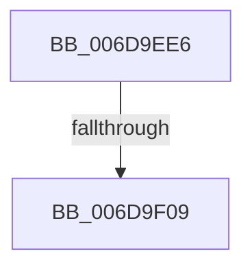

# sub_006D9EE6

- RVA: `0x006D9EE6`–`0x006D9F1A` (길이 `52` bytes)
- VA: `0x00000001406D9EE6`
- 실행 섹션: `.text`
- PDB 이름 있음: `아니요`; PDB Function 태그: `아니요`
- unwind 정보 RVA: `0x00065818`
- 디코드: `13`개 명령, `52/52` bytes 표시
- 미해석 바이트: `0` (있으면 어셈블리에 `.byte`로 보존)

> 이 문서는 커널 이미지의 기계어와 PDB 기호를 분석해 생성했습니다. 4번과 5번은 함수 원형과 자료형을 바이너리 사용 방식에서 추정한 C 해석이며 원본 소스 복구 결과는 아닙니다.

## 1. Dependencies

- 직접 호출 지점: **2**; 고유 호출 대상: **2**
- 직접 호출자로 확인된 함수: **0**
- RIP 상대 이미지 참조: **0**

### Outgoing calls
- `0x006D9EFB` → [KeReleaseSpinLock](../39/KeReleaseSpinLock_function_00392BA0.md) (function, `0x00392BA0`)
- `0x006D9F0F` → [PopFxDerefAndCompleteDirectedPowerTransition](../26/PopFxDerefAndCompleteDirectedPowerTransition_function_0026D8F8.md) (function, `0x0026D8F8`)

### Direct callers
- 이 함수 시작 RVA로 연결되는 직접 call은 확인되지 않았습니다. 간접 호출은 완전히 역산할 수 없습니다.

### Static image references
- 디코드된 RIP-relative 메모리 참조가 없습니다.

## 2. Other-region calls and transfers

- 다른 실행 섹션으로 향하는 call: **0**
- call이 아닌 외부 분기/꼬리 이동: **2**
  - `0x006D9F03` → [PopFxNotifyPreDIrpCompletion + 0x49](../26/PopFxNotifyPreDIrpCompletion_function_0026F1F4.md) (`tail-transfer`)
  - `0x006D9F15` → [PopFxNotifyPreDIrpCompletion + 0x49](../26/PopFxNotifyPreDIrpCompletion_function_0026F1F4.md) (`tail-transfer`)

## 3. Assembly (complete function range)

```asm
006D9EE6  83 CA 02                        or edx, 2
006D9EE9  44 89 B3 C0 04 00 00            mov dword ptr [rbx + 0x4c0], r14d
006D9EF0  89 93 C4 04 00 00               mov dword ptr [rbx + 0x4c4], edx
006D9EF6  48 8B CD                        mov rcx, rbp
006D9EF9  8A D0                           mov dl, al
006D9EFB  E8 A0 8C CB FF                  call 0x140392ba0
006D9F00  40 84 F6                        test sil, sil
006D9F03  0F 84 34 53 B9 FF               je 0x14026f23d
006D9F09  40 8A D7                        mov dl, dil
006D9F0C  48 8B CB                        mov rcx, rbx
006D9F0F  E8 E4 39 B9 FF                  call 0x14026d8f8
006D9F14  90                              nop
006D9F15  E9 23 53 B9 FF                  jmp 0x14026f23d
```

## 4. C-style interpretation (structured pseudocode)

```c
__int64 __fastcall sub_006D9EE6(__int64 a1, int a2)
{
    __int64 result;

    a2 = (unsigned int)((a2) | (2));
    *(unsigned int *)(v_rbx + 1216) = (unsigned int)(v_r14);
    *(unsigned int *)(v_rbx + 1220) = a2;
    result = KeReleaseSpinLock(v_rbp, (unsigned __int8)(result), a3, a4);
    result = PopFxDerefAndCompleteDirectedPowerTransition(v_rbx, (unsigned __int8)(v_rdi), a3, a4);
}
```

## 5. (Beta) C Style

```c
int64_t sub_006D9EE6(int64_t Arg1, int32_t Arg2)
{
    int64_t result;

    Arg2 = (uint32_t)((Arg2) | (2));
    *(uint32_t *)(local_rbx + 0x4C0) = (uint32_t)(local_r14);
    *(uint32_t *)(local_rbx + 0x4C4) = Arg2;
    result = KeReleaseSpinLock(local_rbp, (uint8_t)(result), a3, a4);
    result = PopFxDerefAndCompleteDirectedPowerTransition(local_rbx, (uint8_t)(local_rdi), a3, a4);
}
```

## 6. Execution-region graph

[열기: 2D/3D 그래프와 함수 탐색 컨트롤 패널](../../../control-panel.html?section=text&rva=0x006D9EE6&view=graph)

- 2D 그래프는 위에서 아래로 흐르고, 3D 그래프는 빈 공간을 드래그해 회전합니다. Shift+드래그는 이동, 휠은 확대·축소, 함수 노드 선택은 대상 보고서 이동입니다.

### Static fallback


