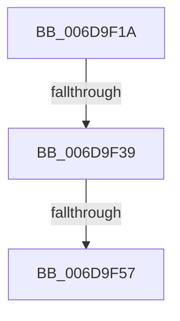

# sub_006D9F1A

- RVA: `0x006D9F1A`–`0x006DA051` (길이 `311` bytes)
- VA: `0x00000001406D9F1A`
- 실행 섹션: `.text`
- PDB 이름 있음: `아니요`; PDB Function 태그: `아니요`
- unwind 정보 RVA: `0x00065874`
- 디코드: `58`개 명령, `311/311` bytes 표시
- 미해석 바이트: `0` (있으면 어셈블리에 `.byte`로 보존)

> 이 문서는 커널 이미지의 기계어와 PDB 기호를 분석해 생성했습니다. 4번과 5번은 함수 원형과 자료형을 바이너리 사용 방식에서 추정한 C 해석이며 원본 소스 복구 결과는 아닙니다.

## 1. Dependencies

- 직접 호출 지점: **4**; 고유 호출 대상: **4**
- 직접 호출자로 확인된 함수: **0**
- RIP 상대 이미지 참조: **2**

### Outgoing calls
- `0x006D9F1D` → [PopComputeWatchdogTimeout](../44/PopComputeWatchdogTimeout_function_00447D54.md) (function, `0x00447D54`)
- `0x006D9F4A` → [tlgKeywordOn](../42/tlgKeywordOn_function_0042EAA0.md) (function, `0x0042EAA0`)
- `0x006D9FA4` → [tlgCreate1Sz_wchar_t](../42/tlgCreate1Sz_wchar_t_function_00426198.md) (function, `0x00426198`)
- `0x006DA046` → [tlgWriteTransfer_EtwWriteTransfer](../42/tlgWriteTransfer_EtwWriteTransfer_function_004260E0.md) (function, `0x004260E0`)

### Direct callers
- 이 함수 시작 RVA로 연결되는 직접 call은 확인되지 않았습니다. 간접 호출은 완전히 역산할 수 없습니다.

### Static image references
- `0x006D9F22` → RVA `0x00E07748` (`.data`; read)
- `0x006D9FB7` → RVA `0x0004C0D5` (`.rdata`; read)

## 2. Other-region calls and transfers

- 다른 실행 섹션으로 향하는 call: **0**
- call이 아닌 외부 분기/꼬리 이동: **3**
  - `0x006D9F33` → [PopDiagTraceIrpFinishTelemetry + 0xE4](../26/PopDiagTraceIrpFinishTelemetry_function_0026F46C.md) (`tail-transfer`)
  - `0x006D9F51` → [PopDiagTraceIrpFinishTelemetry + 0xE4](../26/PopDiagTraceIrpFinishTelemetry_function_0026F46C.md) (`tail-transfer`)
  - `0x006DA04C` → [PopDiagTraceIrpFinishTelemetry + 0xE4](../26/PopDiagTraceIrpFinishTelemetry_function_0026F46C.md) (`tail-transfer`)

## 3. Assembly (complete function range)

```asm
006D9F1A  48 8B CB                        mov rcx, rbx
006D9F1D  E8 32 DE D6 FF                  call 0x140447d54
006D9F22  83 3D 1F D8 72 00 05            cmp dword ptr [rip + 0x72d81f], 5
006D9F29  44 8B C8                        mov r9d, eax
006D9F2C  44 8B 93 C0 00 00 00            mov r10d, dword ptr [rbx + 0xc0]
006D9F33  0F 86 17 56 B9 FF               jbe 0x14026f550
006D9F39  48 BA 00 00 00 00 00 40 00 00   movabs rdx, 0x400000000000
006D9F43  48 8D 0D FE D7 72 00            lea rcx, [rip + 0x72d7fe]
006D9F4A  E8 51 4B D5 FF                  call 0x14042eaa0
006D9F4F  84 C0                           test al, al
006D9F51  0F 84 F9 55 B9 FF               je 0x14026f550
006D9F57  48 8D 44 24 30                  lea rax, [rsp + 0x30]
006D9F5C  44 89 7C 24 30                  mov dword ptr [rsp + 0x30], r15d
006D9F61  48 89 45 80                     mov qword ptr [rbp - 0x80], rax
006D9F65  48 8D 4D B0                     lea rcx, [rbp - 0x50]
006D9F69  48 8B 43 30                     mov rax, qword ptr [rbx + 0x30]
006D9F6D  49 8B D5                        mov rdx, r13
006D9F70  48 89 44 24 48                  mov qword ptr [rsp + 0x48], rax
006D9F75  48 8D 44 24 48                  lea rax, [rsp + 0x48]
006D9F7A  48 89 45 90                     mov qword ptr [rbp - 0x70], rax
006D9F7E  48 8D 44 24 50                  lea rax, [rsp + 0x50]
006D9F83  48 89 45 A0                     mov qword ptr [rbp - 0x60], rax
006D9F87  48 C7 45 88 04 00 00 00         mov qword ptr [rbp - 0x78], 4
006D9F8F  48 C7 45 98 08 00 00 00         mov qword ptr [rbp - 0x68], 8
006D9F97  4C 89 74 24 50                  mov qword ptr [rsp + 0x50], r14
006D9F9C  48 C7 45 A8 08 00 00 00         mov qword ptr [rbp - 0x58], 8
006D9FA4  E8 EF C1 D4 FF                  call 0x140426198
006D9FA9  48 8D 44 24 34                  lea rax, [rsp + 0x34]
006D9FAE  44 89 4C 24 34                  mov dword ptr [rsp + 0x34], r9d
006D9FB3  48 89 45 C0                     mov qword ptr [rbp - 0x40], rax
006D9FB7  48 8D 15 17 21 97 FF            lea rdx, [rip - 0x68dee9]
006D9FBE  8B 83 BC 00 00 00               mov eax, dword ptr [rbx + 0xbc]
006D9FC4  48 8D 0D 7D D7 72 00            lea rcx, [rip + 0x72d77d]
006D9FCB  89 44 24 38                     mov dword ptr [rsp + 0x38], eax
006D9FCF  45 33 C9                        xor r9d, r9d
006D9FD2  48 8D 44 24 38                  lea rax, [rsp + 0x38]
006D9FD7  48 C7 45 C8 04 00 00 00         mov qword ptr [rbp - 0x38], 4
006D9FDF  48 89 45 D0                     mov qword ptr [rbp - 0x30], rax
006D9FE3  45 33 C0                        xor r8d, r8d
006D9FE6  48 8D 44 24 3C                  lea rax, [rsp + 0x3c]
006D9FEB  48 C7 45 D8 04 00 00 00         mov qword ptr [rbp - 0x28], 4
006D9FF3  48 89 45 E0                     mov qword ptr [rbp - 0x20], rax
006D9FF7  48 8D 44 24 40                  lea rax, [rsp + 0x40]
006D9FFC  48 89 45 F0                     mov qword ptr [rbp - 0x10], rax
006DA000  48 8D 44 24 58                  lea rax, [rsp + 0x58]
006DA005  48 89 45 00                     mov qword ptr [rbp], rax
006DA009  48 8D 44 24 60                  lea rax, [rsp + 0x60]
006DA00E  48 89 44 24 28                  mov qword ptr [rsp + 0x28], rax
006DA013  C7 44 24 20 0B 00 00 00         mov dword ptr [rsp + 0x20], 0xb
006DA01B  44 89 54 24 3C                  mov dword ptr [rsp + 0x3c], r10d
006DA020  48 C7 45 E8 04 00 00 00         mov qword ptr [rbp - 0x18], 4
006DA028  44 89 5C 24 40                  mov dword ptr [rsp + 0x40], r11d
006DA02D  48 C7 45 F8 04 00 00 00         mov qword ptr [rbp - 8], 4
006DA035  48 C7 44 24 58 00 00 00 01      mov qword ptr [rsp + 0x58], 0x1000000
006DA03E  48 C7 45 08 08 00 00 00         mov qword ptr [rbp + 8], 8
006DA046  E8 95 C0 D4 FF                  call 0x1404260e0
006DA04B  90                              nop
006DA04C  E9 FF 54 B9 FF                  jmp 0x14026f550
```

## 4. C-style interpretation (structured pseudocode)

```c
__int64 __fastcall sub_006D9F1A(__int64 a1, __int64 a2, int a3, __int64 a4, __int64 a5, __int64 a6, __int64 a7, __int64 a8, __int64 a9, __int64 a10, __int64 a11, __int64 a12)
{
    __int64 result;
    unsigned int v_stack_p20;
    unsigned __int64 v_stack_p28;
    unsigned int v_stack_p30;
    unsigned __int64 v_stack_p34;
    unsigned int v_stack_p38;
    unsigned __int64 v_stack_p3C;
    unsigned int v_stack_p40;
    unsigned __int64 v_stack_p48;
    unsigned __int64 v_stack_p50;
    unsigned __int64 v_stack_p58;

    result = PopComputeWatchdogTimeout(v_rbx, a2, a3, a4);
    result = tlgKeywordOn(v_rip + 7526398, a2, a3, (unsigned int)((unsigned int)(result)));
    v_stack_p30 = (unsigned int)(v_r15);
    *(unsigned __int64 *)(v_rbp - 128) = a6;
    v_stack_p48 = *(unsigned __int64 *)(v_rbx + 48);
    *(unsigned __int64 *)(v_rbp - 112) = a9;
    *(unsigned __int64 *)(v_rbp - 96) = a10;
    *(unsigned __int64 *)(v_rbp - 120) = 4;
    *(unsigned __int64 *)(v_rbp - 104) = 8;
    v_stack_p50 = v_r14;
    *(unsigned __int64 *)(v_rbp - 88) = 8;
    result = tlgCreate1Sz_wchar_t(v_rbp - 80, v_r13, a3, (unsigned int)((unsigned int)(result)));
    v_stack_p34 = (unsigned int)((unsigned int)((unsigned int)(result)));
    *(unsigned __int64 *)(v_rbp - 64) = v_stack_p34;
    v_stack_p38 = (unsigned int)((unsigned int)(*(unsigned int *)(v_rbx + 188)));
    a4 = 0;
    *(unsigned __int64 *)(v_rbp - 56) = 4;
    *(unsigned __int64 *)(v_rbp - 48) = a7;
    a3 = 0;
    *(unsigned __int64 *)(v_rbp - 40) = 4;
    *(unsigned __int64 *)(v_rbp - 32) = v_stack_p3C;
    *(unsigned __int64 *)(v_rbp - 16) = a8;
    *(unsigned __int64 *)(v_rbp) = a11;
    v_stack_p28 = a12;
    v_stack_p20 = 11;
    v_stack_p3C = (unsigned int)((unsigned int)(*(unsigned int *)(v_rbx + 192)));
    *(unsigned __int64 *)(v_rbp - 24) = 4;
    v_stack_p40 = (unsigned int)(v_r11);
    *(unsigned __int64 *)(v_rbp - 8) = 4;
    v_stack_p58 = 0x1000000ULL;
    *(unsigned __int64 *)(v_rbp + 8) = 8;
    result = tlgWriteTransfer_EtwWriteTransfer(v_rip + 7526269, v_rip - 6872809, a3, a4);
}
```

## 5. (Beta) C Style

```c
int64_t sub_006D9F1A(int64_t Arg1, int64_t Arg2, int32_t Arg3, int64_t Arg4, uint64_t Arg5, int64_t Arg6, int64_t Arg7, int64_t Arg8, int64_t Arg9, int64_t Arg10, int64_t Arg11, int64_t Arg12)
{
    int64_t result;
    uint32_t v_stack_p20;
    uint64_t v_stack_p28;
    uint32_t v_stack_p30;
    uint64_t v_stack_p34;
    uint32_t v_stack_p38;
    uint64_t v_stack_p3C;
    uint32_t v_stack_p40;
    uint64_t v_stack_p48;
    uint64_t v_stack_p50;
    uint64_t v_stack_p58;

    result = PopComputeWatchdogTimeout(local_rbx, Arg2, Arg3, Arg4);
    result = tlgKeywordOn(v_rip + 7526398, Arg2, Arg3, (uint32_t)((uint32_t)(result)));
    v_stack_p30 = (uint32_t)(local_r15);
    *(uint64_t *)(local_rbp - 0x80) = Arg6;
    v_stack_p48 = *(uint64_t *)(local_rbx + 0x30);
    *(uint64_t *)(local_rbp - 0x70) = Arg9;
    *(uint64_t *)(local_rbp - 0x60) = Arg10;
    *(uint64_t *)(local_rbp - 0x78) = 4;
    *(uint64_t *)(local_rbp - 0x68) = 8;
    v_stack_p50 = local_r14;
    *(uint64_t *)(local_rbp - 0x58) = 8;
    result = tlgCreate1Sz_wchar_t(local_rbp - 80, local_r13, Arg3, (uint32_t)((uint32_t)(result)));
    v_stack_p34 = (uint32_t)((uint32_t)((uint32_t)(result)));
    *(uint64_t *)(local_rbp - 0x40) = v_stack_p34;
    v_stack_p38 = (uint32_t)((uint32_t)(*(uint32_t *)(local_rbx + 0xBC)));
    Arg4 = 0;
    *(uint64_t *)(local_rbp - 0x38) = 4;
    *(uint64_t *)(local_rbp - 0x30) = Arg7;
    Arg3 = 0;
    *(uint64_t *)(local_rbp - 0x28) = 4;
    *(uint64_t *)(local_rbp - 0x20) = v_stack_p3C;
    *(uint64_t *)(local_rbp - 0x10) = Arg8;
    *(uint64_t *)(local_rbp) = Arg11;
    v_stack_p28 = Arg12;
    v_stack_p20 = 11;
    v_stack_p3C = (uint32_t)((uint32_t)(*(uint32_t *)(local_rbx + 0xC0)));
    *(uint64_t *)(local_rbp - 0x18) = 4;
    v_stack_p40 = (uint32_t)(local_r11);
    *(uint64_t *)(local_rbp - 0x8) = 4;
    v_stack_p58 = 0x1000000ULL;
    *(uint64_t *)(local_rbp + 0x8) = 8;
    result = tlgWriteTransfer_EtwWriteTransfer(v_rip + 7526269, v_rip - 6872809, Arg3, Arg4);
}
```

## 6. Execution-region graph

[열기: 2D/3D 그래프와 함수 탐색 컨트롤 패널](../../../control-panel.html?section=text&rva=0x006D9F1A&view=graph)

- 2D 그래프는 위에서 아래로 흐르고, 3D 그래프는 빈 공간을 드래그해 회전합니다. Shift+드래그는 이동, 휠은 확대·축소, 함수 노드 선택은 대상 보고서 이동입니다.

### Static fallback


