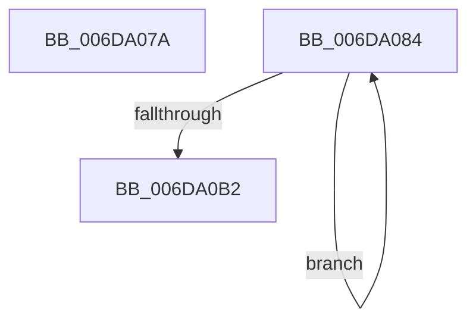

# sub_006DA07A

- RVA: `0x006DA07A`–`0x006DA0BC` (길이 `66` bytes)
- VA: `0x00000001406DA07A`
- 실행 섹션: `.text`
- PDB 이름 있음: `아니요`; PDB Function 태그: `아니요`
- unwind 정보 RVA: `0x00065AFC`
- 디코드: `15`개 명령, `66/66` bytes 표시
- 미해석 바이트: `0` (있으면 어셈블리에 `.byte`로 보존)

> 이 문서는 커널 이미지의 기계어와 PDB 기호를 분석해 생성했습니다. 4번과 5번은 함수 원형과 자료형을 바이너리 사용 방식에서 추정한 C 해석이며 원본 소스 복구 결과는 아닙니다.

## 1. Dependencies

- 직접 호출 지점: **3**; 고유 호출 대상: **3**
- 직접 호출자로 확인된 함수: **0**
- RIP 상대 이미지 참조: **1**

### Outgoing calls
- `0x006DA08B` → [ExReleaseFastMutex](../25/ExReleaseFastMutex_function_002519C0.md) (function, `0x002519C0`)
- `0x006DA097` → [guard_dispatch_icall](../6B/guard_dispatch_icall_function_006BAAD0.md) (function, `0x006BAAD0`)
- `0x006DA0A5` → [ExAcquireFastMutex](../20/ExAcquireFastMutex_function_0020E5A0.md) (function, `0x0020E5A0`)

### Direct callers
- 이 함수 시작 RVA로 연결되는 직접 call은 확인되지 않았습니다. 간접 호출은 완전히 역산할 수 없습니다.

### Static image references
- `0x006DA084` → RVA `0x00F8F580` (`.data`; read)

## 2. Other-region calls and transfers

- 다른 실행 섹션으로 향하는 call: **0**
- call이 아닌 외부 분기/꼬리 이동: **2**
  - `0x006DA07F` → [CcUnmapInactiveViewsInternal + 0x34B](../27/CcUnmapInactiveViewsInternal_function_0027174C.md) (`tail-transfer`)
  - `0x006DA0B7` → [CcUnmapInactiveViewsInternal + 0x499](../27/CcUnmapInactiveViewsInternal_function_0027174C.md) (`tail-transfer`)

## 3. Assembly (complete function range)

```asm
006DA07A  44 89 7C 24 24                  mov dword ptr [rsp + 0x24], r15d
006DA07F  E9 13 7A B9 FF                  jmp 0x140271a97
006DA084  48 8D 0D F5 54 8B 00            lea rcx, [rip + 0x8b54f5]
006DA08B  E8 30 79 B7 FF                  call 0x1402519c0
006DA090  48 8B 43 10                     mov rax, qword ptr [rbx + 0x10]
006DA094  48 8B CD                        mov rcx, rbp
006DA097  E8 34 0A FE FF                  call 0x1406baad0
006DA09C  48 8D 0D DD 54 8B 00            lea rcx, [rip + 0x8b54dd]
006DA0A3  0B F8                           or edi, eax
006DA0A5  E8 F6 44 B3 FF                  call 0x14020e5a0
006DA0AA  48 8B 1B                        mov rbx, qword ptr [rbx]
006DA0AD  49 3B DF                        cmp rbx, r15
006DA0B0  75 D2                           jne 0x1406da084
006DA0B2  44 8B 7C 24 24                  mov r15d, dword ptr [rsp + 0x24]
006DA0B7  E9 29 7B B9 FF                  jmp 0x140271be5
```

## 4. C-style interpretation (structured pseudocode)

```c
__int64 __fastcall sub_006DA07A(void)
{
    unsigned int v_stack_p24;

    v_stack_p24 = (unsigned int)(v_r15);
}
```

## 5. (Beta) C Style

```c
void sub_006DA07A(void)
{
    uint32_t v_stack_p24;

    v_stack_p24 = (uint32_t)(local_r15);
}
```

## 6. Execution-region graph

[열기: 2D/3D 그래프와 함수 탐색 컨트롤 패널](../../../control-panel.html?section=text&rva=0x006DA07A&view=graph)

- 2D 그래프는 위에서 아래로 흐르고, 3D 그래프는 빈 공간을 드래그해 회전합니다. Shift+드래그는 이동, 휠은 확대·축소, 함수 노드 선택은 대상 보고서 이동입니다.

### Static fallback


