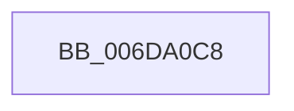

# sub_006DA0C8

- RVA: `0x006DA0C8`–`0x006DA0EA` (길이 `34` bytes)
- VA: `0x00000001406DA0C8`
- 실행 섹션: `.text`
- PDB 이름 있음: `아니요`; PDB Function 태그: `아니요`
- unwind 정보 RVA: `0x00065FA8`
- 디코드: `7`개 명령, `34/34` bytes 표시
- 미해석 바이트: `0` (있으면 어셈블리에 `.byte`로 보존)

> 이 문서는 커널 이미지의 기계어와 PDB 기호를 분석해 생성했습니다. 4번과 5번은 함수 원형과 자료형을 바이너리 사용 방식에서 추정한 C 해석이며 원본 소스 복구 결과는 아닙니다.

## 1. Dependencies

- 직접 호출 지점: **0**; 고유 호출 대상: **0**
- 직접 호출자로 확인된 함수: **0**
- RIP 상대 이미지 참조: **0**

### Outgoing calls
- 직접 디코드된 call 명령이 없습니다.

### Direct callers
- 이 함수 시작 RVA로 연결되는 직접 call은 확인되지 않았습니다. 간접 호출은 완전히 역산할 수 없습니다.

### Static image references
- 디코드된 RIP-relative 메모리 참조가 없습니다.

## 2. Other-region calls and transfers

- 다른 실행 섹션으로 향하는 call: **0**
- call이 아닌 외부 분기/꼬리 이동: **1**
  - `0x006DA0E5` → [MiDeleteVa + 0x19E](../27/MiDeleteVa_function_002789E0.md) (`tail-transfer`)

## 3. Assembly (complete function range)

```asm
006DA0C8  48 8B 8F C0 00 00 00            mov rcx, qword ptr [rdi + 0xc0]
006DA0CF  48 8B 47 58                     mov rax, qword ptr [rdi + 0x58]
006DA0D3  48 8D 14 C8                     lea rdx, [rax + rcx*8]
006DA0D7  49 2B D0                        sub rdx, r8
006DA0DA  48 C1 FA 03                     sar rdx, 3
006DA0DE  48 89 97 D8 00 00 00            mov qword ptr [rdi + 0xd8], rdx
006DA0E5  E9 94 EA B9 FF                  jmp 0x140278b7e
```

## 4. C-style interpretation (structured pseudocode)

```c
__int64 __fastcall sub_006DA0C8(__int64 a1, __int64 a2, __int64 a3)
{
    a2 = (*(unsigned __int64 *)(v_rdi + 88) + *(unsigned __int64 *)(v_rdi + 192) * 8) - (a3);
    a2 = (a2) >> (3);
    *(unsigned __int64 *)(v_rdi + 216) = a2;
}
```

## 5. (Beta) C Style

```c
int64_t sub_006DA0C8(int64_t Arg1, int64_t Arg2, int64_t Arg3)
{
    Arg2 = (*(uint64_t *)(local_rdi + 0x58) + *(uint64_t *)(local_rdi + 0xC0) * 8) - (Arg3);
    Arg2 = (Arg2) >> (3);
    *(uint64_t *)(local_rdi + 0xD8) = Arg2;
}
```

## 6. Execution-region graph

[열기: 2D/3D 그래프와 함수 탐색 컨트롤 패널](../../../control-panel.html?section=text&rva=0x006DA0C8&view=graph)

- 2D 그래프는 위에서 아래로 흐르고, 3D 그래프는 빈 공간을 드래그해 회전합니다. Shift+드래그는 이동, 휠은 확대·축소, 함수 노드 선택은 대상 보고서 이동입니다.

### Static fallback


