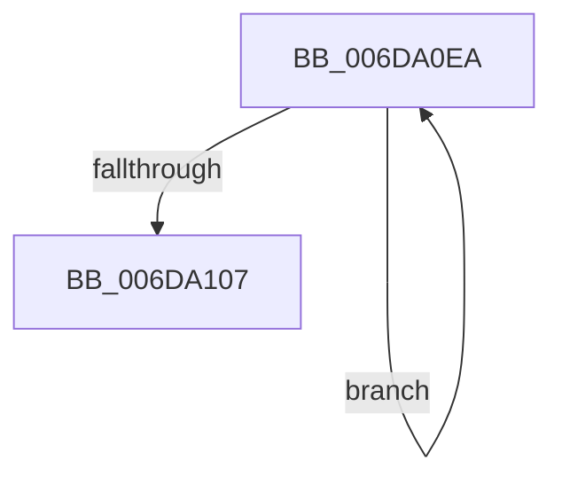

# sub_006DA0EA

- RVA: `0x006DA0EA`–`0x006DA10C` (길이 `34` bytes)
- VA: `0x00000001406DA0EA`
- 실행 섹션: `.text`
- PDB 이름 있음: `아니요`; PDB Function 태그: `아니요`
- unwind 정보 RVA: `0x000664DC`
- 디코드: `10`개 명령, `34/34` bytes 표시
- 미해석 바이트: `0` (있으면 어셈블리에 `.byte`로 보존)

> 이 문서는 커널 이미지의 기계어와 PDB 기호를 분석해 생성했습니다. 4번과 5번은 함수 원형과 자료형을 바이너리 사용 방식에서 추정한 C 해석이며 원본 소스 복구 결과는 아닙니다.

## 1. Dependencies

- 직접 호출 지점: **1**; 고유 호출 대상: **1**
- 직접 호출자로 확인된 함수: **0**
- RIP 상대 이미지 참조: **0**

### Outgoing calls
- `0x006DA0F7` → [RtlAvlRemoveNode](../29/RtlAvlRemoveNode_function_00296650.md) (function, `0x00296650`)

### Direct callers
- 이 함수 시작 RVA로 연결되는 직접 call은 확인되지 않았습니다. 간접 호출은 완전히 역산할 수 없습니다.

### Static image references
- 디코드된 RIP-relative 메모리 참조가 없습니다.

## 2. Other-region calls and transfers

- 다른 실행 섹션으로 향하는 call: **0**
- call이 아닌 외부 분기/꼬리 이동: **1**
  - `0x006DA107` → [MiUnlockWorkingSetExclusive + 0x86](../27/MiUnlockWorkingSetExclusive_function_0027EC70.md) (`tail-transfer`)

## 3. Assembly (complete function range)

```asm
006DA0EA  48 8D 5F B0                     lea rbx, [rdi - 0x50]
006DA0EE  48 8B CD                        mov rcx, rbp
006DA0F1  48 8B 3F                        mov rdi, qword ptr [rdi]
006DA0F4  48 8B D3                        mov rdx, rbx
006DA0F7  E8 54 C5 BB FF                  call 0x140296650
006DA0FC  4C 89 3B                        mov qword ptr [rbx], r15
006DA0FF  4C 8B FB                        mov r15, rbx
006DA102  48 85 FF                        test rdi, rdi
006DA105  75 E3                           jne 0x1406da0ea
006DA107  E9 EA 4B BA FF                  jmp 0x14027ecf6
```

## 4. C-style interpretation (structured pseudocode)

```c
__int64 __fastcall sub_006DA0EA(void)
{
    __int64 result;

    result = RtlAvlRemoveNode(v_rbp, v_rdi - 80, a3, a4);
    *(unsigned __int64 *)(v_rdi - 80) = v_r15;
    if (*(unsigned __int64 *)(v_rdi) != 0) goto loc_006DA0EA;
}
```

## 5. (Beta) C Style

```c
void sub_006DA0EA(void)
{
    int64_t result;

    result = RtlAvlRemoveNode(local_rbp, local_rdi - 80, a3, a4);
    *(uint64_t *)(local_rdi - 0x50) = local_r15;
    if (*(uint64_t *)(local_rdi) != 0) goto loc_006DA0EA;
}
```

## 6. Execution-region graph

[열기: 2D/3D 그래프와 함수 탐색 컨트롤 패널](../../../control-panel.html?section=text&rva=0x006DA0EA&view=graph)

- 2D 그래프는 위에서 아래로 흐르고, 3D 그래프는 빈 공간을 드래그해 회전합니다. Shift+드래그는 이동, 휠은 확대·축소, 함수 노드 선택은 대상 보고서 이동입니다.

### Static fallback


