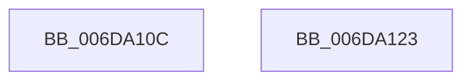

# sub_006DA10C

- RVA: `0x006DA10C`–`0x006DA136` (길이 `42` bytes)
- VA: `0x00000001406DA10C`
- 실행 섹션: `.text`
- PDB 이름 있음: `아니요`; PDB Function 태그: `아니요`
- unwind 정보 RVA: `0x00066674`
- 디코드: `9`개 명령, `42/42` bytes 표시
- 미해석 바이트: `0` (있으면 어셈블리에 `.byte`로 보존)

> 이 문서는 커널 이미지의 기계어와 PDB 기호를 분석해 생성했습니다. 4번과 5번은 함수 원형과 자료형을 바이너리 사용 방식에서 추정한 C 해석이며 원본 소스 복구 결과는 아닙니다.

## 1. Dependencies

- 직접 호출 지점: **2**; 고유 호출 대상: **2**
- 직접 호출자로 확인된 함수: **0**
- RIP 상대 이미지 참조: **0**

### Outgoing calls
- `0x006DA10C` → [MiIssuePageHeatList](../44/MiIssuePageHeatList_function_0044615C.md) (function, `0x0044615C`)
- `0x006DA115` → [MiFreeTransitionPageHeatList](../4E/MiFreeTransitionPageHeatList_function_004E2B08.md) (function, `0x004E2B08`)

### Direct callers
- 이 함수 시작 RVA로 연결되는 직접 call은 확인되지 않았습니다. 간접 호출은 완전히 역산할 수 없습니다.

### Static image references
- 디코드된 RIP-relative 메모리 참조가 없습니다.

## 2. Other-region calls and transfers

- 다른 실행 섹션으로 향하는 call: **0**
- call이 아닌 외부 분기/꼬리 이동: **2**
  - `0x006DA11E` → [sub_0027F063 + 0xD2](../27/Unknown_function_0027F063.md) (`tail-transfer`)
  - `0x006DA131` → [sub_0027F063 + 0xDF](../27/Unknown_function_0027F063.md) (`tail-transfer`)

## 3. Assembly (complete function range)

```asm
006DA10C  E8 4B C0 D6 FF                  call 0x14044615c
006DA111  48 8B 4D B8                     mov rcx, qword ptr [rbp - 0x48]
006DA115  E8 EE 89 E0 FF                  call 0x1404e2b08
006DA11A  4C 89 6D B8                     mov qword ptr [rbp - 0x48], r13
006DA11E  E9 12 50 BA FF                  jmp 0x14027f135
006DA123  81 FF 17 00 00 C0               cmp edi, 0xc0000017
006DA129  B8 34 04 00 C0                  mov eax, 0xc0000434
006DA12E  0F 44 F8                        cmove edi, eax
006DA131  E9 0C 50 BA FF                  jmp 0x14027f142
```

## 4. C-style interpretation (structured pseudocode)

```c
__int64 __fastcall sub_006DA10C(void)
{
    __int64 result;

    result = MiIssuePageHeatList(a1, a2, a3, a4);
    result = MiFreeTransitionPageHeatList(*(unsigned __int64 *)(v_rbp - 72), a2, a3, a4);
    *(unsigned __int64 *)(v_rbp - 72) = v_r13;
}
```

## 5. (Beta) C Style

```c
void sub_006DA10C(void)
{
    int64_t result;

    result = MiIssuePageHeatList(a1, a2, a3, a4);
    result = MiFreeTransitionPageHeatList(*(uint64_t *)(local_rbp - 0x48), a2, a3, a4);
    *(uint64_t *)(local_rbp - 0x48) = local_r13;
}
```

## 6. Execution-region graph

[열기: 2D/3D 그래프와 함수 탐색 컨트롤 패널](../../../control-panel.html?section=text&rva=0x006DA10C&view=graph)

- 2D 그래프는 위에서 아래로 흐르고, 3D 그래프는 빈 공간을 드래그해 회전합니다. Shift+드래그는 이동, 휠은 확대·축소, 함수 노드 선택은 대상 보고서 이동입니다.

### Static fallback


