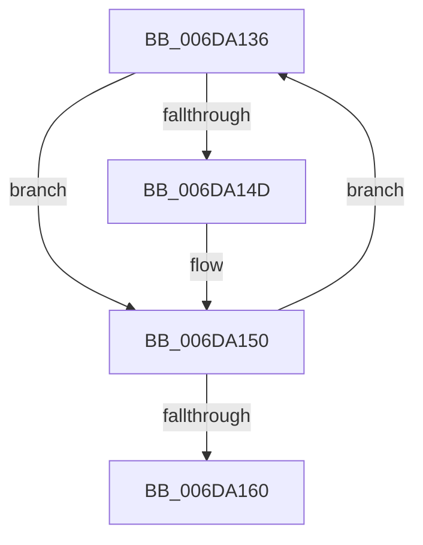

# sub_006DA136

- RVA: `0x006DA136`–`0x006DA165` (길이 `47` bytes)
- VA: `0x00000001406DA136`
- 실행 섹션: `.text`
- PDB 이름 있음: `아니요`; PDB Function 태그: `아니요`
- unwind 정보 RVA: `0x000666E0`
- 디코드: `12`개 명령, `47/47` bytes 표시
- 미해석 바이트: `0` (있으면 어셈블리에 `.byte`로 보존)

> 이 문서는 커널 이미지의 기계어와 PDB 기호를 분석해 생성했습니다. 4번과 5번은 함수 원형과 자료형을 바이너리 사용 방식에서 추정한 C 해석이며 원본 소스 복구 결과는 아닙니다.

## 1. Dependencies

- 직접 호출 지점: **0**; 고유 호출 대상: **0**
- 직접 호출자로 확인된 함수: **0**
- RIP 상대 이미지 참조: **1**

### Outgoing calls
- 직접 디코드된 call 명령이 없습니다.

### Direct callers
- 이 함수 시작 RVA로 연결되는 직접 call은 확인되지 않았습니다. 간접 호출은 완전히 역산할 수 없습니다.

### Static image references
- `0x006DA140` → RVA `0x00FC6A88` (`ALMOSTRO`; read)

## 2. Other-region calls and transfers

- 다른 실행 섹션으로 향하는 call: **0**
- call이 아닌 외부 분기/꼬리 이동: **1**
  - `0x006DA160` → [MiMakeSystemAddressValid + 0x3F7](../27/MiMakeSystemAddressValid_function_0027FF70.md) (`tail-transfer`)

## 3. Assembly (complete function range)

```asm
006DA136  48 8B CB                        mov rcx, rbx
006DA139  48 8B D3                        mov rdx, rbx
006DA13C  48 83 C9 20                     or rcx, 0x20
006DA140  48 F7 05 3D C9 8E 00 00 00 00 02  test qword ptr [rip + 0x8ec93d], 0x2000000
006DA14B  74 03                           je 0x1406da150
006DA14D  0F AE E8                        lfence
006DA150  48 8B C3                        mov rax, rbx
006DA153  F0 48 0F B1 0E                  lock cmpxchg qword ptr [rsi], rcx
006DA158  48 8B D8                        mov rbx, rax
006DA15B  48 3B C2                        cmp rax, rdx
006DA15E  75 D6                           jne 0x1406da136
006DA160  E9 02 62 BA FF                  jmp 0x140280367
```

## 4. C-style interpretation (structured pseudocode)

```c
__int64 __fastcall sub_006DA136(void)
{
    a1 = (v_rbx) | (32);
    if (((*(unsigned __int64 *)(v_rip + 9357629)) & (0x2000000ULL)) != 0) {
    }
    if (v_rbx != v_rbx) goto loc_006DA136;
}
```

## 5. (Beta) C Style

```c
void sub_006DA136(void)
{
    a1 = (local_rbx) | (32);
    if (((*(uint64_t *)(v_rip + 0x8EC93D)) & (0x2000000ULL)) != 0) {
    }
    if (local_rbx != local_rbx) goto loc_006DA136;
}
```

## 6. Execution-region graph

[열기: 2D/3D 그래프와 함수 탐색 컨트롤 패널](../../../control-panel.html?section=text&rva=0x006DA136&view=graph)

- 2D 그래프는 위에서 아래로 흐르고, 3D 그래프는 빈 공간을 드래그해 회전합니다. Shift+드래그는 이동, 휠은 확대·축소, 함수 노드 선택은 대상 보고서 이동입니다.

### Static fallback


