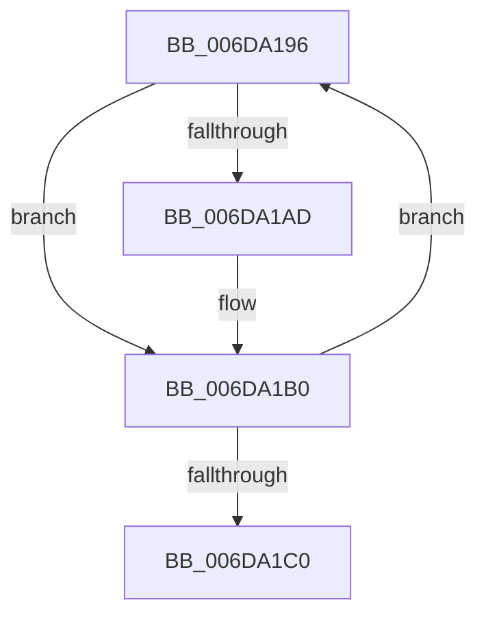

# sub_006DA196

- RVA: `0x006DA196`–`0x006DA1C5` (길이 `47` bytes)
- VA: `0x00000001406DA196`
- 실행 섹션: `.text`
- PDB 이름 있음: `아니요`; PDB Function 태그: `아니요`
- unwind 정보 RVA: `0x00066834`
- 디코드: `12`개 명령, `47/47` bytes 표시
- 미해석 바이트: `0` (있으면 어셈블리에 `.byte`로 보존)

> 이 문서는 커널 이미지의 기계어와 PDB 기호를 분석해 생성했습니다. 4번과 5번은 함수 원형과 자료형을 바이너리 사용 방식에서 추정한 C 해석이며 원본 소스 복구 결과는 아닙니다.

## 1. Dependencies

- 직접 호출 지점: **0**; 고유 호출 대상: **0**
- 직접 호출자로 확인된 함수: **0**
- RIP 상대 이미지 참조: **1**

### Outgoing calls
- 직접 디코드된 call 명령이 없습니다.

### Direct callers
- 이 함수 시작 RVA로 연결되는 직접 call은 확인되지 않았습니다. 간접 호출은 완전히 역산할 수 없습니다.

### Static image references
- `0x006DA1A0` → RVA `0x00FC6A88` (`ALMOSTRO`; read)

## 2. Other-region calls and transfers

- 다른 실행 섹션으로 향하는 call: **0**
- call이 아닌 외부 분기/꼬리 이동: **1**
  - `0x006DA1C0` → [sub_00281A81 + 0x1E5](../28/Unknown_function_00281A81.md) (`tail-transfer`)

## 3. Assembly (complete function range)

```asm
006DA196  48 8B CB                        mov rcx, rbx
006DA199  48 8B D3                        mov rdx, rbx
006DA19C  48 83 C9 20                     or rcx, 0x20
006DA1A0  48 F7 05 DD C8 8E 00 00 00 00 02  test qword ptr [rip + 0x8ec8dd], 0x2000000
006DA1AB  74 03                           je 0x1406da1b0
006DA1AD  0F AE E8                        lfence
006DA1B0  48 8B C3                        mov rax, rbx
006DA1B3  F0 48 0F B1 0E                  lock cmpxchg qword ptr [rsi], rcx
006DA1B8  48 8B D8                        mov rbx, rax
006DA1BB  48 3B C2                        cmp rax, rdx
006DA1BE  75 D6                           jne 0x1406da196
006DA1C0  E9 A1 7A BA FF                  jmp 0x140281c66
```

## 4. C-style interpretation (structured pseudocode)

```c
__int64 __fastcall sub_006DA196(void)
{
    a1 = (v_rbx) | (32);
    if (((*(unsigned __int64 *)(v_rip + 9357533)) & (0x2000000ULL)) != 0) {
    }
    if (v_rbx != v_rbx) goto loc_006DA196;
}
```

## 5. (Beta) C Style

```c
void sub_006DA196(void)
{
    a1 = (local_rbx) | (32);
    if (((*(uint64_t *)(v_rip + 0x8EC8DD)) & (0x2000000ULL)) != 0) {
    }
    if (local_rbx != local_rbx) goto loc_006DA196;
}
```

## 6. Execution-region graph

[열기: 2D/3D 그래프와 함수 탐색 컨트롤 패널](../../../control-panel.html?section=text&rva=0x006DA196&view=graph)

- 2D 그래프는 위에서 아래로 흐르고, 3D 그래프는 빈 공간을 드래그해 회전합니다. Shift+드래그는 이동, 휠은 확대·축소, 함수 노드 선택은 대상 보고서 이동입니다.

### Static fallback


