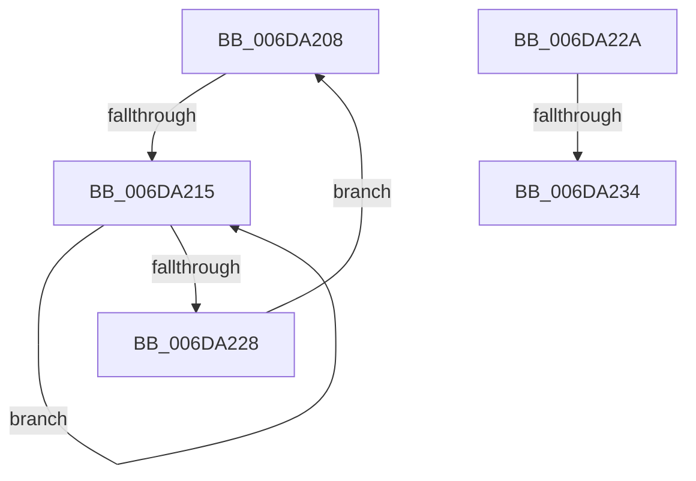

# sub_006DA208

- RVA: `0x006DA208`–`0x006DA245` (길이 `61` bytes)
- VA: `0x00000001406DA208`
- 실행 섹션: `.text`
- PDB 이름 있음: `아니요`; PDB Function 태그: `아니요`
- unwind 정보 RVA: `0x00066A74`
- 디코드: `14`개 명령, `61/61` bytes 표시
- 미해석 바이트: `0` (있으면 어셈블리에 `.byte`로 보존)

> 이 문서는 커널 이미지의 기계어와 PDB 기호를 분석해 생성했습니다. 4번과 5번은 함수 원형과 자료형을 바이너리 사용 방식에서 추정한 C 해석이며 원본 소스 복구 결과는 아닙니다.

## 1. Dependencies

- 직접 호출 지점: **2**; 고유 호출 대상: **2**
- 직접 호출자로 확인된 함수: **0**
- RIP 상대 이미지 참조: **0**

### Outgoing calls
- `0x006DA21A` → [KeYieldProcessorEx](../3F/KeYieldProcessorEx_function_003FBD00.md) (function, `0x003FBD00`)
- `0x006DA237` → [MiLockPageInline](../31/MiLockPageInline_function_0031A340.md) (function, `0x0031A340`)

### Direct callers
- 이 함수 시작 RVA로 연결되는 직접 call은 확인되지 않았습니다. 간접 호출은 완전히 역산할 수 없습니다.

### Static image references
- 디코드된 RIP-relative 메모리 참조가 없습니다.

## 2. Other-region calls and transfers

- 다른 실행 섹션으로 향하는 call: **0**
- call이 아닌 외부 분기/꼬리 이동: **3**
  - `0x006DA20F` → [sub_00285639 + 0x17](../28/Unknown_function_00285639.md) (`tail-transfer`)
  - `0x006DA22E` → [sub_00285639 + 0x17](../28/Unknown_function_00285639.md) (`tail-transfer`)
  - `0x006DA240` → [sub_00285639 + 0x17](../28/Unknown_function_00285639.md) (`tail-transfer`)

## 3. Assembly (complete function range)

```asm
006DA208  F0 48 0F BA 6F 18 3F            lock bts qword ptr [rdi + 0x18], 0x3f
006DA20F  0F 83 3B B4 BA FF               jae 0x140285650
006DA215  48 8D 4C 24 58                  lea rcx, [rsp + 0x58]
006DA21A  E8 E1 1A D2 FF                  call 0x1403fbd00
006DA21F  48 8B 47 18                     mov rax, qword ptr [rdi + 0x18]
006DA223  48 85 C0                        test rax, rax
006DA226  78 ED                           js 0x1406da215
006DA228  EB DE                           jmp 0x1406da208
006DA22A  40 F6 C6 04                     test sil, 4
006DA22E  0F 85 1C B4 BA FF               jne 0x140285650
006DA234  48 8B CF                        mov rcx, rdi
006DA237  E8 04 01 C4 FF                  call 0x14031a340
006DA23C  44 0F B6 E0                     movzx r12d, al
006DA240  E9 0B B4 BA FF                  jmp 0x140285650
```

## 4. C-style interpretation (structured pseudocode)

```c
__int64 __fastcall sub_006DA208(__int64 a1, __int64 a2, __int64 a3, __int64 a4, __int64 a5, __int64 a6, __int64 a7, __int64 a8, __int64 a9, __int64 a10, __int64 a11)
{
    __int64 result;

loc_006DA215:
    result = KeYieldProcessorEx(a11, a2, a3, a4);
    if (sign_flag) goto loc_006DA215;
    goto loc_006DA208;
}
```

## 5. (Beta) C Style

```c
int64_t sub_006DA208(int64_t Arg1, int64_t Arg2, int64_t Arg3, int64_t Arg4, uint64_t Arg5, uint64_t Arg6, uint64_t Arg7, uint64_t Arg8, uint64_t Arg9, uint64_t Arg10, int64_t Arg11)
{
    int64_t result;

loc_006DA215:
    result = KeYieldProcessorEx(Arg11, Arg2, Arg3, Arg4);
    if (sign_flag) goto loc_006DA215;
    goto loc_006DA208;
}
```

## 6. Execution-region graph

[열기: 2D/3D 그래프와 함수 탐색 컨트롤 패널](../../../control-panel.html?section=text&rva=0x006DA208&view=graph)

- 2D 그래프는 위에서 아래로 흐르고, 3D 그래프는 빈 공간을 드래그해 회전합니다. Shift+드래그는 이동, 휠은 확대·축소, 함수 노드 선택은 대상 보고서 이동입니다.

### Static fallback


