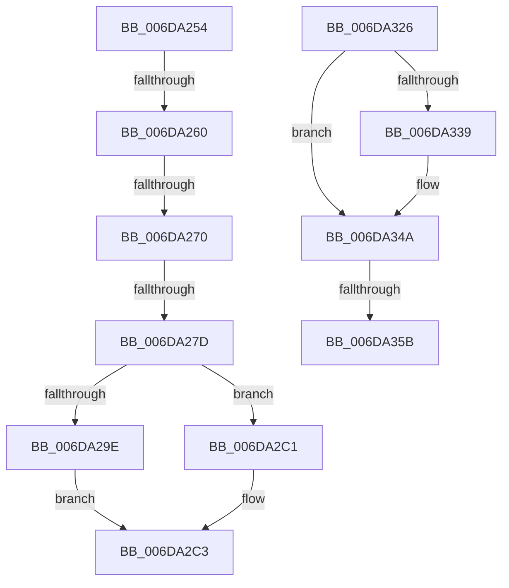

# sub_006DA254

- RVA: `0x006DA254`–`0x006DA360` (길이 `268` bytes)
- VA: `0x00000001406DA254`
- 실행 섹션: `.text`
- PDB 이름 있음: `아니요`; PDB Function 태그: `아니요`
- unwind 정보 RVA: `0x00066CC0`
- 디코드: `57`개 명령, `268/268` bytes 표시
- 미해석 바이트: `0` (있으면 어셈블리에 `.byte`로 보존)

> 이 문서는 커널 이미지의 기계어와 PDB 기호를 분석해 생성했습니다. 4번과 5번은 함수 원형과 자료형을 바이너리 사용 방식에서 추정한 C 해석이며 원본 소스 복구 결과는 아닙니다.

## 1. Dependencies

- 직접 호출 지점: **6**; 고유 호출 대상: **4**
- 직접 호출자로 확인된 함수: **0**
- RIP 상대 이미지 참조: **1**

### Outgoing calls
- `0x006DA284` → [ExAcquireSpinLockExclusive](../24/ExAcquireSpinLockExclusive_function_00248690.md) (function, `0x00248690`)
- `0x006DA2D4` → [MiReleaseSpinLockExclusive](../24/MiReleaseSpinLockExclusive_function_002482C0.md) (function, `0x002482C0`)
- `0x006DA2FA` → [KeWaitForSingleObject](../20/KeWaitForSingleObject_function_0020E6B0.md) (function, `0x0020E6B0`)
- `0x006DA306` → [ExAcquireSpinLockExclusive](../24/ExAcquireSpinLockExclusive_function_00248690.md) (function, `0x00248690`)
- `0x006DA31B` → [MiReleaseSpinLockExclusive](../24/MiReleaseSpinLockExclusive_function_002482C0.md) (function, `0x002482C0`)
- `0x006DA345` → [KeSetEvent](../33/KeSetEvent_function_0033F310.md) (function, `0x0033F310`)

### Direct callers
- 이 함수 시작 RVA로 연결되는 직접 call은 확인되지 않았습니다. 간접 호출은 완전히 역산할 수 없습니다.

### Static image references
- `0x006DA2D9` → RVA `0x000134D0` (`.rdata`; read)

## 2. Other-region calls and transfers

- 다른 실행 섹션으로 향하는 call: **0**
- call이 아닌 외부 분기/꼬리 이동: **6**
  - `0x006DA25A` → [MiChargeCommit + 0x15C](../28/MiChargeCommit_function_00286EB0.md) (`tail-transfer`)
  - `0x006DA26A` → [MiChargeCommit + 0x15C](../28/MiChargeCommit_function_00286EB0.md) (`tail-transfer`)
  - `0x006DA277` → [MiChargeCommit + 0x15C](../28/MiChargeCommit_function_00286EB0.md) (`tail-transfer`)
  - `0x006DA321` → [MiChargeCommit + 0x15C](../28/MiChargeCommit_function_00286EB0.md) (`tail-transfer`)
  - `0x006DA355` → [MiChargeCommit + 0x609](../28/MiChargeCommit_function_00286EB0.md) (`tail-transfer`)
  - `0x006DA35B` → [MiChargeCommit + 0x604](../28/MiChargeCommit_function_00286EB0.md) (`tail-transfer`)

## 3. Assembly (complete function range)

```asm
006DA254  44 0F 20 C0                     mov rax, cr8
006DA258  3C 02                           cmp al, 2
006DA25A  0F 83 AC CD BA FF               jae 0x14028700c
006DA260  48 8B 86 C8 41 00 00            mov rax, qword ptr [rsi + 0x41c8]
006DA267  48 3B D0                        cmp rdx, rax
006DA26A  0F 84 9C CD BA FF               je 0x14028700c
006DA270  83 BE 9C 09 00 00 00            cmp dword ptr [rsi + 0x99c], 0
006DA277  0F 84 8F CD BA FF               je 0x14028700c
006DA27D  48 8D 8E C0 06 00 00            lea rcx, [rsi + 0x6c0]
006DA284  E8 07 E4 B6 FF                  call 0x140248690
006DA289  8B 96 98 09 00 00               mov edx, dword ptr [rsi + 0x998]
006DA28F  4C 8D A6 A0 09 00 00            lea r12, [rsi + 0x9a0]
006DA296  44 0F B6 C0                     movzx r8d, al
006DA29A  85 D2                           test edx, edx
006DA29C  75 23                           jne 0x1406da2c1
006DA29E  66 41 89 14 24                  mov word ptr [r12], dx
006DA2A3  49 8D 44 24 08                  lea rax, [r12 + 8]
006DA2A8  41 89 54 24 04                  mov dword ptr [r12 + 4], edx
006DA2AD  BA 01 00 00 00                  mov edx, 1
006DA2B2  41 C6 44 24 02 06               mov byte ptr [r12 + 2], 6
006DA2B8  48 89 40 08                     mov qword ptr [rax + 8], rax
006DA2BC  48 89 00                        mov qword ptr [rax], rax
006DA2BF  EB 02                           jmp 0x1406da2c3
006DA2C1  FF C2                           inc edx
006DA2C3  89 96 98 09 00 00               mov dword ptr [rsi + 0x998], edx
006DA2C9  48 8D 8E C0 06 00 00            lea rcx, [rsi + 0x6c0]
006DA2D0  41 0F B6 D0                     movzx edx, r8b
006DA2D4  E8 E7 DF B6 FF                  call 0x1402482c0
006DA2D9  48 8B 05 F0 91 93 FF            mov rax, qword ptr [rip - 0x6c6e10]
006DA2E0  45 33 C9                        xor r9d, r9d
006DA2E3  48 89 44 24 38                  mov qword ptr [rsp + 0x38], rax
006DA2E8  45 33 C0                        xor r8d, r8d
006DA2EB  48 8D 44 24 38                  lea rax, [rsp + 0x38]
006DA2F0  33 D2                           xor edx, edx
006DA2F2  49 8B CC                        mov rcx, r12
006DA2F5  48 89 44 24 20                  mov qword ptr [rsp + 0x20], rax
006DA2FA  E8 B1 43 B3 FF                  call 0x14020e6b0
006DA2FF  48 8D 8E C0 06 00 00            lea rcx, [rsi + 0x6c0]
006DA306  E8 85 E3 B6 FF                  call 0x140248690
006DA30B  FF 8E 98 09 00 00               dec dword ptr [rsi + 0x998]
006DA311  48 8D 8E C0 06 00 00            lea rcx, [rsi + 0x6c0]
006DA318  0F B6 D0                        movzx edx, al
006DA31B  E8 A0 DF B6 FF                  call 0x1402482c0
006DA320  90                              nop
006DA321  E9 E6 CC BA FF                  jmp 0x14028700c
006DA326  48 8B 8E 98 4C 00 00            mov rcx, qword ptr [rsi + 0x4c98]
006DA32D  48 8B 86 C8 41 00 00            mov rax, qword ptr [rsi + 0x41c8]
006DA334  48 3B C8                        cmp rcx, rax
006DA337  75 11                           jne 0x1406da34a
006DA339  48 8B 8E 38 01 00 00            mov rcx, qword ptr [rsi + 0x138]
006DA340  45 33 C0                        xor r8d, r8d
006DA343  33 D2                           xor edx, edx
006DA345  E8 C6 4F C6 FF                  call 0x14033f310
006DA34A  48 8B 8E 28 01 00 00            mov rcx, qword ptr [rsi + 0x128]
006DA351  83 79 04 01                     cmp dword ptr [rcx + 4], 1
006DA355  0F 85 5E D1 BA FF               jne 0x1402874b9
006DA35B  E9 54 D1 BA FF                  jmp 0x1402874b4
```

## 4. C-style interpretation (structured pseudocode)

```c
__int64 __fastcall sub_006DA254(__int64 a1, __int64 a2, __int64 a3, int a4, __int64 a5, __int64 a6, __int64 a7)
{
    __int64 result;
    unsigned __int64 v_stack_p20;
    unsigned __int64 v_stack_p38;

    result = ExAcquireSpinLockExclusive(v_rsi + 1728, a2, a3, a4);
    if ((unsigned int)((unsigned int)(*(unsigned int *)(v_rsi + 2456))) != 0) goto loc_006DA2C1;
    *(unsigned __int16 *)(v_rsi + 2464) = (unsigned __int16)((unsigned int)(*(unsigned int *)(v_rsi + 2456)));
    *(unsigned int *)(v_rsi + 2464 + 4) = (unsigned int)((unsigned int)(*(unsigned int *)(v_rsi + 2456)));
    *(unsigned __int8 *)(v_rsi + 2464 + 2) = 6;
    *(unsigned __int64 *)(v_rsi + 2464 + 8 + 8) = v_rsi + 2464 + 8;
    *(unsigned __int64 *)(v_rsi + 2464 + 8) = v_rsi + 2464 + 8;
    goto loc_006DA2C3;
loc_006DA2C1:
    a2 = (unsigned int)((1) + 1);
loc_006DA2C3:
    *(unsigned int *)(v_rsi + 2456) = (unsigned int)(a2);
    result = MiReleaseSpinLockExclusive(v_rsi + 1728, (unsigned __int8)((unsigned __int8)(result)), (unsigned __int8)(result), a4);
    a4 = 0;
    v_stack_p38 = *(unsigned __int64 *)(v_rip - 7106064);
    a3 = 0;
    a2 = 0;
    v_stack_p20 = a7;
    result = KeWaitForSingleObject(v_rsi + 2464, a2, a3, a4);
    result = ExAcquireSpinLockExclusive(v_rsi + 1728, a2, a3, a4);
    result = MiReleaseSpinLockExclusive(v_rsi + 1728, (unsigned __int8)(result), a3, a4);
}
```

## 5. (Beta) C Style

```c
int64_t sub_006DA254(int64_t Arg1, int64_t Arg2, int64_t Arg3, int32_t Arg4, uint64_t Arg5, uint64_t Arg6, int64_t Arg7)
{
    int64_t result;
    uint64_t v_stack_p20;
    uint64_t v_stack_p38;

    result = ExAcquireSpinLockExclusive(local_rsi + 1728, Arg2, Arg3, Arg4);
    if ((uint32_t)((uint32_t)(*(uint32_t *)(local_rsi + 0x998))) != 0) goto loc_006DA2C1;
    *(uint16_t *)(local_rsi + 0x9A0) = (uint16_t)((uint32_t)(*(uint32_t *)(local_rsi + 0x998)));
    *(uint32_t *)(local_rsi + 0x9A0 + 0x4) = (uint32_t)((uint32_t)(*(uint32_t *)(local_rsi + 0x998)));
    *(uint8_t *)(local_rsi + 0x9A0 + 0x2) = 6;
    *(uint64_t *)(local_rsi + 0x9A0 + 0x8 + 0x8) = local_rsi + 2464 + 8;
    *(uint64_t *)(local_rsi + 0x9A0 + 0x8) = local_rsi + 2464 + 8;
    goto loc_006DA2C3;
loc_006DA2C1:
    Arg2 = (uint32_t)((1) + 1);
loc_006DA2C3:
    *(uint32_t *)(local_rsi + 0x998) = (uint32_t)(Arg2);
    result = MiReleaseSpinLockExclusive(local_rsi + 1728, (uint8_t)((uint8_t)(result)), (uint8_t)(result), Arg4);
    Arg4 = 0;
    v_stack_p38 = *(uint64_t *)(v_rip - 0x6C6E10);
    Arg3 = 0;
    Arg2 = 0;
    v_stack_p20 = Arg7;
    result = KeWaitForSingleObject(local_rsi + 2464, Arg2, Arg3, Arg4);
    result = ExAcquireSpinLockExclusive(local_rsi + 1728, Arg2, Arg3, Arg4);
    result = MiReleaseSpinLockExclusive(local_rsi + 1728, (uint8_t)(result), Arg3, Arg4);
}
```

## 6. Execution-region graph

[열기: 2D/3D 그래프와 함수 탐색 컨트롤 패널](../../../control-panel.html?section=text&rva=0x006DA254&view=graph)

- 2D 그래프는 위에서 아래로 흐르고, 3D 그래프는 빈 공간을 드래그해 회전합니다. Shift+드래그는 이동, 휠은 확대·축소, 함수 노드 선택은 대상 보고서 이동입니다.

### Static fallback


