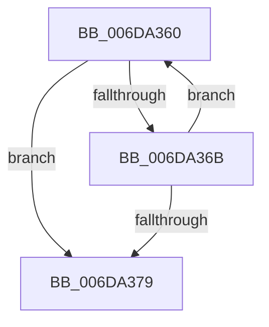

# sub_006DA360

- RVA: `0x006DA360`–`0x006DA383` (길이 `35` bytes)
- VA: `0x00000001406DA360`
- 실행 섹션: `.text`
- PDB 이름 있음: `아니요`; PDB Function 태그: `아니요`
- unwind 정보 RVA: `0x00066E30`
- 디코드: `11`개 명령, `35/35` bytes 표시
- 미해석 바이트: `0` (있으면 어셈블리에 `.byte`로 보존)

> 이 문서는 커널 이미지의 기계어와 PDB 기호를 분석해 생성했습니다. 4번과 5번은 함수 원형과 자료형을 바이너리 사용 방식에서 추정한 C 해석이며 원본 소스 복구 결과는 아닙니다.

## 1. Dependencies

- 직접 호출 지점: **0**; 고유 호출 대상: **0**
- 직접 호출자로 확인된 함수: **0**
- RIP 상대 이미지 참조: **0**

### Outgoing calls
- 직접 디코드된 call 명령이 없습니다.

### Direct callers
- 이 함수 시작 RVA로 연결되는 직접 call은 확인되지 않았습니다. 간접 호출은 완전히 역산할 수 없습니다.

### Static image references
- 디코드된 RIP-relative 메모리 참조가 없습니다.

## 2. Other-region calls and transfers

- 다른 실행 섹션으로 향하는 call: **0**
- call이 아닌 외부 분기/꼬리 이동: **1**
  - `0x006DA37E` → [MiGetPage + 0x15A](../28/MiGetPage_function_002884C0.md) (`tail-transfer`)

## 3. Assembly (complete function range)

```asm
006DA360  0F B6 08                        movzx ecx, byte ptr [rax]
006DA363  44 88 00                        mov byte ptr [rax], r8b
006DA366  3A 4D E4                        cmp cl, byte ptr [rbp - 0x1c]
006DA369  74 0E                           je 0x1406da379
006DA36B  48 FF C0                        inc rax
006DA36E  FE C2                           inc dl
006DA370  44 0F B6 C1                     movzx r8d, cl
006DA374  3A 55 E3                        cmp dl, byte ptr [rbp - 0x1d]
006DA377  72 E7                           jb 0x1406da360
006DA379  44 8B 44 24 38                  mov r8d, dword ptr [rsp + 0x38]
006DA37E  E9 97 E2 BA FF                  jmp 0x14028861a
```

## 4. C-style interpretation (structured pseudocode)

```c
__int64 __fastcall sub_006DA360(__int64 a1, unsigned __int8 a2, unsigned __int8 a3, __int64 a4, __int64 a5, __int64 a6, unsigned int a7)
{
    __int64 result;

    *(unsigned __int8 *)(result) = a3;
    if (((unsigned __int8)(*(unsigned __int8 *)(result))) == (*(unsigned __int8 *)(v_rbp - 28))) goto loc_006DA379;
    result = (result) + 1;
    a2 = (unsigned __int8)((a2) + 1);
    if (a2 < (*(unsigned __int8 *)(v_rbp - 29))) goto loc_006DA360;
loc_006DA379:
}
```

## 5. (Beta) C Style

```c
int64_t sub_006DA360(int64_t Arg1, uint8_t Arg2, uint8_t Arg3, int64_t Arg4, uint64_t Arg5, uint64_t Arg6, uint32_t Arg7)
{
    int64_t result;

    *(uint8_t *)(result) = Arg3;
    if (((uint8_t)(*(uint8_t *)(result))) == (*(uint8_t *)(local_rbp - 0x1C))) goto loc_006DA379;
    result = (result) + 1;
    Arg2 = (uint8_t)((Arg2) + 1);
    if (Arg2 < (*(uint8_t *)(local_rbp - 0x1D))) goto loc_006DA360;
loc_006DA379:
}
```

## 6. Execution-region graph

[열기: 2D/3D 그래프와 함수 탐색 컨트롤 패널](../../../control-panel.html?section=text&rva=0x006DA360&view=graph)

- 2D 그래프는 위에서 아래로 흐르고, 3D 그래프는 빈 공간을 드래그해 회전합니다. Shift+드래그는 이동, 휠은 확대·축소, 함수 노드 선택은 대상 보고서 이동입니다.

### Static fallback


