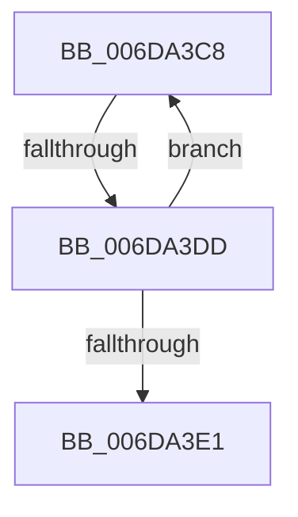

# sub_006DA3C8

- RVA: `0x006DA3C8`–`0x006DA3E6` (길이 `30` bytes)
- VA: `0x00000001406DA3C8`
- 실행 섹션: `.text`
- PDB 이름 있음: `아니요`; PDB Function 태그: `아니요`
- unwind 정보 RVA: `0x00066EF0`
- 디코드: `9`개 명령, `30/30` bytes 표시
- 미해석 바이트: `0` (있으면 어셈블리에 `.byte`로 보존)

> 이 문서는 커널 이미지의 기계어와 PDB 기호를 분석해 생성했습니다. 4번과 5번은 함수 원형과 자료형을 바이너리 사용 방식에서 추정한 C 해석이며 원본 소스 복구 결과는 아닙니다.

## 1. Dependencies

- 직접 호출 지점: **0**; 고유 호출 대상: **0**
- 직접 호출자로 확인된 함수: **0**
- RIP 상대 이미지 참조: **0**

### Outgoing calls
- 직접 디코드된 call 명령이 없습니다.

### Direct callers
- 이 함수 시작 RVA로 연결되는 직접 call은 확인되지 않았습니다. 간접 호출은 완전히 역산할 수 없습니다.

### Static image references
- 디코드된 RIP-relative 메모리 참조가 없습니다.

## 2. Other-region calls and transfers

- 다른 실행 섹션으로 향하는 call: **0**
- call이 아닌 외부 분기/꼬리 이동: **2**
  - `0x006DA3D7` → [MiRemovePageAnyColor + 0x200](../28/MiRemovePageAnyColor_function_0028A9D8.md) (`tail-transfer`)
  - `0x006DA3E1` → [MiRemovePageAnyColor + 0x200](../28/MiRemovePageAnyColor_function_0028A9D8.md) (`tail-transfer`)

## 3. Assembly (complete function range)

```asm
006DA3C8  8B C1                           mov eax, ecx
006DA3CA  83 C1 10                        add ecx, 0x10
006DA3CD  83 E0 3F                        and eax, 0x3f
006DA3D0  49 0F AB C4                     bts r12, rax
006DA3D4  83 F9 40                        cmp ecx, 0x40
006DA3D7  0F 83 FB 07 BB FF               jae 0x14028abd8
006DA3DD  3B CA                           cmp ecx, edx
006DA3DF  72 E7                           jb 0x1406da3c8
006DA3E1  E9 F2 07 BB FF                  jmp 0x14028abd8
```

## 4. C-style interpretation (structured pseudocode)

```c
__int64 __fastcall sub_006DA3C8(int a1, int a2)
{
    __int64 result;

    a1 = (unsigned int)((a1) + (16));
    result = (unsigned int)(((unsigned int)(a1)) & (63));
    if (a1 < a2) goto loc_006DA3C8;
}
```

## 5. (Beta) C Style

```c
int64_t sub_006DA3C8(int32_t Arg1, int32_t Arg2)
{
    int64_t result;

    Arg1 = (uint32_t)((Arg1) + (16));
    result = (uint32_t)(((uint32_t)(Arg1)) & (63));
    if (Arg1 < Arg2) goto loc_006DA3C8;
}
```

## 6. Execution-region graph

[열기: 2D/3D 그래프와 함수 탐색 컨트롤 패널](../../../control-panel.html?section=text&rva=0x006DA3C8&view=graph)

- 2D 그래프는 위에서 아래로 흐르고, 3D 그래프는 빈 공간을 드래그해 회전합니다. Shift+드래그는 이동, 휠은 확대·축소, 함수 노드 선택은 대상 보고서 이동입니다.

### Static fallback


