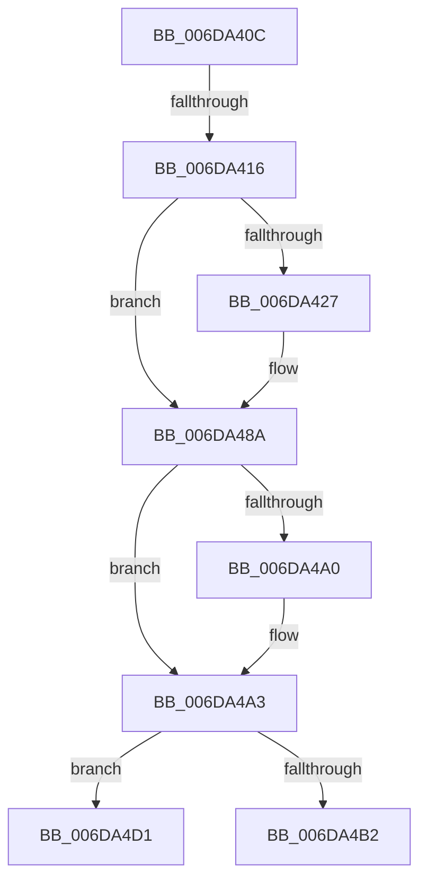

# sub_006DA40C

- RVA: `0x006DA40C`–`0x006DA4DA` (길이 `206` bytes)
- VA: `0x00000001406DA40C`
- 실행 섹션: `.text`
- PDB 이름 있음: `아니요`; PDB Function 태그: `아니요`
- unwind 정보 RVA: `0x00067004`
- 디코드: `40`개 명령, `206/206` bytes 표시
- 미해석 바이트: `0` (있으면 어셈블리에 `.byte`로 보존)

> 이 문서는 커널 이미지의 기계어와 PDB 기호를 분석해 생성했습니다. 4번과 5번은 함수 원형과 자료형을 바이너리 사용 방식에서 추정한 C 해석이며 원본 소스 복구 결과는 아닙니다.

## 1. Dependencies

- 직접 호출 지점: **2**; 고유 호출 대상: **2**
- 직접 호출자로 확인된 함수: **0**
- RIP 상대 이미지 참조: **2**

### Outgoing calls
- `0x006DA485` → [EtwTraceKernelEvent](../23/EtwTraceKernelEvent_function_00235350.md) (function, `0x00235350`)
- `0x006DA4A9` → [MiTrimNoStealPagesFromWorkingSets](../4B/MiTrimNoStealPagesFromWorkingSets_function_004BB268.md) (function, `0x004BB268`)

### Direct callers
- 이 함수 시작 RVA로 연결되는 직접 call은 확인되지 않았습니다. 간접 호출은 완전히 역산할 수 없습니다.

### Static image references
- `0x006DA416` → RVA `0x00FC6B04` (`ALMOSTRO`; read)
- `0x006DA48A` → RVA `0x00EF546C` (`.data`; read/write)

## 2. Other-region calls and transfers

- 다른 실행 섹션으로 향하는 call: **0**
- call이 아닌 외부 분기/꼬리 이동: **3**
  - `0x006DA410` → [MiFindContiguousPagesEx + 0x664](../28/MiFindContiguousPagesEx_function_0028BDE0.md) (`tail-transfer`)
  - `0x006DA4CC` → [MiFindContiguousPagesEx + 0x2D2](../28/MiFindContiguousPagesEx_function_0028BDE0.md) (`tail-transfer`)
  - `0x006DA4D5` → [MiFindContiguousPagesEx + 0x66E](../28/MiFindContiguousPagesEx_function_0028BDE0.md) (`tail-transfer`)

## 3. Assembly (complete function range)

```asm
006DA40C  83 7D 90 00                     cmp dword ptr [rbp - 0x70], 0
006DA410  0F 84 2E 20 BB FF               je 0x14028c444
006DA416  F7 05 E4 C6 8E 00 00 00 10 00   test dword ptr [rip + 0x8ec6e4], 0x100000
006DA420  48 8B 74 24 58                  mov rsi, qword ptr [rsp + 0x58]
006DA425  74 63                           je 0x1406da48a
006DA427  65 48 8B 04 25 88 01 00 00      mov rax, qword ptr gs:[0x188]
006DA430  41 B9 71 02 00 00               mov r9d, 0x271
006DA436  BA 01 00 00 00                  mov edx, 1
006DA43B  48 C7 85 C8 00 00 00 10 00 00 00  mov qword ptr [rbp + 0xc8], 0x10
006DA446  41 B8 00 00 10 20               mov r8d, 0x20100000
006DA44C  C7 44 24 20 02 1A 50 00         mov dword ptr [rsp + 0x20], 0x501a02
006DA454  48 8B 88 10 05 00 00            mov rcx, qword ptr [rax + 0x510]
006DA45B  48 8B C6                        mov rax, rsi
006DA45E  48 C1 E0 0C                     shl rax, 0xc
006DA462  48 89 85 18 01 00 00            mov qword ptr [rbp + 0x118], rax
006DA469  48 8D 85 10 01 00 00            lea rax, [rbp + 0x110]
006DA470  48 89 8D 10 01 00 00            mov qword ptr [rbp + 0x110], rcx
006DA477  48 8D 8D C0 00 00 00            lea rcx, [rbp + 0xc0]
006DA47E  48 89 85 C0 00 00 00            mov qword ptr [rbp + 0xc0], rax
006DA485  E8 C6 AE B5 FF                  call 0x140235350
006DA48A  FF 05 DC AF 81 00               inc dword ptr [rip + 0x81afdc]
006DA490  44 8B 6C 24 50                  mov r13d, dword ptr [rsp + 0x50]
006DA495  8B 54 24 60                     mov edx, dword ptr [rsp + 0x60]
006DA499  41 0F BA E5 1A                  bt r13d, 0x1a
006DA49E  72 03                           jb 0x1406da4a3
006DA4A0  83 E2 FE                        and edx, 0xfffffffe
006DA4A3  83 CA 02                        or edx, 2
006DA4A6  49 8B CF                        mov rcx, r15
006DA4A9  E8 BA 0D DE FF                  call 0x1404bb268
006DA4AE  85 C0                           test eax, eax
006DA4B0  74 1F                           je 0x1406da4d1
006DA4B2  4C 8B 75 38                     mov r14, qword ptr [rbp + 0x38]
006DA4B6  BB FF FF FF FF                  mov ebx, 0xffffffff
006DA4BB  44 89 65 94                     mov dword ptr [rbp - 0x6c], r12d
006DA4BF  44 89 65 90                     mov dword ptr [rbp - 0x70], r12d
006DA4C3  44 89 64 24 60                  mov dword ptr [rsp + 0x60], r12d
006DA4C8  4C 89 65 A0                     mov qword ptr [rbp - 0x60], r12
006DA4CC  E9 E1 1B BB FF                  jmp 0x14028c0b2
006DA4D1  4C 8B 45 B8                     mov r8, qword ptr [rbp - 0x48]
006DA4D5  E9 74 1F BB FF                  jmp 0x14028c44e
```

## 4. C-style interpretation (structured pseudocode)

```c
__int64 __fastcall sub_006DA40C(__int64 a1, __int64 a2, __int64 a3, __int64 a4, __int64 a5, __int64 a6, __int64 a7, __int64 a8, __int64 a9, unsigned int a10, __int64 a11, unsigned int a12)
{
    __int64 result;
    unsigned int v_stack_p20;
    unsigned int v_stack_p60;

    if (((*(unsigned int *)(v_rip + 9357028)) & (0x100000ULL)) != 0) {
        result = *(unsigned __int64 *)(gs_base + (0 + 392));
        a4 = 625;
        a2 = 1;
        *(unsigned __int64 *)(v_rbp + 200) = 16;
        a3 = 0x20100000ULL;
        v_stack_p20 = 0x501A02ULL;
        a1 = *(unsigned __int64 *)(result + 1296);
        result = a11;
        result = (result) << (12);
        *(unsigned __int64 *)(v_rbp + 280) = result;
        result = v_rbp + 272;
        *(unsigned __int64 *)(v_rbp + 272) = a1;
        a1 = v_rbp + 192;
        *(unsigned __int64 *)(v_rbp + 192) = result;
        result = EtwTraceKernelEvent(a1, a2, a3, a4);
    }
    if (!(condition_is_below)) {
        a2 = (unsigned int)(((unsigned int)(a12)) & (0xFFFFFFFEULL));
    }
    a2 = (unsigned int)((a2) | (2));
    result = MiTrimNoStealPagesFromWorkingSets(v_r15, a2, a3, a4);
    if ((unsigned int)(result) == 0) goto loc_006DA4D1;
    *(unsigned int *)(v_rbp - 108) = (unsigned int)(v_r12);
    *(unsigned int *)(v_rbp - 112) = (unsigned int)(v_r12);
    v_stack_p60 = (unsigned int)(v_r12);
    *(unsigned __int64 *)(v_rbp - 96) = v_r12;
loc_006DA4D1:
}
```

## 5. (Beta) C Style

```c
int64_t sub_006DA40C(int64_t Arg1, int64_t Arg2, int64_t Arg3, int64_t Arg4, uint64_t Arg5, uint64_t Arg6, uint64_t Arg7, uint64_t Arg8, uint64_t Arg9, uint32_t Arg10, int64_t Arg11, uint32_t Arg12)
{
    int64_t result;
    uint32_t v_stack_p20;
    uint32_t v_stack_p60;

    if (((*(uint32_t *)(v_rip + 0x8EC6E4)) & (0x100000ULL)) != 0) {
        result = *(uint64_t *)(gs_base + (0 + 0x188));
        Arg4 = 625;
        Arg2 = 1;
        *(uint64_t *)(local_rbp + 0xC8) = 16;
        Arg3 = 0x20100000ULL;
        v_stack_p20 = 0x501A02ULL;
        Arg1 = *(uint64_t *)(result + 0x510);
        result = Arg11;
        result = (result) << (12);
        *(uint64_t *)(local_rbp + 0x118) = result;
        result = local_rbp + 272;
        *(uint64_t *)(local_rbp + 0x110) = Arg1;
        Arg1 = local_rbp + 192;
        *(uint64_t *)(local_rbp + 0xC0) = result;
        result = EtwTraceKernelEvent(Arg1, Arg2, Arg3, Arg4);
    }
    if (!(condition_is_below)) {
        Arg2 = (uint32_t)(((uint32_t)(Arg12)) & (0xFFFFFFFEULL));
    }
    Arg2 = (uint32_t)((Arg2) | (2));
    result = MiTrimNoStealPagesFromWorkingSets(local_r15, Arg2, Arg3, Arg4);
    if ((uint32_t)(result) == 0) goto loc_006DA4D1;
    *(uint32_t *)(local_rbp - 0x6C) = (uint32_t)(local_r12);
    *(uint32_t *)(local_rbp - 0x70) = (uint32_t)(local_r12);
    v_stack_p60 = (uint32_t)(local_r12);
    *(uint64_t *)(local_rbp - 0x60) = local_r12;
loc_006DA4D1:
}
```

## 6. Execution-region graph

[열기: 2D/3D 그래프와 함수 탐색 컨트롤 패널](../../../control-panel.html?section=text&rva=0x006DA40C&view=graph)

- 2D 그래프는 위에서 아래로 흐르고, 3D 그래프는 빈 공간을 드래그해 회전합니다. Shift+드래그는 이동, 휠은 확대·축소, 함수 노드 선택은 대상 보고서 이동입니다.

### Static fallback


