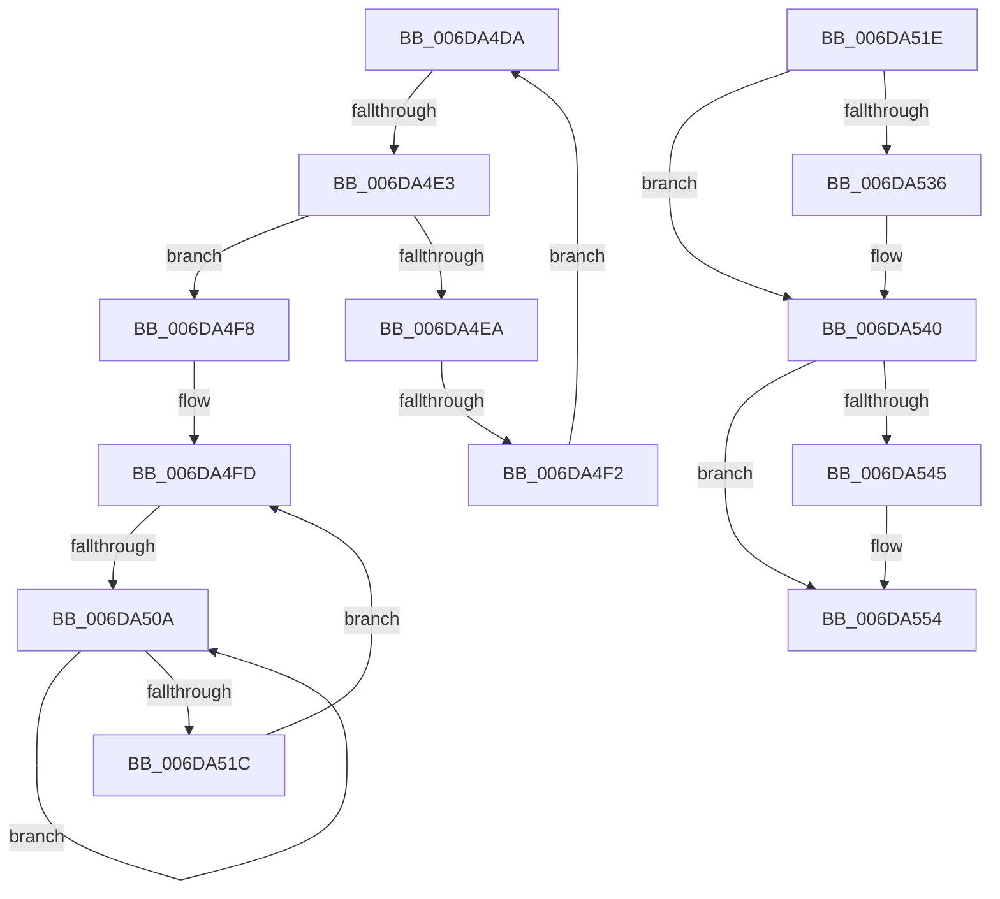

# sub_006DA4DA

- RVA: `0x006DA4DA`–`0x006DA55B` (길이 `129` bytes)
- VA: `0x00000001406DA4DA`
- 실행 섹션: `.text`
- PDB 이름 있음: `아니요`; PDB Function 태그: `아니요`
- unwind 정보 RVA: `0x0006706C`
- 디코드: `36`개 명령, `129/129` bytes 표시
- 미해석 바이트: `0` (있으면 어셈블리에 `.byte`로 보존)

> 이 문서는 커널 이미지의 기계어와 PDB 기호를 분석해 생성했습니다. 4번과 5번은 함수 원형과 자료형을 바이너리 사용 방식에서 추정한 C 해석이며 원본 소스 복구 결과는 아닙니다.

## 1. Dependencies

- 직접 호출 지점: **4**; 고유 호출 대상: **4**
- 직접 호출자로 확인된 함수: **0**
- RIP 상대 이미지 참조: **0**

### Outgoing calls
- `0x006DA50E` → [KeYieldProcessorEx](../3F/KeYieldProcessorEx_function_003FBD00.md) (function, `0x003FBD00`)
- `0x006DA527` → [MiInsertPageInFreeOrZeroedList](../33/MiInsertPageInFreeOrZeroedList_function_00334D20.md) (function, `0x00334D20`)
- `0x006DA53B` → [MiUnlockProtoPoolPage](../24/MiUnlockProtoPoolPage_function_00246090.md) (function, `0x00246090`)
- `0x006DA54F` → [MiReleasePageFileInfo](../28/MiReleasePageFileInfo_function_00283FD0.md) (function, `0x00283FD0`)

### Direct callers
- 이 함수 시작 RVA로 연결되는 직접 call은 확인되지 않았습니다. 간접 호출은 완전히 역산할 수 없습니다.

### Static image references
- 디코드된 RIP-relative 메모리 참조가 없습니다.

## 2. Other-region calls and transfers

- 다른 실행 섹션으로 향하는 call: **0**
- call이 아닌 외부 분기/꼬리 이동: **4**
  - `0x006DA4DD` → [MiMigratePfn + 0x1F3](../28/MiMigratePfn_function_0028DBB0.md) (`tail-transfer`)
  - `0x006DA4EC` → [MiMigratePfn + 0x1F3](../28/MiMigratePfn_function_0028DBB0.md) (`tail-transfer`)
  - `0x006DA504` → [MiMigratePfn + 0x6C8](../28/MiMigratePfn_function_0028DBB0.md) (`tail-transfer`)
  - `0x006DA556` → [MiMigratePfn + 0x5F](../28/MiMigratePfn_function_0028DBB0.md) (`tail-transfer`)

## 3. Assembly (complete function range)

```asm
006DA4DA  4C 3B C2                        cmp r8, rdx
006DA4DD  0F 83 C0 38 BB FF               jae 0x14028dda3
006DA4E3  41 8B 08                        mov ecx, dword ptr [r8]
006DA4E6  3B CE                           cmp ecx, esi
006DA4E8  74 0E                           je 0x1406da4f8
006DA4EA  3B C8                           cmp ecx, eax
006DA4EC  0F 84 B1 38 BB FF               je 0x14028dda3
006DA4F2  49 83 C0 04                     add r8, 4
006DA4F6  EB E2                           jmp 0x1406da4da
006DA4F8  33 F6                           xor esi, esi
006DA4FA  89 75 50                        mov dword ptr [rbp + 0x50], esi
006DA4FD  F0 49 0F BA 6E 18 3F            lock bts qword ptr [r14 + 0x18], 0x3f
006DA504  0F 83 6E 3D BB FF               jae 0x14028e278
006DA50A  48 8D 4D 50                     lea rcx, [rbp + 0x50]
006DA50E  E8 ED 17 D2 FF                  call 0x1403fbd00
006DA513  49 8B 46 18                     mov rax, qword ptr [r14 + 0x18]
006DA517  48 85 C0                        test rax, rax
006DA51A  78 EE                           js 0x1406da50a
006DA51C  EB DF                           jmp 0x1406da4fd
006DA51E  48 8B 4D C0                     mov rcx, qword ptr [rbp - 0x40]
006DA522  BA 02 00 00 00                  mov edx, 2
006DA527  E8 F4 A7 C5 FF                  call 0x140334d20
006DA52C  F0 49 21 76 18                  lock and qword ptr [r14 + 0x18], rsi
006DA531  4D 85 E4                        test r12, r12
006DA534  74 0A                           je 0x1406da540
006DA536  B2 11                           mov dl, 0x11
006DA538  49 8B CC                        mov rcx, r12
006DA53B  E8 50 BB B6 FF                  call 0x140246090
006DA540  48 85 DB                        test rbx, rbx
006DA543  74 0F                           je 0x1406da554
006DA545  48 8B 4D C8                     mov rcx, qword ptr [rbp - 0x38]
006DA549  45 8B C7                        mov r8d, r15d
006DA54C  48 8B D3                        mov rdx, rbx
006DA54F  E8 7C 9A BA FF                  call 0x140283fd0
006DA554  33 C0                           xor eax, eax
006DA556  E9 B4 36 BB FF                  jmp 0x14028dc0f
```

## 4. C-style interpretation (structured pseudocode)

```c
__int64 __fastcall sub_006DA4DA(__int64 a1, __int64 a2, __int64 a3)
{
    __int64 result;
    __int64 v_rsi;

    if (((unsigned int)((unsigned int)(*(unsigned int *)(a3)))) == ((unsigned int)(v_rsi))) goto loc_006DA4F8;
    a3 = (a3) + (4);
    goto loc_006DA4DA;
loc_006DA4F8:
    v_rsi = 0;
    *(unsigned int *)(v_rbp + 80) = 0;
loc_006DA4FD:
loc_006DA50A:
    result = KeYieldProcessorEx(v_rbp + 80, a2, a3, a4);
    if (sign_flag) goto loc_006DA50A;
    goto loc_006DA4FD;
}
```

## 5. (Beta) C Style

```c
int64_t sub_006DA4DA(int64_t Arg1, int64_t Arg2, int64_t Arg3)
{
    int64_t result;
    int64_t local_rsi;

    if (((uint32_t)((uint32_t)(*(uint32_t *)(Arg3)))) == ((uint32_t)(local_rsi))) goto loc_006DA4F8;
    Arg3 = (Arg3) + (4);
    goto loc_006DA4DA;
loc_006DA4F8:
    local_rsi = 0;
    *(uint32_t *)(local_rbp + 0x50) = 0;
loc_006DA4FD:
loc_006DA50A:
    result = KeYieldProcessorEx(local_rbp + 80, Arg2, Arg3, a4);
    if (sign_flag) goto loc_006DA50A;
    goto loc_006DA4FD;
}
```

## 6. Execution-region graph

[열기: 2D/3D 그래프와 함수 탐색 컨트롤 패널](../../../control-panel.html?section=text&rva=0x006DA4DA&view=graph)

- 2D 그래프는 위에서 아래로 흐르고, 3D 그래프는 빈 공간을 드래그해 회전합니다. Shift+드래그는 이동, 휠은 확대·축소, 함수 노드 선택은 대상 보고서 이동입니다.

### Static fallback


