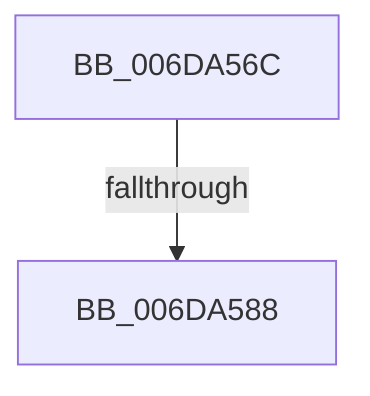

# sub_006DA56C

- RVA: `0x006DA56C`–`0x006DA5A4` (길이 `56` bytes)
- VA: `0x00000001406DA56C`
- 실행 섹션: `.text`
- PDB 이름 있음: `아니요`; PDB Function 태그: `아니요`
- unwind 정보 RVA: `0x0006760C`
- 디코드: `14`개 명령, `56/56` bytes 표시
- 미해석 바이트: `0` (있으면 어셈블리에 `.byte`로 보존)

> 이 문서는 커널 이미지의 기계어와 PDB 기호를 분석해 생성했습니다. 4번과 5번은 함수 원형과 자료형을 바이너리 사용 방식에서 추정한 C 해석이며 원본 소스 복구 결과는 아닙니다.

## 1. Dependencies

- 직접 호출 지점: **2**; 고유 호출 대상: **2**
- 직접 호출자로 확인된 함수: **0**
- RIP 상대 이미지 참조: **0**

### Outgoing calls
- `0x006DA57B` → [MiGetPagePrivilege](../28/MiGetPagePrivilege_function_00285420.md) (function, `0x00285420`)
- `0x006DA59E` → [KeBugCheckEx](../4F/KeBugCheckEx_function_004FD660.md) (function, `0x004FD660`)

### Direct callers
- 이 함수 시작 RVA로 연결되는 직접 call은 확인되지 않았습니다. 간접 호출은 완전히 역산할 수 없습니다.

### Static image references
- 디코드된 RIP-relative 메모리 참조가 없습니다.

## 2. Other-region calls and transfers

- 다른 실행 섹션으로 향하는 call: **0**
- call이 아닌 외부 분기/꼬리 이동: **1**
  - `0x006DA582` → [MiCheckLinearProtectedPteAccessedBit + 0x3F](../29/MiCheckLinearProtectedPteAccessedBit_function_00292D80.md) (`tail-transfer`)

## 3. Assembly (complete function range)

```asm
006DA56C  40 F6 C7 80                     test dil, 0x80
006DA570  B8 06 00 00 00                  mov eax, 6
006DA575  0F 45 D0                        cmovne edx, eax
006DA578  45 33 C0                        xor r8d, r8d
006DA57B  E8 A0 AE BA FF                  call 0x140285420
006DA580  A8 01                           test al, 1
006DA582  0F 84 37 88 BB FF               je 0x140292dbf
006DA588  48 83 64 24 20 00               and qword ptr [rsp + 0x20], 0
006DA58E  4C 8B CB                        mov r9, rbx
006DA591  4C 8B C6                        mov r8, rsi
006DA594  BA 38 15 05 00                  mov edx, 0x51538
006DA599  B9 1A 00 00 00                  mov ecx, 0x1a
006DA59E  E8 BD 30 E2 FF                  call 0x1404fd660
006DA5A3  CC                              int3
```

## 4. C-style interpretation (structured pseudocode)

```c
__int64 __fastcall sub_006DA56C(__int64 a1, __int64 a2, int a3)
{
    __int64 result;
    unsigned __int64 v_stack_p20;

    if ((((unsigned __int8)(v_rdi)) & (128)) != 0) { a2 = 6; }
    a3 = 0;
    result = MiGetPagePrivilege(a1, a2, a3, a4);
    result = KeBugCheckEx(26, (unsigned int)(0x51538ULL), v_rsi, v_rbx);
    return result;
}
```

## 5. (Beta) C Style

```c
int64_t sub_006DA56C(int64_t Arg1, int64_t Arg2, int32_t Arg3)
{
    int64_t result;
    uint64_t v_stack_p20;

    if ((((uint8_t)(local_rdi)) & (128)) != 0) { Arg2 = 6; }
    Arg3 = 0;
    result = MiGetPagePrivilege(Arg1, Arg2, Arg3, a4);
    result = KeBugCheckEx(26, (uint32_t)(0x51538ULL), local_rsi, local_rbx);
    return result;
}
```

## 6. Execution-region graph

[열기: 2D/3D 그래프와 함수 탐색 컨트롤 패널](../../../control-panel.html?section=text&rva=0x006DA56C&view=graph)

- 2D 그래프는 위에서 아래로 흐르고, 3D 그래프는 빈 공간을 드래그해 회전합니다. Shift+드래그는 이동, 휠은 확대·축소, 함수 노드 선택은 대상 보고서 이동입니다.

### Static fallback


