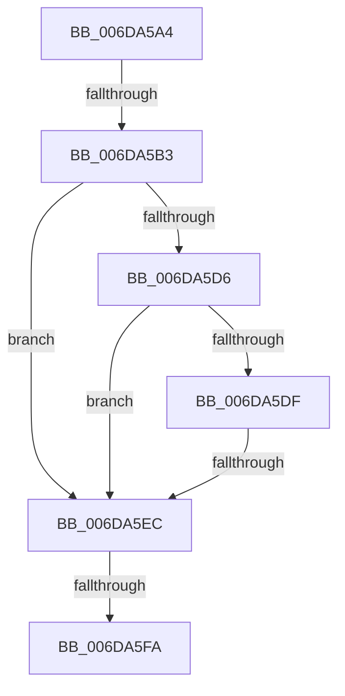

# sub_006DA5A4

- RVA: `0x006DA5A4`–`0x006DA5FF` (길이 `91` bytes)
- VA: `0x00000001406DA5A4`
- 실행 섹션: `.text`
- PDB 이름 있음: `아니요`; PDB Function 태그: `아니요`
- unwind 정보 RVA: `0x00067678`
- 디코드: `20`개 명령, `91/91` bytes 표시
- 미해석 바이트: `0` (있으면 어셈블리에 `.byte`로 보존)

> 이 문서는 커널 이미지의 기계어와 PDB 기호를 분석해 생성했습니다. 4번과 5번은 함수 원형과 자료형을 바이너리 사용 방식에서 추정한 C 해석이며 원본 소스 복구 결과는 아닙니다.

## 1. Dependencies

- 직접 호출 지점: **1**; 고유 호출 대상: **1**
- 직접 호출자로 확인된 함수: **0**
- RIP 상대 이미지 참조: **0**

### Outgoing calls
- `0x006DA5EC` → [MiLocateCloneAddress](../3D/MiLocateCloneAddress_function_003D26B4.md) (function, `0x003D26B4`)

### Direct callers
- 이 함수 시작 RVA로 연결되는 직접 call은 확인되지 않았습니다. 간접 호출은 완전히 역산할 수 없습니다.

### Static image references
- 디코드된 RIP-relative 메모리 참조가 없습니다.

## 2. Other-region calls and transfers

- 다른 실행 섹션으로 향하는 call: **0**
- call이 아닌 외부 분기/꼬리 이동: **4**
  - `0x006DA5AD` → [MiTrimThisWsle + 0x14D](../29/MiTrimThisWsle_function_002932E4.md) (`tail-transfer`)
  - `0x006DA5E6` → [MiTrimThisWsle + 0x166](../29/MiTrimThisWsle_function_002932E4.md) (`tail-transfer`)
  - `0x006DA5F4` → [MiTrimThisWsle + 0x166](../29/MiTrimThisWsle_function_002932E4.md) (`tail-transfer`)
  - `0x006DA5FA` → [MiTrimThisWsle + 0x14D](../29/MiTrimThisWsle_function_002932E4.md) (`tail-transfer`)

## 3. Assembly (complete function range)

```asm
006DA5A4  41 8B 46 10                     mov eax, dword ptr [r14 + 0x10]
006DA5A8  48 0F BA E0 0A                  bt rax, 0xa
006DA5AD  0F 82 7E 8E BB FF               jb 0x140293431
006DA5B3  49 8B 56 08                     mov rdx, qword ptr [r14 + 8]
006DA5B7  49 8D 8D 00 FC FF FF            lea rcx, [r13 - 0x400]
006DA5BE  48 B8 00 00 00 00 00 00 00 80   movabs rax, 0x8000000000000000
006DA5C8  48 0B D0                        or rdx, rax
006DA5CB  49 8B 46 28                     mov rax, qword ptr [r14 + 0x28]
006DA5CF  48 0F BA E0 28                  bt rax, 0x28
006DA5D4  72 16                           jb 0x1406da5ec
006DA5D6  49 8B 46 08                     mov rax, qword ptr [r14 + 8]
006DA5DA  48 85 C0                        test rax, rax
006DA5DD  78 0D                           js 0x1406da5ec
006DA5DF  49 8B 46 08                     mov rax, qword ptr [r14 + 8]
006DA5E3  48 85 C0                        test rax, rax
006DA5E6  0F 85 5E 8E BB FF               jne 0x14029344a
006DA5EC  E8 C3 80 CF FF                  call 0x1403d26b4
006DA5F1  48 85 C0                        test rax, rax
006DA5F4  0F 85 50 8E BB FF               jne 0x14029344a
006DA5FA  E9 32 8E BB FF                  jmp 0x140293431
```

## 4. C-style interpretation (structured pseudocode)

```c
__int64 __fastcall sub_006DA5A4(void)
{
    __int64 result;

    a2 = (*(unsigned __int64 *)(v_r14 + 8)) | ((unsigned int)(*(unsigned int *)(v_r14 + 16)));
    if (condition_is_below) goto loc_006DA5EC;
    if (sign_flag) goto loc_006DA5EC;
loc_006DA5EC:
    result = MiLocateCloneAddress(v_r13 - 1024, a2, a3, a4);
}
```

## 5. (Beta) C Style

```c
void sub_006DA5A4(void)
{
    int64_t result;

    a2 = (*(uint64_t *)(local_r14 + 0x8)) | ((uint32_t)(*(uint32_t *)(local_r14 + 0x10)));
    if (condition_is_below) goto loc_006DA5EC;
    if (sign_flag) goto loc_006DA5EC;
loc_006DA5EC:
    result = MiLocateCloneAddress(local_r13 - 1024, a2, a3, a4);
}
```

## 6. Execution-region graph

[열기: 2D/3D 그래프와 함수 탐색 컨트롤 패널](../../../control-panel.html?section=text&rva=0x006DA5A4&view=graph)

- 2D 그래프는 위에서 아래로 흐르고, 3D 그래프는 빈 공간을 드래그해 회전합니다. Shift+드래그는 이동, 휠은 확대·축소, 함수 노드 선택은 대상 보고서 이동입니다.

### Static fallback


