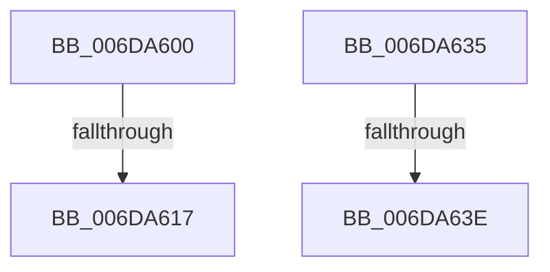

# sub_006DA600

- RVA: `0x006DA600`–`0x006DA650` (길이 `80` bytes)
- VA: `0x00000001406DA600`
- 실행 섹션: `.text`
- PDB 이름 있음: `아니요`; PDB Function 태그: `아니요`
- unwind 정보 RVA: `0x0006779C`
- 디코드: `21`개 명령, `80/80` bytes 표시
- 미해석 바이트: `0` (있으면 어셈블리에 `.byte`로 보존)

> 이 문서는 커널 이미지의 기계어와 PDB 기호를 분석해 생성했습니다. 4번과 5번은 함수 원형과 자료형을 바이너리 사용 방식에서 추정한 C 해석이며 원본 소스 복구 결과는 아닙니다.

## 1. Dependencies

- 직접 호출 지점: **1**; 고유 호출 대상: **1**
- 직접 호출자로 확인된 함수: **0**
- RIP 상대 이미지 참조: **0**

### Outgoing calls
- `0x006DA644` → [MiUnlockPageTable](../21/MiUnlockPageTable_function_00216EC0.md) (function, `0x00216EC0`)

### Direct callers
- 이 함수 시작 RVA로 연결되는 직접 call은 확인되지 않았습니다. 간접 호출은 완전히 역산할 수 없습니다.

### Static image references
- 디코드된 RIP-relative 메모리 참조가 없습니다.

## 2. Other-region calls and transfers

- 다른 실행 섹션으로 향하는 call: **0**
- call이 아닌 외부 분기/꼬리 이동: **4**
  - `0x006DA611` → [MiSetReadOnlyOnSectionView + 0x2DE](../29/MiSetReadOnlyOnSectionView_function_00294538.md) (`tail-transfer`)
  - `0x006DA630` → [MiSetReadOnlyOnSectionView + 0x1F7](../29/MiSetReadOnlyOnSectionView_function_00294538.md) (`tail-transfer`)
  - `0x006DA638` → [MiSetReadOnlyOnSectionView + 0x305](../29/MiSetReadOnlyOnSectionView_function_00294538.md) (`tail-transfer`)
  - `0x006DA64B` → [MiSetReadOnlyOnSectionView + 0x305](../29/MiSetReadOnlyOnSectionView_function_00294538.md) (`tail-transfer`)

## 3. Assembly (complete function range)

```asm
006DA600  8B 44 24 34                     mov eax, dword ptr [rsp + 0x34]
006DA604  48 8B CF                        mov rcx, rdi
006DA607  48 C1 E9 05                     shr rcx, 5
006DA60B  83 E1 1F                        and ecx, 0x1f
006DA60E  48 3B C8                        cmp rcx, rax
006DA611  0F 85 FF A1 BB FF               jne 0x140294816
006DA617  41 8B CF                        mov ecx, r15d
006DA61A  48 C1 E1 05                     shl rcx, 5
006DA61E  48 8B C1                        mov rax, rcx
006DA621  48 33 C7                        xor rax, rdi
006DA624  48 25 1F FC FF FF               and rax, 0xfffffffffffffc1f
006DA62A  48 33 C1                        xor rax, rcx
006DA62D  49 89 06                        mov qword ptr [r14], rax
006DA630  E9 FA A0 BB FF                  jmp 0x14029472f
006DA635  48 85 F6                        test rsi, rsi
006DA638  0F 84 FF A1 BB FF               je 0x14029483d
006DA63E  48 8B D6                        mov rdx, rsi
006DA641  49 8B CC                        mov rcx, r12
006DA644  E8 77 C8 B3 FF                  call 0x140216ec0
006DA649  33 F6                           xor esi, esi
006DA64B  E9 ED A1 BB FF                  jmp 0x14029483d
```

## 4. C-style interpretation (structured pseudocode)

```c
__int64 __fastcall sub_006DA600(void)
{
    __int64 result;
    unsigned int v_stack_p34;

    a1 = (v_rdi) >> (5);
    a1 = (unsigned int)((a1) & (31));
    a1 = ((unsigned int)((unsigned int)(v_r15))) << (5);
    result = (a1) ^ (v_rdi);
    result = (result) & (-993);
    result = (result) ^ (a1);
    *(unsigned __int64 *)(v_r14) = result;
}
```

## 5. (Beta) C Style

```c
void sub_006DA600(void)
{
    int64_t result;
    uint32_t v_stack_p34;

    a1 = (local_rdi) >> (5);
    a1 = (uint32_t)((a1) & (31));
    a1 = ((uint32_t)((uint32_t)(local_r15))) << (5);
    result = (a1) ^ (local_rdi);
    result = (result) & (-993);
    result = (result) ^ (a1);
    *(uint64_t *)(local_r14) = result;
}
```

## 6. Execution-region graph

[열기: 2D/3D 그래프와 함수 탐색 컨트롤 패널](../../../control-panel.html?section=text&rva=0x006DA600&view=graph)

- 2D 그래프는 위에서 아래로 흐르고, 3D 그래프는 빈 공간을 드래그해 회전합니다. Shift+드래그는 이동, 휠은 확대·축소, 함수 노드 선택은 대상 보고서 이동입니다.

### Static fallback


