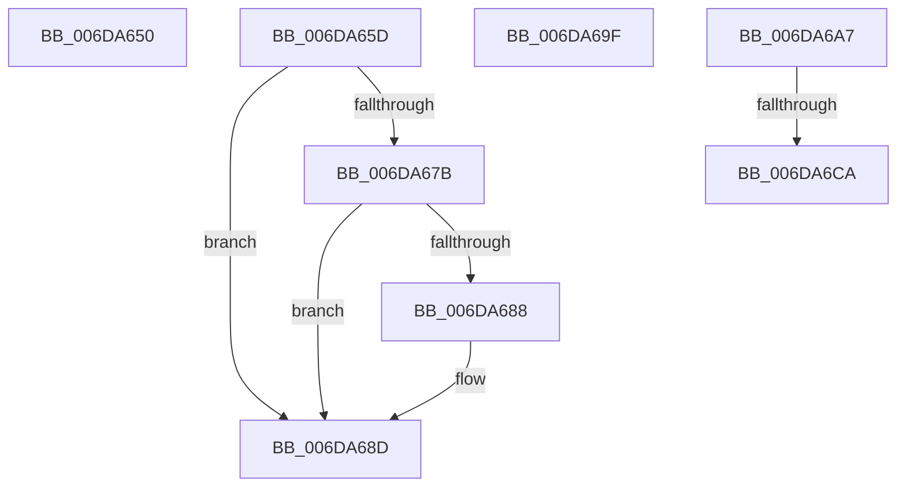

# sub_006DA650

- RVA: `0x006DA650`–`0x006DA6D2` (길이 `130` bytes)
- VA: `0x00000001406DA650`
- 실행 섹션: `.text`
- PDB 이름 있음: `아니요`; PDB Function 태그: `아니요`
- unwind 정보 RVA: `0x00067834`
- 디코드: `30`개 명령, `130/130` bytes 표시
- 미해석 바이트: `0` (있으면 어셈블리에 `.byte`로 보존)

> 이 문서는 커널 이미지의 기계어와 PDB 기호를 분석해 생성했습니다. 4번과 5번은 함수 원형과 자료형을 바이너리 사용 방식에서 추정한 C 해석이며 원본 소스 복구 결과는 아닙니다.

## 1. Dependencies

- 직접 호출 지점: **4**; 고유 호출 대상: **4**
- 직접 호출자로 확인된 함수: **0**
- RIP 상대 이미지 참조: **0**

### Outgoing calls
- `0x006DA661` → [KeAbPostRelease](../2E/KeAbPostRelease_function_002E1600.md) (function, `0x002E1600`)
- `0x006DA688` → [KiCheckForKernelApcDelivery](../2E/KiCheckForKernelApcDelivery_function_002E2C80.md) (function, `0x002E2C80`)
- `0x006DA6AC` → [MiDecrementSubsectionViewCount](../29/MiDecrementSubsectionViewCount_function_00298E90.md) (function, `0x00298E90`)
- `0x006DA6BA` → [MiReleaseSpinLockExclusive](../24/MiReleaseSpinLockExclusive_function_002482C0.md) (function, `0x002482C0`)

### Direct callers
- 이 함수 시작 RVA로 연결되는 직접 call은 확인되지 않았습니다. 간접 호출은 완전히 역산할 수 없습니다.

### Static image references
- 디코드된 RIP-relative 메모리 참조가 없습니다.

## 2. Other-region calls and transfers

- 다른 실행 섹션으로 향하는 call: **0**
- call이 아닌 외부 분기/꼬리 이동: **5**
  - `0x006DA658` → [MiCreatePrototypePtes + 0xA8](../29/MiCreatePrototypePtes_function_002950FC.md) (`tail-transfer`)
  - `0x006DA69A` → [MiCreatePrototypePtes + 0x457](../29/MiCreatePrototypePtes_function_002950FC.md) (`tail-transfer`)
  - `0x006DA6A2` → [MiCreatePrototypePtes + 0x261](../29/MiCreatePrototypePtes_function_002950FC.md) (`tail-transfer`)
  - `0x006DA6C4` → [MiCreatePrototypePtes + 0x261](../29/MiCreatePrototypePtes_function_002950FC.md) (`tail-transfer`)
  - `0x006DA6CD` → [MiCreatePrototypePtes + 0x261](../29/MiCreatePrototypePtes_function_002950FC.md) (`tail-transfer`)

## 3. Assembly (complete function range)

```asm
006DA650  C7 44 24 30 01 00 00 00         mov dword ptr [rsp + 0x30], 1
006DA658  E9 47 AB BB FF                  jmp 0x1402951a4
006DA65D  48 8D 4F 28                     lea rcx, [rdi + 0x28]
006DA661  E8 9A 6F C0 FF                  call 0x1402e1600
006DA666  4C 8B 6C 24 50                  mov r13, qword ptr [rsp + 0x50]
006DA66B  B8 01 00 00 00                  mov eax, 1
006DA670  90                              nop
006DA671  66 41 01 85 E6 01 00 00         add word ptr [r13 + 0x1e6], ax
006DA679  75 12                           jne 0x1406da68d
006DA67B  49 8D 85 98 00 00 00            lea rax, [r13 + 0x98]
006DA682  90                              nop
006DA683  48 39 00                        cmp qword ptr [rax], rax
006DA686  74 05                           je 0x1406da68d
006DA688  E8 F3 85 C0 FF                  call 0x1402e2c80
006DA68D  48 8B 7C 24 48                  mov rdi, qword ptr [rsp + 0x48]
006DA692  44 89 A4 24 B8 00 00 00         mov dword ptr [rsp + 0xb8], r12d
006DA69A  E9 B4 AE BB FF                  jmp 0x140295553
006DA69F  49 8B F4                        mov rsi, r12
006DA6A2  E9 B6 AC BB FF                  jmp 0x14029535d
006DA6A7  8B D5                           mov edx, ebp
006DA6A9  49 8B CF                        mov rcx, r15
006DA6AC  E8 DF E7 BB FF                  call 0x140298e90
006DA6B1  41 8A D5                        mov dl, r13b
006DA6B4  49 8B CC                        mov rcx, r12
006DA6B7  48 8B E8                        mov rbp, rax
006DA6BA  E8 01 DC B6 FF                  call 0x1402482c0
006DA6BF  83 7C 24 3C 03                  cmp dword ptr [rsp + 0x3c], 3
006DA6C4  0F 85 93 AC BB FF               jne 0x14029535d
006DA6CA  48 8B F5                        mov rsi, rbp
006DA6CD  E9 8B AC BB FF                  jmp 0x14029535d
```

## 4. C-style interpretation (structured pseudocode)

```c
__int64 __fastcall sub_006DA650(void)
{
    unsigned int v_stack_p30;
    unsigned int v_stack_p3C;
    unsigned __int64 v_stack_p48;
    unsigned __int64 v_stack_p50;
    unsigned int v_stack_pB8;

    v_stack_p30 = 1;
}
```

## 5. (Beta) C Style

```c
void sub_006DA650(void)
{
    uint32_t v_stack_p30;
    uint32_t v_stack_p3C;
    uint64_t v_stack_p48;
    uint64_t v_stack_p50;
    uint32_t v_stack_pB8;

    v_stack_p30 = 1;
}
```

## 6. Execution-region graph

[열기: 2D/3D 그래프와 함수 탐색 컨트롤 패널](../../../control-panel.html?section=text&rva=0x006DA650&view=graph)

- 2D 그래프는 위에서 아래로 흐르고, 3D 그래프는 빈 공간을 드래그해 회전합니다. Shift+드래그는 이동, 휠은 확대·축소, 함수 노드 선택은 대상 보고서 이동입니다.

### Static fallback


