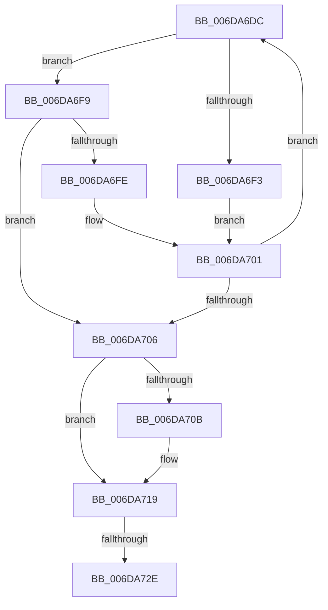

# sub_006DA6DC

- RVA: `0x006DA6DC`–`0x006DA745` (길이 `105` bytes)
- VA: `0x00000001406DA6DC`
- 실행 섹션: `.text`
- PDB 이름 있음: `아니요`; PDB Function 태그: `아니요`
- unwind 정보 RVA: `0x000678F0`
- 디코드: `30`개 명령, `105/105` bytes 표시
- 미해석 바이트: `0` (있으면 어셈블리에 `.byte`로 보존)

> 이 문서는 커널 이미지의 기계어와 PDB 기호를 분석해 생성했습니다. 4번과 5번은 함수 원형과 자료형을 바이너리 사용 방식에서 추정한 C 해석이며 원본 소스 복구 결과는 아닙니다.

## 1. Dependencies

- 직접 호출 지점: **2**; 고유 호출 대상: **2**
- 직접 호출자로 확인된 함수: **0**
- RIP 상대 이미지 참조: **0**

### Outgoing calls
- `0x006DA711` → [RtlAvlRemoveNode](../29/RtlAvlRemoveNode_function_00296650.md) (function, `0x00296650`)
- `0x006DA720` → [MiReleaseSpinLockExclusive](../24/MiReleaseSpinLockExclusive_function_002482C0.md) (function, `0x002482C0`)

### Direct callers
- 이 함수 시작 RVA로 연결되는 직접 call은 확인되지 않았습니다. 간접 호출은 완전히 역산할 수 없습니다.

### Static image references
- 디코드된 RIP-relative 메모리 참조가 없습니다.

## 2. Other-region calls and transfers

- 다른 실행 섹션으로 향하는 call: **0**
- call이 아닌 외부 분기/꼬리 이동: **2**
  - `0x006DA728` → [MiRemoveFromSystemSpace + 0x76](../29/MiRemoveFromSystemSpace_function_002962FC.md) (`tail-transfer`)
  - `0x006DA740` → [MiRemoveFromSystemSpace + 0x1E4](../29/MiRemoveFromSystemSpace_function_002962FC.md) (`tail-transfer`)

## 3. Assembly (complete function range)

```asm
006DA6DC  4C 8B 43 58                     mov r8, qword ptr [rbx + 0x58]
006DA6E0  48 8B 53 20                     mov rdx, qword ptr [rbx + 0x20]
006DA6E4  49 81 E0 00 F0 FF FF            and r8, 0xfffffffffffff000
006DA6EB  49 03 D0                        add rdx, r8
006DA6EE  48 3B F2                        cmp rsi, rdx
006DA6F1  72 06                           jb 0x1406da6f9
006DA6F3  48 8B 5B 08                     mov rbx, qword ptr [rbx + 8]
006DA6F7  EB 08                           jmp 0x1406da701
006DA6F9  49 3B F0                        cmp rsi, r8
006DA6FC  73 08                           jae 0x1406da706
006DA6FE  48 8B 1B                        mov rbx, qword ptr [rbx]
006DA701  48 85 DB                        test rbx, rbx
006DA704  75 D6                           jne 0x1406da6dc
006DA706  48 85 DB                        test rbx, rbx
006DA709  74 0E                           je 0x1406da719
006DA70B  48 8B D3                        mov rdx, rbx
006DA70E  48 8B CF                        mov rcx, rdi
006DA711  E8 3A BF BB FF                  call 0x140296650
006DA716  FF 4F 08                        dec dword ptr [rdi + 8]
006DA719  41 8A D6                        mov dl, r14b
006DA71C  48 8D 4F 0C                     lea rcx, [rdi + 0xc]
006DA720  E8 9B DB B6 FF                  call 0x1402482c0
006DA725  48 85 DB                        test rbx, rbx
006DA728  0F 84 44 BC BB FF               je 0x140296372
006DA72E  48 8B 43 30                     mov rax, qword ptr [rbx + 0x30]
006DA732  48 8B F5                        mov rsi, rbp
006DA735  4C 8B 73 40                     mov r14, qword ptr [rbx + 0x40]
006DA739  48 83 CD FF                     or rbp, 0xffffffffffffffff
006DA73D  48 8B 38                        mov rdi, qword ptr [rax]
006DA740  E9 9B BD BB FF                  jmp 0x1402964e0
```

## 4. C-style interpretation (structured pseudocode)

```c
__int64 __fastcall sub_006DA6DC(void)
{
    __int64 result;
    __int64 v_rbp;

    a3 = (*(unsigned __int64 *)(v_rbx + 88)) & (0xFFFFFFFFFFFFF000ULL);
    a2 = (*(unsigned __int64 *)(v_rbx + 32)) + (a3);
    if (v_rsi < a2) goto loc_006DA6F9;
    goto loc_006DA701;
loc_006DA6F9:
    if (v_rsi >= a3) goto loc_006DA706;
loc_006DA701:
    if (*(unsigned __int64 *)(*(unsigned __int64 *)(v_rbx + 8)) != 0) goto loc_006DA6DC;
loc_006DA706:
    if (*(unsigned __int64 *)(*(unsigned __int64 *)(v_rbx + 8)) != 0) {
        a2 = *(unsigned __int64 *)(*(unsigned __int64 *)(v_rbx + 8));
        a1 = v_rdi;
        result = RtlAvlRemoveNode(a1, a2, a3, a4);
    }
    result = MiReleaseSpinLockExclusive(v_rdi + 12, (unsigned __int8)(v_r14), a3, a4);
    v_rbp = (v_rbp) | (-1);
}
```

## 5. (Beta) C Style

```c
void sub_006DA6DC(void)
{
    int64_t result;
    int64_t local_rbp;

    a3 = (*(uint64_t *)(local_rbx + 0x58)) & (0xFFFFFFFFFFFFF000ULL);
    a2 = (*(uint64_t *)(local_rbx + 0x20)) + (a3);
    if (local_rsi < a2) goto loc_006DA6F9;
    goto loc_006DA701;
loc_006DA6F9:
    if (local_rsi >= a3) goto loc_006DA706;
loc_006DA701:
    if (*(uint64_t *)(*(uint64_t *)(local_rbx + 0x8)) != 0) goto loc_006DA6DC;
loc_006DA706:
    if (*(uint64_t *)(*(uint64_t *)(local_rbx + 0x8)) != 0) {
        a2 = *(uint64_t *)(*(uint64_t *)(local_rbx + 0x8));
        a1 = local_rdi;
        result = RtlAvlRemoveNode(a1, a2, a3, a4);
    }
    result = MiReleaseSpinLockExclusive(local_rdi + 12, (uint8_t)(local_r14), a3, a4);
    local_rbp = (local_rbp) | (-1);
}
```

## 6. Execution-region graph

[열기: 2D/3D 그래프와 함수 탐색 컨트롤 패널](../../../control-panel.html?section=text&rva=0x006DA6DC&view=graph)

- 2D 그래프는 위에서 아래로 흐르고, 3D 그래프는 빈 공간을 드래그해 회전합니다. Shift+드래그는 이동, 휠은 확대·축소, 함수 노드 선택은 대상 보고서 이동입니다.

### Static fallback


