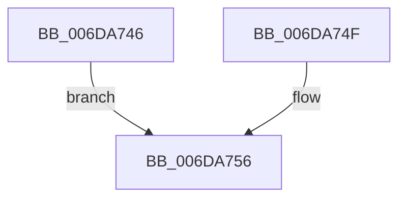

# sub_006DA746

- RVA: `0x006DA746`–`0x006DA772` (길이 `44` bytes)
- VA: `0x00000001406DA746`
- 실행 섹션: `.text`
- PDB 이름 있음: `아니요`; PDB Function 태그: `아니요`
- unwind 정보 RVA: `0x00067BC0`
- 디코드: `11`개 명령, `44/44` bytes 표시
- 미해석 바이트: `0` (있으면 어셈블리에 `.byte`로 보존)

> 이 문서는 커널 이미지의 기계어와 PDB 기호를 분석해 생성했습니다. 4번과 5번은 함수 원형과 자료형을 바이너리 사용 방식에서 추정한 C 해석이며 원본 소스 복구 결과는 아닙니다.

## 1. Dependencies

- 직접 호출 지점: **1**; 고유 호출 대상: **1**
- 직접 호출자로 확인된 함수: **0**
- RIP 상대 이미지 참조: **2**

### Outgoing calls
- `0x006DA767` → [KeSetEvent](../33/KeSetEvent_function_0033F310.md) (function, `0x0033F310`)

### Direct callers
- 이 함수 시작 RVA로 연결되는 직접 call은 확인되지 않았습니다. 간접 호출은 완전히 역산할 수 없습니다.

### Static image references
- `0x006DA746` → RVA `0x00F8F020` (`.data`; read)
- `0x006DA74F` → RVA `0x00F8F060` (`.data`; read)

## 2. Other-region calls and transfers

- 다른 실행 섹션으로 향하는 call: **0**
- call이 아닌 외부 분기/꼬리 이동: **1**
  - `0x006DA76D` → [FsFilterCtrlFree + 0x23](../29/FsFilterCtrlFree_function_0029908C.md) (`tail-transfer`)

## 3. Assembly (complete function range)

```asm
006DA746  4C 8D 0D D3 48 8B 00            lea r9, [rip + 0x8b48d3]
006DA74D  EB 07                           jmp 0x1406da756
006DA74F  4C 8D 0D 0A 49 8B 00            lea r9, [rip + 0x8b490a]
006DA756  49 8B 40 50                     mov rax, qword ptr [r8 + 0x50]
006DA75A  33 D2                           xor edx, edx
006DA75C  45 33 C0                        xor r8d, r8d
006DA75F  49 8B C9                        mov rcx, r9
006DA762  48 83 60 F8 00                  and qword ptr [rax - 8], 0
006DA767  E8 A4 4B C6 FF                  call 0x14033f310
006DA76C  90                              nop
006DA76D  E9 3D E9 BB FF                  jmp 0x1402990af
```

## 4. C-style interpretation (structured pseudocode)

```c
__int64 __fastcall sub_006DA746(__int64 a1, int a2, __int64 a3)
{
    __int64 result;

    goto loc_006DA756;
loc_006DA756:
    a2 = 0;
    a3 = 0;
    result = KeSetEvent(v_rip + 9128147, a2, a3, v_rip + 9128147);
}
```

## 5. (Beta) C Style

```c
int64_t sub_006DA746(int64_t Arg1, int32_t Arg2, void *Arg3)
{
    uint8_t *arg3 = (uint8_t *)Arg3;

    int64_t result;

    goto loc_006DA756;
loc_006DA756:
    Arg2 = 0;
    Arg3 = 0;
    result = KeSetEvent(v_rip + 9128147, Arg2, Arg3, v_rip + 9128147);
}
```

### 관측된 메모리 오프셋

구조체 형식이 확인되지 않은 접근은 인자 기준의 오프셋으로만 기록했습니다.

| 기준 인자 | 오프셋 표현 | 폭 (bit) | 접근 |
|---|---:|---:|---|
| `Arg3` | `+ 0x50` | `64` | `R` |

## 6. Execution-region graph

[열기: 2D/3D 그래프와 함수 탐색 컨트롤 패널](../../../control-panel.html?section=text&rva=0x006DA746&view=graph)

- 2D 그래프는 위에서 아래로 흐르고, 3D 그래프는 빈 공간을 드래그해 회전합니다. Shift+드래그는 이동, 휠은 확대·축소, 함수 노드 선택은 대상 보고서 이동입니다.

### Static fallback


