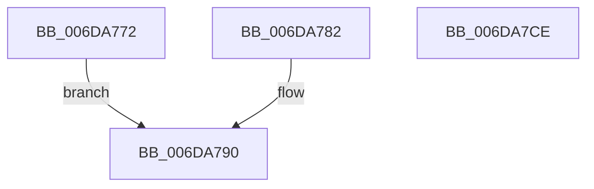

# sub_006DA772

- RVA: `0x006DA772`–`0x006DA7D5` (길이 `99` bytes)
- VA: `0x00000001406DA772`
- 실행 섹션: `.text`
- PDB 이름 있음: `아니요`; PDB Function 태그: `아니요`
- unwind 정보 RVA: `0x00067BF8`
- 디코드: `22`개 명령, `99/99` bytes 표시
- 미해석 바이트: `0` (있으면 어셈블리에 `.byte`로 보존)

> 이 문서는 커널 이미지의 기계어와 PDB 기호를 분석해 생성했습니다. 4번과 5번은 함수 원형과 자료형을 바이너리 사용 방식에서 추정한 C 해석이며 원본 소스 복구 결과는 아닙니다.

## 1. Dependencies

- 직접 호출 지점: **2**; 고유 호출 대상: **2**
- 직접 호출자로 확인된 함수: **0**
- RIP 상대 이미지 참조: **4**

### Outgoing calls
- `0x006DA79E` → [KeWaitForSingleObject](../20/KeWaitForSingleObject_function_0020E6B0.md) (function, `0x0020E6B0`)
- `0x006DA7BE` → [memset](../6C/memset_function_006C6C40.md) (function, `0x006C6C40`)

### Direct callers
- 이 함수 시작 RVA로 연결되는 직접 call은 확인되지 않았습니다. 간접 호출은 완전히 역산할 수 없습니다.

### Static image references
- `0x006DA772` → RVA `0x00F8F040` (`.data`; read)
- `0x006DA779` → RVA `0x00F8F020` (`.data`; read)
- `0x006DA782` → RVA `0x00F8F038` (`.data`; read)
- `0x006DA789` → RVA `0x00F8F060` (`.data`; read)

## 2. Other-region calls and transfers

- 다른 실행 섹션으로 향하는 call: **0**
- call이 아닌 외부 분기/꼬리 이동: **2**
  - `0x006DA7C9` → [FsRtlReleaseFileForModWrite + 0x276](../29/FsRtlReleaseFileForModWrite_function_00299100.md) (`tail-transfer`)
  - `0x006DA7D0` → [FsRtlReleaseFileForModWrite + 0x1E4](../29/FsRtlReleaseFileForModWrite_function_00299100.md) (`tail-transfer`)

## 3. Assembly (complete function range)

```asm
006DA772  48 8B 35 C7 48 8B 00            mov rsi, qword ptr [rip + 0x8b48c7]
006DA779  4C 8D 35 A0 48 8B 00            lea r14, [rip + 0x8b48a0]
006DA780  EB 0E                           jmp 0x1406da790
006DA782  48 8B 35 AF 48 8B 00            mov rsi, qword ptr [rip + 0x8b48af]
006DA789  4C 8D 35 D0 48 8B 00            lea r14, [rip + 0x8b48d0]
006DA790  45 33 C9                        xor r9d, r9d
006DA793  48 89 54 24 20                  mov qword ptr [rsp + 0x20], rdx
006DA798  45 33 C0                        xor r8d, r8d
006DA79B  49 8B CE                        mov rcx, r14
006DA79E  E8 0D 3F B3 FF                  call 0x14020e6b0
006DA7A3  65 48 8B 04 25 88 01 00 00      mov rax, qword ptr gs:[0x188]
006DA7AC  48 8D 5E 08                     lea rbx, [rsi + 8]
006DA7B0  48 8B CB                        mov rcx, rbx
006DA7B3  48 89 06                        mov qword ptr [rsi], rax
006DA7B6  33 D2                           xor edx, edx
006DA7B8  41 B8 C8 03 00 00               mov r8d, 0x3c8
006DA7BE  E8 7D C4 FE FF                  call 0x1406c6c40
006DA7C3  8B 45 90                        mov eax, dword ptr [rbp - 0x70]
006DA7C6  83 C8 02                        or eax, 2
006DA7C9  E9 A8 EB BB FF                  jmp 0x140299376
006DA7CE  33 C9                           xor ecx, ecx
006DA7D0  E9 0F EB BB FF                  jmp 0x1402992e4
```

## 4. C-style interpretation (structured pseudocode)

```c
__int64 __fastcall sub_006DA772(__int64 a1, __int64 a2, int a3, int a4)
{
    __int64 result;
    unsigned __int64 v_stack_p20;

    goto loc_006DA790;
loc_006DA790:
    a4 = 0;
    v_stack_p20 = a2;
    a3 = 0;
    result = KeWaitForSingleObject(v_rip + 9128096, a2, a3, a4);
    *(unsigned __int64 *)(*(unsigned __int64 *)(v_rip + 9128135)) = *(unsigned __int64 *)(gs_base + (0 + 392));
    a2 = 0;
    result = memset(*(unsigned __int64 *)(v_rip + 9128135) + 8, a2, 968, a4);
    result = (unsigned int)(((unsigned int)(*(unsigned int *)(v_rbp - 112))) | (2));
}
```

## 5. (Beta) C Style

```c
int64_t sub_006DA772(int64_t Arg1, int64_t Arg2, int32_t Arg3, int32_t Arg4)
{
    int64_t result;
    uint64_t v_stack_p20;

    goto loc_006DA790;
loc_006DA790:
    Arg4 = 0;
    v_stack_p20 = Arg2;
    Arg3 = 0;
    result = KeWaitForSingleObject(v_rip + 9128096, Arg2, Arg3, Arg4);
    *(uint64_t *)(*(uint64_t *)(v_rip + 0x8B48C7)) = *(uint64_t *)(gs_base + (0 + 0x188));
    Arg2 = 0;
    result = memset(*(uint64_t *)(v_rip + 0x8B48C7) + 8, Arg2, 968, Arg4);
    result = (uint32_t)(((uint32_t)(*(uint32_t *)(local_rbp - 0x70))) | (2));
}
```

## 6. Execution-region graph

[열기: 2D/3D 그래프와 함수 탐색 컨트롤 패널](../../../control-panel.html?section=text&rva=0x006DA772&view=graph)

- 2D 그래프는 위에서 아래로 흐르고, 3D 그래프는 빈 공간을 드래그해 회전합니다. Shift+드래그는 이동, 휠은 확대·축소, 함수 노드 선택은 대상 보고서 이동입니다.

### Static fallback


