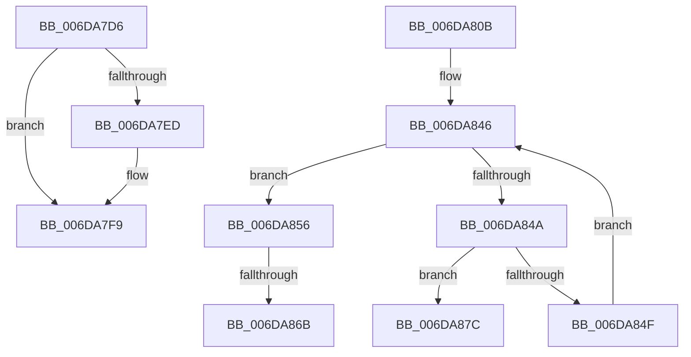

# sub_006DA7D6

- RVA: `0x006DA7D6`–`0x006DA889` (길이 `179` bytes)
- VA: `0x00000001406DA7D6`
- 실행 섹션: `.text`
- PDB 이름 있음: `아니요`; PDB Function 태그: `아니요`
- unwind 정보 RVA: `0x00067C5C`
- 디코드: `45`개 명령, `179/179` bytes 표시
- 미해석 바이트: `0` (있으면 어셈블리에 `.byte`로 보존)

> 이 문서는 커널 이미지의 기계어와 PDB 기호를 분석해 생성했습니다. 4번과 5번은 함수 원형과 자료형을 바이너리 사용 방식에서 추정한 C 해석이며 원본 소스 복구 결과는 아닙니다.

## 1. Dependencies

- 직접 호출 지점: **4**; 고유 호출 대상: **4**
- 직접 호출자로 확인된 함수: **0**
- RIP 상대 이미지 참조: **1**

### Outgoing calls
- `0x006DA7DF` → [MiFlushComplete](../29/MiFlushComplete_function_002980A0.md) (function, `0x002980A0`)
- `0x006DA7F4` → [KiLowerIrqlProcessIrqlFlags](../4F/KiLowerIrqlProcessIrqlFlags_function_004F5698.md) (function, `0x004F5698`)
- `0x006DA83E` → [KeWaitForMultipleObjects](../20/KeWaitForMultipleObjects_function_0020D110.md) (function, `0x0020D110`)
- `0x006DA871` → [KiRaiseIrqlProcessIrqlFlags](../4F/KiRaiseIrqlProcessIrqlFlags_function_004F56FC.md) (function, `0x004F56FC`)

### Direct callers
- 이 함수 시작 RVA로 연결되는 직접 call은 확인되지 않았습니다. 간접 호출은 완전히 역산할 수 없습니다.

### Static image references
- `0x006DA7E4` → RVA `0x00FC6D20` (`ALMOSTRO`; read)

## 2. Other-region calls and transfers

- 다른 실행 섹션으로 향하는 call: **0**
- call이 아닌 외부 분기/꼬리 이동: **4**
  - `0x006DA806` → [MiIssueAsynchronousFlush + 0x19C](../29/MiIssueAsynchronousFlush_function_00299898.md) (`tail-transfer`)
  - `0x006DA865` → [MiIssueAsynchronousFlush + 0x1CD](../29/MiIssueAsynchronousFlush_function_00299898.md) (`tail-transfer`)
  - `0x006DA877` → [MiIssueAsynchronousFlush + 0x1CD](../29/MiIssueAsynchronousFlush_function_00299898.md) (`tail-transfer`)
  - `0x006DA884` → [MiIssueAsynchronousFlush + 0x2AD](../29/MiIssueAsynchronousFlush_function_00299898.md) (`tail-transfer`)

## 3. Assembly (complete function range)

```asm
006DA7D6  45 33 C0                        xor r8d, r8d
006DA7D9  48 8B D3                        mov rdx, rbx
006DA7DC  48 8B CB                        mov rcx, rbx
006DA7DF  E8 BC D8 BB FF                  call 0x1402980a0
006DA7E4  44 39 25 35 C5 8E 00            cmp dword ptr [rip + 0x8ec535], r12d
006DA7EB  74 0C                           je 0x1406da7f9
006DA7ED  44 0F 20 C1                     mov rcx, cr8
006DA7F1  40 8A D7                        mov dl, dil
006DA7F4  E8 9F AE E1 FF                  call 0x1404f5698
006DA7F9  40 0F B6 C7                     movzx eax, dil
006DA7FD  44 0F 22 C0                     mov cr8, rax
006DA801  BF 03 01 00 00                  mov edi, 0x103
006DA806  E9 29 F2 BB FF                  jmp 0x140299a34
006DA80B  40 0F B6 C7                     movzx eax, dil
006DA80F  44 0F 22 C0                     mov cr8, rax
006DA813  41 B9 13 00 00 00               mov r9d, 0x13
006DA819  49 8D 85 80 08 00 00            lea rax, [r13 + 0x880]
006DA820  48 89 44 24 38                  mov qword ptr [rsp + 0x38], rax
006DA825  45 8B C7                        mov r8d, r15d
006DA828  4C 89 64 24 30                  mov qword ptr [rsp + 0x30], r12
006DA82D  48 8B D5                        mov rdx, rbp
006DA830  44 88 64 24 28                  mov byte ptr [rsp + 0x28], r12b
006DA835  41 8D 49 F5                     lea ecx, [r9 - 0xb]
006DA839  44 88 64 24 20                  mov byte ptr [rsp + 0x20], r12b
006DA83E  E8 CD 28 B3 FF                  call 0x14020d110
006DA843  49 8B DD                        mov rbx, r13
006DA846  85 F6                           test esi, esi
006DA848  74 0C                           je 0x1406da856
006DA84A  44 39 23                        cmp dword ptr [rbx], r12d
006DA84D  7C 2D                           jl 0x1406da87c
006DA84F  49 03 DE                        add rbx, r14
006DA852  FF CE                           dec esi
006DA854  EB F0                           jmp 0x1406da846
006DA856  44 0F 20 C7                     mov rdi, cr8
006DA85A  45 0F 22 C7                     mov cr8, r15
006DA85E  44 39 25 BB C4 8E 00            cmp dword ptr [rip + 0x8ec4bb], r12d
006DA865  0F 84 FA F1 BB FF               je 0x140299a65
006DA86B  41 8A D7                        mov dl, r15b
006DA86E  40 8A CF                        mov cl, dil
006DA871  E8 86 AE E1 FF                  call 0x1404f56fc
006DA876  90                              nop
006DA877  E9 E9 F1 BB FF                  jmp 0x140299a65
006DA87C  48 8B 43 48                     mov rax, qword ptr [rbx + 0x48]
006DA880  44 89 60 28                     mov dword ptr [rax + 0x28], r12d
006DA884  E9 BC F2 BB FF                  jmp 0x140299b45
```

## 4. C-style interpretation (structured pseudocode)

```c
__int64 __fastcall sub_006DA7D6(__int64 a1, __int64 a2, int a3)
{
    __int64 result;
    unsigned __int8 v_stack_p20;
    unsigned __int8 v_stack_p28;
    unsigned __int64 v_stack_p30;
    unsigned __int64 v_stack_p38;

    a3 = 0;
    result = MiFlushComplete(v_rbx, v_rbx, a3, a4);
    if ((*(unsigned int *)(v_rip + 9356597)) != ((unsigned int)(v_r12))) {
        a1 = v_cr8;
        a2 = (unsigned __int8)(v_rdi);
        result = KiLowerIrqlProcessIrqlFlags(a1, a2, a3, a4);
    }
}
```

## 5. (Beta) C Style

```c
int64_t sub_006DA7D6(int64_t Arg1, int64_t Arg2, int32_t Arg3)
{
    int64_t result;
    uint8_t v_stack_p20;
    uint8_t v_stack_p28;
    uint64_t v_stack_p30;
    uint64_t v_stack_p38;

    Arg3 = 0;
    result = MiFlushComplete(local_rbx, local_rbx, Arg3, a4);
    if ((*(uint32_t *)(v_rip + 0x8EC535)) != ((uint32_t)(local_r12))) {
        Arg1 = v_cr8;
        Arg2 = (uint8_t)(local_rdi);
        result = KiLowerIrqlProcessIrqlFlags(Arg1, Arg2, Arg3, a4);
    }
}
```

## 6. Execution-region graph

[열기: 2D/3D 그래프와 함수 탐색 컨트롤 패널](../../../control-panel.html?section=text&rva=0x006DA7D6&view=graph)

- 2D 그래프는 위에서 아래로 흐르고, 3D 그래프는 빈 공간을 드래그해 회전합니다. Shift+드래그는 이동, 휠은 확대·축소, 함수 노드 선택은 대상 보고서 이동입니다.

### Static fallback


