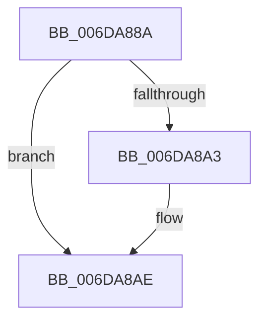

# sub_006DA88A

- RVA: `0x006DA88A`–`0x006DA8BF` (길이 `53` bytes)
- VA: `0x00000001406DA88A`
- 실행 섹션: `.text`
- PDB 이름 있음: `아니요`; PDB Function 태그: `아니요`
- unwind 정보 RVA: `0x00067C8C`
- 디코드: `14`개 명령, `53/53` bytes 표시
- 미해석 바이트: `0` (있으면 어셈블리에 `.byte`로 보존)

> 이 문서는 커널 이미지의 기계어와 PDB 기호를 분석해 생성했습니다. 4번과 5번은 함수 원형과 자료형을 바이너리 사용 방식에서 추정한 C 해석이며 원본 소스 복구 결과는 아닙니다.

## 1. Dependencies

- 직접 호출 지점: **2**; 고유 호출 대상: **2**
- 직접 호출자로 확인된 함수: **0**
- RIP 상대 이미지 참조: **1**

### Outgoing calls
- `0x006DA896` → [guard_dispatch_icall](../6B/guard_dispatch_icall_function_006BAAD0.md) (function, `0x006BAAD0`)
- `0x006DA8A9` → [KiLowerIrqlProcessIrqlFlags](../4F/KiLowerIrqlProcessIrqlFlags_function_004F5698.md) (function, `0x004F5698`)

### Direct callers
- 이 함수 시작 RVA로 연결되는 직접 call은 확인되지 않았습니다. 간접 호출은 완전히 역산할 수 없습니다.

### Static image references
- `0x006DA89B` → RVA `0x00FC6D20` (`ALMOSTRO`; read)

## 2. Other-region calls and transfers

- 다른 실행 섹션으로 향하는 call: **0**
- call이 아닌 외부 분기/꼬리 이동: **1**
  - `0x006DA8BA` → [IoAsynchronousPageWrite + 0x165](../29/IoAsynchronousPageWrite_function_00299C08.md) (`tail-transfer`)

## 3. Assembly (complete function range)

```asm
006DA88A  45 33 C0                        xor r8d, r8d
006DA88D  49 8B D6                        mov rdx, r14
006DA890  49 8B CC                        mov rcx, r12
006DA893  49 8B C7                        mov rax, r15
006DA896  E8 35 02 FE FF                  call 0x1406baad0
006DA89B  39 35 7F C4 8E 00               cmp dword ptr [rip + 0x8ec47f], esi
006DA8A1  74 0B                           je 0x1406da8ae
006DA8A3  44 0F 20 C1                     mov rcx, cr8
006DA8A7  8A D3                           mov dl, bl
006DA8A9  E8 EA AD E1 FF                  call 0x1404f5698
006DA8AE  0F B6 C3                        movzx eax, bl
006DA8B1  44 0F 22 C0                     mov cr8, rax
006DA8B5  B8 03 01 00 00                  mov eax, 0x103
006DA8BA  E9 AE F4 BB FF                  jmp 0x140299d6d
```

## 4. C-style interpretation (structured pseudocode)

```c
__int64 __fastcall sub_006DA88A(__int64 a1, __int64 a2, int a3)
{
    __int64 result;

    a3 = 0;
    result = guard_dispatch_icall(v_r12, v_r14, a3, a4);
    if ((*(unsigned int *)(v_rip + 9356415)) != ((unsigned int)(v_rsi))) {
        a1 = v_cr8;
        a2 = (unsigned __int8)(v_rbx);
        result = KiLowerIrqlProcessIrqlFlags(a1, a2, a3, a4);
    }
}
```

## 5. (Beta) C Style

```c
int64_t sub_006DA88A(int64_t Arg1, int64_t Arg2, int32_t Arg3)
{
    int64_t result;

    Arg3 = 0;
    result = guard_dispatch_icall(local_r12, local_r14, Arg3, a4);
    if ((*(uint32_t *)(v_rip + 0x8EC47F)) != ((uint32_t)(local_rsi))) {
        Arg1 = v_cr8;
        Arg2 = (uint8_t)(local_rbx);
        result = KiLowerIrqlProcessIrqlFlags(Arg1, Arg2, Arg3, a4);
    }
}
```

## 6. Execution-region graph

[열기: 2D/3D 그래프와 함수 탐색 컨트롤 패널](../../../control-panel.html?section=text&rva=0x006DA88A&view=graph)

- 2D 그래프는 위에서 아래로 흐르고, 3D 그래프는 빈 공간을 드래그해 회전합니다. Shift+드래그는 이동, 휠은 확대·축소, 함수 노드 선택은 대상 보고서 이동입니다.

### Static fallback


