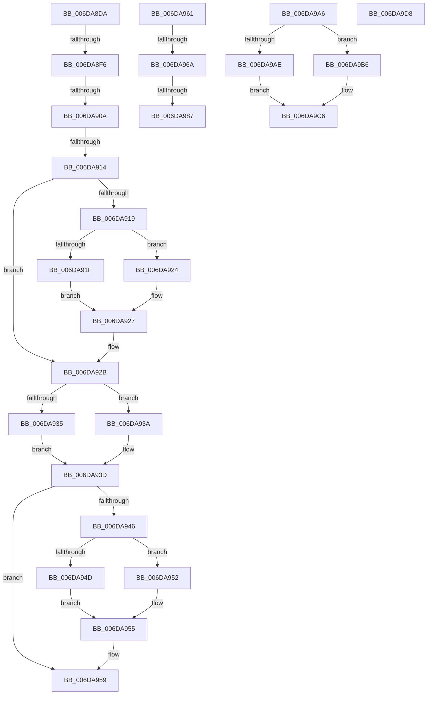

# sub_006DA8DA

- RVA: `0x006DA8DA`–`0x006DAA03` (길이 `297` bytes)
- VA: `0x00000001406DA8DA`
- 실행 섹션: `.text`
- PDB 이름 있음: `아니요`; PDB Function 태그: `아니요`
- unwind 정보 RVA: `0x00067FCC`
- 디코드: `83`개 명령, `297/297` bytes 표시
- 미해석 바이트: `0` (있으면 어셈블리에 `.byte`로 보존)

> 이 문서는 커널 이미지의 기계어와 PDB 기호를 분석해 생성했습니다. 4번과 5번은 함수 원형과 자료형을 바이너리 사용 방식에서 추정한 C 해석이며 원본 소스 복구 결과는 아닙니다.

## 1. Dependencies

- 직접 호출 지점: **4**; 고유 호출 대상: **4**
- 직접 호출자로 확인된 함수: **0**
- RIP 상대 이미지 참조: **0**

### Outgoing calls
- `0x006DA976` → [IopReplaceCompletionPort](../4B/IopReplaceCompletionPort_function_004BCA58.md) (function, `0x004BCA58`)
- `0x006DA98F` → [ObfDereferenceObjectWithTag](../2F/ObfDereferenceObjectWithTag_function_002F78E0.md) (function, `0x002F78E0`)
- `0x006DA9BE` → [IopSetFileObjectIosbRange](../../page/71/IopSetFileObjectIosbRange_function_0071C1C8.md) (function, `0x0071C1C8`)
- `0x006DA9E4` → [IopSetFileMemoryPartitionInformation](../../page/71/IopSetFileMemoryPartitionInformation_function_0071E414.md) (function, `0x0071E414`)

### Direct callers
- 이 함수 시작 RVA로 연결되는 직접 call은 확인되지 않았습니다. 간접 호출은 완전히 역산할 수 없습니다.

### Static image references
- 디코드된 RIP-relative 메모리 참조가 없습니다.

## 2. Other-region calls and transfers

- 다른 실행 섹션으로 향하는 call: **2**
  - `0x006DA9BE` → [IopSetFileObjectIosbRange](../../page/71/IopSetFileObjectIosbRange_function_0071C1C8.md) (`.text` → `PAGE`)
  - `0x006DA9E4` → [IopSetFileMemoryPartitionInformation](../../page/71/IopSetFileMemoryPartitionInformation_function_0071E414.md) (`.text` → `PAGE`)
- call이 아닌 외부 분기/꼬리 이동: **9**
  - `0x006DA8F0` → [NtSetInformationFile + 0xB02](../29/NtSetInformationFile_function_0029C5E0.md) (`tail-transfer`)
  - `0x006DA904` → [NtSetInformationFile + 0xB02](../29/NtSetInformationFile_function_0029C5E0.md) (`tail-transfer`)
  - `0x006DA90E` → [NtSetInformationFile + 0xB02](../29/NtSetInformationFile_function_0029C5E0.md) (`tail-transfer`)
  - `0x006DA95C` → [NtSetInformationFile + 0xA29](../29/NtSetInformationFile_function_0029C5E0.md) (`tail-transfer`)
  - `0x006DA964` → [NtSetInformationFile + 0xA29](../29/NtSetInformationFile_function_0029C5E0.md) (`tail-transfer`)
  - `0x006DA981` → [NtSetInformationFile + 0xA29](../29/NtSetInformationFile_function_0029C5E0.md) (`tail-transfer`)
  - `0x006DA9A1` → [NtSetInformationFile + 0x789](../29/NtSetInformationFile_function_0029C5E0.md) (`tail-transfer`)
  - `0x006DA9D3` → [NtSetInformationFile + 0x789](../29/NtSetInformationFile_function_0029C5E0.md) (`tail-transfer`)
  - `0x006DA9FE` → [NtSetInformationFile + 0x78E](../29/NtSetInformationFile_function_0029C5E0.md) (`tail-transfer`)

## 3. Assembly (complete function range)

```asm
006DA8DA  45 8B D0                        mov r10d, r8d
006DA8DD  41 83 E2 30                     and r10d, 0x30
006DA8E1  41 8B 14 24                     mov edx, dword ptr [r12]
006DA8E5  0F 95 C1                        setne cl
006DA8E8  F6 C2 02                        test dl, 2
006DA8EB  0F 94 C0                        sete al
006DA8EE  84 C8                           test al, cl
006DA8F0  0F 85 EC 27 BC FF               jne 0x14029d0e2
006DA8F6  45 85 D2                        test r10d, r10d
006DA8F9  0F 94 C1                        sete cl
006DA8FC  F6 C2 02                        test dl, 2
006DA8FF  0F 95 C0                        setne al
006DA902  84 C8                           test al, cl
006DA904  0F 85 D8 27 BC FF               jne 0x14029d0e2
006DA90A  41 83 FA 30                     cmp r10d, 0x30
006DA90E  0F 84 CE 27 BC FF               je 0x14029d0e2
006DA914  F6 C2 08                        test dl, 8
006DA917  75 12                           jne 0x1406da92b
006DA919  41 F6 C0 02                     test r8b, 2
006DA91D  74 05                           je 0x1406da924
006DA91F  83 CA 10                        or edx, 0x10
006DA922  EB 03                           jmp 0x1406da927
006DA924  83 E2 EF                        and edx, 0xffffffef
006DA927  41 89 14 24                     mov dword ptr [r12], edx
006DA92B  41 8B 01                        mov eax, dword ptr [r9]
006DA92E  49 8B CC                        mov rcx, r12
006DA931  A8 04                           test al, 4
006DA933  74 05                           je 0x1406da93a
006DA935  83 CA 20                        or edx, 0x20
006DA938  EB 03                           jmp 0x1406da93d
006DA93A  83 E2 DF                        and edx, 0xffffffdf
006DA93D  8B C2                           mov eax, edx
006DA93F  89 11                           mov dword ptr [rcx], edx
006DA941  F6 C2 02                        test dl, 2
006DA944  74 13                           je 0x1406da959
006DA946  41 8B 01                        mov eax, dword ptr [r9]
006DA949  A8 10                           test al, 0x10
006DA94B  74 05                           je 0x1406da952
006DA94D  83 CA 04                        or edx, 4
006DA950  EB 03                           jmp 0x1406da955
006DA952  83 E2 FB                        and edx, 0xfffffffb
006DA955  41 89 14 24                     mov dword ptr [r12], edx
006DA959  45 8B FE                        mov r15d, r14d
006DA95C  E9 A8 26 BC FF                  jmp 0x14029d009
006DA961  45 85 FF                        test r15d, r15d
006DA964  0F 88 9F 26 BC FF               js 0x14029d009
006DA96A  4C 8B 47 08                     mov r8, qword ptr [rdi + 8]
006DA96E  48 8B D3                        mov rdx, rbx
006DA971  48 8B 4C 24 38                  mov rcx, qword ptr [rsp + 0x38]
006DA976  E8 DD 20 DE FF                  call 0x1404bca58
006DA97B  44 8B F8                        mov r15d, eax
006DA97E  48 85 DB                        test rbx, rbx
006DA981  0F 84 82 26 BC FF               je 0x14029d009
006DA987  BA 44 66 6C 74                  mov edx, 0x746c6644
006DA98C  48 8B CB                        mov rcx, rbx
006DA98F  E8 4C CF C1 FF                  call 0x1402f78e0
006DA994  44 89 7E 30                     mov dword ptr [rsi + 0x30], r15d
006DA998  4C 89 76 38                     mov qword ptr [rsi + 0x38], r14
006DA99C  0F B6 7C 24 31                  movzx edi, byte ptr [rsp + 0x31]
006DA9A1  E9 C3 23 BC FF                  jmp 0x14029cd69
006DA9A6  41 8B 04 24                     mov eax, dword ptr [r12]
006DA9AA  A8 02                           test al, 2
006DA9AC  74 08                           je 0x1406da9b6
006DA9AE  41 BF 0D 00 00 C0               mov r15d, 0xc000000d
006DA9B4  EB 10                           jmp 0x1406da9c6
006DA9B6  48 8B D6                        mov rdx, rsi
006DA9B9  48 8B 4C 24 38                  mov rcx, qword ptr [rsp + 0x38]
006DA9BE  E8 05 18 04 00                  call 0x14071c1c8
006DA9C3  44 8B F8                        mov r15d, eax
006DA9C6  44 89 7E 30                     mov dword ptr [rsi + 0x30], r15d
006DA9CA  4C 89 76 38                     mov qword ptr [rsi + 0x38], r14
006DA9CE  0F B6 7C 24 31                  movzx edi, byte ptr [rsp + 0x31]
006DA9D3  E9 91 23 BC FF                  jmp 0x14029cd69
006DA9D8  45 8B C5                        mov r8d, r13d
006DA9DB  48 8B 56 18                     mov rdx, qword ptr [rsi + 0x18]
006DA9DF  48 8B 4C 24 38                  mov rcx, qword ptr [rsp + 0x38]
006DA9E4  E8 2B 3A 04 00                  call 0x14071e414
006DA9E9  44 8B F8                        mov r15d, eax
006DA9EC  0F B6 44 24 30                  movzx eax, byte ptr [rsp + 0x30]
006DA9F1  44 89 7E 30                     mov dword ptr [rsi + 0x30], r15d
006DA9F5  4C 89 76 38                     mov qword ptr [rsi + 0x38], r14
006DA9F9  0F B6 7C 24 31                  movzx edi, byte ptr [rsp + 0x31]
006DA9FE  E9 6B 23 BC FF                  jmp 0x14029cd6e
```

## 4. C-style interpretation (structured pseudocode)

```c
__int64 __fastcall sub_006DA8DA(__int64 a1, __int64 a2, int a3, __int64 a4)
{
    __int64 result;
    __int64 v_r10;
    unsigned __int8 v_stack_p30;
    unsigned __int8 v_stack_p31;
    unsigned __int64 v_stack_p38;

    v_r10 = (unsigned int)(((unsigned int)(a3)) & (48));
    a1 = (condition_is_not_equal) ? 1 : 0;
    result = ((((unsigned __int8)((unsigned int)(*(unsigned int *)(v_r12)))) & (2)) == 0) ? 1 : 0;
    a1 = ((unsigned int)(v_r10) == 0) ? 1 : 0;
    result = ((((unsigned __int8)((unsigned int)(*(unsigned int *)(v_r12)))) & (2)) != 0) ? 1 : 0;
    if ((((unsigned __int8)((unsigned int)(*(unsigned int *)(v_r12)))) & (8)) != 0) goto loc_006DA92B;
    if ((((unsigned __int8)(a3)) & (2)) == 0) goto loc_006DA924;
    a2 = (unsigned int)(((unsigned int)(*(unsigned int *)(v_r12))) | (16));
    goto loc_006DA927;
loc_006DA924:
    a2 = (unsigned int)((a2) & (0xFFFFFFEFULL));
loc_006DA927:
    *(unsigned int *)(v_r12) = (unsigned int)(a2);
loc_006DA92B:
    if ((((unsigned __int8)((unsigned int)(*(unsigned int *)(a4)))) & (4)) == 0) goto loc_006DA93A;
    a2 = (unsigned int)((a2) | (32));
    goto loc_006DA93D;
loc_006DA93A:
    a2 = (unsigned int)((a2) & (0xFFFFFFDFULL));
loc_006DA93D:
    *(unsigned int *)(v_r12) = (unsigned int)(a2);
    if ((((unsigned __int8)(a2)) & (2)) == 0) goto loc_006DA959;
    if ((((unsigned __int8)((unsigned int)(*(unsigned int *)(a4)))) & (16)) == 0) goto loc_006DA952;
    a2 = (unsigned int)((a2) | (4));
    goto loc_006DA955;
loc_006DA952:
    a2 = (unsigned int)((a2) & (0xFFFFFFFBULL));
loc_006DA955:
    *(unsigned int *)(v_r12) = (unsigned int)(a2);
loc_006DA959:
}
```

## 5. (Beta) C Style

```c
int64_t sub_006DA8DA(int64_t Arg1, int64_t Arg2, int32_t Arg3, void *Arg4)
{
    uint8_t *arg4 = (uint8_t *)Arg4;

    int64_t result;
    int64_t local_r10;
    uint8_t v_stack_p30;
    uint8_t v_stack_p31;
    uint64_t v_stack_p38;

    local_r10 = (uint32_t)(((uint32_t)(Arg3)) & (48));
    Arg1 = (condition_is_not_equal) ? 1 : 0;
    result = ((((uint8_t)((uint32_t)(*(uint32_t *)(local_r12)))) & (2)) == 0) ? 1 : 0;
    Arg1 = ((uint32_t)(local_r10) == 0) ? 1 : 0;
    result = ((((uint8_t)((uint32_t)(*(uint32_t *)(local_r12)))) & (2)) != 0) ? 1 : 0;
    if ((((uint8_t)((uint32_t)(*(uint32_t *)(local_r12)))) & (8)) != 0) goto loc_006DA92B;
    if ((((uint8_t)(Arg3)) & (2)) == 0) goto loc_006DA924;
    Arg2 = (uint32_t)(((uint32_t)(*(uint32_t *)(local_r12))) | (16));
    goto loc_006DA927;
loc_006DA924:
    Arg2 = (uint32_t)((Arg2) & (0xFFFFFFEFULL));
loc_006DA927:
    *(uint32_t *)(local_r12) = (uint32_t)(Arg2);
loc_006DA92B:
    if ((((uint8_t)((uint32_t)(*(uint32_t *)(arg4)))) & (4)) == 0) goto loc_006DA93A;
    Arg2 = (uint32_t)((Arg2) | (32));
    goto loc_006DA93D;
loc_006DA93A:
    Arg2 = (uint32_t)((Arg2) & (0xFFFFFFDFULL));
loc_006DA93D:
    *(uint32_t *)(local_r12) = (uint32_t)(Arg2);
    if ((((uint8_t)(Arg2)) & (2)) == 0) goto loc_006DA959;
    if ((((uint8_t)((uint32_t)(*(uint32_t *)(arg4)))) & (16)) == 0) goto loc_006DA952;
    Arg2 = (uint32_t)((Arg2) | (4));
    goto loc_006DA955;
loc_006DA952:
    Arg2 = (uint32_t)((Arg2) & (0xFFFFFFFBULL));
loc_006DA955:
    *(uint32_t *)(local_r12) = (uint32_t)(Arg2);
loc_006DA959:
}
```

### 관측된 메모리 오프셋

구조체 형식이 확인되지 않은 접근은 인자 기준의 오프셋으로만 기록했습니다.

| 기준 인자 | 오프셋 표현 | 폭 (bit) | 접근 |
|---|---:|---:|---|
| `Arg4` | `+ 0x0` | `32` | `R` |

## 6. Execution-region graph

[열기: 2D/3D 그래프와 함수 탐색 컨트롤 패널](../../../control-panel.html?section=text&rva=0x006DA8DA&view=graph)

- 2D 그래프는 위에서 아래로 흐르고, 3D 그래프는 빈 공간을 드래그해 회전합니다. Shift+드래그는 이동, 휠은 확대·축소, 함수 노드 선택은 대상 보고서 이동입니다.

### Static fallback


