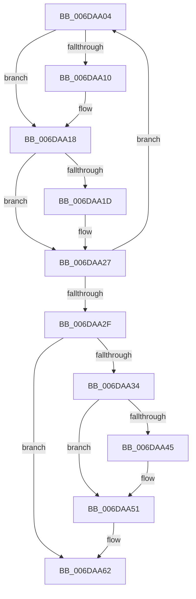

# sub_006DAA04

- RVA: `0x006DAA04`–`0x006DAA6A` (길이 `102` bytes)
- VA: `0x00000001406DAA04`
- 실행 섹션: `.text`
- PDB 이름 있음: `아니요`; PDB Function 태그: `아니요`
- unwind 정보 RVA: `0x00068124`
- 디코드: `27`개 명령, `102/102` bytes 표시
- 미해석 바이트: `0` (있으면 어셈블리에 `.byte`로 보존)

> 이 문서는 커널 이미지의 기계어와 PDB 기호를 분석해 생성했습니다. 4번과 5번은 함수 원형과 자료형을 바이너리 사용 방식에서 추정한 C 해석이며 원본 소스 복구 결과는 아닙니다.

## 1. Dependencies

- 직접 호출 지점: **5**; 고유 호출 대상: **5**
- 직접 호출자로 확인된 함수: **0**
- RIP 상대 이미지 참조: **2**

### Outgoing calls
- `0x006DAA13` → [MmUnlockPages](../29/MmUnlockPages_function_0029EEE0.md) (function, `0x0029EEE0`)
- `0x006DAA22` → [ExFreePoolWithTag](../../poolcode/B8/ExFreePoolWithTag_function_00B82870.md) (function, `0x00B82870`)
- `0x006DAA4C` → [ExfTryToWakePushLock](../26/ExfTryToWakePushLock_function_00265DD0.md) (function, `0x00265DD0`)
- `0x006DAA58` → [KeAbPostRelease](../2E/KeAbPostRelease_function_002E1600.md) (function, `0x002E1600`)
- `0x006DAA5D` → [KeLeaveCriticalRegion](../25/KeLeaveCriticalRegion_function_0025D8B0.md) (function, `0x0025D8B0`)

### Direct callers
- 이 함수 시작 RVA로 연결되는 직접 call은 확인되지 않았습니다. 간접 호출은 완전히 역산할 수 없습니다.

### Static image references
- `0x006DAA34` → RVA `0x00F8EBE8` (`.data`; read/write)
- `0x006DAA45` → RVA `0x00F8EBE8` (`.data`; read)

## 2. Other-region calls and transfers

- 다른 실행 섹션으로 향하는 call: **1**
  - `0x006DAA22` → [ExFreePoolWithTag](../../poolcode/B8/ExFreePoolWithTag_function_00B82870.md) (`.text` → `POOLCODE`)
- call이 아닌 외부 분기/꼬리 이동: **1**
  - `0x006DAA65` → [VslpLockPagesForTransfer + 0x183](../29/VslpLockPagesForTransfer_function_0029E0FC.md) (`tail-transfer`)

## 3. Assembly (complete function range)

```asm
006DAA04  4C 8B 27                        mov r12, qword ptr [rdi]
006DAA07  48 89 37                        mov qword ptr [rdi], rsi
006DAA0A  F6 47 0A 02                     test byte ptr [rdi + 0xa], 2
006DAA0E  74 08                           je 0x1406daa18
006DAA10  48 8B CF                        mov rcx, rdi
006DAA13  E8 C8 44 BC FF                  call 0x14029eee0
006DAA18  45 85 F6                        test r14d, r14d
006DAA1B  75 0A                           jne 0x1406daa27
006DAA1D  33 D2                           xor edx, edx
006DAA1F  48 8B CF                        mov rcx, rdi
006DAA22  E8 49 7E 4A 00                  call 0x140b82870
006DAA27  49 8B FC                        mov rdi, r12
006DAA2A  4D 85 E4                        test r12, r12
006DAA2D  75 D5                           jne 0x1406daa04
006DAA2F  45 85 F6                        test r14d, r14d
006DAA32  74 2E                           je 0x1406daa62
006DAA34  F0 48 0F C1 1D AB 41 8B 00      lock xadd qword ptr [rip + 0x8b41ab], rbx
006DAA3D  80 E3 06                        and bl, 6
006DAA40  80 FB 02                        cmp bl, 2
006DAA43  75 0C                           jne 0x1406daa51
006DAA45  48 8D 0D 9C 41 8B 00            lea rcx, [rip + 0x8b419c]
006DAA4C  E8 7F B3 B8 FF                  call 0x140265dd0
006DAA51  48 8D 0D 90 41 8B 00            lea rcx, [rip + 0x8b4190]
006DAA58  E8 A3 6B C0 FF                  call 0x1402e1600
006DAA5D  E8 4E 2E B8 FF                  call 0x14025d8b0
006DAA62  41 8B C7                        mov eax, r15d
006DAA65  E9 15 38 BC FF                  jmp 0x14029e27f
```

## 4. C-style interpretation (structured pseudocode)

```c
__int64 __fastcall sub_006DAA04(__int64 a1, int a2)
{
    __int64 result;
    __int64 v_rbx;

    *(unsigned __int64 *)(v_rdi) = v_rsi;
    if (((*(unsigned __int8 *)(v_rdi + 10)) & (2)) != 0) {
        a1 = v_rdi;
        result = MmUnlockPages(a1, a2, a3, a4);
    }
    if ((unsigned int)(v_r14) == 0) {
        a2 = 0;
        a1 = v_rdi;
        result = ExFreePoolWithTag(a1, a2, a3, a4);
    }
    if (*(unsigned __int64 *)(v_rdi) != 0) goto loc_006DAA04;
    if ((unsigned int)(v_r14) == 0) goto loc_006DAA62;
    v_rbx = (unsigned __int8)((v_rbx) & (6));
    if (((unsigned __int8)(v_rbx)) == 2) {
        a1 = v_rip + 9126300;
        result = ExfTryToWakePushLock(a1, a2, a3, a4);
    }
    result = KeAbPostRelease(v_rip + 9126288, a2, a3, a4);
    result = KeLeaveCriticalRegion(v_rip + 9126288, a2, a3, a4);
loc_006DAA62:
}
```

## 5. (Beta) C Style

```c
int64_t sub_006DAA04(int64_t Arg1, int32_t Arg2)
{
    int64_t result;
    int64_t local_rbx;

    *(uint64_t *)(local_rdi) = local_rsi;
    if (((*(uint8_t *)(local_rdi + 0xA)) & (2)) != 0) {
        Arg1 = local_rdi;
        result = MmUnlockPages(Arg1, Arg2, a3, a4);
    }
    if ((uint32_t)(local_r14) == 0) {
        Arg2 = 0;
        Arg1 = local_rdi;
        result = ExFreePoolWithTag(Arg1, Arg2, a3, a4);
    }
    if (*(uint64_t *)(local_rdi) != 0) goto loc_006DAA04;
    if ((uint32_t)(local_r14) == 0) goto loc_006DAA62;
    local_rbx = (uint8_t)((local_rbx) & (6));
    if (((uint8_t)(local_rbx)) == 2) {
        Arg1 = v_rip + 9126300;
        result = ExfTryToWakePushLock(Arg1, Arg2, a3, a4);
    }
    result = KeAbPostRelease(v_rip + 9126288, Arg2, a3, a4);
    result = KeLeaveCriticalRegion(v_rip + 9126288, Arg2, a3, a4);
loc_006DAA62:
}
```

## 6. Execution-region graph

[열기: 2D/3D 그래프와 함수 탐색 컨트롤 패널](../../../control-panel.html?section=text&rva=0x006DAA04&view=graph)

- 2D 그래프는 위에서 아래로 흐르고, 3D 그래프는 빈 공간을 드래그해 회전합니다. Shift+드래그는 이동, 휠은 확대·축소, 함수 노드 선택은 대상 보고서 이동입니다.

### Static fallback


