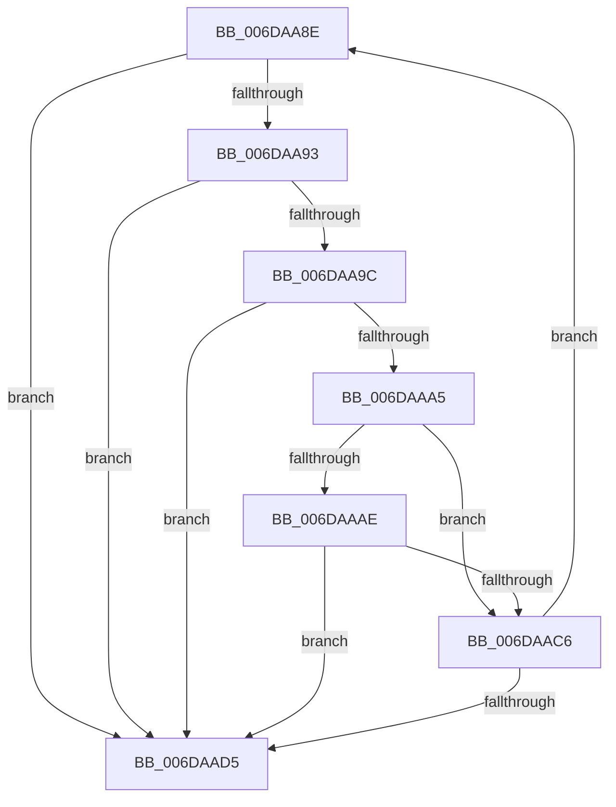

# sub_006DAA8E

- RVA: `0x006DAA8E`–`0x006DAAE5` (길이 `87` bytes)
- VA: `0x00000001406DAA8E`
- 실행 섹션: `.text`
- PDB 이름 있음: `아니요`; PDB Function 태그: `아니요`
- unwind 정보 RVA: `0x000682AC`
- 디코드: `27`개 명령, `87/87` bytes 표시
- 미해석 바이트: `0` (있으면 어셈블리에 `.byte`로 보존)

> 이 문서는 커널 이미지의 기계어와 PDB 기호를 분석해 생성했습니다. 4번과 5번은 함수 원형과 자료형을 바이너리 사용 방식에서 추정한 C 해석이며 원본 소스 복구 결과는 아닙니다.

## 1. Dependencies

- 직접 호출 지점: **1**; 고유 호출 대상: **1**
- 직접 호출자로 확인된 함수: **0**
- RIP 상대 이미지 참조: **1**

### Outgoing calls
- `0x006DAADA` → [MiDereferenceIoPages](../2A/MiDereferenceIoPages_function_002AB1B0.md) (function, `0x002AB1B0`)

### Direct callers
- 이 함수 시작 RVA로 연결되는 직접 call은 확인되지 않았습니다. 간접 호출은 완전히 역산할 수 없습니다.

### Static image references
- `0x006DAAA5` → RVA `0x00E2DCE0` (`.data`; read)

## 2. Other-region calls and transfers

- 다른 실행 섹션으로 향하는 call: **0**
- call이 아닌 외부 분기/꼬리 이동: **1**
  - `0x006DAAE0` → [MmUnlockPages + 0x11C](../29/MmUnlockPages_function_0029EEE0.md) (`tail-transfer`)

## 3. Assembly (complete function range)

```asm
006DAA8E  4D 3B CC                        cmp r9, r12
006DAA91  74 42                           je 0x1406daad5
006DAA93  4D 8B 01                        mov r8, qword ptr [r9]
006DAA96  49 83 F8 FF                     cmp r8, -1
006DAA9A  74 39                           je 0x1406daad5
006DAA9C  48 8D 41 01                     lea rax, [rcx + 1]
006DAAA0  4C 3B C0                        cmp r8, rax
006DAAA3  75 30                           jne 0x1406daad5
006DAAA5  4C 3B 05 34 32 75 00            cmp r8, qword ptr [rip + 0x753234]
006DAAAC  77 18                           ja 0x1406daac6
006DAAAE  4B 8D 0C 40                     lea rcx, [r8 + r8*2]
006DAAB2  48 03 C9                        add rcx, rcx
006DAAB5  49 8B C3                        mov rax, r11
006DAAB8  48 8B 04 C8                     mov rax, qword ptr [rax + rcx*8]
006DAABC  48 C1 E8 36                     shr rax, 0x36
006DAAC0  0F BA E0 00                     bt eax, 0
006DAAC4  72 0F                           jb 0x1406daad5
006DAAC6  49 FF C6                        inc r14
006DAAC9  49 83 C1 08                     add r9, 8
006DAACD  49 8B C8                        mov rcx, r8
006DAAD0  4D 3B F2                        cmp r14, r10
006DAAD3  72 B9                           jb 0x1406daa8e
006DAAD5  4D 8B C6                        mov r8, r14
006DAAD8  33 C9                           xor ecx, ecx
006DAADA  E8 D1 06 BD FF                  call 0x1402ab1b0
006DAADF  90                              nop
006DAAE0  E9 17 45 BC FF                  jmp 0x14029effc
```

## 4. C-style interpretation (structured pseudocode)

```c
__int64 __fastcall sub_006DAA8E(__int64 a1, __int64 a2, __int64 a3, __int64 a4)
{
    __int64 result;
    __int64 v_r14;

    if (a4 == v_r12) goto loc_006DAAD5;
    if ((*(unsigned __int64 *)(a4)) == -1) goto loc_006DAAD5;
    if ((*(unsigned __int64 *)(a4)) != (a1 + 1)) goto loc_006DAAD5;
    if ((*(unsigned __int64 *)(a4)) > (*(unsigned __int64 *)(v_rip + 7680564))) goto loc_006DAAC6;
    a1 = (*(unsigned __int64 *)(a4) + *(unsigned __int64 *)(a4) * 2) + (*(unsigned __int64 *)(a4) + *(unsigned __int64 *)(a4) * 2);
    result = (*(unsigned __int64 *)(v_r11 + a1 * 8)) >> (54);
    if (condition_is_below) goto loc_006DAAD5;
loc_006DAAC6:
    v_r14 = (v_r14) + 1;
    a4 = (a4) + (8);
    if (v_r14 < v_r10) goto loc_006DAA8E;
loc_006DAAD5:
    a1 = 0;
    result = MiDereferenceIoPages(a1, a2, v_r14, a4);
}
```

## 5. (Beta) C Style

```c
int64_t sub_006DAA8E(int64_t Arg1, int64_t Arg2, int64_t Arg3, int64_t Arg4)
{
    int64_t result;
    int64_t local_r14;

    if (Arg4 == local_r12) goto loc_006DAAD5;
    if ((*(uint64_t *)(Arg4)) == -1) goto loc_006DAAD5;
    if ((*(uint64_t *)(Arg4)) != (Arg1 + 1)) goto loc_006DAAD5;
    if ((*(uint64_t *)(Arg4)) > (*(uint64_t *)(v_rip + 0x753234))) goto loc_006DAAC6;
    Arg1 = (*(uint64_t *)(Arg4) + *(uint64_t *)(Arg4) * 2) + (*(uint64_t *)(Arg4) + *(uint64_t *)(Arg4) * 2);
    result = (*(uint64_t *)(local_r11 + Arg1 * 8)) >> (54);
    if (condition_is_below) goto loc_006DAAD5;
loc_006DAAC6:
    local_r14 = (local_r14) + 1;
    Arg4 = (Arg4) + (8);
    if (local_r14 < local_r10) goto loc_006DAA8E;
loc_006DAAD5:
    Arg1 = 0;
    result = MiDereferenceIoPages(Arg1, Arg2, local_r14, Arg4);
}
```

## 6. Execution-region graph

[열기: 2D/3D 그래프와 함수 탐색 컨트롤 패널](../../../control-panel.html?section=text&rva=0x006DAA8E&view=graph)

- 2D 그래프는 위에서 아래로 흐르고, 3D 그래프는 빈 공간을 드래그해 회전합니다. Shift+드래그는 이동, 휠은 확대·축소, 함수 노드 선택은 대상 보고서 이동입니다.

### Static fallback


