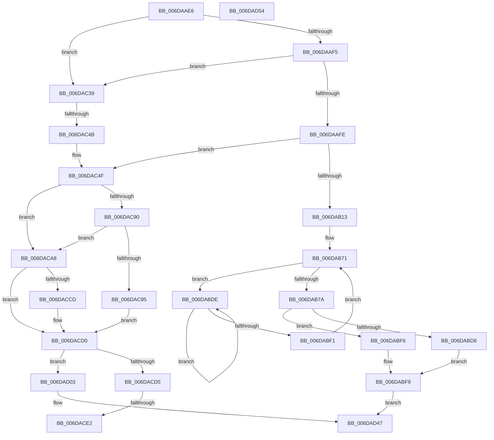

# sub_006DAAE6

- RVA: `0x006DAAE6`–`0x006DAD62` (길이 `636` bytes)
- VA: `0x00000001406DAAE6`
- 실행 섹션: `.text`
- PDB 이름 있음: `아니요`; PDB Function 태그: `아니요`
- unwind 정보 RVA: `0x00068398`
- 디코드: `153`개 명령, `636/636` bytes 표시
- 미해석 바이트: `0` (있으면 어셈블리에 `.byte`로 보존)

> 이 문서는 커널 이미지의 기계어와 PDB 기호를 분석해 생성했습니다. 4번과 5번은 함수 원형과 자료형을 바이너리 사용 방식에서 추정한 C 해석이며 원본 소스 복구 결과는 아닙니다.

## 1. Dependencies

- 직접 호출 지점: **21**; 고유 호출 대상: **17**
- 직접 호출자로 확인된 함수: **0**
- RIP 상대 이미지 참조: **3**

### Outgoing calls
- `0x006DAB06` → [KeTryToFreezeThreadStack](../4B/KeTryToFreezeThreadStack_function_004B5038.md) (function, `0x004B5038`)
- `0x006DAB1E` → [MiMapPageInHyperSpaceWorker](../33/MiMapPageInHyperSpaceWorker_function_00332B10.md) (function, `0x00332B10`)
- `0x006DAB56` → [MiCopyKstack](../67/MiCopyKstack_function_0067B058.md) (function, `0x0067B058`)
- `0x006DAB66` → [MiUnmapPageInHyperSpaceWorker](../43/MiUnmapPageInHyperSpaceWorker_function_00432800.md) (function, `0x00432800`)
- `0x006DAB80` → [MiSwitchKstackPages](../67/MiSwitchKstackPages_function_0067B464.md) (function, `0x0067B464`)
- `0x006DAB97` → [MiClearPfnReuseFields](../37/MiClearPfnReuseFields_function_003759F0.md) (function, `0x003759F0`)
- `0x006DABE3` → [KeYieldProcessorEx](../3F/KeYieldProcessorEx_function_003FBD00.md) (function, `0x003FBD00`)
- `0x006DAC06` → [KiReleaseThreadStateLock](../21/KiReleaseThreadStateLock_function_00217910.md) (function, `0x00217910`)
- `0x006DAC15` → [MiUnlockPageTable](../21/MiUnlockPageTable_function_00216EC0.md) (function, `0x00216EC0`)
- `0x006DAC21` → [MiUnlockWorkingSetShared](../27/MiUnlockWorkingSetShared_function_0027D690.md) (function, `0x0027D690`)
- `0x006DAC3E` → [MiAddLockedPageCharge](../28/MiAddLockedPageCharge_function_0028B550.md) (function, `0x0028B550`)
- `0x006DAC64` → [MiUnlockPageTable](../21/MiUnlockPageTable_function_00216EC0.md) (function, `0x00216EC0`)
- `0x006DAC70` → [MiUnlockWorkingSetShared](../27/MiUnlockWorkingSetShared_function_0027D690.md) (function, `0x0027D690`)
- `0x006DAC9F` → [KeGenericCallDpcEx](../2C/KeGenericCallDpcEx_function_002C99F4.md) (function, `0x002C99F4`)
- `0x006DACC4` → [KeExpandKernelStackAndCalloutInternal](../2F/KeExpandKernelStackAndCalloutInternal_function_002F8450.md) (function, `0x002F8450`)
- `0x006DACE2` → [MiLockPageInline](../31/MiLockPageInline_function_0031A340.md) (function, `0x0031A340`)
- `0x006DACED` → [MiRemoveLockedPageChargeAndDecRef](../24/MiRemoveLockedPageChargeAndDecRef_function_002459D0.md) (function, `0x002459D0`)
- `0x006DACF8` → [MiUnlockPage](../31/MiUnlockPage_function_0031A3E0.md) (function, `0x0031A3E0`)
- `0x006DAD10` → [MiLockPageInline](../31/MiLockPageInline_function_0031A340.md) (function, `0x0031A340`)
- `0x006DAD42` → [MiUnlockPage](../31/MiUnlockPage_function_0031A3E0.md) (function, `0x0031A3E0`)
- `0x006DAD57` → [MiReleaseFreshPage](../33/MiReleaseFreshPage_function_00334AE0.md) (function, `0x00334AE0`)

### Direct callers
- 이 함수 시작 RVA로 연결되는 직접 call은 확인되지 않았습니다. 간접 호출은 완전히 역산할 수 없습니다.

### Static image references
- `0x006DAC98` → RVA `0x0048BA30` (`MiDoStackCopy`; read)
- `0x006DACA8` → RVA `0x00FC5020` (`ALMOSTRO`; read)
- `0x006DACAF` → RVA `0x002C8B30` (`MiJumpStack`; read)

## 2. Other-region calls and transfers

- 다른 실행 섹션으로 향하는 call: **0**
- call이 아닌 외부 분기/꼬리 이동: **5**
  - `0x006DAC45` → [MiSwapStackPage + 0x41F](../29/MiSwapStackPage_function_0029FDE0.md) (`tail-transfer`)
  - `0x006DACDC` → [MiSwapStackPage + 0x445](../29/MiSwapStackPage_function_0029FDE0.md) (`tail-transfer`)
  - `0x006DACFE` → [MiSwapStackPage + 0x445](../29/MiSwapStackPage_function_0029FDE0.md) (`tail-transfer`)
  - `0x006DAD4F` → [MiSwapStackPage + 0x2DC](../29/MiSwapStackPage_function_0029FDE0.md) (`tail-transfer`)
  - `0x006DAD5D` → [MiSwapStackPage + 0x3B5](../29/MiSwapStackPage_function_0029FDE0.md) (`tail-transfer`)

## 3. Assembly (complete function range)

```asm
006DAAE6  48 8B 5C 24 48                  mov rbx, qword ptr [rsp + 0x48]
006DAAEB  49 83 FF F0                     cmp r15, -0x10
006DAAEF  0F 84 44 01 00 00               je 0x1406dac39
006DAAF5  4C 3B FB                        cmp r15, rbx
006DAAF8  0F 84 3B 01 00 00               je 0x1406dac39
006DAAFE  48 8D 54 24 40                  lea rdx, [rsp + 0x40]
006DAB03  49 8B CF                        mov rcx, r15
006DAB06  E8 2D A5 DD FF                  call 0x1404b5038
006DAB0B  84 C0                           test al, al
006DAB0D  0F 84 3C 01 00 00               je 0x1406dac4f
006DAB13  33 D2                           xor edx, edx
006DAB15  41 B8 00 00 00 80               mov r8d, 0x80000000
006DAB1B  49 8B CD                        mov rcx, r13
006DAB1E  E8 ED 7F C5 FF                  call 0x140332b10
006DAB23  4C 8B C0                        mov r8, rax
006DAB26  48 8B D8                        mov rbx, rax
006DAB29  48 B8 F8 FF FF FF 7F 00 00 00   movabs rax, 0x7ffffffff8
006DAB33  49 C1 E8 09                     shr r8, 9
006DAB37  4C 23 C0                        and r8, rax
006DAB3A  48 B8 00 00 00 00 80 F6 FF FF   movabs rax, 0xfffff68000000000
006DAB44  48 8B C8                        mov rcx, rax
006DAB47  4C 03 C1                        add r8, rcx
006DAB4A  41 B9 01 00 00 00               mov r9d, 1
006DAB50  48 8B CD                        mov rcx, rbp
006DAB53  48 8B D7                        mov rdx, rdi
006DAB56  E8 FD 04 FA FF                  call 0x14067b058
006DAB5B  41 B8 00 00 00 80               mov r8d, 0x80000000
006DAB61  B2 11                           mov dl, 0x11
006DAB63  48 8B CB                        mov rcx, rbx
006DAB66  E8 95 7C D5 FF                  call 0x140432800
006DAB6B  33 DB                           xor ebx, ebx
006DAB6D  89 5C 24 38                     mov dword ptr [rsp + 0x38], ebx
006DAB71  F0 48 0F BA 6D 18 3F            lock bts qword ptr [rbp + 0x18], 0x3f
006DAB78  72 64                           jb 0x1406dabde
006DAB7A  48 8B D7                        mov rdx, rdi
006DAB7D  48 8B CD                        mov rcx, rbp
006DAB80  E8 DF 08 FA FF                  call 0x14067b464
006DAB85  49 B9 FF FF FF FF FF FF FF 7F   movabs r9, 0x7fffffffffffffff
006DAB8F  F0 4C 21 4D 18                  lock and qword ptr [rbp + 0x18], r9
006DAB94  48 8B CF                        mov rcx, rdi
006DAB97  E8 54 AE C9 FF                  call 0x1403759f0
006DAB9C  48 8B 47 18                     mov rax, qword ptr [rdi + 0x18]
006DABA0  48 BA 00 00 00 00 00 00 00 C0   movabs rdx, 0xc000000000000000
006DABAA  48 23 C2                        and rax, rdx
006DABAD  48 89 47 18                     mov qword ptr [rdi + 0x18], rax
006DABB1  8B 47 20                        mov eax, dword ptr [rdi + 0x20]
006DABB4  89 44 24 34                     mov dword ptr [rsp + 0x34], eax
006DABB8  66 89 5C 24 34                  mov word ptr [rsp + 0x34], bx
006DABBD  8B 44 24 34                     mov eax, dword ptr [rsp + 0x34]
006DABC1  89 47 20                        mov dword ptr [rdi + 0x20], eax
006DABC4  F0 4C 21 4F 18                  lock and qword ptr [rdi + 0x18], r9
006DABC9  48 8B 54 24 40                  mov rdx, qword ptr [rsp + 0x40]
006DABCE  48 89 54 24 50                  mov qword ptr [rsp + 0x50], rdx
006DABD3  48 85 D2                        test rdx, rdx
006DABD6  74 1E                           je 0x1406dabf6
006DABD8  48 83 E2 FE                     and rdx, 0xfffffffffffffffe
006DABDC  EB 1B                           jmp 0x1406dabf9
006DABDE  48 8D 4C 24 38                  lea rcx, [rsp + 0x38]
006DABE3  E8 18 11 D2 FF                  call 0x1403fbd00
006DABE8  48 8B 45 18                     mov rax, qword ptr [rbp + 0x18]
006DABEC  48 85 C0                        test rax, rax
006DABEF  78 ED                           js 0x1406dabde
006DABF1  E9 7B FF FF FF                  jmp 0x1406dab71
006DABF6  48 8B D3                        mov rdx, rbx
006DABF9  45 33 C9                        xor r9d, r9d
006DABFC  48 89 5C 24 20                  mov qword ptr [rsp + 0x20], rbx
006DAC01  4C 8D 44 24 50                  lea r8, [rsp + 0x50]
006DAC06  E8 05 CD B3 FF                  call 0x140217910
006DAC0B  49 8B D4                        mov rdx, r12
006DAC0E  49 89 5F 40                     mov qword ptr [r15 + 0x40], rbx
006DAC12  49 8B CE                        mov rcx, r14
006DAC15  E8 A6 C2 B3 FF                  call 0x140216ec0
006DAC1A  8A 54 24 30                     mov dl, byte ptr [rsp + 0x30]
006DAC1E  49 8B CE                        mov rcx, r14
006DAC21  E8 6A 2A BA FF                  call 0x14027d690
006DAC26  48 8B 84 24 C8 00 00 00         mov rax, qword ptr [rsp + 0xc8]
006DAC2E  C7 00 01 00 00 00               mov dword ptr [rax], 1
006DAC34  E9 0E 01 00 00                  jmp 0x1406dad47
006DAC39  33 D2                           xor edx, edx
006DAC3B  48 8B CF                        mov rcx, rdi
006DAC3E  E8 0D 09 BB FF                  call 0x14028b550
006DAC43  85 C0                           test eax, eax
006DAC45  0F 84 B4 55 BC FF               je 0x1402a01ff
006DAC4B  48 89 7E 30                     mov qword ptr [rsi + 0x30], rdi
006DAC4F  49 B9 FF FF FF FF FF FF FF 7F   movabs r9, 0x7fffffffffffffff
006DAC59  F0 4C 21 4F 18                  lock and qword ptr [rdi + 0x18], r9
006DAC5E  49 8B D4                        mov rdx, r12
006DAC61  49 8B CE                        mov rcx, r14
006DAC64  E8 57 C2 B3 FF                  call 0x140216ec0
006DAC69  8A 54 24 30                     mov dl, byte ptr [rsp + 0x30]
006DAC6D  49 8B CE                        mov rcx, r14
006DAC70  E8 1B 2A BA FF                  call 0x14027d690
006DAC75  48 8B 44 24 58                  mov rax, qword ptr [rsp + 0x58]
006DAC7A  48 89 06                        mov qword ptr [rsi], rax
006DAC7D  33 C0                           xor eax, eax
006DAC7F  4C 89 6E 08                     mov qword ptr [rsi + 8], r13
006DAC83  48 89 46 10                     mov qword ptr [rsi + 0x10], rax
006DAC87  89 46 20                        mov dword ptr [rsi + 0x20], eax
006DAC8A  49 83 FF F0                     cmp r15, -0x10
006DAC8E  74 18                           je 0x1406daca8
006DAC90  4C 3B FB                        cmp r15, rbx
006DAC93  74 13                           je 0x1406daca8
006DAC95  48 8B D6                        mov rdx, rsi
006DAC98  48 8D 0D 91 0D DB FF            lea rcx, [rip - 0x24f26f]
006DAC9F  E8 50 ED BE FF                  call 0x1402c99f4
006DACA4  33 DB                           xor ebx, ebx
006DACA6  EB 28                           jmp 0x1406dacd0
006DACA8  44 8B 05 71 A3 8E 00            mov r8d, dword ptr [rip + 0x8ea371]
006DACAF  48 8D 0D 7A DE BE FF            lea rcx, [rip - 0x412186]
006DACB6  33 DB                           xor ebx, ebx
006DACB8  48 8B D6                        mov rdx, rsi
006DACBB  48 89 5C 24 20                  mov qword ptr [rsp + 0x20], rbx
006DACC0  44 8D 4B 01                     lea r9d, [rbx + 1]
006DACC4  E8 87 D7 C1 FF                  call 0x1402f8450
006DACC9  85 C0                           test eax, eax
006DACCB  79 03                           jns 0x1406dacd0
006DACCD  89 46 20                        mov dword ptr [rsi + 0x20], eax
006DACD0  39 5E 20                        cmp dword ptr [rsi + 0x20], ebx
006DACD3  7D 2E                           jge 0x1406dad03
006DACD5  48 8B 4E 30                     mov rcx, qword ptr [rsi + 0x30]
006DACD9  48 85 C9                        test rcx, rcx
006DACDC  0F 84 43 55 BC FF               je 0x1402a0225
006DACE2  E8 59 F6 C3 FF                  call 0x14031a340
006DACE7  48 8B 4E 30                     mov rcx, qword ptr [rsi + 0x30]
006DACEB  8A D8                           mov bl, al
006DACED  E8 DE AC B6 FF                  call 0x1402459d0
006DACF2  48 8B 4E 30                     mov rcx, qword ptr [rsi + 0x30]
006DACF6  8A D3                           mov dl, bl
006DACF8  E8 E3 F6 C3 FF                  call 0x14031a3e0
006DACFD  90                              nop
006DACFE  E9 22 55 BC FF                  jmp 0x1402a0225
006DAD03  48 8B 84 24 C8 00 00 00         mov rax, qword ptr [rsp + 0xc8]
006DAD0B  48 8B CF                        mov rcx, rdi
006DAD0E  89 18                           mov dword ptr [rax], ebx
006DAD10  E8 2B F6 C3 FF                  call 0x14031a340
006DAD15  48 8B 4F 18                     mov rcx, qword ptr [rdi + 0x18]
006DAD19  48 BA 00 00 00 00 00 00 00 C0   movabs rdx, 0xc000000000000000
006DAD23  48 23 CA                        and rcx, rdx
006DAD26  8A D0                           mov dl, al
006DAD28  48 89 4F 18                     mov qword ptr [rdi + 0x18], rcx
006DAD2C  8B 4F 20                        mov ecx, dword ptr [rdi + 0x20]
006DAD2F  89 4C 24 34                     mov dword ptr [rsp + 0x34], ecx
006DAD33  66 89 5C 24 34                  mov word ptr [rsp + 0x34], bx
006DAD38  8B 4C 24 34                     mov ecx, dword ptr [rsp + 0x34]
006DAD3C  89 4F 20                        mov dword ptr [rdi + 0x20], ecx
006DAD3F  48 8B CF                        mov rcx, rdi
006DAD42  E8 99 F6 C3 FF                  call 0x14031a3e0
006DAD47  4C 8B BC 24 C0 00 00 00         mov r15, qword ptr [rsp + 0xc0]
006DAD4F  E9 68 53 BC FF                  jmp 0x1402a00bc
006DAD54  48 8B CD                        mov rcx, rbp
006DAD57  E8 84 9D C5 FF                  call 0x140334ae0
006DAD5C  90                              nop
006DAD5D  E9 33 54 BC FF                  jmp 0x1402a0195
```

## 4. C-style interpretation (structured pseudocode)

```c
__int64 __fastcall sub_006DAAE6(__int64 a1, __int64 a2, __int64 a3, __int64 a4, __int64 a5, unsigned __int8 a6, __int64 a7, __int64 a8, __int64 a9, __int64 a10, __int64 a11, __int64 a12, __int64 a13, __int64 a14, __int64 a15, __int64 a16, __int64 a17, __int64 a18, __int64 a19, __int64 a20, __int64 a21, __int64 a22, __int64 a23, __int64 a24, __int64 a25)
{
    __int64 result;
    __int64 v_rbx;
    unsigned __int64 v_stack_p20;
    unsigned int v_stack_p34;
    unsigned int v_stack_p38;
    unsigned __int64 v_stack_p50;

    if (v_r15 == -16) goto loc_006DAC39;
    if (v_r15 == a9) goto loc_006DAC39;
    result = KeTryToFreezeThreadStack(v_r15, a8, a3, a4);
    if ((unsigned __int8)(result) == 0) goto loc_006DAC4F;
    a2 = 0;
    result = MiMapPageInHyperSpaceWorker(v_r13, a2, (unsigned int)(0x80000000ULL), a4);
    a3 = (result) >> (9);
    a3 = (a3) & (result);
    a3 = (a3) + (result);
    result = MiCopyKstack(v_rbp, v_rdi, a3, 1);
    result = MiUnmapPageInHyperSpaceWorker(result, 17, (unsigned int)(0x80000000ULL), 1);
    v_rbx = 0;
    v_stack_p38 = 0;
loc_006DAB71:
    if (condition_is_below) goto loc_006DABDE;
    result = MiSwitchKstackPages(v_rbp, v_rdi, (unsigned int)(0x80000000ULL), 1);
    result = MiClearPfnReuseFields(v_rdi, v_rdi, (unsigned int)(0x80000000ULL), 1);
    result = (*(unsigned __int64 *)(v_rdi + 24)) & (v_rdi);
    *(unsigned __int64 *)(v_rdi + 24) = result;
    v_stack_p34 = (unsigned int)((unsigned int)(*(unsigned int *)(v_rdi + 32)));
    v_stack_p34 = 0;
    *(unsigned int *)(v_rdi + 32) = (unsigned int)((unsigned int)(v_stack_p34));
    v_stack_p50 = a8;
    if (a8 == 0) goto loc_006DABF6;
    a2 = (a8) & (-2);
    goto loc_006DABF9;
loc_006DABDE:
    result = KeYieldProcessorEx(a7, a2, (unsigned int)(0x80000000ULL), 1);
    if (sign_flag) goto loc_006DABDE;
    goto loc_006DAB71;
loc_006DABF6:
loc_006DABF9:
    a4 = 0;
    v_stack_p20 = 0;
    result = KiReleaseThreadStateLock(a7, 0, a10, a4);
    *(unsigned __int64 *)(v_r15 + 64) = 0;
    result = MiUnlockPageTable(v_r14, v_r12, a10, a4);
    result = MiUnlockWorkingSetShared(v_r14, a6, a10, a4);
    *(unsigned int *)(a25) = 1;
    goto loc_006DAD47;
loc_006DAC39:
    a2 = 0;
    result = MiAddLockedPageCharge(v_rdi, a2, a10, a4);
    *(unsigned __int64 *)(v_rsi + 48) = v_rdi;
loc_006DAC4F:
    result = MiUnlockPageTable(v_r14, v_r12, a10, a4);
    result = MiUnlockWorkingSetShared(v_r14, a6, a10, a4);
    *(unsigned __int64 *)(v_rsi) = a11;
    result = 0;
    *(unsigned __int64 *)(v_rsi + 8) = v_r13;
    *(unsigned __int64 *)(v_rsi + 16) = 0;
    *(unsigned int *)(v_rsi + 32) = 0;
    if (v_r15 == -16) goto loc_006DACA8;
    if (v_r15 == 0) goto loc_006DACA8;
    result = KeGenericCallDpcEx(v_rip - 2421359, v_rsi, a10, a4);
    v_rbx = 0;
    goto loc_006DACD0;
loc_006DACA8:
    v_rbx = 0;
    v_stack_p20 = 0;
    result = KeExpandKernelStackAndCalloutInternal(v_rip - 4268422, v_rsi, (unsigned int)(*(unsigned int *)(v_rip + 9347953)), v_rbx + 1);
    if (sign_flag) {
        *(unsigned int *)(v_rsi + 32) = (unsigned int)(result);
    }
    if ((*(unsigned int *)(v_rsi + 32)) >= 0) goto loc_006DAD03;
    result = MiLockPageInline(*(unsigned __int64 *)(v_rsi + 48), v_rsi, (unsigned int)(*(unsigned int *)(v_rip + 9347953)), v_rbx + 1);
    result = MiRemoveLockedPageChargeAndDecRef(*(unsigned __int64 *)(v_rsi + 48), v_rsi, (unsigned int)(*(unsigned int *)(v_rip + 9347953)), v_rbx + 1);
    result = MiUnlockPage(*(unsigned __int64 *)(v_rsi + 48), (unsigned __int8)((unsigned __int8)(result)), (unsigned int)(*(unsigned int *)(v_rip + 9347953)), v_rbx + 1);
loc_006DAD03:
    *(unsigned int *)(a25) = (unsigned int)((unsigned __int8)(result));
    result = MiLockPageInline(v_rdi, (unsigned __int8)((unsigned __int8)(result)), (unsigned int)(*(unsigned int *)(v_rip + 9347953)), v_rbx + 1);
    a1 = (*(unsigned __int64 *)(v_rdi + 24)) & ((unsigned __int8)((unsigned __int8)(result)));
    *(unsigned __int64 *)(v_rdi + 24) = a1;
    v_stack_p34 = (unsigned int)((unsigned int)(*(unsigned int *)(v_rdi + 32)));
    v_stack_p34 = (unsigned __int16)((unsigned __int8)(result));
    *(unsigned int *)(v_rdi + 32) = (unsigned int)((unsigned int)(v_stack_p34));
    result = MiUnlockPage(v_rdi, (unsigned __int8)(result), (unsigned int)(*(unsigned int *)(v_rip + 9347953)), v_rbx + 1);
loc_006DAD47:
}
```

## 5. (Beta) C Style

```c
int64_t sub_006DAAE6(int64_t Arg1, int64_t Arg2, int64_t Arg3, int64_t Arg4, uint64_t Arg5, uint8_t Arg6, int64_t Arg7, int64_t Arg8, int64_t Arg9, int64_t Arg10, int64_t Arg11, uint64_t Arg12, uint64_t Arg13, uint64_t Arg14, uint64_t Arg15, uint64_t Arg16, uint64_t Arg17, uint64_t Arg18, uint64_t Arg19, uint64_t Arg20, uint64_t Arg21, uint64_t Arg22, uint64_t Arg23, int64_t Arg24, void *Arg25)
{
    uint8_t *arg25 = (uint8_t *)Arg25;

    int64_t result;
    int64_t local_rbx;
    uint64_t v_stack_p20;
    uint32_t v_stack_p34;
    uint32_t v_stack_p38;
    uint64_t v_stack_p50;

    if (local_r15 == -16) goto loc_006DAC39;
    if (local_r15 == Arg9) goto loc_006DAC39;
    result = KeTryToFreezeThreadStack(local_r15, Arg8, Arg3, Arg4);
    if ((uint8_t)(result) == 0) goto loc_006DAC4F;
    Arg2 = 0;
    result = MiMapPageInHyperSpaceWorker(local_r13, Arg2, (uint32_t)(0x80000000ULL), Arg4);
    Arg3 = (result) >> (9);
    Arg3 = (Arg3) & (result);
    Arg3 = (Arg3) + (result);
    result = MiCopyKstack(local_rbp, local_rdi, Arg3, 1);
    result = MiUnmapPageInHyperSpaceWorker(result, 17, (uint32_t)(0x80000000ULL), 1);
    local_rbx = 0;
    v_stack_p38 = 0;
loc_006DAB71:
    if (condition_is_below) goto loc_006DABDE;
    result = MiSwitchKstackPages(local_rbp, local_rdi, (uint32_t)(0x80000000ULL), 1);
    result = MiClearPfnReuseFields(local_rdi, local_rdi, (uint32_t)(0x80000000ULL), 1);
    result = (*(uint64_t *)(local_rdi + 0x18)) & (local_rdi);
    *(uint64_t *)(local_rdi + 0x18) = result;
    v_stack_p34 = (uint32_t)((uint32_t)(*(uint32_t *)(local_rdi + 0x20)));
    v_stack_p34 = 0;
    *(uint32_t *)(local_rdi + 0x20) = (uint32_t)((uint32_t)(v_stack_p34));
    v_stack_p50 = Arg8;
    if (Arg8 == 0) goto loc_006DABF6;
    Arg2 = (Arg8) & (-2);
    goto loc_006DABF9;
loc_006DABDE:
    result = KeYieldProcessorEx(Arg7, Arg2, (uint32_t)(0x80000000ULL), 1);
    if (sign_flag) goto loc_006DABDE;
    goto loc_006DAB71;
loc_006DABF6:
loc_006DABF9:
    Arg4 = 0;
    v_stack_p20 = 0;
    result = KiReleaseThreadStateLock(Arg7, 0, Arg10, Arg4);
    *(uint64_t *)(local_r15 + 0x40) = 0;
    result = MiUnlockPageTable(local_r14, local_r12, Arg10, Arg4);
    result = MiUnlockWorkingSetShared(local_r14, Arg6, Arg10, Arg4);
    *(uint32_t *)(arg25) = 1;
    goto loc_006DAD47;
loc_006DAC39:
    Arg2 = 0;
    result = MiAddLockedPageCharge(local_rdi, Arg2, Arg10, Arg4);
    *(uint64_t *)(local_rsi + 0x30) = local_rdi;
loc_006DAC4F:
    result = MiUnlockPageTable(local_r14, local_r12, Arg10, Arg4);
    result = MiUnlockWorkingSetShared(local_r14, Arg6, Arg10, Arg4);
    *(uint64_t *)(local_rsi) = Arg11;
    result = 0;
    *(uint64_t *)(local_rsi + 0x8) = local_r13;
    *(uint64_t *)(local_rsi + 0x10) = 0;
    *(uint32_t *)(local_rsi + 0x20) = 0;
    if (local_r15 == -16) goto loc_006DACA8;
    if (local_r15 == 0) goto loc_006DACA8;
    result = KeGenericCallDpcEx(v_rip - 2421359, local_rsi, Arg10, Arg4);
    local_rbx = 0;
    goto loc_006DACD0;
loc_006DACA8:
    local_rbx = 0;
    v_stack_p20 = 0;
    result = KeExpandKernelStackAndCalloutInternal(v_rip - 4268422, local_rsi, (uint32_t)(*(uint32_t *)(v_rip + 0x8EA371)), local_rbx + 1);
    if (sign_flag) {
        *(uint32_t *)(local_rsi + 0x20) = (uint32_t)(result);
    }
    if ((*(uint32_t *)(local_rsi + 0x20)) >= 0) goto loc_006DAD03;
    result = MiLockPageInline(*(uint64_t *)(local_rsi + 0x30), local_rsi, (uint32_t)(*(uint32_t *)(v_rip + 0x8EA371)), local_rbx + 1);
    result = MiRemoveLockedPageChargeAndDecRef(*(uint64_t *)(local_rsi + 0x30), local_rsi, (uint32_t)(*(uint32_t *)(v_rip + 0x8EA371)), local_rbx + 1);
    result = MiUnlockPage(*(uint64_t *)(local_rsi + 0x30), (uint8_t)((uint8_t)(result)), (uint32_t)(*(uint32_t *)(v_rip + 0x8EA371)), local_rbx + 1);
loc_006DAD03:
    *(uint32_t *)(arg25) = (uint32_t)((uint8_t)(result));
    result = MiLockPageInline(local_rdi, (uint8_t)((uint8_t)(result)), (uint32_t)(*(uint32_t *)(v_rip + 0x8EA371)), local_rbx + 1);
    Arg1 = (*(uint64_t *)(local_rdi + 0x18)) & ((uint8_t)((uint8_t)(result)));
    *(uint64_t *)(local_rdi + 0x18) = Arg1;
    v_stack_p34 = (uint32_t)((uint32_t)(*(uint32_t *)(local_rdi + 0x20)));
    v_stack_p34 = (uint16_t)((uint8_t)(result));
    *(uint32_t *)(local_rdi + 0x20) = (uint32_t)((uint32_t)(v_stack_p34));
    result = MiUnlockPage(local_rdi, (uint8_t)(result), (uint32_t)(*(uint32_t *)(v_rip + 0x8EA371)), local_rbx + 1);
loc_006DAD47:
}
```

### 관측된 메모리 오프셋

구조체 형식이 확인되지 않은 접근은 인자 기준의 오프셋으로만 기록했습니다.

| 기준 인자 | 오프셋 표현 | 폭 (bit) | 접근 |
|---|---:|---:|---|
| `Arg25` | `+ 0x0` | `32` | `W` |

## 6. Execution-region graph

[열기: 2D/3D 그래프와 함수 탐색 컨트롤 패널](../../../control-panel.html?section=text&rva=0x006DAAE6&view=graph)

- 2D 그래프는 위에서 아래로 흐르고, 3D 그래프는 빈 공간을 드래그해 회전합니다. Shift+드래그는 이동, 휠은 확대·축소, 함수 노드 선택은 대상 보고서 이동입니다.

### Static fallback


