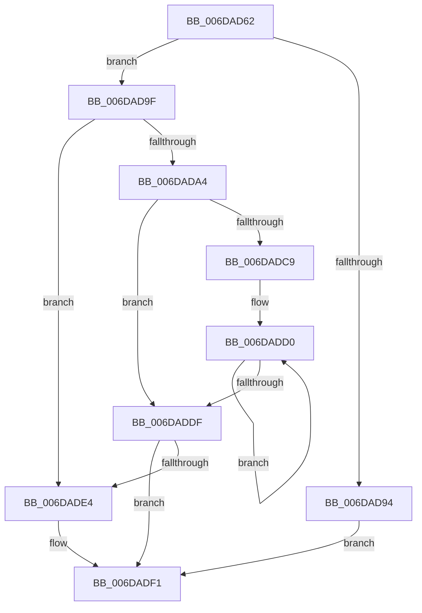

# sub_006DAD62

- RVA: `0x006DAD62`–`0x006DAE01` (길이 `159` bytes)
- VA: `0x00000001406DAD62`
- 실행 섹션: `.text`
- PDB 이름 있음: `아니요`; PDB Function 태그: `아니요`
- unwind 정보 RVA: `0x00068440`
- 디코드: `47`개 명령, `159/159` bytes 표시
- 미해석 바이트: `0` (있으면 어셈블리에 `.byte`로 보존)

> 이 문서는 커널 이미지의 기계어와 PDB 기호를 분석해 생성했습니다. 4번과 5번은 함수 원형과 자료형을 바이너리 사용 방식에서 추정한 C 해석이며 원본 소스 복구 결과는 아닙니다.

## 1. Dependencies

- 직접 호출 지점: **0**; 고유 호출 대상: **0**
- 직접 호출자로 확인된 함수: **0**
- RIP 상대 이미지 참조: **0**

### Outgoing calls
- 직접 디코드된 call 명령이 없습니다.

### Direct callers
- 이 함수 시작 RVA로 연결되는 직접 call은 확인되지 않았습니다. 간접 호출은 완전히 역산할 수 없습니다.

### Static image references
- 디코드된 RIP-relative 메모리 참조가 없습니다.

## 2. Other-region calls and transfers

- 다른 실행 섹션으로 향하는 call: **0**
- call이 아닌 외부 분기/꼬리 이동: **1**
  - `0x006DADFC` → [MiFreePageToSlabEntry + 0xDE](../2A/MiFreePageToSlabEntry_function_002A0D94.md) (`tail-transfer`)

## 3. Assembly (complete function range)

```asm
006DAD62  B9 40 00 00 00                  mov ecx, 0x40
006DAD67  48 8B 82 B0 DE 00 00            mov rax, qword ptr [rdx + 0xdeb0]
006DAD6E  44 8B D3                        mov r10d, ebx
006DAD71  44 8B D9                        mov r11d, ecx
006DAD74  41 83 E3 1F                     and r11d, 0x1f
006DAD78  44 8B C1                        mov r8d, ecx
006DAD7B  49 C1 E8 05                     shr r8, 5
006DAD7F  48 8B 90 D8 CA 04 00            mov rdx, qword ptr [rax + 0x4cad8]
006DAD86  49 8D 43 01                     lea rax, [r11 + 1]
006DAD8A  4E 8D 0C 82                     lea r9, [rdx + r8*4]
006DAD8E  48 83 F8 20                     cmp rax, 0x20
006DAD92  77 0B                           ja 0x1406dad9f
006DAD94  41 8B CB                        mov ecx, r11d
006DAD97  D3 E3                           shl ebx, cl
006DAD99  F0 41 09 19                     lock or dword ptr [r9], ebx
006DAD9D  EB 52                           jmp 0x1406dadf1
006DAD9F  83 E1 1F                        and ecx, 0x1f
006DADA2  74 40                           je 0x1406dade4
006DADA4  BA 20 00 00 00                  mov edx, 0x20
006DADA9  8B C3                           mov eax, ebx
006DADAB  2B D1                           sub edx, ecx
006DADAD  8B CA                           mov ecx, edx
006DADAF  D3 E0                           shl eax, cl
006DADB1  49 8B CB                        mov rcx, r11
006DADB4  2B C3                           sub eax, ebx
006DADB6  D3 E0                           shl eax, cl
006DADB8  F0 41 09 01                     lock or dword ptr [r9], eax
006DADBC  44 2B D2                        sub r10d, edx
006DADBF  49 83 C1 04                     add r9, 4
006DADC3  41 83 FA 20                     cmp r10d, 0x20
006DADC7  72 16                           jb 0x1406daddf
006DADC9  41 8B C2                        mov eax, r10d
006DADCC  48 C1 E8 05                     shr rax, 5
006DADD0  41 89 31                        mov dword ptr [r9], esi
006DADD3  44 03 D7                        add r10d, edi
006DADD6  49 83 C1 04                     add r9, 4
006DADDA  48 2B C3                        sub rax, rbx
006DADDD  75 F1                           jne 0x1406dadd0
006DADDF  45 85 D2                        test r10d, r10d
006DADE2  74 0D                           je 0x1406dadf1
006DADE4  41 8B CA                        mov ecx, r10d
006DADE7  8B C3                           mov eax, ebx
006DADE9  D3 E0                           shl eax, cl
006DADEB  2B C3                           sub eax, ebx
006DADED  F0 41 09 01                     lock or dword ptr [r9], eax
006DADF1  48 C7 85 B0 00 00 00 00 00 00 00  mov qword ptr [rbp + 0xb0], 0
006DADFC  E9 71 60 BC FF                  jmp 0x1402a0e72
```

## 4. C-style interpretation (structured pseudocode)

```c
__int64 __fastcall sub_006DAD62(__int64 a1, __int64 a2)
{
    __int64 result;
    __int64 v_r10;
    __int64 v_r11;
    __int64 v_rbx;

    v_r11 = (unsigned int)((64) & (31));
    a3 = (64) >> (5);
    if ((v_r11 + 1) > 32) goto loc_006DAD9F;
    v_rbx = (unsigned int)((v_rbx) << ((unsigned __int8)((unsigned int)((unsigned int)(v_r11)))));
    goto loc_006DADF1;
loc_006DAD9F:
    a1 = (unsigned int)(((unsigned int)((unsigned int)(v_r11))) & (31));
    if (condition_is_equal) goto loc_006DADE4;
    a2 = (unsigned int)((32) - ((unsigned int)(a1)));
    result = (unsigned int)(((unsigned int)((unsigned int)(v_rbx))) << ((unsigned __int8)((unsigned int)((unsigned int)(a2)))));
    result = (unsigned int)((result) - ((unsigned int)(v_rbx)));
    result = (unsigned int)((result) << ((unsigned __int8)(v_r11)));
    v_r10 = (unsigned int)(((unsigned int)((unsigned int)(v_rbx))) - ((unsigned int)(a2)));
    a4 = (*(unsigned __int64 *)(*(unsigned __int64 *)(a2 + 57008) + 314072) + a3 * 4) + (4);
    if (((unsigned int)(v_r10)) < 32) goto loc_006DADDF;
    result = ((unsigned int)((unsigned int)(v_r10))) >> (5);
loc_006DADD0:
    *(unsigned int *)(a4) = (unsigned int)(v_rsi);
    v_r10 = (unsigned int)((v_r10) + ((unsigned int)(v_rdi)));
    a4 = (a4) + (4);
    result = (result) - (v_rbx);
    if (condition_is_not_equal) goto loc_006DADD0;
loc_006DADDF:
    if ((unsigned int)(v_r10) != 0) {
        a1 = (unsigned int)(v_r10);
        result = (unsigned int)(v_rbx);
        result = (unsigned int)((result) << ((unsigned __int8)(a1)));
        result = (unsigned int)((result) - ((unsigned int)(v_rbx)));
    }
    *(unsigned __int64 *)(v_rbp + 176) = 0;
}
```

## 5. (Beta) C Style

```c
int64_t sub_006DAD62(int64_t Arg1, void *Arg2)
{
    uint8_t *arg2 = (uint8_t *)Arg2;

    int64_t result;
    int64_t local_r10;
    int64_t local_r11;
    int64_t local_rbx;

    local_r11 = (uint32_t)((64) & (31));
    a3 = (64) >> (5);
    if ((local_r11 + 1) > 32) goto loc_006DAD9F;
    local_rbx = (uint32_t)((local_rbx) << ((uint8_t)((uint32_t)((uint32_t)(local_r11)))));
    goto loc_006DADF1;
loc_006DAD9F:
    Arg1 = (uint32_t)(((uint32_t)((uint32_t)(local_r11))) & (31));
    if (condition_is_equal) goto loc_006DADE4;
    Arg2 = (uint32_t)((32) - ((uint32_t)(Arg1)));
    result = (uint32_t)(((uint32_t)((uint32_t)(local_rbx))) << ((uint8_t)((uint32_t)((uint32_t)(Arg2)))));
    result = (uint32_t)((result) - ((uint32_t)(local_rbx)));
    result = (uint32_t)((result) << ((uint8_t)(local_r11)));
    local_r10 = (uint32_t)(((uint32_t)((uint32_t)(local_rbx))) - ((uint32_t)(Arg2)));
    a4 = (*(uint64_t *)(*(uint64_t *)(arg2 + 0xDEB0) + 0x4CAD8) + a3 * 4) + (4);
    if (((uint32_t)(local_r10)) < 32) goto loc_006DADDF;
    result = ((uint32_t)((uint32_t)(local_r10))) >> (5);
loc_006DADD0:
    *(uint32_t *)(a4) = (uint32_t)(local_rsi);
    local_r10 = (uint32_t)((local_r10) + ((uint32_t)(local_rdi)));
    a4 = (a4) + (4);
    result = (result) - (local_rbx);
    if (condition_is_not_equal) goto loc_006DADD0;
loc_006DADDF:
    if ((uint32_t)(local_r10) != 0) {
        Arg1 = (uint32_t)(local_r10);
        result = (uint32_t)(local_rbx);
        result = (uint32_t)((result) << ((uint8_t)(Arg1)));
        result = (uint32_t)((result) - ((uint32_t)(local_rbx)));
    }
    *(uint64_t *)(local_rbp + 0xB0) = 0;
}
```

### 관측된 메모리 오프셋

구조체 형식이 확인되지 않은 접근은 인자 기준의 오프셋으로만 기록했습니다.

| 기준 인자 | 오프셋 표현 | 폭 (bit) | 접근 |
|---|---:|---:|---|
| `Arg2` | `+ 0xDEB0` | `64` | `R` |

## 6. Execution-region graph

[열기: 2D/3D 그래프와 함수 탐색 컨트롤 패널](../../../control-panel.html?section=text&rva=0x006DAD62&view=graph)

- 2D 그래프는 위에서 아래로 흐르고, 3D 그래프는 빈 공간을 드래그해 회전합니다. Shift+드래그는 이동, 휠은 확대·축소, 함수 노드 선택은 대상 보고서 이동입니다.

### Static fallback


