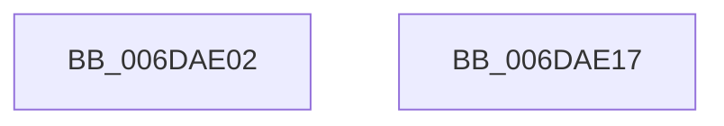

# sub_006DAE02

- RVA: `0x006DAE02`–`0x006DAE30` (길이 `46` bytes)
- VA: `0x00000001406DAE02`
- 실행 섹션: `.text`
- PDB 이름 있음: `아니요`; PDB Function 태그: `아니요`
- unwind 정보 RVA: `0x000684C4`
- 디코드: `11`개 명령, `46/46` bytes 표시
- 미해석 바이트: `0` (있으면 어셈블리에 `.byte`로 보존)

> 이 문서는 커널 이미지의 기계어와 PDB 기호를 분석해 생성했습니다. 4번과 5번은 함수 원형과 자료형을 바이너리 사용 방식에서 추정한 C 해석이며 원본 소스 복구 결과는 아닙니다.

## 1. Dependencies

- 직접 호출 지점: **2**; 고유 호출 대상: **1**
- 직접 호출자로 확인된 함수: **0**
- RIP 상대 이미지 참조: **2**

### Outgoing calls
- `0x006DAE0C` → [KeReleaseSpinLock](../39/KeReleaseSpinLock_function_00392BA0.md) (function, `0x00392BA0`)
- `0x006DAE25` → [KeReleaseSpinLock](../39/KeReleaseSpinLock_function_00392BA0.md) (function, `0x00392BA0`)

### Direct callers
- 이 함수 시작 RVA로 연결되는 직접 call은 확인되지 않았습니다. 간접 호출은 완전히 역산할 수 없습니다.

### Static image references
- `0x006DAE05` → RVA `0x00F22D38` (`.data`; read)
- `0x006DAE1E` → RVA `0x00F22E58` (`.data`; read)

## 2. Other-region calls and transfers

- 다른 실행 섹션으로 향하는 call: **0**
- call이 아닌 외부 분기/꼬리 이동: **2**
  - `0x006DAE12` → [KeDeleteThread + 0x2B](../2A/KeDeleteThread_function_002A12D4.md) (`tail-transfer`)
  - `0x006DAE2B` → [KeDeleteThread + 0x38](../2A/KeDeleteThread_function_002A12D4.md) (`tail-transfer`)

## 3. Assembly (complete function range)

```asm
006DAE02  41 8A D0                        mov dl, r8b
006DAE05  48 8D 0D 2C 7F 84 00            lea rcx, [rip + 0x847f2c]
006DAE0C  E8 8F 7D CB FF                  call 0x140392ba0
006DAE11  90                              nop
006DAE12  E9 E8 64 BC FF                  jmp 0x1402a12ff
006DAE17  B9 03 00 00 00                  mov ecx, 3
006DAE1C  CD 29                           int 0x29
006DAE1E  48 8D 0D 33 80 84 00            lea rcx, [rip + 0x848033]
006DAE25  E8 76 7D CB FF                  call 0x140392ba0
006DAE2A  90                              nop
006DAE2B  E9 DC 64 BC FF                  jmp 0x1402a130c
```

## 4. C-style interpretation (structured pseudocode)

```c
__int64 __fastcall sub_006DAE02(__int64 a1, __int64 a2, unsigned __int8 a3)
{
    __int64 result;

    result = KeReleaseSpinLock(v_rip + 8683308, a3, a3, a4);
}
```

## 5. (Beta) C Style

```c
int64_t sub_006DAE02(int64_t Arg1, int64_t Arg2, uint8_t Arg3)
{
    int64_t result;

    result = KeReleaseSpinLock(v_rip + 8683308, Arg3, Arg3, a4);
}
```

## 6. Execution-region graph

[열기: 2D/3D 그래프와 함수 탐색 컨트롤 패널](../../../control-panel.html?section=text&rva=0x006DAE02&view=graph)

- 2D 그래프는 위에서 아래로 흐르고, 3D 그래프는 빈 공간을 드래그해 회전합니다. Shift+드래그는 이동, 휠은 확대·축소, 함수 노드 선택은 대상 보고서 이동입니다.

### Static fallback


