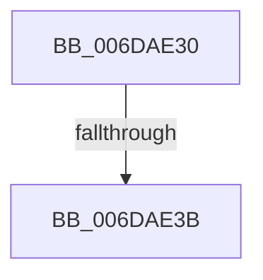

# sub_006DAE30

- RVA: `0x006DAE30`–`0x006DAE59` (길이 `41` bytes)
- VA: `0x00000001406DAE30`
- 실행 섹션: `.text`
- PDB 이름 있음: `아니요`; PDB Function 태그: `아니요`
- unwind 정보 RVA: `0x00068570`
- 디코드: `10`개 명령, `41/41` bytes 표시
- 미해석 바이트: `0` (있으면 어셈블리에 `.byte`로 보존)

> 이 문서는 커널 이미지의 기계어와 PDB 기호를 분석해 생성했습니다. 4번과 5번은 함수 원형과 자료형을 바이너리 사용 방식에서 추정한 C 해석이며 원본 소스 복구 결과는 아닙니다.

## 1. Dependencies

- 직접 호출 지점: **1**; 고유 호출 대상: **1**
- 직접 호출자로 확인된 함수: **0**
- RIP 상대 이미지 참조: **0**

### Outgoing calls
- `0x006DAE53` → [KeBugCheckEx](../4F/KeBugCheckEx_function_004FD660.md) (function, `0x004FD660`)

### Direct callers
- 이 함수 시작 RVA로 연결되는 직접 call은 확인되지 않았습니다. 간접 호출은 완전히 역산할 수 없습니다.

### Static image references
- 디코드된 RIP-relative 메모리 참조가 없습니다.

## 2. Other-region calls and transfers

- 다른 실행 섹션으로 향하는 call: **0**
- call이 아닌 외부 분기/꼬리 이동: **1**
  - `0x006DAE35` → [MiAllocateKernelStackPages + 0x3C8](../2A/MiAllocateKernelStackPages_function_002A1BEC.md) (`tail-transfer`)

## 3. Assembly (complete function range)

```asm
006DAE30  3D 43 00 00 C0                  cmp eax, 0xc0000043
006DAE35  0F 85 79 71 BC FF               jne 0x1402a1fb4
006DAE3B  4C 63 4E 34                     movsxd r9, dword ptr [rsi + 0x34]
006DAE3F  4C 8B C3                        mov r8, rbx
006DAE42  48 98                           cdqe
006DAE44  BA 40 15 05 00                  mov edx, 0x51540
006DAE49  B9 1A 00 00 00                  mov ecx, 0x1a
006DAE4E  48 89 44 24 20                  mov qword ptr [rsp + 0x20], rax
006DAE53  E8 08 28 E2 FF                  call 0x1404fd660
006DAE58  CC                              int3
```

## 4. C-style interpretation (structured pseudocode)

```c
__int64 __fastcall sub_006DAE30(void)
{
    __int64 result;
    unsigned __int64 v_stack_p20;

    v_stack_p20 = result;
    result = KeBugCheckEx(26, (unsigned int)(0x51540ULL), v_rbx, (int)(*(unsigned int *)(v_rsi + 52)));
    return result;
}
```

## 5. (Beta) C Style

```c
void sub_006DAE30(void)
{
    int64_t result;
    uint64_t v_stack_p20;

    v_stack_p20 = result;
    result = KeBugCheckEx(26, (uint32_t)(0x51540ULL), local_rbx, (int32_t)(*(uint32_t *)(local_rsi + 0x34)));
    return result;
}
```

## 6. Execution-region graph

[열기: 2D/3D 그래프와 함수 탐색 컨트롤 패널](../../../control-panel.html?section=text&rva=0x006DAE30&view=graph)

- 2D 그래프는 위에서 아래로 흐르고, 3D 그래프는 빈 공간을 드래그해 회전합니다. Shift+드래그는 이동, 휠은 확대·축소, 함수 노드 선택은 대상 보고서 이동입니다.

### Static fallback


